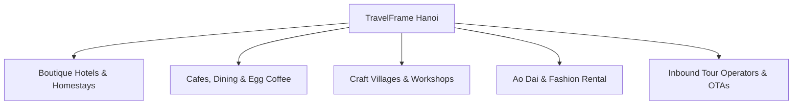

# TravelFrame Media Kit & B2B Partnership Proposal 2026

- **Mã tài liệu:** `OFF-20260917-MEDIA-KIT-B2B-OFFERS`
- **Bộ phận chủ trì:** Brand-Strategy / Marketing-Growth / Sales-CRM
- **Phạm vi đối tác:** Boutique Hotels & Homestays, Quán Cafe & Nhà hàng ẩm thực, Làng nghề & Workshop thủ công, Đơn vị cho thuê trang phục, Công ty lữ hành Inbound
- **Ngày lập:** 2026-09-17
- **Trạng thái:** Active / Commercial Proposal

---

## 1. Hồ Sơ Năng Lực & Thông Số Kênh Truyền Thông (Social Media Kit)

TravelFrame là đơn vị tiên phong kết hợp giữa **trải nghiệm khám phá văn hóa Hà Nội cùng người bản địa** và **dịch vụ nhiếp ảnh / video dọc chuyên nghiệp (4K Reels & TikTok)** dành riêng cho du khách quốc tế.

### 1.1. Bảng Thông Số Mạng Xã Hội Đầy Đủ (Social Media Metrics)

| Chỉ số truyền thông | Số liệu ghi nhận (30 Ngày) | Ý nghĩa thương mại đối với Đối tác |
|---|---:|---|
| **Tổng lượt xem video (Total Views)** | **41.921 views** | Mức độ nhận diện thương hiệu du lịch Hà Nội tăng trưởng mạnh mẽ qua định dạng video ngắn. |
| **Tài khoản tiếp cận (Accounts Reached)** | **27.370 accounts** | Khả năng mở rộng tệp khán giả mới liên tục cho các điểm đến và dịch vụ liên kết. |
| **Tỷ lệ khán giả ngoài kênh (Non-followers)** | **98,7%** | **Cực kỳ giá trị cho đối tác:** Tiếp cận trực tiếp du khách quốc tế mới chuẩn bị hoặc vừa đặt chân tới Việt Nam. |
| **Lượt tương tác (Interactions)** | **~1.700 lượt** | Khán giả tương tác thực chất qua bình luận hỏi đường, xin lịch trình, hỏi quán ăn và lưu lại chuyến đi. |
| **Lượt xem hồ sơ (Profile Visits)** | **301 lượt** | Nhóm khách có nhu cầu thực tế tìm hiểu sâu về dịch vụ và lịch trình khám phá. |
| **Top Video Viral 1: Cảnh báo lừa đảo Hà Nội** | **14.900 views / 126 shares** | Thể hiện mức độ tin cậy cao của kênh, khán giả chủ động share cho bạn đồng hành trong chuyến đi. |
| **Top Video Viral 2: Phố Tàu Train Street 2026** | **4.400 views (Share rate: 1,82%)** | Khả năng điều hướng khách du lịch đến đúng các quán cà phê an toàn và trải nghiệm uy tín. |
| **Lưu lượng tìm kiếm Website & Cẩm nang** | **Hàng ngàn lượt đọc/tháng** | Hệ thống blog SEO chuyên sâu về Food Guide, Best Photo Spots, Hotel Concierge Guide tại Hà Nội. |

### 1.2. Nhân Khẩu Học & Hành Vi Du Khách Của TravelFrame (Audience Demographics)

- **Thị trường trọng điểm:** Úc, Mỹ, Anh, Châu Âu, Singapore, Đài Loan, Hàn Quốc (chiếm >80% tệp du khách).
- **Độ tuổi chủ đạo:** 23 – 40 tuổi (Millennials, Solo female travelers, Cặp đôi trăng mật, Content creators, Nhóm bạn trẻ trí thức).
- **Mức chi tiêu & Hành vi:**
  - Thuộc phân khúc trung và cao cấp, sẵn sàng chi trả **$75 – $290 USD** cho một buổi trải nghiệm riêng tư.
  - Tôn trọng văn hóa địa phương, yêu thích những góc ẩn giấu (hidden gems), đam mê cà phê đặc sản và ẩm thực hè phố truyền thống.
  - Luôn tìm kiếm những địa điểm có thẩm mỹ cao, độc đáo để lưu giữ hình ảnh và chia sẻ lên mạng xã hội cá nhân.

---

## 2. Các Gói Hợp Tác Doanh Nghiệp (B2B Collaboration Offers)

TravelFrame thiết kế 5 mô hình hợp tác linh hoạt nhằm mang lại giá trị gia tăng hai chiều, gia tăng doanh thu và nâng tầm hình ảnh cho các doanh nghiệp đồng hành tại Hà Nội:

---

### 2.1. Hợp Tác Dành Cho Khách Sạn Boutique, Homestay & Khách Sạn Phố Cổ (Hotel & Concierge Partner)

> **Mục tiêu:** Giúp khách sạn nâng cao trải nghiệm lưu trú, tăng đánh giá 5 sao trên OTA/TripAdvisor và tạo thêm dòng doanh thu hoa hồng thụ động.

* **Hình thức triển khai:**
  1. **Tích hợp Concierge Experience:** Khách sạn đưa gói tour của TravelFrame vào Menu Tour / Standee QR đặt tại quầy lễ tân hoặc trên bàn phòng ngủ.
  2. **Bản đồ trải nghiệm đồng thương hiệu (Co-branded Guest Guide):** Cung cấp cẩm nang du lịch Hà Nội bỏ túi gắn logo của khách sạn cho khách lưu trú.
* **Quyền lợi đối tác khách sạn:**
  * **Hoa hồng giới thiệu hấp dẫn:** Nhận ngay **15% giá trị tour** (tương đương **280.000 – 1.100.000 VND / booking**) khi khách lưu trú quét mã hoặc đặt tour qua lễ tân.
  * **Tài trợ hình ảnh truyền thông:** TravelFrame tặng khách sạn **01 gói chụp ảnh không gian/phòng nghỉ/dịch vụ miễn phí** (trị giá $200 USD) sau mỗi 5 lượt giới thiệu thành công.
  * **Nâng tầm chất lượng dịch vụ:** Khách lưu trú có được trải nghiệm tuyệt vời, giúp khách sạn nhận về những đánh giá 5 sao xuất sắc về sự chu đáo.

---

### 2.2. Hợp Tác Dành Cho Quán Cà Phê Đặc Sản, Trà & Ẩm Thực Hà Nội (Curated Dining & Cafe Partner)

> **Mục tiêu:** Mang lại lượng khách du lịch quốc tế văn minh, đều đặn hàng tuần và sở hữu những hình ảnh/video triệu view quảng bá quán.

* **Hình thức triển khai:**
  1. **Official Rest Stop:** Quán trở thành điểm dừng chân thưởng thức cà phê trứng, trà sen hoặc món ăn truyền thống chính thức trong tour của TravelFrame.
  2. **Bàn đặt trước độc quyền:** Khách của TravelFrame được ưu tiên ngồi tại các góc ban công hoặc vị trí đẹp nhất của quán để chụp ảnh và thư giãn.
* **Quyền lợi đối tác quán:**
  * **Doanh thu đều đặn:** Cam kết lượng khách quốc tế ghé quán theo từng khung giờ cố định trong tuần (nhóm nhỏ 1-4 người, văn minh, lịch sự).
  * **Quảng bá thương hiệu miễn phí trên Social:** Quán được gắn thẻ (tag), nhắc tên trong các video Reels/TikTok và bài viết cẩm nang ẩm thực của TravelFrame.
  * **Nhận bộ ảnh đồ uống/không gian chuẩn tạp chí:** TravelFrame gửi tặng quán bộ ảnh món ăn/thức uống chất lượng cao sau mỗi buổi tour để quán sử dụng trên Google Maps và mạng xã hội.

---

### 2.3. Hợp Tác Dành Cho Làng Nghề Truyền Thống & Workshop Thủ Công (Artisan & Workshop Partner)

> **Mục tiêu:** Lan tỏa giá trị di sản văn hóa Việt Nam tới du khách quốc tế và thúc đẩy tiêu thụ sản phẩm thủ công mỹ nghệ cao cấp.

* **Đối tượng phù hợp:** Xưởng gốm Bát Tràng, Làng hương Quảng Phú Cầu, Xưởng lụa Vạn Phúc, Workshop nón lá, thêu tay, làm cà phê trứng.
* **Hình thức triển khai:**
  * Đưa xưởng vào làm điểm nhấn trải nghiệm trong tour cả ngày *The Full-Day Cultural Odyssey ($290 USD)*.
* **Quyền lợi đối tác:**
  * **Nguồn khách sẵn sàng chi trả cao:** Tiếp cận nhóm du khách quốc tế tôn trọng nghệ nhân và có nhu cầu mua quà lưu niệm thủ công tinh xảo.
  * **Sản xuất phim tài liệu ngắn (Cinematic Documentary):** TravelFrame thực hiện các thước phim nghệ thuật về bàn tay nghệ nhân và quy trình sản xuất, gửi tặng đối tác để quảng bá văn hóa ra thế giới.
  * **Cam kết giá vé workshop cố định:** Đảm bảo thanh toán sòng phẳng, minh bạch theo từng booking của khách.

---

### 2.4. Hợp Tác Dành Cho Cửa Hàng Cho Thuê Cổ Phục & Áo Dài (Ao Dai & Heritage Wardrobe Partner)

> **Mục tiêu:** Cung cấp trải nghiệm trọn vẹn "Mặc áo dài Việt Nam chụp ảnh tại phố cổ Hà Nội" cho du khách quốc tế.

* **Hình thức triển khai:**
  * TravelFrame giới thiệu cửa hàng là điểm thuê trang phục độc quyền cho gói chụp ảnh *Heritage Hanoi* và *Hanoi in Style*.
* **Quyền lợi đối tác:**
  * **Nguồn khách thuê ổn định:** Nhận khách thuê trang phục thường xuyên vào các khung giờ sáng sớm hoặc đầu giờ chiều.
  * **Bộ ảnh Lookbook thời trang miễn phí:** Nhận toàn bộ ảnh chụp du khách quốc tế mặc trang phục của cửa hàng tại các bối cảnh di tích Hà Nội để làm tư liệu marketing.
  * **Chiết khấu hoa hồng hai chiều:** Cửa hàng chiết khấu giá thuê ưu đãi cho khách của TravelFrame, ngược lại nhận hoa hồng khi khách mua thêm phụ kiện hoặc gói nâng cao.

---

### 2.5. Hợp Tác Dành Cho Công Ty Lữ Hành Inbound & Tour Operators (B2B Visual Fulfillment Partner)

> **Mục tiêu:** Trở thành đơn vị gia công nội dung hình ảnh/video cao cấp cho các đoàn khách VIP của các hãng lữ hành quốc tế.

* **Hình thức triển khai:**
  * TravelFrame đóng vai trò là "Ground Visual Host" phụ trách mảng media và trải nghiệm bản địa chuyên sâu cho các khách lẻ hoặc nhóm VIP của công ty lữ hành.
* **Quyền lợi đối tác lữ hành:**
  * **Gia tăng giá trị gói tour:** Bổ sung gói chụp ảnh kỷ niệm và video Reels 9:16 vào tour trọn gói của công ty lữ hành mà không cần tự nuôi đội ngũ media cồng kềnh.
  * **Mức giá B2B chiết khấu sâu (20% – 30%):** Áp dụng bảng giá đại lý đặc biệt cho các hợp đồng booking định kỳ theo tháng/quý.
  * **Cam kết SLA bảo mật:** Giao ảnh đúng hạn (24h sneak peek, 48h full album), tôn trọng thương hiệu của công ty lữ hành (White-label service).

---

## 3. Các Cấp Độ Đối Tác (Partnership Tiers Summary)

| Cấp độ | Tên mô hình | Phí tham gia | Quyền lợi truyền thông & Khách hàng | Mức hoa hồng / Chiết khấu |
|---|---|:---:|---|:---:|
| **Tier 1** | **Community Affiliate** | **0 VNĐ** | Đặt Standee/Brochure tại địa điểm; Xuất hiện trên danh mục đối tác website. | Nhận **15% hoa hồng** khi giới thiệu khách |
| **Tier 2** | **Featured Stop Partner** | **0 VNĐ** | Trở thành điểm dừng chân cố định trong tour; Nhận ảnh chụp sản phẩm/không gian miễn phí. | Hỗ trợ giá ưu đãi theo hợp đồng |
| **Tier 3** | **Strategic Co-Branding** | **Theo thỏa thuận** | 01 Video Review chuyên sâu trên Reels/TikTok; Đặt bài PR trên cẩm nang SEO; Quảng bá trong Guest Guide PDF. | Thỏa thuận tài trợ chéo / Doanh thu |

---

## 4. Quy Trình Ký Kết & Triển Khai Trong 3 Bước

1. **Bước 1 — Khảo sát & Trao đổi (Day 1):** TravelFrame ghé thăm địa điểm của đối tác, thẩm định không gian, dịch vụ và thống nhất phong cách kết nối.
2. **Bước 2 — Cung cấp tài liệu & Chụp thử nghiệm (Day 2-3):** TravelFrame bàn giao ấn phẩm truyền thông (Standee QR, Brochure) và thực hiện buổi chụp trải nghiệm thử nghiệm.
3. **Bước 3 — Chính thức đón khách & Báo cáo đối soát (Hàng tháng):** Bắt đầu đưa khách ghé thăm hoặc tiếp nhận booking; đối soát hoa hồng minh bạch vào ngày 05 hàng tháng.

---
*Tài liệu thuộc bản quyền TravelFrame Hanoi — Sẵn sàng gửi tới các đối tác tiềm năng.*
