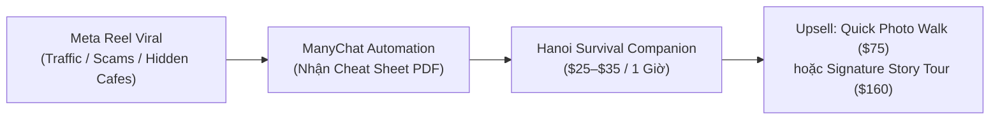

# Đặc Tả Gói Sản Phẩm: Hanoi Survival Companion (Draft)

- **Tên sản phẩm:** Hanoi Survival Companion
- **Mã sản phẩm:** `PKG-DRAFT-HANOI-SURVIVAL-COMPANION`
- **Bộ phận chủ trì:** Brand-Strategy & Offers-Pricing
- **Ngày lập:** 2026-09-29
- **Trạng thái:** `Draft` — Chờ Rocky phê duyệt (Chưa publish / Chưa áp dụng trên live systems)
- **Tài liệu tham chiếu:**
  - Bảng giá niêm yết TravelFrame: [`Brand-Strategy/Offers-Pricing/TravelFrame-Website-Packages-Pricing-2026-09-15.md`](file:///Users/macbook/Codex%20GPT/travelframe.vn/Brand-Strategy/Offers-Pricing/TravelFrame-Website-Packages-Pricing-2026-09-15.md)
  - Tổng hợp bằng chứng & tiếng nói khách hàng: [`Research-Insights/Library/knowledge/2026-09-26-customer-evidence-synthesis.md`](file:///Users/macbook/Codex%20GPT/travelframe.vn/Research-Insights/Library/knowledge/2026-09-26-customer-evidence-synthesis.md)

---

## 1. Định Vị Sản Phẩm & Mục Tiêu Chiến Lược (Strategic Intent & Positioning)

### 1.1. Bản Chất Sản Phẩm
**Hanoi Survival Companion** là một **Lead Magnet vật lý (Physical Lead Magnet / Front-end Tripwire Offer)** được thiết kế riêng cho những du khách vừa đặt chân tới Hà Nội. 

Thay vì chỉ phát hành tài liệu PDF tải về máy, TravelFrame cung cấp một trải nghiệm "nhập môn" trực tiếp kéo dài 1 giờ cùng một người bạn địa phương (Local Host). Gói dịch vụ này xóa tan cảm giác ngợp thở trước giao thông, nỗi sợ bẫy du lịch (tourist traps/scams), và đưa du khách bước vào nhịp sống phố cổ một cách nhẹ nhàng, ấm áp và an tâm nhất.



### 1.2. Mục Tiêu Chiến Lược
1. **Giá thấp đến mức không cần đắn đo (No-brainer pricing):** Mức giá $25–$35 USD giúp khách hàng dễ dàng ra quyết định thanh toán ngay trong 24 giờ đầu tiên có mặt tại Hà Nội mà không cần so sánh giá hay do dự.
2. **Kích hoạt khoảnh khắc "Wow" đầu tiên:** Giải quyết ngay 2 rào cản tâm lý lớn nhất được ghi nhận trong nghiên cứu khách hàng ([Customer Evidence Synthesis](file:///Users/macbook/Codex%20GPT/travelframe.vn/Research-Insights/Library/knowledge/2026-09-26-customer-evidence-synthesis.md)):
   - Nỗi sợ bị đâm xe khi băng qua đường phố cổ ("trò chơi sinh tử Frogger").
   - Sự lạc lõng, e ngại tìm kiếm các quán cà phê ngõ sâu (sợ chủ quán khó tính, sợ bẫy giá).
3. **Cầu nối Upsell tự nhiên (Trust Bridge):** Khi du khách đã chạm mặt, trò chuyện thân tình và nhận những bức ảnh iPhone đẹp vượt kỳ vọng ngay tại chỗ, rào cản hoài nghi bị xóa bỏ. Đây là bệ phóng chuyển đổi trực tiếp sang các gói tour chuyên nghiệp:
   - **Quick Photo Walk** ($75 USD / ~1.950.000 VND — 2 đến 2.5 giờ)
   - **Signature Story Tour** ($160 USD / ~4.150.000 VND — 4 đến 4.5 giờ)

---

## 2. Chân Dung Khách Hàng Mục Tiêu (Target Audience)

- **Solo Travelers & Solo Female Travelers:** Những bạn trẻ (22–38 tuổi, thị trường nói tiếng Anh: Úc, Mỹ, Anh, Châu Âu, Singapore) lần đầu du lịch một mình tại Đông Nam Á, cần một cảm giác an toàn và một người bạn đồng hành tin cậy ngay khi rời khách sạn.
- **First-Timers đến Hà Nội:** Khách vừa check-in khách sạn, chưa quen nhịp sống, còn e ngại tiếng còi xe, muốn có người bản địa hướng dẫn cách ứng xử cơ bản và gợi ý lịch trình thực tế.
- **Khán giả chuyển đổi từ Content Viral:** Du khách theo dõi các Reels triệu view của TravelFrame về chủ đề:
  - *"Crossing the road in Vietnam without stress"*
  - *"Hanoi Tourist Scams & Street Smart Warnings"*
  - *"Lowkey gatekeeping secret alleyway cafes in Old Quarter"*

---

## 3. Thông Số & Chi Tiết Gói Dịch Vụ (Product Specifications)

| Hạng mục | Chi tiết đặc tả |
|---|---|
| **Tên gói sản phẩm** | **Hanoi Survival Companion** |
| **Mức giá đề xuất** | **$25 – $35 USD** (~650.000 – 910.000 VND / nhóm) |
| **Thời lượng trải nghiệm** | **1 giờ (60 phút)** |
| **Quy mô nhóm** | **1 – 2 khách** (Trải nghiệm riêng tư, cá nhân hóa, không ghép đoàn đông) |
| **Gói hình ảnh đi kèm** | **Photo Phone** (Chụp bằng iPhone thế hệ mới, góc nhìn tự nhiên candid) |
| **Số lượng ảnh** | **5 – 8 ảnh candid chất lượng cao** |
| **SLA Bàn giao hình ảnh** | **Giao ngay trong vòng 15 phút sau buổi đi** (tối đa 1 giờ theo chuẩn Photo Phone) qua AirDrop hoặc liên kết Google Drive/Cloud |
| **Phương thức di chuyển** | Đi bộ nhẹ nhàng trong bán kính khu phố cổ (Old Quarter walking) |
| **Ngôn ngữ host** | Tiếng Anh trôi chảy, thân thiện, mang phong thái "người bạn địa phương" (Local Friend) |

---

## 4. Danh Mục Dịch Vụ Bao Gồm (What's Included)

1. **Đón tận nơi ấm áp:** Local Host trực tiếp đón khách tại sảnh khách sạn trong Phố Cổ hoặc điểm hẹn trung tâm thuận tiện nhất (như Nhà hát Lớn, Bờ Hồ Hoàn Kiếm, Đền Ngọc Sơn).
2. **Thực hành kỹ năng qua đường bản địa (The 3 Golden Rules):**
   - **Quy tắc 1: Không bao giờ dừng lại đột ngột hay lùi lại (Never stop or run back):** Giúp người lái xe máy tính toán được quỹ đạo né tránh.
   - **Quy tắc 2: Giữ nhịp bước đều đặn và tự tin (Maintain a steady walking pace):** Hãy để dòng xe máy lướt quanh bạn như dòng nước uốn quanh tảng đá.
   - **Quy tắc 3: Giao tiếp ánh mắt nhẹ nhàng (Make gentle eye contact with oncoming riders):** Đưa tay ra hiệu tầm thấp ngang hông và nhìn nhẹ về phía các dòng xe đang tới để xác nhận sự hiện diện.
3. **Dẫn lối vào 2 quán ẩn (Hidden Gem Cafes):** Len lỏi qua các ngõ nhỏ cổ kính đặc trưng, thoát khỏi tiếng ồn đường phố để chạm vào không gian mộc mạc (ví dụ: quán cà phê tầng thượng view chợ cổ hoặc quán sân trong rêu phong).
4. **1 ly đồ uống đặc sản Hà Nội:** Thưởng thức Cà phê Trứng (Egg Coffee) béo ngậy truyền thống hoặc Cà phê Cốt Dừa (Coconut Coffee) mát lạnh.
5. **Gói ảnh Photo Phone chụp bằng iPhone:** Ghi lại 5–8 khoảnh khắc tự nhiên (candid shots) khi khách băng qua đường tự tin, nụ cười bên ly cà phê, hoặc bước đi trong con ngõ phố cổ. Bàn giao ngay tại chỗ.
6. **Bản đồ bỏ túi độc quyền (Pocket-size Survival Map):** Một ấn phẩm gấp gọn tinh tế ghi lại:
   - Danh sách 5 quán ăn gia truyền không lo chặt chém (Phở bò, Bún chả, Bánh cuốn).
   - Tọa độ 3 điểm rooftop ngắm hoàng hôn đẹp nhất.
   - Các số điện thoại hỗ trợ khẩn cấp & mẹo trả giá xích lô/taxi chuẩn người bản xứ.

---

## 5. Vai Trò Trong Phễu Kinh Doanh (Funnel Integration & Customer Journey)

```mermaid
journey
    title Hành Trình Chuyển Đổi Hanoi Survival Companion
    section Bước 1: Tiếp Cận
      Xem Reel qua đường / lừa đảo: 5: Khách
      Bình luận "HANOI" nhận PDF: 4: Khách
    section Bước 2: Kích Hoạt
      Nhận đề xuất gói Survival Companion: 4: Khách, ManyChat
      Đặt lịch hẹn $25-$35: 5: Khách, Host
    section Bước 3: Trải Nghiệm 1 Giờ
      Host đón tại sảnh & chỉ 3 quy tắc: 5: Khách, Host
      Khám phá quán ẩn & uống cà phê trứng: 5: Khách, Host
      Nhận 5-8 ảnh iPhone qua AirDrop: 5: Khách, Host
    section Bước 4: Upsell
      Host gợi mở lịch trình ngày mai: 4: Khách, Host
      Chốt gói Quick Photo Walk / Story Tour: 5: Khách, Host
```

1. **Top-of-Funnel (Organic Viral & Chatbot):**
   - Du khách tương tác với Reel viral về mẹo sinh tồn tại Hà Nội.
   - ManyChat gửi Cheat Sheet PDF bỏ túi. Trong trang cuối của PDF và chuỗi tin nhắn follow-up tự động, TravelFrame đưa ra thông điệp:
     > *"Bạn vừa tới Hà Nội và thấy bỡ ngỡ trước dòng xe máy tấp nập? Đừng ngồi trong phòng khách sạn. Hãy dành 1 giờ cùng người bạn TravelFrame — chúng tôi sẽ giúp bạn làm chủ đường phố và đưa bạn đến quán cà phê ẩn ngon nhất!"*
2. **Conversion to Entry Offer:** Khách thanh toán nhanh gói $25–$35 qua cổng thanh toán quốc tế (Stripe/PayPal) hoặc xác nhận qua WhatsApp với lễ tân khách sạn.
3. **Execution & Wow Moment:** Host xuất hiện đúng giờ, ấm áp, xóa tan mọi rào cản văn hóa, chụp ảnh đẹp và bàn giao ngay tại quán cà phê.
4. **Bottom-of-Funnel (Back-end Upsell):** Tại phút thứ 50 của buổi đi, Host thực hiện kịch bản gợi mở nâng hạng dịch vụ cho ngày tiếp theo.

---

## 6. Kịch Bản Gợi Mở Upsell Thực Địa (Host Upsell Script & Delivery Playbook)

### 6.1. Nguyên Tắc Ứng Xử Của Host
- **Tone & Voice:** Ấm áp, chân thành, nhiệt tình như một người bạn đại diện cho lòng hiếu khách của người Hà Nội.
- **Quy tắc vàng:** Tuyệt đối không chèo kéo, không tạo áp lực bán hàng (No hard-selling). Lời mời chỉ xuất hiện sau khi khách đã thể hiện sự thích thú và bất ngờ khi nhận ảnh qua AirDrop.

### 6.2. Kịch Bản Lời Thoại Mẫu (English Upsell Script)

> **Thời điểm:** Khi hai người đang ngồi ở quán cà phê thứ hai, Host vừa AirDrop xong bộ ảnh 5–8 tấm và khách thốt lên khen ngợi hình ảnh.

* **Host:** *"I'm so glad you love these quick phone shots! Hanoi has so many hidden layers, especially early in the morning or during the golden afternoon light."*
* **Khách:** *"Yes, I really want to see more, but I only have 2 days here."*
* **Host (Chuyển tiếp tự nhiên):** 
  > *"If you'd like to explore more of Hanoi tomorrow with professional camera photos, we have a 2-hour **Quick Photo Walk** that covers either our Heritage mood or Everyday street life mood. I can check our photographer's availability for you right now, and since you're already with us today, we can apply your session toward a priority schedule."*
* **Nếu khách muốn trải nghiệm sâu hơn:**
  > *"Or if you want a complete storytelling experience with cinematic vertical video for your Instagram, our **Signature Story Tour** covers both Old Quarter and the French Quarter over 4 hours. It's our guests' favorite way to capture Hanoi."*

### 6.3. Xử Lý Phản Hồi
- **Nếu khách hào hứng:** Host mở ngay calendar di động, chốt khung giờ sáng mai (ví dụ 7:30 AM hoặc 15:00 PM), nhập thông tin lên hệ thống Sales CRM hoặc gửi link xác nhận đặt tour qua WhatsApp.
- **Nếu khách cần suy nghĩ:** Host gửi kèm Digital Lookbook & Bảng giá qua WhatsApp: *"No problem at all! I'll send you our photo lookbook on WhatsApp. If you feel like joining us tomorrow, just text me before 9:00 PM tonight!"*

---

## 7. Các Quyết Định Mở Cần Rocky Phê Duyệt (Open Decisions for Rocky)

Trước khi chuyển trạng thái từ `Draft` sang `Approved` và đưa vào kịch bản vận hành thực tế, cần Rocky chốt 4 vấn đề cốt lõi sau:

### Quyết định 1: Mức Giá Niêm Yết Chính Xác ($25, $30 hay $35 USD?)
- **Phương án A — $25 USD (~650.000 VND):** 
  - *Ưu điểm:* Cực kỳ hấp dẫn, giá sàn tuyệt đối, tỉ lệ chuyển đổi từ ManyChat sang đặt tour cao nhất.
  - *Nhược điểm:* Biên lợi nhuận mỏng sau khi trả thù lao cho Host và tiền đồ uống.
- **Phương án B — $30 USD (~780.000 VND) [Đề xuất]:** 
  - *Ưu điểm:* Điểm cân bằng hoàn hảo giữa tâm lý "không cần đắn đo" của khách Tây và đảm bảo chi phí vận hành có lãi nhẹ ngay ở tầng phễu đầu tiên.
- **Phương án C — $35 USD (~910.000 VND):** 
  - *Ưu điểm:* Đảm bảo mức thù lao tốt hơn cho Host chất lượng cao, giữ định vị cao cấp của thương hiệu.
  - *Nhược điểm:* Có thể khiến một số khách solo trẻ tuổi cân nhắc so sánh với các tour đi bộ miễn phí (Free Walking Tours tip-based).

### Quyết định 2: Chính Sách Đồ Uống Đi Kèm (Drink Policy)
- **Phương án 1 (Bao gồm 1 ly đồ uống đặc sản trong giá tour — Đề xuất):** 
  - Khách không cần mở ví rút tiền lẻ tại quán cà phê, tạo trải nghiệm mượt mà không ma sát (frictionless). Chi phí 1 ly Cà phê Trứng / Cốt Dừa tại các quán đối tác khoảng 35.000 – 50.000 VND (~$1.5–$2 USD), hoàn toàn nằm trong tầm kiểm soát chi phí.
- **Phương án 2 (Khách tự thanh toán đồ uống):** 
  - Giảm giá thành gói tour xuống mức tối đa ($20–$25 USD), nhưng giảm đi cảm giác hiếu khách của người bản địa.

### Quyết định 3: Khung Giờ Phục Vụ Trong Ngày (Available Slots)
Cần xác định các khung giờ cố định để Host dễ sắp xếp lịch và không trùng với các tour chính (Quick Photo Walk / Signature Story Tour):
- **Khung Sáng Mát (Morning Kick-off):** `08:00 – 09:00` (Phù hợp khách thức dậy sớm, muốn nạp năng lượng và tự tin dạo phố cả ngày).
- **Khung Đầu Chiều (Afternoon Check-in):** `14:30 – 15:30` hoặc `16:30 – 17:30` (Đón đầu lượng khách vừa nhận phòng khách sạn lúc 14:00, muốn ra phố ngắm hoàng hôn).
- **Linh hoạt theo yêu cầu (On-demand):** Có cho phép khách đặt slot bất kỳ trong khung giờ 08:00 – 18:00 hay không?

### Quyết định 4: Cơ Chế Hoa Hồng Khích Lệ Host Khi Upsell Thành Công
- Đề xuất chính sách thưởng nóng (Commission/Bonus) cho Host khi khách chốt thành công gói tiếp theo:
  - Upsell sang **Quick Photo Walk** ($75): Thưởng **$10 USD** (~250.000 VND) cho Host.
  - Upsell sang **Signature Story Tour** ($160): Thưởng **$20 USD** (~500.000 VND) cho Host.
- Cơ chế này tạo động lực mạnh mẽ để Host chăm sóc khách tận tâm và chủ động thực hành kịch bản upsell một cách tinh tế.

---

## 8. Bảng So Sánh Vị Trí Trong Danh Mục Sản Phẩm TravelFrame

| Tiêu chí | Hanoi Survival Companion *(Gói mới - Draft)* | The Quick Photo Walk *(Entry Tour)* | The Signature Story Tour *(Core / Hero)* | The Full-Day Cultural Odyssey *(VIP)* |
|---|---|---|---|---|
| **Định vị** | Lead Magnet / Front-end Tripwire | Light Exploration Photo Tour | Flagship Storytelling Experience | Ultimate Deep-Dive Expedition |
| **Thời lượng** | 1 giờ | 2 – 2.5 giờ | 4 – 4.5 giờ | 8 – 9 giờ |
| **Quy mô** | 1 – 2 khách | 1 – 2 khách | 1 – 3 khách | 2 – 6 khách |
| **Mức giá** | **$25 – $35 USD** | **$75 USD** | **$160 USD** | **$290 USD** |
| **Thiết bị chụp** | iPhone (Photo Phone) | Máy ảnh chuyên nghiệp | Máy ảnh chuyên nghiệp | Máy ảnh chuyên nghiệp |
| **Sản phẩm hình ảnh** | 5 – 8 ảnh candid tự nhiên | 15+ ảnh chỉnh sửa màu + gốc | 35+ ảnh master + 1 Reel dọc 4K | 60+ ảnh magazine + 1 Short Film 4K |
| **SLA Giao file** | **Giao ngay trong 15 phút** | 24 – 48 giờ | 48 giờ | 72 giờ |
| **Mục đích chính** | Tạo lòng tin, xóa sợ hãi, kích hoạt upsell | Khám phá nhanh 1 khu vực trọng điểm | Trải nghiệm trọn vẹn văn hóa & phong cách sống | Hành trình văn hóa liên hoàn & làng nghề |

---

## 9. Kế Hoạch Triển Khai Sau Khi Được Phê Duyệt (Next Steps Upon Approval)

1. **Khảo sát & chốt 4 địa điểm quán cà phê ẩn đối tác:** Ký thỏa thuận hợp tác nhanh với các quán ngõ nhỏ/rooftop quanh khu vực Hàng Buồm, Chợ Đồng Xuân, Hàng Gai, Chân Cầm.
2. **Thiết kế & in ấn Survival Pocket Map:** Thiết kế mẫu bản đồ gấp gọn bỏ túi phong cách vintage ấm áp, gắn mã QR hướng dẫn nhanh.
3. **Huấn luyện Host (Host Playbook Training):** Tổ chức buổi workshop nội bộ hướng dẫn kỹ năng giao tiếp, 3 nguyên tắc qua đường và thực hành kịch bản upsell tự nhiên.
4. **Cài đặt kịch bản ManyChat & Trang Booking:** Tích hợp nút đặt hẹn gói Companion trên luồng tin nhắn tự động `HANOI` và trên website `travelframe.sidevn.com`.
