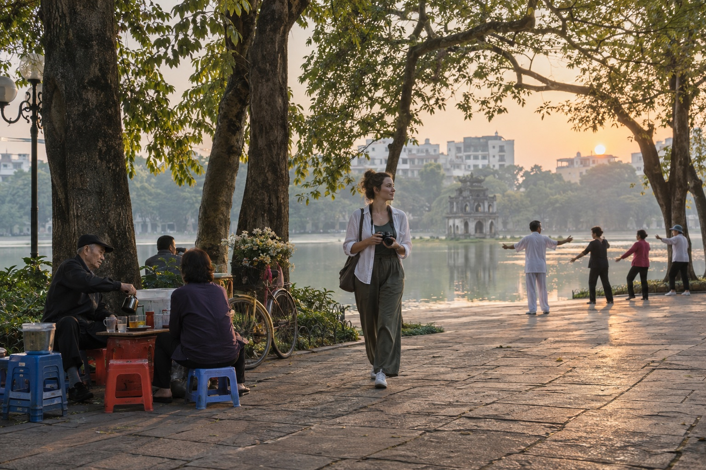
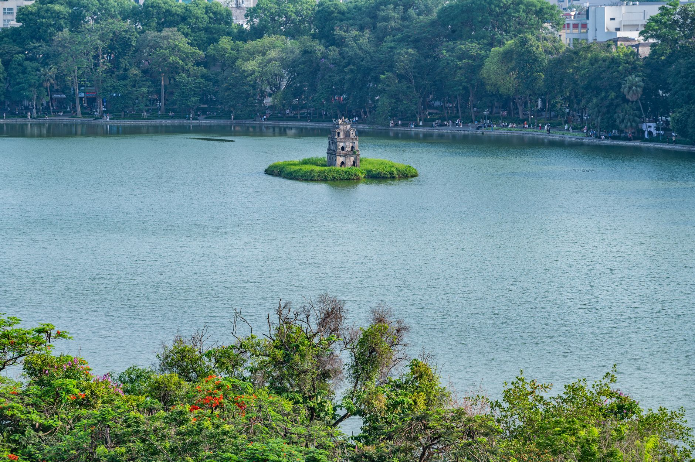

# The Slow Hanoi 48-Hour Itinerary: A Calm Two-Day Walking Guide

*By TravelFrame Editorial Team · Updated September 25, 2026*

Many two-day Hanoi itineraries read like a race. They ask you to cross the city repeatedly, eat on command and spend more time checking the clock than noticing where you are.

Hanoi works better in clusters.

Choose one part of the city for each half-day. Walk when the streets invite you to walk. Pause when a cafe, courtyard or conversation becomes more interesting than the next pin on your map.

This 48-hour plan is intentionally spacious. Opening hours, weather and venue access can change, so verify key stops before your visit.


*Editorial illustration generated with Codex for TravelFrame. AI-generated image.*

## Before You Start

Use this itinerary as a rhythm, not a reservation sheet.

- Group nearby places together.
- Keep one rest period each afternoon.
- Check official opening hours for ticketed sites.
- Ask before photographing people closely.
- Use app-based rides when walking between distant clusters.
- Keep sacred spaces quiet and dress respectfully.

## Day 1 Morning: Hoàn Kiếm Lake and the Old Quarter

### 6:45 AM: Begin at Hoàn Kiếm Lake

Walk one gentle loop or choose a quiet section under the trees. You will see exercise groups, breakfast deliveries and the city shifting from dawn into working hours.

Do not rush to photograph everything. Spend ten minutes observing the direction of the light and the flow of pedestrians.


*Photo: Nguyen Ngoc Tien / Pexels.*

### 7:45 AM: Eat a Local Breakfast

Choose a busy, clean stall or restaurant near your route. Phở is an obvious choice, but bánh cuốn, xôi and bún riêu can be equally good morning options.

Ask for the price before ordering when a menu is not displayed. TravelFrame's last canonical snapshot listed street phở at an indicative `40,000-65,000 VND` on September 6, 2026. Treat that range as dated guidance, not a tariff.


*Photo: Nam Phong Bùi / Pexels.*

### 9:00 AM: Walk the Craft Streets

Move through two or three streets rather than trying to cover the entire Old Quarter.

Look for silverwork around Hàng Bạc, woven goods, paper products, old shop signs and the narrow rhythm of tube-house facades. Many businesses are active workplaces. Ask before stepping inside with a camera.

### 11:00 AM: Take a Cafe Pause

Choose a cafe because it feels comfortable, not because it appears on every list. A balcony gives you a wider street view. A ground-floor shop gives you closer contact with the neighborhood rhythm.

## Day 1 Afternoon: French Quarter at a Slower Pace

### 2:30 PM: Start Near the Opera House

The French Quarter offers wider pavements and more open compositions than the Old Quarter. Walk around the Opera House, nearby gardens and public streets with preserved facades.

Some buildings are hotels, offices or diplomatic properties. Photograph from public space and respect security signs.

### 4:30 PM: Rest

Return to your accommodation. Shower, back up your photos and stop making decisions for an hour.

This pause is part of the itinerary. Hanoi's heat, humidity and traffic can make a full day feel longer than the map suggests.

### 6:30 PM: Dinner Within One Neighborhood

Choose a dinner area you can explore on foot after eating. Bún chả, bánh cuốn and chả cá are strong Hanoi options. Confirm ingredients if you have allergies or dietary restrictions.


*Photo: Markus Winkler / Pexels.*

## Day 2 Morning: West Lake and a Sacred-Space Visit

### 7:00 AM: Walk a Short West Lake Section

West Lake is large. Do not try to walk the full perimeter during a two-day visit.

Choose one section and enjoy the open air, water and neighborhood cafes. Use a ride-hailing app to reach the area and confirm the vehicle before boarding.

### 8:00 AM: Visit Trấn Quốc Pagoda Respectfully

Check current access before leaving your hotel. Cover shoulders and knees, lower your voice, and avoid photographing worshippers closely.

The purpose of the stop is not to collect a perfect temple portrait. Give the place time before taking out your camera.

### 9:30 AM: Tea or a Quiet Breakfast

Lotus tea is associated with West Lake, but product quality and seasonality vary. Choose a reputable tea house and ask what is being served rather than assuming every cup is locally scented lotus tea.

## Day 2 Afternoon: Temple of Literature and Long Biên

### 2:00 PM: Temple of Literature

The Temple of Literature gives you a slower sequence of gates, courtyards and garden spaces. The official visitor website should be checked for current hours, ticket information and special events before you go.

Move through the site quietly. Keep pathways open and avoid directing a long portrait session in a crowded ceremonial area.

### 4:30 PM: Choose Your Final Scene

Pick one of these options based on weather and energy:

- **Long Biên approaches:** iron structure, river landscape and late-day light.
- **Phùng Hưng area:** railway arches, murals and neighborhood textures.
- **Hoàn Kiếm return:** an easy final loop with dinner nearby.

On Long Biên Bridge, use designated pedestrian space, secure loose items and remain separated from the railway.

## How to Keep the Itinerary Flexible

### Rain

Move the architecture walk under covered arcades or into a cafe. Do not force a bridge or lakeside plan during unsafe weather.

### Heat

Begin earlier, carry water and protect the afternoon rest period.

### Crowds

Skip the photograph rather than blocking an entrance or turning a worship space into a set.

### Low Energy

Remove one cluster. A slow itinerary only works when you are willing to see less.

## Add Photography Without Turning the Trip Into a Shoot

The easiest place for a private photo walk is Day 1 morning, when the route already moves through varied Old Quarter and French Quarter textures.

TravelFrame's working experience combines a local companion, route planning, gentle posing support and photography. Exact package, duration, delivery and price are confirmed in writing.

Visit [TravelFrame](https://travelframe.vn/) or message `PHOTO` to [@travelframe.vn](https://instagram.com/travelframe.vn) to discuss current options.

## Frequently Asked Questions

### Is 48 hours enough for Hanoi?

It is enough for a thoughtful introduction to the historic center and one wider neighborhood cluster. It is not enough to see every major attraction.

### How should I travel between the Old Quarter and West Lake?

An app-based car is often the simplest option. Check the estimated fare in the app, confirm the vehicle and allow extra time for traffic.

### What should I book in advance?

Confirm accommodation and any essential ticketed experience. Re-check official hours for museums, heritage sites and performances near the visit date.

### Is this itinerary suitable for solo female travelers?

The route uses central, well-known areas and leaves daylight for most walking. Individual comfort and street conditions vary, so use normal city precautions and adjust any stop that feels uncomfortable.

## Editorial Sources

- Official Temple of Literature visitor information: https://vanmieu.gov.vn/fr/visitor-information
- TravelFrame canonical product and guest-experience source: `03-Product-And-Guest-Experience.md`
- TravelFrame canonical safety and dated price source: `06-Safety-And-Verified-Travel-Facts.md`

```json
{
  "@context": "https://schema.org",
  "@graph": [
    {
      "@type": "Article",
      "headline": "The Slow Hanoi 48-Hour Itinerary: A Calm Two-Day Walking Guide",
      "description": "A spacious two-day Hanoi itinerary organized around walkable neighborhood clusters, cultural respect and time to pause.",
      "author": {"@type": "Organization", "name": "TravelFrame"},
      "publisher": {"@type": "Organization", "name": "TravelFrame"},
      "datePublished": "2026-09-25",
      "dateModified": "2026-09-25"
    },
    {
      "@type": "TouristTrip",
      "name": "Slow Hanoi 48-Hour Itinerary",
      "touristType": ["Solo traveler", "Couple", "First-time visitor"],
      "itinerary": {
        "@type": "ItemList",
        "itemListElement": [
          {"@type": "ListItem", "position": 1, "name": "Day 1: Hoan Kiem Lake, Old Quarter and French Quarter"},
          {"@type": "ListItem", "position": 2, "name": "Day 2: West Lake, Temple of Literature and a flexible sunset stop"}
        ]
      }
    }
  ]
}
```
