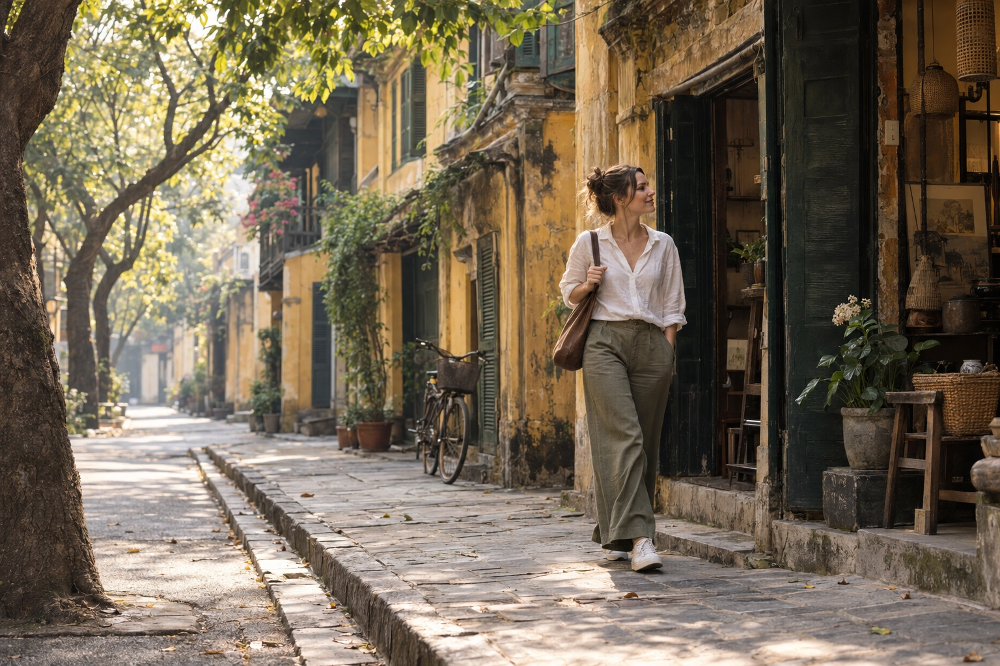
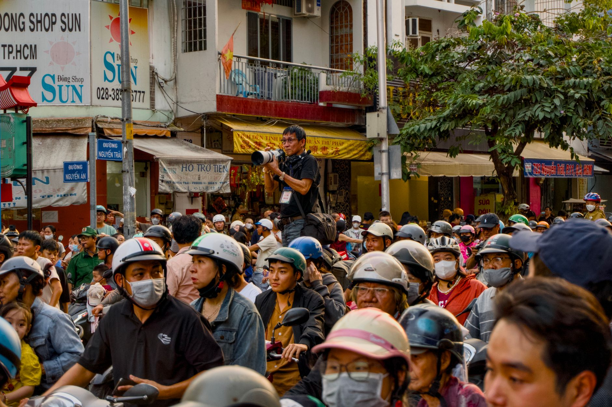
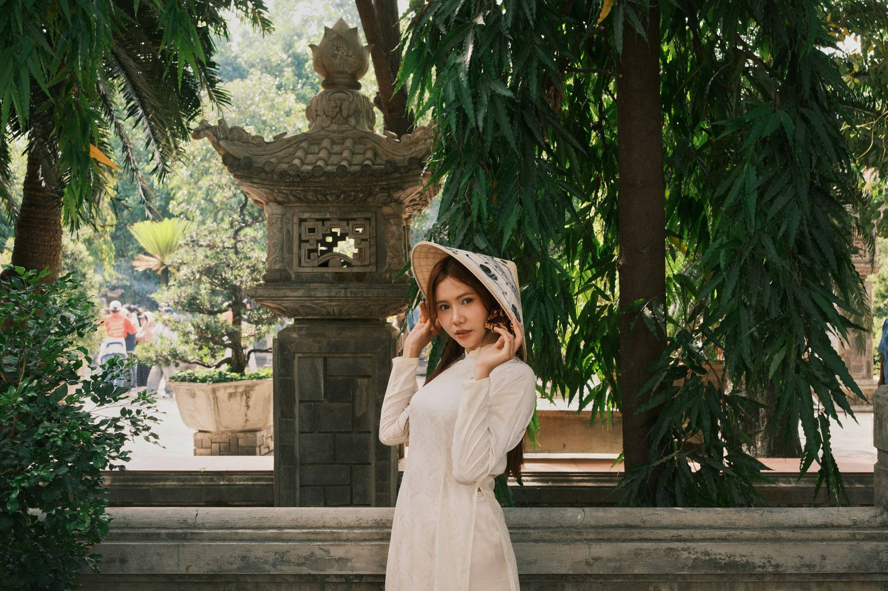

# Solo Female Travel in Hanoi: How to Get Natural Photos Without Awkward Posing

*By TravelFrame Editorial Team · Updated September 25, 2026*

Traveling solo gives you freedom. Your camera roll does not always reflect it.

You may return from a full day in Hanoi with hundreds of street photos, food photos and screenshots, but only two rushed pictures of yourself. One is a wide-angle selfie. The other was taken by a kind stranger who accidentally cropped out the street.

The answer is not to turn your trip into a fashion shoot. It is to make photography part of the walk.

This guide covers the best light, practical outfits, natural movement prompts and simple safety habits for getting photographs that still feel like you.


*Editorial illustration generated with Codex for TravelFrame. AI-generated image.*

## Start Early, but Do Not Obsess Over One Exact Time

Early morning is useful because the light is softer and many streets feel less compressed. Hanoi is already awake: people exercise by the lake, breakfast stalls prepare their first bowls, and shops begin opening their shutters.

The best window changes with season and weather. Instead of treating 7:00 AM as a rule, plan to begin around sunrise and adjust for cloud cover, heat and your location.

Morning helps in three ways:

- **Softer light:** skin tones and textured walls photograph more gently.
- **More room:** you can move without blocking a busy pavement.
- **Less performance pressure:** a quieter street makes natural expressions easier.

**Pro move:** spend the first ten minutes walking and talking without trying to create a perfect frame.

## Choose an Outfit You Can Actually Walk In

Hanoi rewards comfortable clothes. Pavements can be uneven, curbs can be high, and scooters may occupy part of the walkway.

### Colors That Work Well

| Hanoi backdrop | Outfit direction | Why it works |
|---|---|---|
| Yellow walls and green shutters | White, ivory, olive or soft blue | Clear contrast without looking staged |
| Temple courtyards | Modest linen layers and muted colors | Respectful and visually calm |
| Long Biên Bridge | Cream, navy, rust or denim | Holds detail against iron and open sky |
| Street cafes | Simple solid colors | Keeps attention on expression and context |

Avoid carrying an outfit that requires constant adjustment. A dress that catches on steps or shoes you cannot walk in will change your posture and your mood.

Bring one small accessory, such as a scarf or light overshirt, if you want variety without losing time.

## Stop Posing and Start Doing

Most people feel awkward because they are asked to freeze. Movement gives your body a reason to relax.

### The Slow Walk

Walk toward the photographer, then pass slightly to one side. Keep your pace steady and look at the street rather than the lens.

### The Cafe Pause

Sit where you would genuinely stop. Order something you want to drink. Hold the cup, watch the pavement and continue the conversation.

### The Shopfront Look

Pause at a bookstore, flower stall or craft shop. Let your attention rest on a real detail. Ask the owner before photographing inside or making a person the focus of the frame.

### The Turn Back

Walk away, then look back after hearing your name. The movement creates a natural shoulder line and expression.

### The Quiet Portrait

Not every image needs motion. Stand in open shade, angle your body slightly away from the camera, breathe out and let your hands rest naturally.


*Photo: Tuan Vy / Pexels.*

## Plan Locations as a Walk, Not a Checklist

Three nearby scenes usually produce a better set of photographs than six locations reached by car.

A simple morning route could combine:

1. A quiet Old Quarter street with layered facades.
2. A public cafe or courtyard break.
3. A wider architectural setting in the French Quarter.

Another route might stay around the Temple of Literature and nearby streets. Dress respectfully, check current visitor rules and avoid blocking entrances or ceremonies.


*Photo: quang vinh / Pexels. Confirm photography rules at each site before shooting.*

## Street Awareness for Solo Travelers

Hanoi can feel intense before its traffic patterns become familiar. Use the same practical habits you would use in any large city:

- Keep your phone secure near the road edge.
- Use a zipped crossbody bag.
- Book rides through the app and confirm the vehicle details.
- Avoid placing a tripod where it blocks pedestrians.
- Ask before photographing a vendor, artisan or resident closely.
- Leave a location if the interaction or crowd feels uncomfortable.

When crossing a street, use a marked crossing where available. Move predictably, keep watching traffic and do not step out only because another person waves you forward.

Avoid absolute safety claims. Conditions vary by street, time and individual experience. A local companion can reduce navigation friction, but no guide can guarantee that every environment is risk-free.

## When a Local Photo Companion Helps

A private photo walk is useful when you want to remain present instead of managing a tripod, checking every frame and researching each route alone.

TravelFrame's working concept combines:

- A local walking companion.
- Route planning around mood and current conditions.
- Gentle movement and posing guidance.
- Photography as part of the experience.

Package names, duration, price, image count and delivery time are confirmed in writing before booking. We do not publish a promise that has not been operationally approved.

To discuss a solo Hanoi walk, visit [TravelFrame](https://travelframe.vn/) or message `PHOTO` to [@travelframe.vn](https://instagram.com/travelframe.vn).

## Frequently Asked Questions

### What if I always look stiff in photos?

Begin with actions instead of poses. Walking, browsing and holding a drink give your hands and eyes something real to do.

### Should I bring a change of clothes?

One comfortable outfit with a light layer is usually more practical for a walking session. Confirm changing options before bringing a second outfit.

### What happens if it rains?

Light rain can create reflections and softer light, but the route should follow current weather and safety conditions. Rescheduling or route changes must be agreed for the specific booking.

### How do I book a TravelFrame photo walk?

Message `PHOTO` to `@travelframe.vn`. The team will confirm the date, route, package, inclusions, delivery terms and image-use permissions in writing.

## Editorial Notes

- Tone and content follow TravelFrame's current operating ICP: international solo female travelers seeking local support, confidence and natural visual memories.
- No price, duration, image count, testimonial or delivery SLA is presented as approved commercial truth.
- Pexels photographs include creator attribution. The hero is an AI-generated editorial illustration.

```json
{
  "@context": "https://schema.org",
  "@graph": [
    {
      "@type": "Article",
      "headline": "Solo Female Travel in Hanoi: How to Get Natural Photos Without Awkward Posing",
      "description": "A practical photography and street-awareness guide for solo female travelers in Hanoi.",
      "author": {"@type": "Organization", "name": "TravelFrame"},
      "publisher": {"@type": "Organization", "name": "TravelFrame"},
      "datePublished": "2026-09-25",
      "dateModified": "2026-09-25"
    },
    {
      "@type": "FAQPage",
      "mainEntity": [
        {
          "@type": "Question",
          "name": "How can a solo traveler get natural photos in Hanoi?",
          "acceptedAnswer": {
            "@type": "Answer",
            "text": "Use soft morning light, comfortable clothing and movement prompts such as walking, browsing or pausing at a cafe. Ask permission before close portraits of local people."
          }
        },
        {
          "@type": "Question",
          "name": "How do I book a TravelFrame photo walk?",
          "acceptedAnswer": {
            "@type": "Answer",
            "text": "Message PHOTO to @travelframe.vn. The team confirms package, route, inclusions and delivery terms in writing."
          }
        }
      ]
    }
  ]
}
```
