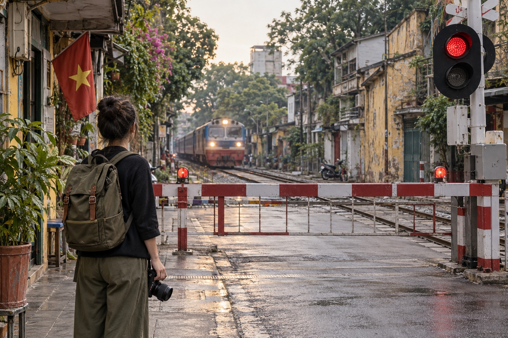
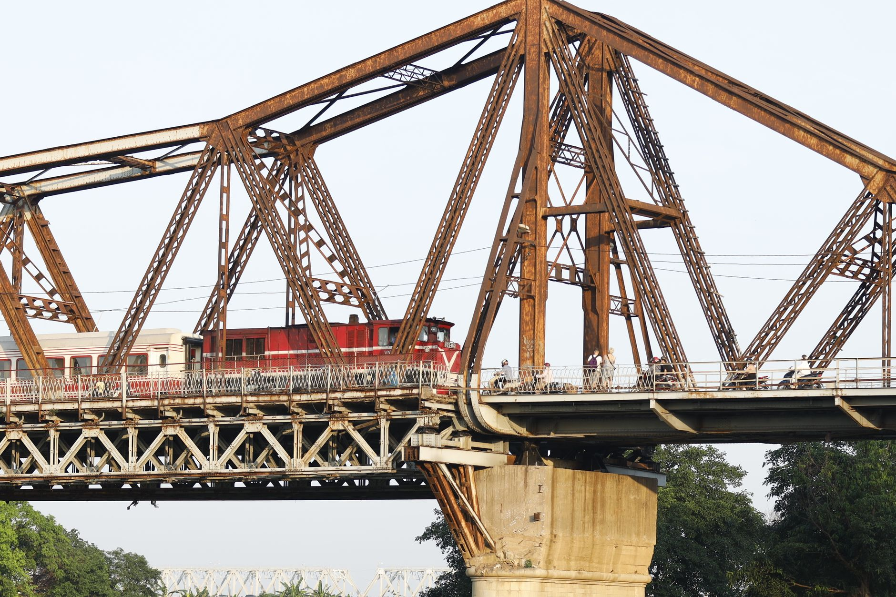
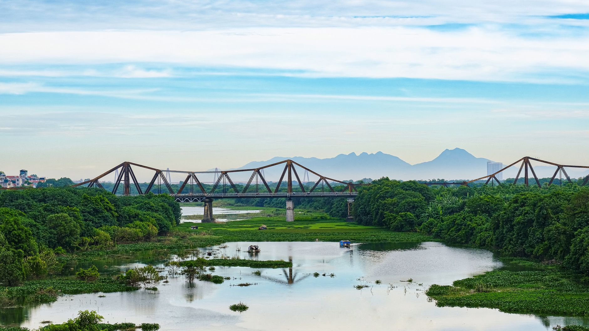

# Hanoi Train Street 2026: A Safety-First Guide and Better Railway Photo Spots

*By TravelFrame Editorial Team · Fact-checked September 25, 2026*

Hanoi Train Street is one of the city's most searched locations. It is also an active railway corridor running through a residential neighborhood.

That distinction matters.

Online posts often describe Train Street as either fully open or completely closed. The reality is less convenient: access and enforcement can change, barriers must be respected, and a cafe invitation does not override instructions from railway staff or local authorities.

This guide explains how to approach the area responsibly, why static train timetables are unreliable, and where to find railway atmosphere without standing on the tracks.


*Editorial illustration generated with Codex for TravelFrame. AI-generated image; do not treat it as evidence of current access conditions.*

## Is Hanoi Train Street Open in 2026?

The safest answer is: **do not assume access is available**.

Hanoi authorities have repeatedly increased enforcement around the railway corridor. Official city reporting in March 2025 described inspections and penalties for people entering the railway safety area to take photos. In April 2026, local authorities around the Khâm Thiên and Lê Duẩn section announced tighter monitoring, including cameras, and reiterated that tourism businesses must not occupy the railway safety corridor.

Conditions can differ by entrance and can change without notice. A route that appeared open in a recent social post may be closed when you arrive.

Use these rules:

- Stop at every barrier or checkpoint.
- Follow railway staff, police and local security immediately.
- Never climb around a barrier or follow someone through a residential entrance.
- Never stand, sit or place a tripod on the rails.
- Do not treat a drink purchase as permission to ignore an official restriction.

**Pro move:** plan Train Street as an optional observation stop, not the anchor of your Hanoi day.

## Why We Do Not Publish a Fixed Train Street Schedule

Search results are full of minute-by-minute Train Street timetables. Many are copied from older blogs, cafe boards or social posts.

That creates false confidence.

Passenger and freight operations can change because of delays, maintenance and operational decisions. The time printed on a rail ticket or booking page is not a guarantee of the exact minute a train will pass a specific city crossing.

Before going:

1. Check current passenger train information through Vietnam Railways or an official ticketing channel.
2. Ask your hotel or accommodation to verify local access on the same day.
3. Treat any cafe timetable as an estimate.
4. Leave if authorities close the area.

If seeing a train is essential to your trip, use a normal public level crossing and remain behind the closed barrier. You may not get the viral close-up angle, but you will get a truthful view of Hanoi's working railway.


*Photo: Nguyễn Hưng / Pexels.*

## Essential Safety Rules

### Stay Outside the Railway Corridor

The rail line is transport infrastructure, not a pedestrian street. Keep your body, phone, camera straps and luggage behind the barrier or marked safety boundary.

### Do Not Copy Social Media Behavior

A video may have been filmed before restrictions changed. It may also show unsafe or unauthorized behavior. The fact that someone captured a shot does not make the shot legal or repeatable.

### Keep Children Beside You

Children should remain directly supervised and well away from the track. If the area becomes crowded, leave rather than trying to hold your position.

### Respect the Neighborhood

People live beside the railway. Keep voices low, do not photograph residents through windows, and ask before taking a close portrait of a person or business.

### Leave When Asked

Do not negotiate for one more photo. Do not argue that another visitor was allowed through. A calm exit protects you and reduces pressure on the community.

## Three Calmer Ways to Photograph Hanoi's Railway Heritage

These ideas still require normal street awareness. They are alternatives to entering the narrow residential rail corridor, not promises of unrestricted access.

### 1. Phùng Hưng Mural Street and the Railway Arches

Phùng Hưng offers old masonry, murals and layered streetscape details near the elevated railway. Work from the public pavement and frame the arches, trees and neighborhood activity.

**Best approach:** arrive in the morning, keep the composition wide and ask before including a vendor or resident as the main subject.

### 2. Long Biên Bridge Approaches

Long Biên Bridge is one of Hanoi's strongest visual symbols. The iron structure, Red River landscape and nearby market activity create more photographic variety than a single viral alley.

Use designated pedestrian areas and stay separated from the railway line. Conditions on the bridge can be windy and busy, so secure loose clothing and camera straps.


*Photo: tu nguyen / Pexels.*

### 3. A Public Level Crossing

A normal public crossing can show the rhythm of Hanoi's railway without requiring anyone to enter the track area. Stand on the pavement behind the barrier and photograph the wider scene: waiting scooters, the warning light and the train moving through the city.

This angle tells a more honest story. It shows how the railway is part of daily Hanoi, not a stage built for visitors.

## A Better Hanoi Photo Plan

If Train Street is closed, your day is not ruined. Hanoi has hundreds of visual layers within a short walk:

- Weathered facades and craft streets in the Old Quarter.
- Morning life around Hoàn Kiếm Lake.
- French-era architecture around the Opera House.
- Temple courtyards, with respectful dress and photography.
- Long Biên's iron structure and river landscape.

TravelFrame's working approach is simple: build a flexible walking route around the light, the guest's pace and current local conditions. We do not guarantee Train Street access or place it in a fixed route.

For help planning a private, photo-friendly Hanoi walk, visit [TravelFrame](https://travelframe.vn/) or message `PHOTO` to [@travelframe.vn](https://instagram.com/travelframe.vn). Exact routes, inclusions and delivery details are confirmed in writing before booking.

## Frequently Asked Questions

### Can I enter if a cafe owner invites me?

An invitation does not override a barrier or instruction from authorities. Follow the restriction you see on the day.

### Where can I find the current train time?

Check Vietnam Railways or an official rail ticketing channel, then treat the passage time at any particular crossing as approximate. Do not rely only on a blog timetable.

### Can I take photos from behind a barrier?

Yes, when you remain in a public area and follow staff instructions. Keep equipment out of the railway corridor and avoid blocking traffic.

### Is Train Street included in TravelFrame routes?

No fixed route guarantees Train Street. Any route is adjusted to current access, safety and the guest's confirmed priorities.

## Editorial Sources

- Hanoi city report on Train Street enforcement, March 25, 2025: https://cmshn.hanoi.gov.vn/tin-so-nganh/tang-cuong-xu-phat-tuyen-truyen-bao-dam-an-toan-giao-thong-khu-vuc-ca-phe-duong-tau-4250325161459344.htm
- Văn Miếu ward report on railway safety monitoring, April 13, 2026: https://vanmieuquoctugiam.hanoi.gov.vn/linh-vuc-kinh-te-ha-tang-va-do-thi-67678/se-lap-camera-quan-ly-tai-khu-vuc-ca-phe-duong-tau-tren-tuyen-kham-thien-le-duan-2813260415105532541.htm
- TravelFrame canonical safety rules: `06-Safety-And-Verified-Travel-Facts.md`

```json
{
  "@context": "https://schema.org",
  "@graph": [
    {
      "@type": "Article",
      "headline": "Hanoi Train Street 2026: A Safety-First Guide and Better Railway Photo Spots",
      "description": "A safety-first guide to changing Hanoi Train Street access, railway barriers, train-time uncertainty and alternative railway photo spots.",
      "author": {"@type": "Organization", "name": "TravelFrame"},
      "publisher": {"@type": "Organization", "name": "TravelFrame"},
      "datePublished": "2026-09-25",
      "dateModified": "2026-09-25"
    },
    {
      "@type": "FAQPage",
      "mainEntity": [
        {
          "@type": "Question",
          "name": "Is Hanoi Train Street open in 2026?",
          "acceptedAnswer": {
            "@type": "Answer",
            "text": "Access is regulated and can change without notice. Visitors should obey barriers and instructions from railway staff, police and local security."
          }
        },
        {
          "@type": "Question",
          "name": "What time does the train pass Hanoi Train Street?",
          "acceptedAnswer": {
            "@type": "Answer",
            "text": "Check current information through Vietnam Railways or an official ticketing channel. Passage times at a specific city crossing should be treated as approximate."
          }
        }
      ]
    }
  ]
}
```
