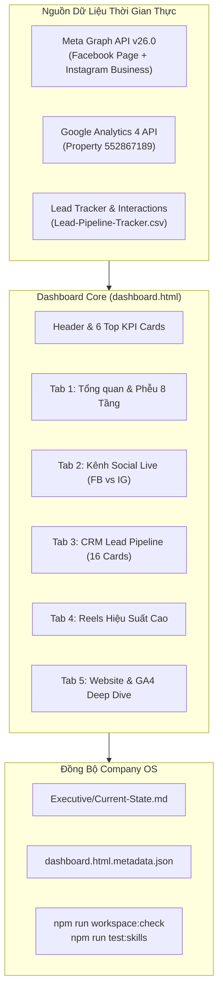
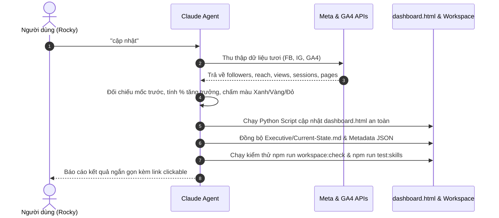

# Hướng Dẫn Kiến Trúc & Quy Trình Tạo/Cập Nhật Real-Time Performance Dashboard (Dành Cho Claude)

> **Tài liệu chuẩn hóa kiến trúc & cẩm nang vận hành (Runbook) cho Claude**  
> **Chủ quản:** Data-Analytics & Technology-Automation (TravelFrame)  
> **Áp dụng cho:** Artifact Dashboard thời gian thực `dashboard.html`  
> **Cập nhật lần cuối:** 2026-11-02  

---

## 1. Mục Đích & Phạm Vi Tài Liệu

Tài liệu này được thiết kế để cung cấp toàn bộ hướng dẫn kỹ thuật, kiến trúc giao diện, nguồn dữ liệu và quy trình tự động hóa cho **Claude** (hoặc bất kỳ AI Coding Assistant nào) nhằm:
1. **Tái tạo (Recreate)** bảng điều khiển hiệu suất thời gian thực (Real-Time Performance Dashboard) từ đầu thành một file HTML độc lập hoàn chỉnh.
2. **Cập nhật (Update)** số liệu trực tiếp một cách chính xác, an toàn, không làm hỏng cấu trúc HTML/CSS/JS.
3. **Đồng bộ chuẩn hóa (Sync)** dữ liệu với Company OS (`Executive/Current-State.md`, `Data-Analytics/Lead-Pipeline-Tracker.csv`) và tuân thủ các quy tắc trong `Daily-Reporting-Standard.md`.

---

## 2. Kiến Trúc Tổng Thể Của Dashboard

Dashboard được thiết kế theo mô hình **Single-File Self-Contained Artifact HTML**, cho phép mở trực tiếp trên mọi trình duyệt web hoặc nhúng trong giao diện chat của AI Agent mà không phụ thuộc vào build tools phức tạp (Node.js/Webpack/Vite).



### 2.1. Ngăn Xếp Kỹ Thuật (Tech Stack)
- **HTML5 Ngữ nghĩa (Semantic HTML5):** Cấu trúc thẻ rõ ràng, trợ năng cao.
- **Tailwind CSS (Allowlisted CDN Script):** Sử dụng `https://www.gstatic.com/antigravity/web/dev/tailwindcss.min.js`.
- **CSS Variables (Theme Adaptable):** Sử dụng các biến màu CSS tiêu chuẩn để tự động thích ứng với cả giao diện Sáng (Light) và Tối (Dark):
  - `var(--background)`: Màu nền chính (`#09090b` / `#ffffff`)
  - `var(--foreground)`: Màu chữ chính (`#fafafa` / `#09090b`)
  - `var(--card)`: Màu thẻ nền (`#18181b` / `#f4f4f5`)
  - `var(--border)`: Màu đường viền vi tế (`#27272a` / `#e4e4e7`)
  - `var(--muted-foreground)`: Màu phụ chú mờ (`#a1a1aa` / `#71717a`)
  - `var(--primary)` & `var(--primary-foreground)`: Màu nhấn chính (Xanh biển/Xanh ngọc).
- **Vanilla JavaScript:** Chuyển đổi các tab nhẹ nhàng bằng hàm `switchTab(tabId)` mà không cần jQuery hay thư viện bên ngoài.

### 2.2. Các Nguồn Dữ Liệu Live (Real-Time Ingestion)
1. **Meta Graph API v26.0:**
   - **Facebook Page:** ID `1409099405611405` (`travelframe.vn`) -> Số follower/fan, bài viết, lượt chia sẻ, bình luận.
   - **Instagram Business:** ID `17841438272497512` (`@travelframe.vn`) -> Số follower, số lượng media, lượt tiếp cận 24h (Reach), lượt xem 24h (Views), tương tác (Accounts Engaged), lượt lưu bài (Saves), số liệu từng Reel.
2. **Google Analytics 4 Data API (Property `552867189`):**
   - Phiên truy cập (Sessions), Số người dùng hoạt động (Active Users), Lượt xem trang (Screen Pageviews).
   - Tỷ lệ thoát (Bounce Rate), Thời lượng phiên trung bình (Average Session Duration).
   - Hành trình phễu: `/tours` (danh mục), `/booking` (bước 1), `/booking/details` (bước 2 - chốt thông tin).
   - Người dùng hoạt động thời gian thực (Realtime Report: URL trang + Quốc gia).
3. **CRM Lead Pipeline & Interactions Ledger:**
   - `Data-Analytics/Lead-Pipeline-Tracker.csv`: Danh sách 16 Leads (Mã, Kênh, Giai đoạn, Báo giá, Hành động kế tiếp).
   - `Marketing-Growth/Content/Meta-Messenger-All-Interactions-Log.md`: Nhật ký tương tác 50+ hội thoại với khách hàng.

---

## 3. Cấu Trúc Chi Tiết Của 5 Tab Chức Năng

Dashboard bao gồm **Header cố định + 6 KPI Cards trên đỉnh** cùng **5 Tabs nội dung chuyên sâu**:

```
[ HEADER: Tên thương hiệu · Trạng thái Live · Thời gian cập nhật · Nút chọn 5 Tab ]
[ 6 TOP KPI CARDS: FB Followers | IG Followers | IG Saves | IG Reach/Views | GA4 Sessions | CRM Leads ]
---------------------------------------------------------------------------------------------------------
[ TAB 1: Tổng quan & Phễu ] -> Điểm nhấn vận hành · Bảng phễu 8 tầng · Snapshot 16 Leads
[ TAB 2: Kênh Social Live ] -> Chi tiết Instagram Insights vs Facebook Fanpage Growth
[ TAB 3: Lead Pipeline ]    -> Lưới 16 thẻ khách hàng chi tiết (Nhu cầu, Báo giá, Lịch sử gửi, Next Step)
[ TAB 4: Reels Hiệu Suất ]  -> Bảng xếp hạng video Reels (Tuổi bài, Views, Likes, Shares, Tình trạng Seed)
[ TAB 5: Website & GA4 ]   -> 4 Thẻ chỉ số sâu, Hành trình /booking/details, Realtime Visitors, Top Pages
```

### 3.1. Header & 6 Top KPI Cards
Mỗi thẻ KPI hiển thị:
- **Tên chỉ số** (chữ hoa nhỏ).
- **Badge trạng thái chuẩn mực:** `[Xanh]` (tăng ≥10%), `[Vàng]` (ổn định ±10%), hoặc `[Đỏ]` (giảm ≥10% hoặc = 0).
- **Con số lớn nổi bật** (font 2xl hoặc 3xl, font-bold).
- **Dòng chú giải ngắn:** So sánh với hôm qua / 24h trước và bối cảnh vận hành.

### 3.2. Tab 1: Tổng Quan & Phễu Doanh Số 8 Tầng
1. **Điểm Nhấn Vận Hành (Highlights - 3 Cột):** Nêu bật 3 sự kiện lớn nhất trong khung giờ (ví dụ: FB lập đỉnh mới, Reels tăng likes/nhận review văn hóa, Website đạt mốc views mới).
2. **Bảng Phễu Doanh Số 8 Tầng (Bắt buộc theo chuẩn Daily Reporting Standard):**
   - Tầng 1: Reach Instagram (accounts)
   - Tầng 2: Lượt xem trang cá nhân IG (Profile visits)
   - Tầng 3: Lượt bấm link bio IG (Website taps)
   - Tầng 4: DM / Messenger hỏi tour & tiếp cận riêng
   - Tầng 5: Phiên website (GA4 Sessions MTD)
   - Tầng 6: Lượt xem trang đặt tour (`/booking/details`)
   - Tầng 7: Lead thu thập được (CRM Pipeline)
   - Tầng 8: Doanh số & Đơn cọc đối soát (USD / Số cọc)
   *Cột đối chiếu:* Số hiện tại | Số hôm qua cùng giờ | Số 7 ngày trước | Trạng thái (Xanh/Vàng/Đỏ).
3. **Bảng Snapshot Khách Hàng Tiềm Năng (Live Leads Table):** Hiển thị bảng tóm tắt 16 Leads với các cột: Mã Lead, Tên khách hàng, Kênh/Bài viết, Nhu cầu, Giai đoạn, Nội dung đã gửi, Hành động kế tiếp.

### 3.3. Tab 2: Kênh Social Live (Meta Insights)
- **Instagram Breakdown:** Số follower (595), Media (203), Lượt xem 24h, Reach 24h, Lượt lưu (Saves), Profile visits, Link clicks, Tài khoản tương tác (Engaged), Tổng tương tác (Likes + Saves + Comments + Shares).
- **Facebook Fanpage Breakdown:** Số followers/likes (2.891), Tốc độ tăng trưởng hôm nay, 24h qua, 48h qua, 7 ngày qua (+22,5% vs 23/10), Tình trạng chăm sóc inbox qua Meta Suite.

### 3.4. Tab 3: Chi Tiết 16 Khách Hàng (Lead Pipeline)
Lưới 16 Cards responsive (1 cột trên mobile, 2 cột trên tablet, 3 cột trên desktop):
- Header card: Mã lead (ví dụ: `L-20261031-16`) + Phân hạng Tier + Trạng thái Stage (`Quoted`, `Guide-Sent`, `Nurture`).
- Tên khách hàng & Nguồn phát sinh (FB Reel Comment, IG DM, etc.).
- Khung ghi chú chi tiết: Thời điểm nhận comment, Nội dung cẩm nang/báo giá đã gửi (gói $30/$60/$99 hoặc cheat sheet ẩm thực), Trạng thái chờ phản hồi và ngày dự kiến đến Hà Nội.

### 3.5. Tab 4: Hiệu Suất Video Reels (Meta Live Insights)
Bảng theo dõi toàn bộ các video Reels đang hoạt động:
- Thời gian đăng (ngày giờ ICT).
- Tiêu đề nội dung / Chủ đề (Hook & Concept).
- Tuổi bài (số giờ hoặc ngày kể từ lúc đăng).
- Số liệu tương tác: Reach, Views, Saves, Shares, Likes.
- Tình trạng Seed Comment (theo Seed Comment Playbook).
- Link bài viết trực tiếp (Clickable hyperlink đến Facebook Reel hoặc Instagram Reel).

### 3.6. Tab 5: Kênh Website & Phễu Chuyển Đổi GA4
- 4 Thẻ KPI lớn: Active Users MTD, Sessions MTD, Screen Pageviews MTD, Phễu Booking (`/booking/details`).
- Thanh đo lường chất lượng: Tỷ lệ thoát (Bounce Rate), Thời lượng phiên trung bình (Average Session Duration), Trạng thái tracking & Số lượng Realtime Active Users hiện tại.
- Bảng Top Landing Pages: `/tours`, `/`, `/booking`, `/tour/spiritual-west-lake-breeze`, `/tour/food-tour`, `/booking/details`, v.v.

---

## 4. Mẫu Khung HTML Chuẩn (HTML Skeleton & CSS Template)

Claude có thể sử dụng khung mã HTML dưới đây để render hoặc tái cấu trúc dashboard:

```html
<!DOCTYPE html>
<html lang="vi">
<head>
  <meta charset="UTF-8">
  <meta name="viewport" content="width=device-width, initial-scale=1.0">
  <title>TravelFrame — Real-Time Performance Dashboard</title>
  <!-- Tailwind CSS Script -->
  <script src="https://www.gstatic.com/antigravity/web/dev/tailwindcss.min.js"></script>
  <style>
    .hidden { display: none !important; }
    .badge-green { background: rgba(16, 185, 129, 0.15); color: #10b981; border: 1px solid rgba(16, 185, 129, 0.3); }
    .badge-yellow { background: rgba(245, 158, 11, 0.15); color: #f59e0b; border: 1px solid rgba(245, 158, 11, 0.3); }
    .badge-red { background: rgba(239, 68, 68, 0.15); color: #ef4444; border: 1px solid rgba(239, 68, 68, 0.3); }
    .badge-blue { background: rgba(59, 130, 246, 0.15); color: #3b82f6; border: 1px solid rgba(59, 130, 246, 0.3); }
    .tab-btn.active { background-color: var(--primary) !important; color: var(--primary-foreground) !important; }
    table { border-spacing: 0; width: 100%; }
  </style>
</head>
<body class="bg-[var(--background)] text-[var(--foreground)] antialiased p-4 md:p-6">
  <div class="max-w-7xl mx-auto space-y-6">
    
    <!-- HEADER -->
    <header class="flex flex-col md:flex-row md:items-center justify-between pb-6 border-b border-[var(--border)] gap-4">
      <div>
        <div class="flex items-center gap-3">
          <span class="text-xs font-semibold uppercase tracking-wider px-2.5 py-1 rounded bg-[var(--card)] border border-[var(--border)] text-[var(--muted-foreground)]">Company OS · Morning Snapshot</span>
          <span class="text-xs font-semibold px-2.5 py-1 rounded badge-green">Live Update: [THỜI_GIAN]</span>
          <span class="text-xs font-semibold px-2.5 py-1 rounded badge-blue">[TIÊU_ĐỀ_ĐỘT_PHÁ]</span>
        </div>
        <h1 class="text-2xl md:text-3xl font-bold tracking-tight mt-2 text-[var(--foreground)]">TravelFrame — Bảng Điều Khiển Real-Time Website & Social</h1>
        <p class="text-sm text-[var(--muted-foreground)] mt-1">Cập nhật trực tiếp từ Meta Graph API v26.0 & GA4</p>
      </div>
      <div class="flex flex-wrap items-center gap-2">
        <button onclick="switchTab('overview')" id="btn-overview" class="tab-btn active px-3.5 py-2 rounded-lg text-sm font-medium bg-[var(--primary)] text-[var(--primary-foreground)] shadow-sm transition-colors">Tổng quan & Phễu</button>
        <button onclick="switchTab('social')" id="btn-social" class="tab-btn px-3.5 py-2 rounded-lg text-sm font-medium bg-[var(--card)] border border-[var(--border)] text-[var(--muted-foreground)] hover:text-[var(--foreground)] transition-colors">Kênh Social (Live)</button>
        <button onclick="switchTab('leads')" id="btn-leads" class="tab-btn px-3.5 py-2 rounded-lg text-sm font-medium bg-[var(--card)] border border-[var(--border)] text-[var(--muted-foreground)] hover:text-[var(--foreground)] transition-colors">Lead Pipeline (16 Leads)</button>
        <button onclick="switchTab('content')" id="btn-content" class="tab-btn px-3.5 py-2 rounded-lg text-sm font-medium bg-[var(--card)] border border-[var(--border)] text-[var(--muted-foreground)] hover:text-[var(--foreground)] transition-colors">Reels Hiệu Suất Cao</button>
        <button onclick="switchTab('website')" id="btn-website" class="tab-btn px-3.5 py-2 rounded-lg text-sm font-medium bg-[var(--card)] border border-[var(--border)] text-[var(--muted-foreground)] hover:text-[var(--foreground)] transition-colors">Kênh Website & GA4</button>
      </div>
    </header>

    <!-- TOP 6 KPI CARDS -->
    <section class="grid grid-cols-2 md:grid-cols-3 lg:grid-cols-6 gap-4">
      <!-- Thẻ 1: FB Followers -->
      <!-- Thẻ 2: IG Followers -->
      <!-- Thẻ 3: IG Saves -->
      <!-- Thẻ 4: IG Reach & Views -->
      <!-- Thẻ 5: GA4 Sessions & Views -->
      <!-- Thẻ 6: CRM Leads -->
    </section>

    <!-- TAB 1: OVERVIEW & FUNNEL -->
    <div id="tab-overview" class="tab-content space-y-6">
      <!-- 3 Cột Điểm Nhấn Vận Hành -->
      <!-- Bảng Phễu Doanh Số 8 Tầng -->
      <!-- Bảng Snapshot Leads Trực Tiếp -->
    </div>

    <!-- TAB 2: SOCIAL LIVE -->
    <div id="tab-social" class="tab-content hidden space-y-6">
      <!-- Instagram Breakdown & Facebook Fanpage Breakdown -->
    </div>

    <!-- TAB 3: LEADS PIPELINE -->
    <div id="tab-leads" class="tab-content hidden space-y-6">
      <!-- Lưới 16 Cards Khách Hàng -->
    </div>

    <!-- TAB 4: REELS LIVE -->
    <div id="tab-content" class="tab-content hidden space-y-6">
      <!-- Bảng Hiệu Suất Video Reels -->
    </div>

    <!-- TAB 5: WEBSITE & GA4 -->
    <div id="tab-website" class="tab-content hidden space-y-6">
      <!-- 4 Cards lớn, Thanh đo Bounce Rate & Bảng Top Pages -->
    </div>

  </div>

  <!-- JAVASCRIPT CONTROLLER -->
  <script>
    function switchTab(tabId) {
      var contents = document.querySelectorAll('.tab-content');
      for (var i = 0; i < contents.length; i++) {
        contents[i].classList.add('hidden');
      }
      var activeContent = document.getElementById('tab-' + tabId);
      if (activeContent) {
        activeContent.classList.remove('hidden');
      }
      var buttons = document.querySelectorAll('.tab-btn');
      for (var j = 0; j < buttons.length; j++) {
        buttons[j].classList.remove('active', 'bg-[var(--primary)]', 'text-[var(--primary-foreground)]');
        buttons[j].classList.add('bg-[var(--card)]', 'text-[var(--muted-foreground)]');
      }
      var activeBtn = document.getElementById('btn-' + tabId);
      if (activeBtn) {
        activeBtn.classList.remove('bg-[var(--card)]', 'text-[var(--muted-foreground)]');
        activeBtn.classList.add('active', 'bg-[var(--primary)]', 'text-[var(--primary-foreground)]');
      }
    }
  </script>
</body>
</html>
```

---

## 5. Quy Trình 5 Bước Cập Nhật Tự Động (Runbook Cho Claude)

Mỗi khi người dùng yêu cầu `"cập nhật"`, Claude cần thực hiện đầy đủ 5 bước sau:



### Bước 1: Thu Thập Dữ Liệu Tươi (Fresh Data Ingestion)
Gọi các công cụ MCP hoặc chạy script lấy thông tin:
1. `get_facebook_page_info`: Lấy `followers_count`, `fan_count`.
2. `get_instagram_profile`: Lấy `followers_count`, `media_count`.
3. `get_instagram_insights`: Lấy `reach`, `views`, `accounts_engaged`.
4. `list_instagram_media` & `list_facebook_page_posts`: Lấy likes, comments, shares của các bài viết mới nhất.
5. `get_ga4_traffic_overview` với tham số `start_date: "2026-10-01"`, `end_date: "today"`: Lấy `activeUsers`, `sessions`, `screenPageViews`, `bounceRate`, `averageSessionDuration`.
6. `get_ga4_top_pages` với `limit: 20`: Lấy views của `/tours`, `/booking`, `/booking/details`.
7. `get_ga4_realtime`: Lấy số lượng người dùng đang truy cập live.

### Bước 2: Phân Tích & Đối Soát (Comparative Analysis)
- **So sánh số liệu:** Lấy số mới trừ đi số của mốc gần nhất (ví dụ: tối hôm trước) để ra delta (`+15 followers`, `+10 sessions`, `+2 booking details`).
- **Phân loại trạng thái (Xanh / Vàng / Đỏ):**
  - **Xanh:** Tăng trưởng ≥ +10% hoặc đạt cột mốc mới quan trọng.
  - **Vàng:** Dao động nhẹ trong khoảng ±10%.
  - **Đỏ:** Giảm ≥ -10% hoặc các chỉ số cọc/doanh số đang bằng 0.
- **Kiểm tra Lead mới:** Đối chiếu xem có comment từ khóa mới (`"Food"`, `"Photo"`, `"Hanoi"`) cần bổ sung vào pipeline hay không.

### Bước 3: Cập Nhật `dashboard.html` Bằng Script Python
> [!IMPORTANT]
> **Không sửa file HTML thủ công từng dòng lớn bằng replace chuỗi văn bản thông thường** vì rất dễ bị lỗi do ký tự unicode, dấu nháy cong (`’` vs `'`), hoặc khoảng trắng xuống dòng (`\r\n`).  
> **Khuyến nghị chuẩn:** Hãy viết một script Python ngắn hạn (scratch script) sử dụng `re.sub()` để thay thế chính xác từng khối nội dung.

### Bước 4: Đồng Bộ Hóa Vào Company OS
1. **Cập nhật `Executive/Current-State.md`:** Cập nhật bảng `## Chỉ số` tại mốc thời gian mới nhất (giờ ICT, ngày tháng).
2. **Cập nhật Metadata:** Ghi đè file `dashboard.html.metadata.json` với trường `updatedAt` và bản tóm tắt ngắn.

### Bước 5: Kiểm Tra Toàn Vẹn & Báo Cáo
1. Chạy `npm run workspace:check` (đảm bảo 10/10 PASS).
2. Chạy `npm run test:skills` (đảm bảo 15/15 PASS).
3. Báo cáo ngắn gọn cho người dùng với bảng tóm tắt các chỉ số cốt lõi và đính kèm link clickable dạng `file://...`.

---

## 6. Mẫu Python Script Cập Nhật Tự Động (Reusable Updater)

Claude có thể lưu và tái sử dụng đoạn mã Python này để cập nhật dashboard bất kỳ lúc nào:

```python
import re

file_path = "/Users/macbook/.gemini/antigravity/brain/e99c21c5-c9ba-4243-89b3-d3ab07dc13c0/dashboard.html"

with open(file_path, "r", encoding="utf-8") as f:
    content = f.read()

# 1. Cập nhật Title & Header Time
time_str = "10:06 ICT 02/11/2026"
content = re.sub(r"<title>[^<]+</title>", f"<title>TravelFrame — Real-Time Performance Dashboard ({time_str})</title>", content)
content = re.sub(r'badge-green">Live Update: [^<]+<', f'badge-green">Live Update: {time_str}<', content)

# 2. Cập nhật FB Followers Card
fb_val = "2.891"
content = re.sub(
    r'(FB Followers</p>[\s\S]*?<p class="text-2xl font-bold mt-2 text-emerald-500">)[^<]+(</p>)',
    rf'\g<1>{fb_val}\g<2>', content
)

# 3. Cập nhật IG Followers Card
ig_val = "595"
content = re.sub(
    r'(IG Followers</p>[\s\S]*?<p class="text-2xl font-bold mt-2 text-\[var\(--foreground\)\]">)[^<]+(</p>)',
    rf'\g<1>{ig_val}\g<2>', content
)

# 4. Cập nhật GA4 Sessions Card
ga4_sessions = "770 sessions"
content = re.sub(
    r'(GA4 Sessions \(MTD\)</p>[\s\S]*?<p class="text-2xl font-bold mt-2 text-emerald-500">)[^<]+(</p>)',
    rf'\g<1>{ga4_sessions}\g<2>', content
)

# 5. Ghi lại file
with open(file_path, "w", encoding="utf-8") as f:
    f.write(content)

print(f"Dashboard updated successfully at {time_str}!")
```

---

## 7. Các Lưu Ý Sống Còn Về Kỹ Thuật & Chính Sách (Rules & Policies)

1. **Bảo mật tuyệt đối (Zero Secret Leaks):** Không bao giờ in, ghi log hoặc commit Access Token của Meta, Google API key vào tài liệu hoặc file code. Sử dụng macOS Keychain (`travelframe-meta-automation-token`) hoặc biến môi trường nội bộ.
2. **Tuân thủ quy chuẩn báo cáo (`Daily-Reporting-Standard.md`):**
   - Phễu 8 tầng luôn đứng trước số lượng Follower.
   - Bất kỳ chỉ số doanh số hoặc cọc đối soát nào bằng **0** thì bắt buộc trạng thái là **`[Đỏ]`** (không được tô xanh hay vàng).
   - Tuyệt đối không dùng từ ngữ cảm tính không số liệu (như *"bùng nổ"*, *"rực rỡ"*, *"kỳ diệu"*); mọi kết luận phải dựa trên % tăng trưởng và con số đo lường thực tế.
3. **Chu kỳ đo lường của Instagram Insights:** API Instagram Insights tính theo chu kỳ ngày (day cycle reset lúc ~07:00 UTC / 14:00 ICT). Khi chu kỳ vừa reset, Reach và Views ngày mới sẽ tích lũy lại từ đầu; Claude cần ghi chú rõ *"chu kỳ mới"* song song với *"mốc đỉnh 24h rolling"* để người xem không bị nhầm là số liệu sụt giảm.
4. **Giữ nguyên trạng mã nguồn:** Khi thêm hàng mới vào bảng hoặc thẻ Card khách hàng mới, hãy tuân thủ chính xác class Tailwind và cấu trúc phân cấp DOM hiện có.
