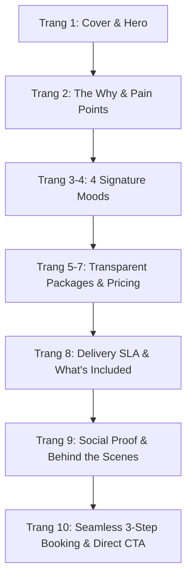

# Báo Cáo Phân Tích Kênh Meta & Chiến Lược Thiết Kế Catalogue Pitching Khách Hàng

- **Mã báo cáo:** `REP-20260917-META-CATALOGUE-STRATEGY`
- **Bộ phận chủ trì:** Data-Analytics / Marketing-Growth / Brand-Strategy
- **Phạm vi:** Instagram `@travelframe.vn`, Facebook Fanpage TravelFrame, Website Packages & Guest Guide Assets
- **Ngày lập:** 2026-09-17
- **Trạng thái:** Draft / Review

---

## 1. Hiện Trạng Kết Nối Kỹ Thuật MCP (Meta Data Connector)

### 1.1. Kết quả kiểm tra MCP `travelframe-meta`
Trong quá trình thực thi, hệ thống đã kích hoạt server MCP `travelframe-meta` và gọi các công cụ trích xuất dữ liệu:
- `get_travelframe_connection`
- `get_facebook_page_info`

**Kết quả từ Meta Graph API:**
```text
Error validating access token: Session has expired on Monday, 14-Sep-26 00:00:00 PDT.
The current time is Wednesday, 16-Sep-26 20:53:11 PDT.
```
- **Nguyên nhân:** Token truy cập người dùng (User Access Token) cấp cho `travelframe-meta-readonly` trong macOS Keychain đã hết hạn phiên làm việc (Session expired vào ngày 14/09/2026).
- **Tuân thủ quy chuẩn bảo mật (`AGENTS.md`, `12-Tools-And-Permissions.md`):**
  - Agent **không** tự ý đọc, trích xuất hoặc ghi đè secrets/keychain credentials.
  - Khi token hết hạn, hệ thống dừng các lệnh write/live read và thông báo yêu cầu cấp lại token mới.

### 1.2. Hướng dẫn Rocky cập nhật Access Token để kích hoạt lại Live MCP
Để khôi phục đồng bộ live tự động từ Meta Graph API:
1. Tạo một User Access Token dài hạn mới từ Meta for Developers / Graph API Explorer với các quyền: `pages_read_engagement`, `pages_show_list`, `instagram_basic`, `instagram_manage_insights`.
2. Cập nhật vào Keychain bằng lệnh terminal:
   ```bash
   security add-generic-password -a "$USER" -s "travelframe-meta-readonly" -w "<NEW_TOKEN>" -U
   ```
3. Sau khi cập nhật, MCP sẽ tự động đọc token mới mà không làm lộ secret vào code hay tài liệu.

### 1.3. Nguồn dữ liệu chuẩn hóa sử dụng cho báo cáo (Data Fallback & Baseline)
Để đảm bảo tiến độ xây dựng catalogue pitching không bị gián đoạn, báo cáo được tổng hợp dựa trên các nguồn dữ liệu chuẩn hóa, có thẩm định cao nhất trong hệ thống:
- **`09-Instagram-Insights-Snapshot-2026-09-07-2147.md`:** Dữ liệu phân tích 30 ngày kênh Instagram `@travelframe.vn`.
- **`TravelFrame-Website-Packages-Pricing-2026-09-15.md`:** Kiểm kê chi tiết các gói tour, visual packages và logic giá trên website.
- **`01-Brand-Source-Of-Truth.md` & `02-Audience-And-Funnel.md`:** Định vị thương hiệu, persona và hành trình chuyển đổi.
- **`03-Product-And-Guest-Experience.md` & `TravelFrame-Hanoi-Guest-Guide.pdf`:** Bộ khung sản phẩm, 4 moods và slide decks pitching mẫu đã xuất bản.

---

## 2. Báo Cáo Phân Tích Dữ Liệu Kênh & Tín Hiệu Khách Hàng

### 2.1. Tổng quan hiệu suất 30 ngày (Instagram `@travelframe.vn`)

| Chỉ số | Giá trị ghi nhận | Đánh giá / Diễn giải |
|---|---:|---|
| **Tổng lượt xem (Views)** | **41.921** | Tăng trưởng đột biến nhờ phân phối Reels |
| **Tài khoản tiếp cận (Accounts Reached)** | **27.370** | Khả năng mở phễu (Discovery) rất mạnh |
| **Tỷ lệ khán giả ngoài kênh (Non-followers)** | **98,7%** | Nội dung gần như tiếp cận hoàn toàn khách mới |
| **Khán giả theo dõi kênh (Followers)** | **1,3%** | Follower base chưa được tận dụng sâu |
| **Lượt tương tác (Interactions)** | **~1.700** | Tương tác tốt trên nhóm nội dung đánh trúng nhu cầu |
| **Lượt xem hồ sơ (Profile Visits)** | **301** | ~1,10% số người tiếp cận vào xem trang cá nhân |
| **Views / Reached Account** | **~1,53** | Tần suất lặp lại ở mức khá nhưng chưa tối ưu giữ chân |

### 2.2. Phân tích Content-Market Fit: Nội dung nào đang chiến thắng?

Dữ liệu phân tích các bài đăng nổi bật cho thấy một xu hướng rõ nét:

```text
Nội dung Hữu ích (Travel Utility) >> Nội dung Cảm hứng đơn thuần (Aesthetic-only)
```

1. **Top Winner về phân phối & lượt share:**
   - `5 Tourist Scams You Need to Avoid in Hanoi`: **14.900 views**, 133 likes, 16 comments, **126 shares**.
   - Khách du lịch quốc tế có xu hướng lưu lại và gửi bài cho bạn đồng hành (Share rate ~0,85%) khi nội dung giúp họ **tránh mất tiền, tránh bẫy du lịch và an tâm hơn**.
2. **Top Winner về chất lượng hữu dụng (Utility Quality):**
   - `Hanoi Train Street 2026 Quick Guide`: **4.400 views**, **80 shares** (Share rate đạt **1,82%** - cao gấp đôi mức trung bình).
   - Nội dung giải quyết bài toán cụ thể: Lối vào, giờ tàu chạy, quán cà phê an toàn, không bị chèo kéo.
3. **Bài học chiến lược cho Catalogue:**
   - Khách hàng không mua tour vì "Hà Nội rất thơ mộng" (họ đã biết điều đó).
   - Khách hàng chi tiền book TravelFrame vì **họ muốn một người bạn địa phương đáng tin cậy giúp chuyến đi an toàn, không bị chặt chém, trải nghiệm trọn vẹn và mang về ảnh đẹp tự nhiên mà không tốn công sức**.

### 2.3. Khoảng trống chuyển đổi lớn nhất (The Funnel Gap / "Brand Bridge")

Báo cáo dữ liệu chỉ ra nút thắt chuyển đổi nghiêm trọng:
> **"Người xem nhớ TravelFrame như một kênh chia sẻ mẹo du lịch Việt Nam, nhưng hoàn toàn không biết TravelFrame cung cấp dịch vụ Photo-Tour chuyên nghiệp."**

- Tỷ lệ từ Reached sang Profile Visit chỉ đạt **1,10%**.
- Thiếu cầu nối tự nhiên từ "xem video mẹo" sang "đặt tour trải nghiệm cùng người bản địa kiêm nhiếp ảnh gia".
- **Catalogue đóng vai trò là cây cầu (Brand Bridge) quyết định:** Khi khách nhắn tin DM hoặc vào bio link tìm hiểu, catalogue phải ngay lập tức chuyển đổi tâm lý từ "người tìm thông tin" sang "khách hàng sẵn sàng đặt lịch".

### 2.4. Chân dung khách hàng mục tiêu cần nhắm tới trong Catalogue

Dựa trên dữ liệu tương tác và tệp khách quốc tế:

1. **Solo Female Traveler (23–40 tuổi) [Ưu tiên số 1]:**
   - *Nỗi đau (Pain points):* Muốn có ảnh đẹp kỷ niệm nhưng ghét tự dựng tripod ở chỗ đông người; ngại nhờ người lạ chụp; lo lắng về an toàn khi đi một mình trong ngõ nhỏ.
   - *Mong muốn:* Một "local friend" vừa am hiểu đường phố, vừa chụp ảnh có tâm, bảo đảm an toàn và mang lại cảm giác thoải mái.
2. **Couples / Honeymooners [Ưu tiên số 2]:**
   - *Nỗi đau:* Thường chỉ có ảnh selfie dính mặt hoặc một người phải chụp cho người kia; ảnh chụp nhanh bằng điện thoại không có chất điện ảnh.
   - *Mong muốn:* Bộ ảnh đôi tự nhiên, bắt trọn khoảnh khắc lãng mạn tại các góc phố cổ, không bị bắt tạo dáng đơ cứng.
3. **Content Creators / Digital Nomads [Ưu tiên số 3]:**
   - *Nỗi đau:* Thiếu footage chất lượng cao góc dọc (9:16) để làm Reels/TikTok; cần người dẫn đến các góc quay độc lạ ít du khách biết.
   - *Mong muốn:* Video ngắn sẵn sàng đăng tải và các góc máy mang tính phóng sự địa phương.
4. **Gia đình nhỏ & Nhóm bạn (2–4 người):**
   - *Nỗi đau:* Khó có ảnh đầy đủ mọi thành viên; tour truyền thống thì quá vội vã và đưa vào các điểm mua sắm không mong muốn.
   - *Mong muốn:* Trải nghiệm riêng tư (private), nhịp đi thư thái, phù hợp mọi lứa tuổi.

---

## 3. Chiến Lược Thiết Kế Catalogue Pitching Chuyên Nghiệp

### 3.1. Định vị & Nguyên tắc thiết kế (Creative & Strategic Guidelines)

- **Định vị cốt lõi:** *"Explore Hanoi with a local friend, preserve memories in cinematic frames"* (Khám phá Hà Nội cùng người bạn bản địa, lưu giữ kỷ niệm bằng những khung hình điện ảnh).
- **Định dạng tối ưu:**
  - **Mobile-first PDF & Interactive Web Viewer (Canva/Figma):** Tỷ lệ chuẩn A4 Dọc hoặc tỷ lệ màn hình 16:9 dọc (1080x1920) / iPad (4:3) để khách mở mượt mà ngay trên Instagram DM hoặc WhatsApp.
  - **Dung lượng:** 10 – 12 trang (ngắn gọn, trực diện, không lan man).
- **Hệ thống Visual Identity:**
  - **Màu sắc chủ đạo:** Deep Teal (`#008AA3`) làm điểm nhấn sang trọng, Charcoal (`#222222`) cho văn bản, Nền Off-white / kem sáng nhạt mang lại sự ấm áp, tinh tế.
  - **Bố cục:** Phong cách Editorial Magazine, hình ảnh lớn tràn viền hoặc bố cục bất đối xứng hiện đại; bo góc nhẹ (tối đa 8px), tuyệt đối không dùng gradient rẻ tiền hay hình khối trang trí thừa.
  - **Chất lượng hình ảnh:** Ảnh màu tự nhiên, ánh sáng thực tế (golden hour, ánh đèn phố cổ, quán cà phê), bắt trọn cảm xúc candid của khách du lịch.

---

### 3.2. Cấu Trúc Khung 10 Trang Chi Tiết Cho Catalogue Pitching



#### Trang 1: Trang Bìa (Cover & Value Hook)
- **Hình ảnh:** Một bức ảnh candid đắt giá (khách đang cười tự nhiên tại một góc ban công cổ hoặc con phố rợp bóng cây Hà Nội).
- **Tiêu đề lớn:** `TRAVELFRAME HANOI`
- **Phụ đề:** `Private Photo Tours & Guided Local Experiences`
- **Thông điệp ngắn:** *"Not just a tour. Not just a photoshoot. Your personal visual story of Hanoi."*
- **Footer:** Website `travelframe.vn` | Instagram `@travelframe.vn` | WhatsApp Contact.

#### Trang 2: Vấn Đề Của Khách & Sự Khác Biệt (Why TravelFrame?)
- **Bảng đối chiếu trực quan (Comparison Table):**
  - *Standard Group Tour:* Điểm đến đông đúc, lịch trình cố định, không có ai chụp ảnh đẹp cho bạn, cảm giác công nghiệp.
  - *Awkward Photoshoot:* Phải tạo dáng gượng ép, nhiếp ảnh gia ít tương tác, không hiểu văn hóa địa phương.
  - *The TravelFrame Way:* Một người bạn bản địa dẫn đường, kể những câu chuyện ẩn giấu, chỉ dẫn góc chụp tinh tế, ghi lại khoảnh khắc tự nhiên như một cuốn phim du ký.

#### Trang 3 & 4: 4 Phong Cách Trải Nghiệm & Hình Ảnh (The 4 Signature Moods)
Khách được tự do lựa chọn mood phù hợp với cá tính của mình:
1. **Heritage Hanoi (Dấu Ấn Cổ Kính):**
   - *Không gian:* Hoàng thành Thăng Long, Văn Miếu, những bức tường rêu phong, chùa Trấn Quốc.
   - *Tone hình:* Trầm ấm, hoài niệm, tôn vinh kiến trúc và chiều sâu văn hóa.
2. **Everyday Hanoi (Nhịp Sống Đời Thường):**
   - *Không gian:* Quán cà phê trứng ngõ nhỏ, chợ truyền thống Đồng Xuân, góc phố ẩm thực, Train Street an toàn.
   - *Tone hình:* Tươi vui, sống động, phóng sự đời thường giàu năng lượng.
3. **Hanoi in Style (Thanh Lịch & Sang Trọng):**
   - *Không gian:* Khu phố Pháp (French Quarter), Nhà Hát Lớn, Khách sạn Metropole, đại lộ rợp bóng cây Phan Đình Phùng.
   - *Tone hình:* Tinh tế, bố cục sạch sẽ, đậm chất thời trang editorial.
4. **Hanoi After Dark (Hà Nội Về Đêm):**
   - *Không gian:* Cầu Long Biên lúc hoàng hôn, phố Tạ Hiện, chợ đêm, ánh đèn neon phản chiếu trên mặt hồ.
   - *Tone hình:* Điện ảnh (cinematic), độ tương phản cao, huyền ảo.

#### Trang 5, 6 & 7: Các Gói Dịch Vụ & Giá Minh Bạch (All-Inclusive Package Ladder)
*Giải quyết triệt để lỗi gây bối rối trên website (tách riêng tour base và visual rate khiến khách khó hiểu). Catalogue pitching sử dụng **Mô hình A (Trọn gói đã bao gồm Visual & Host)**:*

| Gói Trải Nghiệm | Thời lượng & Quy mô | Deliverables (Sản phẩm bàn giao) | Trải nghiệm & Inclusions | Giá tham khảo (All-Inclusive) |
|---|---|---|---|---:|
| **1. The Quick Photo Walk** | 2 - 2.5 Giờ<br>(1 - 2 Khách) | • **15+ ảnh** chỉnh màu cao cấp<br>• Toàn bộ ảnh gốc chất lượng cao<br>• Bàn giao trong **24 - 48h** | • Khám phá 1 khu vực trọng tâm (Phố Cổ hoặc Phố Pháp)<br>• Hướng dẫn tạo dáng tự nhiên<br>• 1 ly cà phê đặc sản Hà Nội | **From $75 USD**<br>(~1.950.000 VND) |
| **2. The Signature Story Tour**<br>*(Most Popular)* | 4 - 4.5 Giờ<br>(1 - 3 Khách) | • **35+ ảnh** retouch nghệ thuật<br>• **1 video Reel/TikTok (30-45s)** dựng sẵn nhạc bản quyền<br>• Bàn giao trong **48h** | • Kết hợp 2 Moods tùy chọn<br>• Local street food / Egg coffee break<br>• Vé vào các điểm di tích trong tuyến<br>• Di chuyển xe riêng giữa các điểm xa | **From $160 USD**<br>(~4.150.000 VND) |
| **3. The Full-Day Cultural Odyssey** | 8 - 9 Giờ<br>(Nhóm 2 - 6 Khách) | • **60+ ảnh** hoàn thiện tạp chí<br>• **1 phim ngắn cinematic (60-90s)**<br>• Toàn bộ raw clips hậu trường | • Tuyến nội thành mở rộng hoặc Làng nghề (Bát Tràng / Làng Hương)<br>• Xe hơi riêng đời mới trọn ngày<br>• Bữa trưa ẩm thực truyền thống<br>• Vé tham quan & trải nghiệm làm gốm/nghề | **From $290 USD**<br>(~7.500.000 VND) |

> *Ghi chú:* Giá trên đã bao gồm nhiếp ảnh gia chuyên nghiệp kiêm người đồng hành bản địa tiếng Anh lưu loát, không phát sinh chi phí ẩn.

#### Trang 8: Cam Kết Bàn Giao & Tiêu Chuẩn Kỹ Thuật (SLA & Gear)
- **Thiết bị tác nghiệp:** Máy ảnh Full-frame chuyên nghiệp (Sony/Canon dòng cao cấp) kết hợp ống kính chân dung tiêu cự vàng; mic thu âm không dây cho video.
- **Quy trình bàn giao siêu tốc:**
  - *Trong 24 giờ:* Gửi link "Sneak Peek" (3-5 tấm ảnh đẹp nhất) để khách đăng ngay Story/Instagram trong chuyến đi.
  - *Trong 48-72 giờ:* Hoàn thiện toàn bộ album qua Private Cloud Gallery (Pixieset/Google Drive bảo mật cao, tải ảnh gốc Full HD và dung lượng web tối ưu).
- **Chính sách riêng tư:** Tôn trọng tuyệt đối quyền hình ảnh cá nhân; TravelFrame chỉ chia sẻ ảnh lên portfolio khi nhận được sự đồng thuận của khách.

#### Trang 9: Trải Nghiệm Khách Hàng Thật & Social Proof
- Trích dẫn 3-4 phản hồi chân thực từ các nhóm khách điển hình:
  - *Solo traveler:* "I was nervous about taking photos alone, but Mike made me feel like an old friend walking around Hanoi. The photos look like stills from a movie!"
  - *Couple traveler:* "No awkward posing. Just genuine laughter and beautiful Hanoi alleys."
- Hình ảnh hậu trường (Behind the scenes): Nụ cười của host và khách, màn hình máy ảnh chụp khoảnh khắc thật.

#### Trang 10: Quy Trình Đặt Tour 3 Bước Đơn Giản & Kêu Gọi Hành Động (Call To Action)
- **Quy trình tinh gọn:**
  1. **Step 1 - Share your vibe:** Chọn ngày, số lượng người và phong cách (Mood) bạn yêu thích.
  2. **Step 2 - Tailor your route:** Trò chuyện trực tiếp cùng TravelFrame để tinh chỉnh điểm đến và thời gian đón phù hợp với khách sạn của bạn.
  3. **Step 3 - Meet & Explore:** Gặp gỡ local host và tận hưởng chuyến đi không âu lo.
- **Kênh liên hệ trực tiếp (Direct Booking Channels):**
  - Instagram Direct Message: `@travelframe.vn`
  - WhatsApp Booking Hotline: `+84 (0) ...` (kèm mã QR quét trực tiếp)
  - Website: `https://travelframe.sidevn.com`
- **Chính sách an tâm:** Miễn phí hủy tour trước 48 giờ; dời lịch linh hoạt nếu thời tiết mưa lớn.

---

## 4. Kế Hoạch Triển Khai Tiếp Theo (Action Plan)

| Hạng mục | Bộ phận chịu trách nhiệm | Thời hạn | Hành động cụ thể |
|---|---|---|---|
| **1. Token Renewal** | Rocky / Technology-Automation | Ngay khi có thể | Cấp mới Meta Long-Lived Token vào Keychain để mở lại luồng sync tự động qua MCP. |
| **2. Layout & Graphic Design** | Creative-Production | 2 ngày | Thiết kế dàn trang catalogue theo cấu trúc 10 trang trên Figma/Canva bằng hệ thống assets đã chuẩn hóa trong `Creative-Production/Assets`. |
| **3. Pitching Deck Export** | Creative-Production | 1 ngày | Xuất bản 2 định dạng: PDF Mobile (gửi qua WhatsApp/Email) và Web Interactive Flipbook (nhúng vào Link Bio). |
| **4. Inbound Sales Script** | Sales-CRM | 1 ngày | Cập nhật kịch bản phản hồi DM tự động trên Instagram/ManyChat: Tự động gửi Catalogue PDF khi khách hỏi giá hoặc lịch trình. |

---
*Báo cáo được lưu trữ chính thức tại artifacts và workspace theo Company OS Protocol.*
