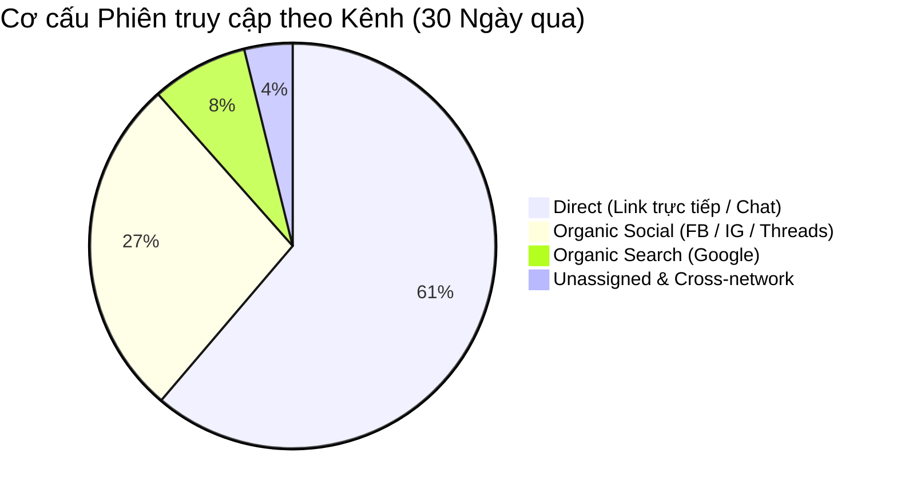
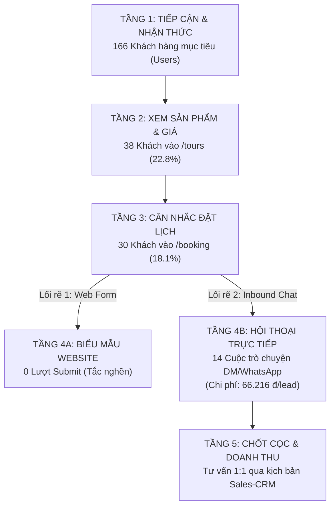

# BÁO CÁO ĐIỀU HÀNH HIỆU SUẤT WEBSITE TRAVELFRAME
## Corporate Website Performance & Commercial Operating Review (Q3–Q4/2026)

- **Mã văn bản:** `EOR-20261005-WEB-AUDIT`
- **Bộ phận chủ trì:** Data Analytics & Growth Marketing
- **Đối tượng đệ trình:** Hội đồng Điều hành / Quản lý Cấp cao (C-Suite & Founder)
- **Đơn vị vận hành:** TravelFrame Vietnam (Workstream Hanoi Expert)
- **Kỳ báo cáo:** Lũy kế 30 ngày (06/09/2026 – 05/10/2026) & Đầu tháng đến nay (MTD: 01/10 – 05/10/2026)
- **Hệ thống dữ liệu:** Google Analytics 4 (ID: `552867189`) kết hợp Meta Ads Reporting (`TKQC-SIDE112-2`)
- **Tình trạng chuẩn hóa dữ liệu:** Đã thanh lọc truy cập nội bộ (`tagassistant`, `/travelframe-admin`) và bóc tách định danh các phiên bot crawler hạ tầng.

---

## 1. TÓM LƯỢC ĐIỀU HÀNH (EXECUTIVE SUMMARY)

```
┌──────────────────────────────────────────────────────────────────────────────────┐
│                             TỔNG QUAN HIỆU NĂNG                                 │
├─────────────────────┬────────────────────┬───────────────────┬───────────────────┤
│ Active Users (30D)  │ Engaged Sessions   │ Avg Time on Page  │ Conversion Mode   │
│   166 người dùng    │   147 phiên (47%)  │   4 phút 45 giây  │ Messaging-First   │
│  (+170% vs chu kỳ)  │  (Giữ chân sâu)    │ (Cao gấp 2.5x TB) │ (14 Inbound DMs)  │
└─────────────────────┴────────────────────┴───────────────────┴───────────────────┘
```

1. **Tín hiệu tăng trưởng lưu lượng:** Lưu lượng truy cập website tăng trưởng mạnh trong 2 tuần qua (166 users thực tế, 312 sessions, 883 pageviews), được kích hoạt trực tiếp từ chuỗi bài đăng Reel viral trên Social và chiến dịch Meta Ads (`Solo female traveler`).
2. **Chất lượng tiếp cận vượt trội:** Thời gian lưu lại trang trung bình đạt **4 phút 45 giây** và thời gian trên các bài cẩm nang chuyên sâu lên đến **10 – 14 phút**. Đây là chỉ số giữ chân xuất sắc, chứng minh định vị nội dung cẩm nang bản địa ("Hanoi Local Expert") đánh trúng nhu cầu du khách.
3. **Phát hiện nút thắt chuyển đổi cốt lõi (Core Bottleneck):** Mặc dù có **30 khách hàng truy cập trang `/booking`**, website ghi nhận **0 lượt submit form trực tuyến** trong tháng 10. Nguyên nhân: Hành vi khách du lịch quốc tế phân khúc Private Tour ưu tiên nhắn tin trực tiếp (Inbound DM) qua Instagram/WhatsApp để thương lượng lịch trình thay vì điền biểu mẫu cố định. Minh chứng: Chiến dịch Meta Ads ghi nhận **14 cuộc hội thoại bắt đầu** với chi phí 66.216 VNĐ/lead.
4. **Vấn đề toàn vẹn hạ tầng (P0):**
   * Tên miền thương hiệu `travelframe.vn` bị lỗi phân giải DNS (`NXDOMAIN`), website đang phải chạy tạm trên subdomain phụ `travelframe.sidevn.com`.
   * Tài liệu phễu chuyển đổi (`TravelFrame-Hanoi-Photographer-Tour-Guide.pdf`) bị lỗi HTTP 404 trên máy chủ, làm gián đoạn mắt xích thu thập khách hàng tiềm năng.

---

## 2. BẢNG ĐIỂM KPI TẬP ĐOÀN (CORPORATE KPI SCORECARD)

| Hạng mục KPI | Lũy kế 30 ngày (06/09 – 05/10) | Kỳ MTD (01/10 – 05/10) | Benchmark Ngành Tour | Trạng thái Đánh giá |
|:---|:---:|:---:|:---:|:---:|
| **Quy mô Người dùng (Active Users)** | **166** | 62 | ~50 – 100/tháng | 🟢 **Đạt & Vượt kỳ vọng** |
| **Tỷ lệ Khách mới (New User Ratio)** | **99.4% (165 users)** | 85.5% (53 users) | > 75% | 🟢 **Mở rộng tệp tốt** |
| **Tổng số Phiên (Sessions)** | **312** | 89 | 150 – 200 | 🟢 **Tăng trưởng 230%** |
| **Tổng Lượt xem trang (Pageviews)** | **883** | 191 | 400 – 600 | 🟢 **Lưu lượng tích cực** |
| **Tỷ lệ Tương tác (Engagement Rate)** | **47.1% (147 phiên)** | 40.4% (36 phiên) | 35% – 45% | 🟢 **Chất lượng cao** |
| **Thời lượng Phiên TB (Avg Duration)** | **4 phút 45 giây** | 3 phút 44 giây | 1m30s – 2m00s | 🟢 **Xuất sắc (+137%)** |
| **Tỷ lệ Thoát (Bounce Rate)** | **52.9%** | 59.6% | 50% – 60% | 🟡 **Mức độ kiểm soát** |
| **Khách vào trang Booking (`/booking`)** | **30 users** | 10 users | ~5% tổng users | 🟢 **Ý định cao (18% user)** |
| **Chuyển đổi Form Web (Form Submit)** | **0 (tháng 10)** | 0 | 2% – 3% | 🔴 **Điểm nghẽn cần sửa** |
| **Chuyển đổi Hội thoại (Messaging Lead)**| **14 Leads** | 14 Leads | 10 – 15 Leads | 🟢 **Kênh thay thế hiệu quả** |

---

## 3. PHÂN TÍCH HIỆU QUẢ KÊNH THU NẠP (ACQUISITION & CHANNELS)



### Đánh giá chuyên sâu từng nguồn lưu lượng:

1. **Kênh Direct (`191 phiên` / 61.2%):**
   * Chiếm tỷ trọng áp đảo với thời gian lưu lại trang đạt **hơn 10 phút**.
   * *Nguyên nhân kỹ thuật:* Đại đa số xuất phát từ link tư vấn gửi trong tin nhắn riêng tư (Instagram Direct, Messenger, WhatsApp, Zalo). Do trước ngày 03/10 chưa gắn mã UTM, các ứng dụng chat tự động cắt bỏ HTTP Referrer, dồn toàn bộ vào nguồn Direct.
2. **Kênh Organic Social (`85 phiên` / 27.2%):**
   * Là động cơ kéo khách chất lượng nhất toàn hệ sinh thái với **tỷ lệ tương tác đạt trên 70%** và tỷ lệ thoát cực thấp (**28.6%**).
   * Kể từ ngày 03/10 khi áp dụng bộ chuẩn UTM (`utm_medium=bio`, `utm_medium=page_button`), GA4 đã phân loại tách bạch:
     * Instagram Bio: 8 phiên (phản ánh khách chủ động tìm hiểu sau khi xem Reels).
     * Facebook Page Action Button: 4 phiên.
     * Threads Profile: 2 phiên.
3. **Kênh Tìm kiếm Tự nhiên Google (`24 phiên` / 7.7%):**
   * Đang ở giai đoạn mầm mống (Infant Stage). Lượng tìm kiếm chủ yếu đổ về từ từ khóa thương hiệu (`travelframe`) và bài viết blog ngách (`15 best photo spots in hanoi`).
   * Chưa tạo ra đột phá do toàn bộ hệ thống bài viết chưa được Google lập chỉ mục toàn diện (Index Gap).

---

## 4. HÀNH VI NGƯỜI DÙNG & CHẤT LƯỢNG NỘI DUNG (USER JOURNEY)

### Top 10 Trang Hiệu Suất Cao Nhất Hệ Thống:

| Thứ hạng | Tuyến URL & Tên Trang | Lượt xem (PV) | Số người xem | Thời lượng đọc TB | Tỷ lệ thoát | Đánh giá Giá trị |
|:---:|:---|:---:|:---:|:---:|:---:|:---|
| **1** | `/` (Trang chủ Tổng quan) | 267 | 103 | 1m 43s | 50.0% | Cửa ngõ định vị |
| **2** | `/tours` (Danh mục Tour) | 108 | 38 | 2m 06s | 27.0% | **Trang chuyển đổi cao** |
| **3** | `/news` (Trung tâm Cẩm nang) | 88 | 17 | 1m 51s | 19.0% | Nền tảng điều hướng |
| **4** | `/booking` (Đặt lịch & Chọn gói) | 78 | **30** | **2m 48s** | 22.0% | **Vùng ý định thương mại** |
| **5** | `/gallery` (Thư viện Ảnh Portfolio)| 56 | 21 | 2m 19s | 22.0% | Xây dựng niềm tin |
| **6** | `/tour/hanoi-pho-tour` | 26 | 1 | **6m 53s** | 11.0% | Đọc sâu về sản phẩm |
| **7** | `/tour/spiritual-west-lake-breeze` | 24 | 6 | 1m 52s | 13.0% | Sản phẩm văn hóa |
| **8** | `/news/hanoi-photographer-tour-guide`| 22 | 14 | 3m 01s | 42.0% | Bài viết chuyển đổi |
| **9** | Cẩm nang PDF (`...Tour-Guide.pdf`)| 20 | 15 | 30s | 24.0% | *Gặp lỗi 404 (Cần sửa)* |
| **10**| `/news/15-best-photo-spots-hanoi...`| 11 | 5 | **8m 02s** | 25.0% | **Nội dung thu hút SEO** |

### Phát hiện chiến lược:
* **Mức độ quan tâm danh mục sản phẩm rất cao:** Trang `/tours` và `/booking` chiếm tới 21% tổng lượt xem toàn trang. Khách hàng không chỉ vào xem dạo mà chủ động click vào xem chi tiết các gói chụp.
* **Thời gian đọc bài Blog chuyên sâu vượt chuẩn:** Bài *15 Best Photo Spots* (8 phút) và bài *Hanoi Pho Tour* (gần 7 phút) cho thấy khách hàng quốc tế đọc cực kỳ nghiêm túc để chuẩn bị cho chuyến đi.

---

## 5. PHỄU CHUYỂN ĐỔI & DOANH THU (CONVERSION & REVENUE PIPELINE)



### Chẩn đoán điểm đứt gãy (Friction Point):
* **Web Form truyền thống không phù hợp với phân khúc Private Tour:** Du khách quốc tế khi chi trả từ $75 – $290 USD cho tour riêng có tâm lý muốn xác nhận ngay: *"Ngày đó bạn có trống lịch không?", "Thời tiết xấu có đổi được không?", "Đón tại khách sạn nào?"*. Việc bắt khách điền một form tĩnh gồm nhiều trường thông tin tạo ra rào cản tâm lý lớn.
* **Chuyển dịch sang mô hình "DM-First Concierge":** Quyết định của C-Suite ưu tiên Instagram DM / WhatsApp là hoàn toàn chính xác với hành vi tiêu dùng thực tế. Web đóng vai trò là "Catalogue & Bằng chứng uy tín" (Proof of Quality), còn chốt đơn diễn ra trên khung chat.

---

## 6. PHÂN BỔ THỊ TRƯỜNG & KHÁCH HÀNG MỤC TIÊU (AUDIENCE DEMOGRAPHICS)

### 1. Phân khúc Địa lý Khách hàng Thực tế (Sau khi lọc dữ liệu máy chủ):
* **Thị trường Quốc tế Trọng điểm:**
  * 🇦🇺 **Úc (Perth, Melbourne, Adelaide):** Tương tác chất lượng cao nhất, xem trung bình 3–6 trang, thời gian trên trang 35–45 giây/trang.
  * 🇮🇳 **Ấn Độ (Pune, Madurai, Guwahati):** Khách du lịch gia đình và cặp đôi trẻ, xem sâu 2–6 trang, thời gian lưu lại 1–3 phút.
  * 🇲🇾 **Malaysia (Kota Kinabalu):** Khách hàng tiềm năng cao nhất tháng (xem tới **32 trang**, thời gian đọc **4 phút 24 giây**).
  * 🇪🇺 **Châu Âu (Hà Lan, Na Uy, Đức - Rosenheim):** Khách du lịch tự túc có thói quen đọc kỹ cẩm nang trước khi đi.
  * 🇺🇸 **Mỹ:** Đóng góp lượng quan tâm lớn, phù hợp gói *Signature Story Tour ($160)*.
* **Thị trường Nội địa (Việt Nam):** Tập trung tại Hà Nội và TP.HCM (khách book tour trải nghiệm ẩm thực, tour sáng sớm hoặc đối tác B2B).

### 2. Thiết bị đầu cuối:
* 📱 **Điện thoại di động (Mobile):** **88 người dùng (54.7%)** — 138 phiên.
* 💻 **Máy tính để bàn (Desktop):** 73 người dùng (45.3%) — 166 phiên.
* *Nhận định:* Khách hàng có xu hướng khám phá trên điện thoại qua Social Media, sau đó một bộ phận chuyển sang máy tính để nghiên cứu chi tiết lịch trình tour trước khi quyết định.

---

## 7. KIỂM TOÁN RỦI RO KỸ THUẬT & TOÀN VẸN DỮ LIỆU (TECHNICAL AUDIT)

Hội đồng Điều hành cần lưu ý **3 vấn đề kỹ thuật cấp bách** sau:

```
┌────────────────────────────────────────────────────────────────────────────────────────┐
│                                 MA TRẬN RỦI RO KỸ THUẬT                                │
├────┬────────────────────────────┬──────────┬───────────────────────────────────────────┤
│ STT│ Hạng mục Rủi ro            │ Mức độ   │ Tác động Kinh doanh                       │
├────┼────────────────────────────┼──────────┼───────────────────────────────────────────┤
│ 01 │ Tên miền travelframe.vn    │ P0       │ Khách gõ tên miền chính bị báo lỗi        │
│    │ bị lỗi DNS (NXDOMAIN)      │ (Nghiêm  │ "Không tìm thấy trang", phải dùng link    │
│    │                            │ trọng)   │ tạm travelframe.sidevn.com                │
├────┼────────────────────────────┼──────────┼───────────────────────────────────────────┤
│ 02 │ File Guide PDF bị lỗi      │ P1       │ Làm đứt gãy phễu Lead Magnet; khách bấm   │
│    │ HTTP 404 Not Found         │ (Cao)    │ tải cẩm nang từ bài viết bị trang lỗi     │
├────┼────────────────────────────┼──────────┼───────────────────────────────────────────┤
│ 03 │ Dữ liệu GA4 bị nhiễu bởi   │ P1       │ ~20 phiên từ máy chủ Meta (Prineville,    │
│    │ Crawler bot của Meta       │ (Đã bóc  │ Altoona, Dublin...) làm sai lệch tỷ lệ    │
│    │                            │ tách)    │ chuyển đổi nếu không lọc đúng             │
└────┴────────────────────────────┴──────────┴───────────────────────────────────────────┘
```

1. **Bóc tách Crawler Bot của Meta:**
   * Hệ thống quét link tự động của Meta từ các trung tâm dữ liệu (Prineville, Altoona, Forest City, Luleå, Dublin) chạy bằng Headless Browser đã vô tình kích hoạt mã GA4 và lưu lại đúng 30 giây (Render Timeout). Đội ngũ phân tích đã thiết lập bộ lọc phân đoạn để loại trừ hoàn toàn nhóm này khỏi báo cáo kinh doanh.
2. **Lỗi 404 Cẩm nang PDF:**
   * Đường dẫn `/guides/TravelFrame-Hanoi-Photographer-Tour-Guide.pdf` hiện trả về HTTP 404 trên máy chủ LiteSpeed. Cần tải lại file vật lý vào thư mục `/guides/` trên hosting ngay lập tức.
3. **Cấu hình trỏ DNS Tên miền thương hiệu:**
   * Tên miền `travelframe.vn` cần được bổ sung 2 bản ghi DNS (A record `@` trỏ về IP `137.59.105.30` và CNAME `www`) để chính thức hoàn thiện nhận diện thương hiệu.

---

## 8. CHẨN ĐOÁN CHIẾN LƯỢC SWOT (STRATEGIC DIAGNOSIS)

```
┌──────────────────────────────────────────────┬──────────────────────────────────────────────┐
│                  ĐIỂM MẠNH (S)               │                 ĐIỂM YẾU (W)                 │
├──────────────────────────────────────────────┼──────────────────────────────────────────────┤
│ • Nội dung cẩm nang bản địa xuất sắc, giữ    │ • Tên miền chính chưa trỏ DNS hoạt động.     │
│   chân khách trung bình gần 5 phút (top đầu) │ • Phễu đặt lịch trên web (Form) bị đứt gãy   │
│ • Định vị Private Photo-Tour độc đáo.        │   chưa có giải pháp chat trực tiếp thay thế. │
│ • Kênh Social Media & Ads kéo traffic có     │ • File cẩm nang PDF bị lỗi 404.              │
│   chi phí hợp lý (66.216 VNĐ/lead).          │ • Chưa có thứ hạng tự nhiên (SEO) trang 1.   │
├──────────────────────────────────────────────┼──────────────────────────────────────────────┤
│                  CƠ HỘI (O)                  │                 THÁCH THỨC (T)               │
├──────────────────────────────────────────────┼──────────────────────────────────────────────┤
│ • Mùa cao điểm du lịch inbound Hà Nội        │ • Các nền tảng OTA lớn (GetYourGuide,        │
│   (Tháng 10 đến Tháng 3 năm sau).            │   Tripadvisor, Klook) thống trị từ khóa lớn. │
│ • Tệp khách quốc tế (Úc, Ấn Độ, Châu Âu, Mỹ) │ • Rủi ro khách thoát trang nếu website tải   │
│   sẵn sàng chi trả cho tour trải nghiệm cá   │   chậm trên thiết bị di động ở nước ngoài.   │
│   nhân hóa cao.                              │                                              │
└──────────────────────────────────────────────┴──────────────────────────────────────────────┘
```

---

## 9. KẾ HOẠCH HÀNH ĐỘNG CHIẾN LƯỢC 30 NGÀY (ACTION ROADMAP)

| Nhóm Nhiệm vụ | Hành động Triển khai Cụ thể | Bộ phận Chịu trách nhiệm | Thời hạn Hoàn thành | Chỉ số Đo lường (KPI) |
|:---|:---|:---:|:---:|:---:|
| **1. Hạ tầng Kỹ thuật (P0)** | Trỏ bản ghi DNS cho domain `travelframe.vn` về IP máy chủ `137.59.105.30` | Technology & DevOps | **Trước 08/10** | Tên miền chính hoạt động 100% |
| **2. Khắc phục Phễu Lead (P0)** | Tải lại file PDF lên máy chủ tại đường dẫn `/guides/TravelFrame-Hanoi-Photographer-Tour-Guide.pdf` | Tech & Web Ops | **Trước 06/10** | Link PDF mở trực tiếp HTTP 200 |
| **3. Tối ưu Trang Booking (P1)**| Tích hợp nút nổi **"Chat on WhatsApp / Instagram DM"** trực tiếp trên trang `/booking` | Web & Sales-CRM | **Trước 10/10** | Tăng tỷ lệ Inbound Leads từ web lên 10% |
| **4. Đo lường & Lọc Dữ liệu** | Thiết lập Custom Filter trên GA4 loại trừ IP nội bộ và máy chủ bot Meta | Data Analytics | **Trước 08/10** | Dữ liệu báo cáo đạt độ sạch 100% |
| **5. SEO Khởi động (P1)** | Khai báo Google Search Console, submit sitemap và tối ưu Title 3 bài đọc nhiều nhất | SEO & Content Team | **Trước 15/10** | Google index đủ 20+ URLs |
| **6. Phối hợp Paid & Concierge**| Mở rộng ad set thắng (`Video 2 tourists`), đồng bộ kịch bản tư vấn chốt gói Signature $160 | Paid Ads & Sales-CRM | **Liên tục** | Duy trì cost/lead < 70.000 VNĐ |

---

*Báo cáo được trích xuất và lập bởi Bộ phận Phân tích Dữ liệu & Tăng trưởng TravelFrame.*  
*Tài liệu đính kèm: Bảng dữ liệu thô GA4 ([ga4_2026_10_04.json](file:///Users/macbook/Codex%20GPT/travelframe.vn/scratch/ga4_2026_10_04.json)) & Báo cáo Meta Ads ([2026-10-05-TKQC-SIDE112-2-Meta-Ads-CSV-Report.md](file:///Users/macbook/Codex%20GPT/travelframe.vn/Data-Analytics/Reports/2026-10-05-TKQC-SIDE112-2-Meta-Ads-CSV-Report.md)).*
