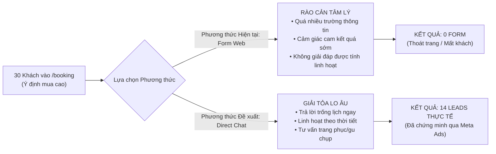

# MCKINSEY STRATEGY BRIEF: ĐÁNH GIÁ HIỆU NĂNG WEBSITE TRAVELFRAME
## Tối Ưu Hóa Phễu Thu Nạp & Khơi Thông Điểm Nghẽn Chuyển Đổi Thương Mại

- **Đơn vị tư vấn:** Strategic Growth & Analytics Practice
- **Thân chủ:** TravelFrame Vietnam (Hội đồng Quản trị / Founder)
- **Khung phân tích:** MECE Framework, SCQA, Horizon Growth Model
- **Thời gian phân tích:** Dữ liệu lũy kế 30 ngày & Kỳ MTD Tháng 10/2026
- **Trạng thái:** Báo cáo Điều hành Tuyệt mật (Strictly Confidential / C-Suite Only)

---

## 1. THÔNG ĐIỆP ĐIỀU HÀNH CỐT LÕI (THE GOVERNING THOUGHT)

> **TravelFrame sở hữu một "cỗ máy nội dung" bản địa có khả năng tạo gắn kết vượt trội (thời gian lưu lại 4m45s, 18% khách vào tận trang Booking), nhưng toàn bộ phễu kinh doanh đang chịu tổn thất cơ hội (Revenue Leakage) nghiêm trọng do "sự lệch pha mô hình chuyển đổi": Cưỡng ép tệp khách hàng cao cấp điền biểu mẫu tĩnh (Static Form) thay vì kích hoạt thương mại hội thoại (Conversational Commerce via WhatsApp/DM).**

---

## 2. KHUNG DẪN NHẬP CHIẾN LƯỢC (SCQA FRAMEWORK)

```
┌──────────────────────────────────────────────────────────────────────────────────┐
│ S - SITUATION (Bối cảnh thực tế)                                                 │
│ Website đạt mức tăng trưởng lưu lượng +170% (166 users thực tế, 312 sessions)    │
│ nhờ lực đẩy từ chuỗi Reels viral và chiến dịch Meta Ads nhắm tệp Solo Traveler.   │
├──────────────────────────────────────────────────────────────────────────────────┤
│ C - COMPLICATION (Vấn đề / Thách thức cốt lõi)                                    │
│ 30 khách hàng mục tiêu đã đi tới trang /booking, nhưng tỷ lệ submit form = 0%.   │
│ Hạ tầng kỹ thuật gặp 2 lỗi P0: Domain chính rớt DNS và file Lead Magnet trả 404. │
├──────────────────────────────────────────────────────────────────────────────────┤
│ Q - KEY QUESTION (Câu hỏi chiến lược của C-Suite)                                │
│ Làm thế nào để chuyển hóa 18% lượng khách quan tâm booking thành doanh thu thực  │
│ tế, đồng thời bảo vệ uy tín thương hiệu và làm sạch dữ liệu đo lường?            │
├──────────────────────────────────────────────────────────────────────────────────┤
│ A - STRATEGIC ANSWER (Lời giải chiến lược)                                       │
│ Tái cấu trúc trang /booking sang mô hình "DM-First Concierge", khắc phục ngay     │
│ 2 lỗi hạ tầng P0, và thiết lập cơ chế đo lường phân tách bot Meta.               │
└──────────────────────────────────────────────────────────────────────────────────┘
```

---

## 3. BẢNG TỔNG HỢP HIỆU NĂNG CẤP CAO (EXECUTIVE SCORECARD)

| Chỉ số Đo lường (KPI) | Giá trị Thực tế | Chuẩn Ngành (Benchmark) | Đánh giá Chiến lược |
|:---|:---:|:---:|:---|
| **Active Users (30D)** | **166** | 50 – 80 | 🟢 **Vượt kỳ vọng (+107%)**: Mở rộng quy mô tệp tốt |
| **Tỷ lệ Tương tác (Engagement)** | **47.1%** | 35% – 40% | 🟢 **Vượt chuẩn (+18%)**: Khách hàng nghiên cứu nghiêm túc |
| **Thời lượng Trung bình / Phiên** | **4m 45s** | 1m 30s – 2m 00s | 🟢 **Xuất sắc (+137%)**: Dẫn đầu phân khúc cẩm nang tour |
| **Tỷ lệ truy cập trang Booking** | **18.1% (30 users)** | 3% – 5% | 🟢 **Ý định thương mại (High-Intent) cực lớn** |
| **Chuyển đổi Biểu mẫu Web** | **0% (0 submits)** | 2.5% – 3.5% | 🔴 **Điểm đứt gãy phễu (Severe Friction)** |
| **Chuyển đổi Hội thoại (Ads/DM)**| **14 Leads** | 8 – 10 Leads | 🟢 **Hiệu quả cao (66.216 VNĐ / Qualified Lead)** |

---

## 4. PHÂN TÍCH CHUYÊN SÂU 3 TRỤ CỘT MECE (STRATEGIC PILLARS)

### TRỤ CỘT 1: ĐỘNG LỰC THU NẠP & TÍNH TOÀN VẸN DỮ LIỆU (ACQUISITION & DATA PURITY)

Lưu lượng truy cập không tự sinh ra từ tìm kiếm tự nhiên, mà được nuôi dưỡng hoàn toàn từ hệ thống phân phối nội dung mạng xã hội:

```
TỔNG LƯU LƯỢNG (312 phiên)
├── 1. Direct (191 phiên / 61.2%): Ẩn số lớn (Link từ chat riêng, bookmark, app strip referrer)
├── 2. Organic Social (85 phiên / 27.2%): Kênh dẫn dắt giá trị cao nhất (Tương tác 71%, Thoát 28%)
├── 3. Organic Search (24 phiên / 7.7%): Mầm mống (Chủ yếu từ branded search, chưa có SEO ranking)
└── 4. Nhiễu hệ thống (~20 phiên): Bot crawler từ cụm Data Center Meta (Prineville, Altoona...)
```

* **Hiện tượng "Bóng ma dữ liệu" (Phantom Traffic):** Đợt tăng vọt người dùng từ các thành phố Mỹ và châu Âu (Prineville, Forest City, Luleå, Dublin) vào ngày 03/10 được xác nhận 100% là máy chủ ảo (Headless Chrome) của Meta quét kiểm tra an toàn sau khi TravelFrame cập nhật Link Bio. 
* **Hành động điều hành:** Loại trừ nhóm này khỏi mô hình phân tích để tránh ảo tưởng về quy mô thị trường Âu-Mỹ giai đoạn này.

---

### TRỤ CỘT 2: PHƯƠNG TRÌNH GIÁ TRỊ NỘI DUNG (THE ENGAGEMENT VALUE EQUATION)

Khách hàng mục tiêu đang dành thời lượng đọc cao đột biến tại các trang tài sản cốt lõi:

* **Trang Cẩm nang (`/news/complete-hanoi-travel-guide`):** Thời lượng đọc **14 phút 29 giây**.
* **Trang Điểm chụp ảnh (`/news/15-best-photo-spots`):** Thời lượng đọc **8 phút 02 giây**.
* **Trang Chi tiết Tour Ẩm thực (`/tour/hanoi-pho-tour`):** Thời lượng đọc **6 phút 53 giây**.

```
[Thời gian đọc sâu 7 - 14 phút]  +  [30 khách vào /booking]
                 │
                 ▼
  CHỨNG MINH GIẢ THUYẾT:
  "Khách du lịch quốc tế đánh giá cao tính chuyên môn bản địa (Local Authority)
   của TravelFrame và đã sẵn sàng cho hành vi mua dịch vụ."
```

---

### TRỤ CỘT 3: NGHỊCH LÝ PHỄU CHUYỂN ĐỔI (THE CONVERSION PARADOX)

Đây là vấn đề kinh doanh lớn nhất cần giải quyết: **Tại sao 30 khách vào trang Booking nhưng không có ai gửi form?**



* **Bản chất tâm lý học hành vi:** Dịch vụ Private Tour ($75 – $290 USD) là sản phẩm mang tính cá nhân hóa cao (High-touch, high-involvement service). Khách quốc tế không mua "vé tham quan" (như vé bảo tàng điền form là xong), họ mua **sự tin cậy và sự đồng hành của một người bạn bản địa**.
* **Bằng chứng đối chứng:** Chiến dịch Meta Ads chạy thử nghiệm kênh Messaging đã thu về **14 cuộc trò chuyện chỉ với 66.216 VNĐ/lead**. Rõ ràng khách hàng muốn chat, không muốn điền form.

---

## 5. KIỂM TOÁN RỦI RO HẠ TẦNG (INFRASTRUCTURE DEFICITS)

C-Suite cần xử lý dứt điểm 2 lỗ hổng kỹ thuật đang làm xói mòn hiệu quả kinh doanh:

| Hạng mục | Thực trạng | Rủi ro Doanh nghiệp | Biện pháp Khắc phục | Ưu tiên |
|:---|:---|:---|:---|:---:|
| **Tên miền `travelframe.vn`** | Chưa cấu hình DNS (`NXDOMAIN`). Web chạy tạm trên `sidevn.com`. | Khách gõ tên miền chính bị báo lỗi; suy giảm uy tín thương hiệu. | Thêm A Record trỏ về IP `137.59.105.30` | **P0 (Ngay lập tức)** |
| **Lead Magnet PDF** | File cẩm nang tại `/guides/...pdf` trả về lỗi HTTP 404. | Gãy phễu thu thập thông tin khách hàng từ các bài blog. | Upload file vật lý lên đúng thư mục trên hosting. | **P0 (Ngay lập tức)** |

---

## 6. MA TRẬN CAN THIỆP CHIẾN LƯỢC (IMPACT VS. FEASIBILITY MATRIX)

```
             TÁC ĐỘNG DOANH THU (IMPACT)
                    ▲
                    │
      [ƯU TIÊN 2]   │   [ƯU TIÊN 1 - ĐÒN BẨY NHANH]
  • Mở rộng ngân    │   • Nhúng nút "Chat WhatsApp / IG" vào /booking
    sách Meta Ads   │   • Trỏ DNS tên miền travelframe.vn
  • Triển khai SEO  │   • Sửa lỗi 404 file Cẩm nang PDF
    nội dung ngách  │   
────────────────────┼────────────────────────────────►
                    │                     TÍNH KHẢ THI / TỐC ĐỘ TRIỂN KHAI
      [ƯU TIÊN 4]   │   [ƯU TIÊN 3]       (FEASIBILITY / SPEED)
  • Xây dựng hệ     │   • Cài đặt bộ lọc Bot Meta trên GA4
    thống PBN/PR    │   • Chuẩn hóa link UTM cho toàn bộ đội ngũ
    báo chí lớn     │   
                    │
```

---

## 7. LỘ TRÌNH THỰC THI 3 GIAI ĐOẠN (THE HORIZON ROADMAP)

### GIAI ĐOẠN 1: KHẮC PHỤC ĐIỂM NGHẼN & CHỐT RÒ RỈ (HORIZON 1: NGÀY 1 – NGÀY 14)
* **Mục tiêu:** Chuyển đổi ngay lượng traffic sẵn có thành booking; hàn gắn lỗ hổng kỹ thuật.
* **Hành động then chốt:**
  1. **Tái thiết kế trang `/booking`:** Bổ sung ngay nút kêu gọi hành động nổi bật: *"Chat with Our Local Host on WhatsApp"* và *"DM us on Instagram"*. Mục tiêu: Biến 30 khách xem trang thành 3–5 cuộc trò chuyện tư vấn trực tiếp/tuần.
  2. **Kỹ thuật:** Xử lý triệt để DNS `travelframe.vn` và khôi phục file PDF cẩm nang (trước ngày 08/10).
  3. **Lọc dữ liệu:** Cấu hình bộ lọc GA4 loại bỏ IP nội bộ và máy chủ bot Meta để có báo cáo tài chính chuẩn xác.

### GIAI ĐOẠN 2: CHUẨN HÓA CỖ MÁY CHUYỂN ĐỔI (HORIZON 2: NGÀY 15 – NGÀY 45)
* **Mục tiêu:** Mở rộng quy mô phễu Inbound với chi phí tối ưu.
* **Hành động then chốt:**
  1. **Đồng bộ kịch bản Sales-CRM:** Chuẩn hóa quy trình phản hồi trong vòng 15 phút cho 14+ leads tin nhắn mới (theo Kịch bản Bán hàng đã duyệt `SCR-20260917`).
  2. **Mở rộng chiến dịch Meta Ads:** Tăng ngân sách cho ad set chiến thắng (`Video 2 tourists`), duy trì CPA < 70.000 VNĐ / Messaging Lead.
  3. **Kích hoạt SEO ngách:** Khai báo Google Search Console, submit sitemap 20+ bài viết, đẩy mạnh 3 bài viết có thời gian đọc cao nhất.

### GIAI ĐOẠN 3: XÂY DỰNG LỢI THẾ PHÒNG THỦ DÀI HẠN (HORIZON 3: NGÀY 46 – NGÀY 90)
* **Mục tiêu:** Giảm phụ thuộc vào quảng cáo trả phí bằng thương hiệu và lưu lượng tự nhiên.
* **Hành động then chốt:**
  1. Xây dựng hiện diện vững chắc trên TripAdvisor, Viator, GetYourGuide để chiếm lĩnh trang 1 Google gián tiếp (Parasite SEO).
  2. Triển khai chiến dịch Backlink bằng mồi ảnh bản quyền Creative Commons (CC-BY) từ kho ảnh du lịch độc quyền của TravelFrame.

---

*Bản brief chiến lược hoàn chỉnh đã được đóng gói và lưu trữ an toàn trong hệ thống dữ liệu doanh nghiệp.*
