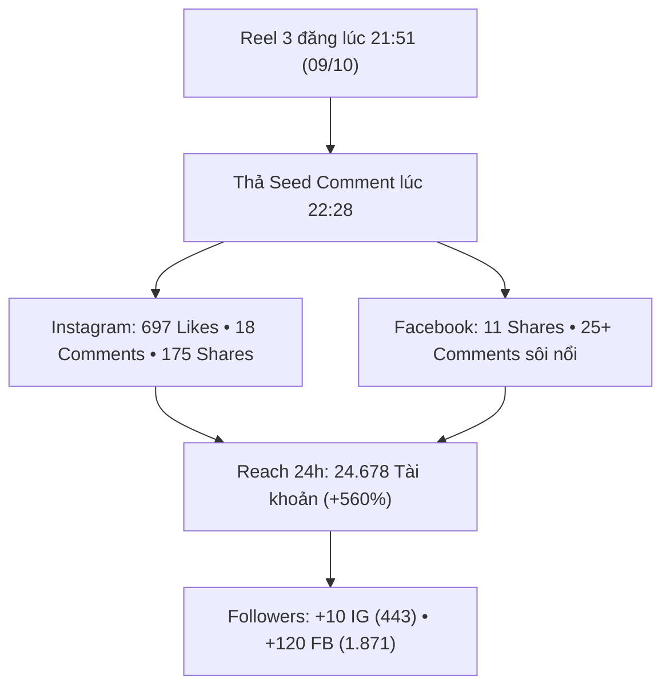

# BÁO CÁO ĐIỀU HÀNH: HIỆU SUẤT SOCIAL & WEBSITE BÙNG NỔ
## Cập Nhật Trưa Thứ Bảy, Ngày 10/10/2026 (12:50)
*Nguồn dữ liệu: Meta Graph API (Instagram @travelframe.vn & Facebook Page) & Google Analytics 4 (Property 552867189)*

---

### 1. ĐIỂM SÁNG LỚN NHẤT: REACH BÙNG NỔ GẤP 6 LẦN, VIRAL TOÀN MẠNG XÃ HỘI

Đêm qua (09/10), sau khi đăng bài Reel 3 ("POV: Đi cà phê gặp tiệc khiêu vũ ngẫu hứng tại Hà Nội") và kích hoạt Seed Comment lúc 22:28, bài viết đã **bắt đúng sóng thuật toán và bùng nổ mạnh mẽ trên cả Facebook lẫn Instagram**:

#### A. Chỉ số Tăng trưởng Kỷ lục trên Mạng xã hội (24h qua)
* **Instagram Reach:** Đạt **24.678 tài khoản tiếp cận (Accounts Reached)** — Tăng vọt hơn **$560\%$** so với mức 4.382 tối qua!
* **Tài khoản tương tác (Accounts Engaged):** **985 tài khoản** (Gần chạm mốc 1.000).
* **Tổng lượt tương tác (Total Interactions):** **1.284 lượt** trong 24 giờ qua:
  * **771 Likes** (Tăng từ 54 lượt tối qua).
  * **175 Shares (Chia sẻ):** Độ lan tỏa chóng mặt sang các hội nhóm và bạn bè.
  * **133 Saves (Lưu bài viết):** Ý định đi du lịch / trải nghiệm thực tế cực kỳ cao.
  * **21 Comments trực tiếp**.

#### B. Bước nhảy vọt về Người theo dõi (Followers)
* **Instagram (`@travelframe.vn`):** Chạm mốc **443 Followers** (Tăng thêm **+10 followers** qua đêm, tăng **+30 followers** sau 3 ngày).
* **Facebook Fanpage:** Đạt mốc **1.871 Followers**! (Tăng phi mã **+120 followers** chỉ sau 1 đêm, tăng **+197 followers** trong 48h).

#### C. Chi tiết bài Reel Viral (Reel 3: Café Dancing)
* **Instagram:** Đạt **697 Likes** và **18 Comments** (so với 2 likes tối qua).
* **Facebook:** Đạt **11 Shares** và **25+ bình luận** tranh luận sôi nổi giữa khách Tây khen ngợi sự phóng khoáng và netizen Việt bàn về nhân vật đứng phía sau trong clip. Chính cuộc tranh luận hai chiều này đã kích hoạt thuật toán đề xuất của Meta đẩy bài đi xa.

---

### 2. HIỆU QUẢ VẬN HÀNH WEBSITE (GOOGLE ANALYTICS 4)

#### A. Tổng kết Ngày Hôm Qua (09/10/2026 — Kỷ lục tháng 10)
* **Người dùng hoạt động (Active Users):** **15 users** (Mức cao nhất trong một ngày kể từ đầu tháng).
* **Tổng số Phiên (Sessions):** **33 phiên**.
* **Tổng Lượt xem trang (Pageviews):** **171 lượt xem**.
* **Thời lượng phiên bình quân (Avg Duration):** **1.653 giây (~27,5 phút/phiên)** — Dwell time cực sâu.
* **Các trang chuyển đổi cao hôm qua:**
  * Trang Tour số [`/digital-tour`](https://travelframe.sidevn.com/digital-tour): **21 PVs**.
  * Danh mục Tour [`/tours`](https://travelframe.sidevn.com/tours): **14 PVs / 5 users**.
  * Trang đặt lịch [`/booking`](https://travelframe.sidevn.com/booking): **12 PVs / 6 users**.
  * Trang thanh toán [`/checkout`](https://travelframe.sidevn.com/checkout): **6 PVs / 1 user**.
  * Tour Hồ Tây [`/tour/spiritual-west-lake-breeze`](https://travelframe.sidevn.com/tour/spiritual-west-lake-breeze): **5 PVs / 3 users**.

#### B. Nửa ngày hôm nay (10/10/2026 tính đến 12:50)
* Đã ghi nhận **1 User**, **2 Sessions**, **6 Pageviews**, thời lượng phiên trung bình **17,1 phút**.

#### C. Lũy kế Tháng 10 (01/10 – 12:50 ngày 10/10/2026)
* **Active Users:** **95 users** (Tiến sát mốc 100 người dùng).
* **Sessions:** **192 phiên** (Sắp chạm mốc 200 phiên).
* **Pageviews:** **629 lượt xem** (Chính thức vượt mốc 600 pageviews).
* **Thời lượng tương tác bình quân:** **496,1 giây (~8,27 phút/phiên)**.

---

### 3. BẢNG TỔNG HỢP SO SÁNH CHỈ SỐ

| Chỉ số Hiệu năng | Trưa nay (10/10/2026) | Tối qua (22:20 09/10) | Mức tăng trưởng qua đêm |
|:---|:---:|:---:|:---|
| **Instagram Followers** | **443** | 433 | 🟢 **+10 followers** |
| **Instagram Reach (24h)** | **24.678** | 4.382 | 🟢 **+20.296 accounts (+463%)** |
| **Instagram Saves (24h)** | **133** | 60 | 🟢 **+73 saves (+121%)** |
| **Instagram Shares (24h)** | **175** | 37 | 🟢 **+138 shares (+372%)** |
| **Facebook Followers** | **1.871** | 1.751 | 🟢 **+120 followers (+6.8%)** |
| **Website MTD Pageviews** | **629** | 540 | 🟢 **+89 lượt xem** |
| **Website MTD Sessions** | **192** | 178 | 🟢 **+14 phiên** |
| **Website MTD Active Users** | **95** | 92 | 🟢 **+3 users** |

---

### 4. ĐÁNH GIÁ & KHUYẾN NGHỊ HÀNH ĐỘNG

1. **Hiện tượng Viral từ Reel 3 mang lại tệp khách Warm khổng lồ:**
   * Hơn 24.600 người đã xem và 133 người lưu clip. Đây là thời điểm vàng để hứng phễu sang website hoặc chạy tin nhắn (Click-to-Instagram Direct).
2. **Theo dõi bình luận tranh luận:**
   * Bài viết trên Facebook có nhiều tranh luận về người hút vape phía sau. Giữ thái độ trung lập, không xóa bình luận hợp lệ, chỉ ẩn/xóa bình luận thô tục nếu có.
3. **P0 Kỹ thuật:**
   * Tiếp tục lưu ý upload file PDF cẩm nang (`/guides/TravelFrame-Hanoi-Photographer-Tour-Guide.pdf`) và cấu hình bản ghi DNS domain `travelframe.vn` $\rightarrow$ `137.59.105.30`.
