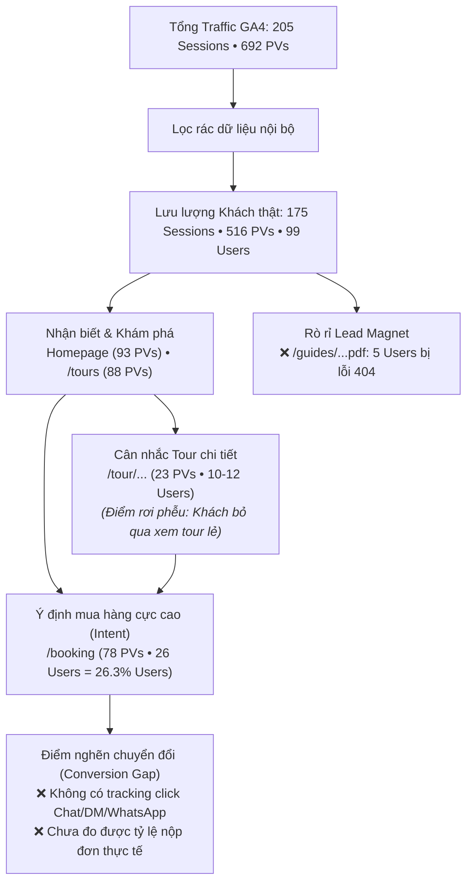
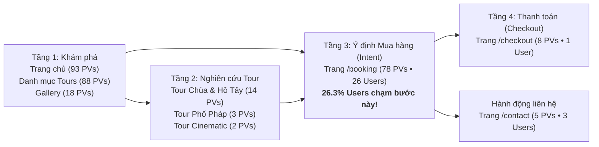

# BÁO CÁO PHÂN TÍCH CHUYÊN SÂU HIỆU QUẢ WEBSITE TRAVELFRAME
## Đánh Giá Toàn Diện Dữ Liệu GA4 (01/10 – 11/10/2026)
*Người thực hiện: Data-Analytics • Phương pháp phân tích: MECE, Pyramid Principle, Phân rã dữ liệu sạch (Clean Data Decomposition)*  
*Nguồn dữ liệu: Google Analytics 4 (Property ID: `552867189`)*

---

### 1. KẾT LUẬN ĐIỀU HÀNH (GOVERNING THOUGHT)

**Website TravelFrame đang sở hữu tỷ lệ người dùng có ý định mua hàng (Intent Rate) đặc biệt cao: hơn $26\%$ người dùng thực tế truy cập vào trang [`/booking`](https://travelframe.sidevn.com/booking) và lưu lại trung bình hơn 5,5 phút. Tuy nhiên, hiệu quả chuyển đổi thành khách hàng thực tế đang bị nghẽn bởi 3 rào cản lớn: (1) Dữ liệu báo cáo thô đang bị thổi phồng bởi $14,6\%$ phiên debug và $25,4\%$ lượt xem từ trang quản trị nội bộ; (2) Thiếu hoàn toàn hệ thống đo lường sự kiện chuyển đổi (Custom Event Tracking) cho các nút Chat Zalo/WhatsApp/DM trên trang Booking; và (3) Lỗ hổng kỹ thuật nghiêm trọng khiến 5 khách hàng tiềm năng click tải cẩm nang du lịch bị dính lỗi 404 Page Not Found.**

---

### 2. PHÂN RÃ DỮ LIỆU: BÁO CÁO THÔ VS. DỮ LIỆU KHÁCH THỰC TẾ

Để đánh giá chính xác chất lượng vận hành của website, cần bóc tách toàn bộ hoạt động kỹ thuật nội bộ ra khỏi dữ liệu hành vi của khách hàng:

| Chỉ số | Dữ liệu Thô (Gross) | Hoạt động Nội bộ / Debug | Dữ liệu Khách thật (Net) | Tỷ trọng Nội bộ |
|:---|:---:|:---:|:---:|:---:|
| **Active Users (Người dùng)** | **100** | 1 user (Tag Assistant) | **99 users** | 1,0% |
| **Sessions (Số phiên)** | **205** | 30 sessions (`tagassistant.google.com`) | **175 sessions** | **14,6%** |
| **Pageviews (Lượt xem trang)** | **692** | 176 pageviews (`/travelframe-admin/...`) | **516 pageviews** | **25,4%** |
| **Tỷ lệ thoát (Bounce Rate)** | **44,39%** | Đã gồm admin & debug | **~48–50%** (Ước tính) | — |
| **Thời lượng phiên bình quân** | **334,0s (~5,5m)** | Bị kéo dài do admin làm việc | **~240–280s (~4–4,5m)** | — |

> **Khuyến nghị vận hành:** Cần cấu hình Bộ lọc nội bộ (Internal Traffic Filter theo địa chỉ IP) trong Google Analytics 4 để các dashboard điều hành phản ánh 100% dữ liệu của người dùng bên ngoài.

---

### 3. CƠ CẤU NGUỒN TRUY CẬP KHÁCH THẬT (TRAFFIC ACQUISITION)

Sau khi loại bỏ 30 phiên của Tag Assistant, cơ cấu 175 phiên người dùng thật phân bổ như sau:

| Nhóm kênh (Channel) | Nguồn / Phương thức (Source / Medium) | Sessions | Users | % Sessions Khách | Nhận xét & Đánh giá |
|:---|:---|:---:|:---:|:---:|:---|
| **Organic Social** | `ig / social` | 21 | 19 | 12,0% | Khách click từ bài viết/Reels Instagram |
| **Organic Social** | `facebook / page_button` | 19 | 5 | 10,9% | Khách quay lại nhiều lần từ nút trang FB |
| **Organic Social** | `facebook.com / referral` | 14 | 14 | 8,0% | Khách từ bài post chia sẻ trên Facebook |
| **Organic Social** | `instagram / bio` | 9 | 9 | 5,1% | Khách bấm link trực tiếp từ Bio Instagram |
| **Organic Social** | `l.facebook.com` & `m.facebook.com` | 11 | 8 | 6,3% | Truy cập di động qua Facebook App |
| **Organic Social** | `threads / social` | 6 | 6 | 3,4% | Traffic từ thảo luận trên Threads |
| **Organic Social** | `l.instagram.com` & khác | 5 | 4 | 2,9% | Các link phụ từ Instagram |
| *Tổng Organic Social* | *Toàn bộ mạng xã hội tự nhiên* | **85** | **65** | **48,6%** | **Động cơ tăng trưởng chính của website** |
| **Direct** | `(direct) / (none)` | **70** | **29** | **40,0%** | Mở trực tiếp, bookmark, app chat ẩn referrer |
| **Organic Search** | `google / organic` | **17** | **3** | **9,7%** | Tìm kiếm Google (chủ yếu là 3 users quay lại) |
| **Paid Social** | `fb / paid` | **1** | **1** | **0,6%** | Meta Ads chủ yếu click-to-DM, ít vào site |
| **Khác** | `(not set)` / Cross-network | **2** | **1** | **1,1%** | Dữ liệu chưa xác định |
| **TỔNG CỘNG** | | **175** | **99** | **100%** | |

* **Động lực tăng trưởng số 1 là Organic Social (48,6%):** Instagram và Facebook đóng vai trò là "máy bơm traffic" hiệu quả nhất vào website.
* **Direct (40,0%) có tỷ lệ phiên/user rất cao (2,4 phiên/user):** Khách hàng sau khi biết đến TravelFrame có thói quen mở lại trang web nhiều lần để xem xét.
* **Organic Search (Google):** 17 phiên nhưng chỉ từ 3 users, cho thấy SEO chưa tiếp cận được khách hàng mới tìm kiếm tự nhiên ngoài thị trường.

---

### 4. PHÂN TÍCH PHỄU CHUYỂN ĐỔI NGƯỜI DÙNG (USER JOURNEY & FUNNEL)

Phân tích dữ liệu hành trình của 516 lượt xem trang người dùng thật cho thấy bức tranh rõ nét về hành vi khách hàng:

#### A. Tầng 1: Khám phá & Danh mục (Discovery)
* **Trang chủ (`/`):** **93 pageviews** (39 users). Là điểm chạm đầu tiên giải thích giá trị "Tour chụp ảnh riêng tư tại Hà Nội".
* **Danh mục Tour ([`/tours`](https://travelframe.sidevn.com/tours)):** **88 pageviews** (34 users). Trang có lượt xem cao nhất trong nhóm sản phẩm, 34% tổng số người dùng đều ghé qua đây.
* **Thư viện ảnh ([`/gallery`](https://travelframe.sidevn.com/gallery)):** **18 pageviews** (11 users). Nơi khách xem bằng chứng ảnh chụp thực tế.
* **Tin tức & Cẩm nang ([`/news`](https://travelframe.sidevn.com/news)):** **56 pageviews** (9 users).

#### B. Tầng 2: Xem chi tiết từng Tour (Consideration Gap)
* **Tour Hồ Tây & Ba Đình (`/tour/spiritual-west-lake-breeze`):** **14 pageviews** (4 users).
* **Tour Khu phố Pháp (`/tour/french-colonial-historical-footsteps`):** **3 pageviews** (3 users).
* **Tour Chụp ảnh Cinematic Phố cổ (`/tour/cinematic-hanoi-visual-storytelling-walk`):** **2 pageviews** (2 users).
* **Tour Bình minh Long Biên (`/tour/hanoi-early-bird-sunrise-local-markets`):** **2 pageviews** (2 users).
* **Tour Ẩm thực (`/tour/food-tour`):** **2 pageviews** (1 user).
* **Hiện tượng bất thường:** Tổng số lượt xem các trang tour chi tiết chỉ có **23 pageviews** từ khoảng **10–12 users**, trong khi có tới **34 users xem trang danh mục `/tours`** và **26 users vào thẳng `/booking`**.
  * *Nguyên nhân:* Khách hàng sau khi xem lướt qua thẻ mô tả trên trang `/tours` thường bấm thẳng vào nút "Book Now" để xem giá và lịch trống, bỏ qua trang chi tiết lịch trình.

#### C. Tầng 3: Ý định Đặt Tour (Intent to Buy - Đạt mức rất cao)
* **Trang Đặt lịch ([`/booking`](https://travelframe.sidevn.com/booking)):** **78 pageviews** (26 users).
  * **26,3% người dùng thực tế** (26 trên 99 users) đã tiến tới trang Booking!
  * So với tiêu chuẩn ngành du lịch/tour trải nghiệm (thường chỉ 5%–10% traffic vào tới bước đặt lịch), mức 26,3% chứng minh traffic đổ về từ Reels/Social có **độ khớp nhu cầu (Relevance) rất cao**.
* **Trang Thanh toán ([`/checkout`](https://travelframe.sidevn.com/checkout)):** **8 pageviews** (1 user).

#### D. Tầng 4: Đọc cẩm nang du lịch (Content & Lead Magnet)
* Bài viết hướng dẫn thuê thợ ảnh (`/news/hanoi-photographer-tour-guide`): **19 pageviews từ 19 users độc lập**! Đây là bài blog thu hút lượng người đọc tự nhiên cao nhất website.
* Trải nghiệm bản đồ tour số ([`/digital-tour`](https://travelframe.sidevn.com/digital-tour)): **29 pageviews** (1 user trải nghiệm rất sâu nhiều địa điểm trên map).

---

### 5. CÁC ĐIỂM NGHẼN KỸ THUẬT & RÒ RỈ CHUYỂN ĐỔI (CRITICAL ISSUES)

#### 🔴 Vấn đề 1: Lỗi 404 File PDF Cẩm nang Du lịch (Mất khách trực tiếp)
* **URL:** `/guides/TravelFrame-Hanoi-Photographer-Tour-Guide.pdf`
* **Dữ liệu GA4 ghi nhận:** **5 pageviews từ 5 người dùng khác nhau** mở link này và đều nhận thông báo **`Page not found | TravelFrame Vietnam`**.
* **Mức độ nghiêm trọng:** **P0**. Đây là tài liệu Lead Magnet được dùng làm mồi câu trên mạng xã hội (bảo khách bấm link nhận cẩm nang). Khách click vào bị lỗi 404 sẽ lập tức rời bỏ và đánh giá thấp tính chuyên nghiệp của thương hiệu.

#### 🟡 Vấn đề 2: Đường dẫn `/tour` bị 404
* **URL:** `/tour` ghi nhận **3 pageviews / 3 users** bị lỗi `Page not found`.
* **Mức độ:** **P1**. Do khách gõ thiếu chữ "s" (đúng phải là `/tours`) hoặc có một nút/breadcrumb nội bộ đang trỏ sai đường dẫn. Cần tạo redirect `301 /tour -> /tours`.

#### 🟡 Vấn đề 3: Phân mảnh Meta Title trên cùng một URL
* Trang chủ `/` tồn tại 2 title trong dữ liệu:
  1. `Private Hanoi Photo Tours & Vacation Photography | TravelFrame Vietnam` (75 PVs)
  2. `Private Hanoi Tours with Photo & Video Keepsakes | TravelFrame Vietnam` (18 PVs)
* Trang `/news/hanoi-photographer-tour-guide` cũng có 2 title khác nhau:
  1. `Hanoi Photographer Tour Guide | TravelFrame Vietnam` (11 PVs)
  2. `Hanoi Photographer Tour Guide | Best Photo Spots | TravelFrame Vietnam` (8 PVs)
* **Mức độ:** **P2**. Cho thấy mã nguồn đang đổi title động hoặc chưa cố định thẻ `<title>` chuẩn SEO, gây phân tán tín hiệu xếp hạng tìm kiếm của Google.

#### 🔴 Vấn đề 4: "Vùng mù" đo lường chuyển đổi (Measurement Blind Spot)
* Hiện tại GA4 chưa có Custom Event cho các hành động cốt lõi:
  * `click_whatsapp` (bấm chat WhatsApp tư vấn)
  * `click_messenger` / `click_instagram_dm`
  * `booking_form_submit` (gửi form đặt chỗ thành công)
* **Hậu quả:** Chúng ta biết có 26 người vào `/booking`, nhưng không thể biết chính xác có bao nhiêu người đã bấm nút liên hệ hoặc đặt tour qua form.

---

### 6. BẢNG MA TRẬN HÀNH ĐỘNG ĐỀ XUẤT (IMPACT × EFFORT)

| STT | Hành động đề xuất | Phòng ban phụ trách | Tác động (Impact) | Nỗ lực (Effort) | Ưu tiên |
|:---:|:---|:---:|:---:|:---:|:---:|
| **1** | **Upload ngay file PDF** `TravelFrame-Hanoi-Photographer-Tour-Guide.pdf` vào thư mục `public/guides/` để khắc phục lỗi 404 cho 5+ khách hàng. | Technology-Automation | Cực cao (Khắc phục gãy phễu) | Thấp (< 10 phút) | **P0 (Làm ngay)** |
| **2** | **Cấu hình 301 Redirect:** Chuyển hướng tự động từ `/tour` sang [`/tours`](https://travelframe.sidevn.com/tours). | Technology-Automation | Trung bình | Thấp (< 5 phút) | **P1** |
| **3** | **Cài đặt Event Tracking GA4:** Gắn sự kiện đo lường lượt click vào nút WhatsApp, Hotline và gửi Form trên trang [`/booking`](https://travelframe.sidevn.com/booking). | Technology-Automation | Rất cao (Đo ROI thực tế) | Trung bình (1-2 giờ) | **P1** |
| **4** | **Cấu hình Internal Traffic Filter GA4:** Loại trừ IP văn phòng/nhân viên và debug Tag Assistant khỏi báo cáo người dùng. | Data-Analytics | Cao (Làm sạch số liệu) | Thấp (15 phút) | **P1** |
| **5** | **Tối ưu trang Tour Chi tiết:** Bổ sung nút "Xem mẫu ảnh thực tế" và CTA Booking nổi bật để kéo người xem từ `/tours` vào đọc sâu từng sản phẩm. | Creative & Marketing | Trung bình | Trung bình | **P2** |
| **6** | **Trỏ bản ghi DNS domain chính thức:** Hoàn tất cấu hình trỏ `travelframe.vn` về IP server để thay thế domain tạm `travelframe.sidevn.com`. | Technology-Automation | Cao (Nhận diện thương hiệu) | Phụ thuộc Rocky | **P0 (Chờ duyệt)** |
