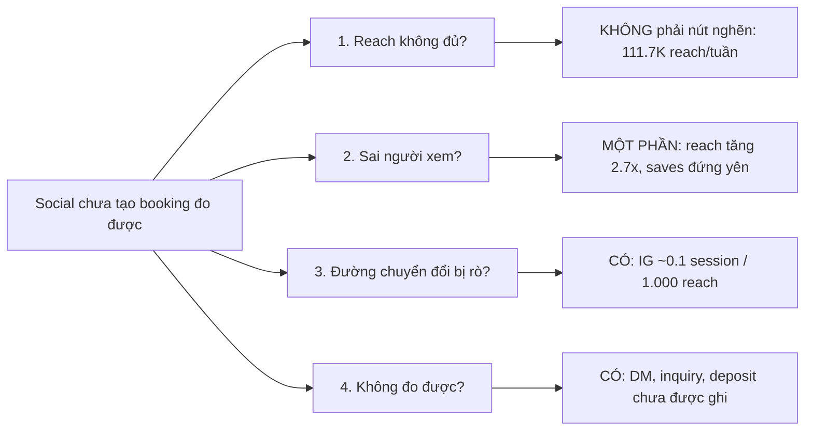

# TravelFrame Social — Đánh giá chiến lược (dạng McKinsey)

- Owner: Data-Analytics · Trạng thái: **Draft cho Rocky** · Lập: 2026-10-13 19:10 GMT+7
- Nguồn: Meta Graph API qua MCP `travelframe-meta` (read-only), GA4 property `552867189` qua MCP, Seed-Comment-Tracker.csv, các báo cáo 07/10, 08/10, 10/10, 13/10 trong `Data-Analytics/Reports/`.
- Cấu trúc: pyramid principle (kết luận trước, bằng chứng sau), SCQA, issue tree, mỗi phần mở bằng action title.

---

## Kết luận chính (governing thought)

**Social của TravelFrame đã giải được bài toán reach nhưng chưa giải bài toán kinh doanh. Reach tuần qua tăng 2,7 lần, nhưng phần lớn mức tăng đến từ một reel dùng footage của người khác và gây tranh cãi. Nhóm người "lên kế hoạch du lịch" (đo bằng saves) đứng yên quanh 900/tuần suốt 4 tuần. Kênh chuyển đổi chính là Instagram DM thì đang không được đo. Trong 30 ngày tới nên chuyển trọng tâm từ "thêm reach" sang ba việc: xử lý rủi ro bản quyền, đo được DM, và dùng content nối thẳng tới sản phẩm photo walk.**

---

## SCQA

| | |
|---|---|
| **Situation** | Follower tăng nhanh: IG 425 → **514** (09–13/10), FB 1.612 (07/10) → **2.079** (13/10). Kênh đăng khoảng 4 reel/ngày, chủ yếu là mẹo tiếng Việt và mẹo du lịch. |
| **Complication** | Tuần 06–12/10 reach IG đạt 111.712 (+166% WoW), nhưng saves giảm, sessions từ FB+IG về website giảm từ 76 xuống 30 (theo báo cáo 10:00 hôm nay, đã lọc nội bộ), key events vẫn bằng 0, và chưa có số DM hay booking để đối soát. |
| **Question** | Social nên tối ưu cái gì để tạo booking photo walk thay vì chỉ tạo lượt xem? |
| **Answer** | Bảo vệ tài khoản trước, đo phễu DM, rồi phân bổ lại danh mục nội dung theo vai trò trong phễu (xem mục 5). |

---

## Issue tree — "Vì sao social chưa tạo booking?"

Nút nghẽn nằm ở nhánh 3 và 4. Thêm reach không gỡ được nút nghẽn này.

---

## 1. Mức tăng reach có thật, nhưng phụ thuộc một bài và bài đó không thuộc quyền của TravelFrame

**Exhibit 1 — Instagram account insights theo tuần (total_value, gồm cả paid nếu có)**

| Chỉ số | 15–21/09 | 22–28/09 | 29/09–05/10 | 06–12/10 | WoW |
|---|---:|---:|---:|---:|---:|
| Reach | 36.308 | 35.278 | 41.940 | **111.712** | +166% |
| Views | 67.231 | 68.145 | 81.666 | **179.772** | +120% |
| Interactions | 3.025 | 2.895 | 3.078 | **8.067** | +162% |
| Shares | 704 | 489 | 461 | 961 | +108% |
| Profile visits | 414 | 195 | 378 | 707 | +87% |
| **Saves** | 772 | 929 | 1.031 | **885** | **−14%** |

- Reel "Café Hà Nội lúc 2 PM, mọi người nhảy múa" (đăng 09/10 21:51 ICT) hiện có **4.438 likes, 86 comments**. Riêng like + comment lũy kế của reel này bằng khoảng 56% tổng interactions của tuần (khác cửa sổ thời gian nên chỉ là ước lượng độ lớn).
- Reel này dùng footage của TikTok @d_a_r_r_i_o_o (caption ghi "video source"). Comment mining ngày 10/10 đo được **NSS −22**, 11 comment phân biệt chủng tộc đã bị ẩn, 0 comment hỏi tour/giá. Báo cáo đó khuyến nghị archive reel. **Reel vẫn đang hiển thị** (API trả về lúc 18:40 hôm nay).
- Tài khoản đã dính tranh chấp bản quyền ngày 07/10. Audit 08/10 ghi nhận 12 reel Nhóm 2, 6 reel Nhóm 3 và 3 reel Nhóm 4 vẫn hiển thị (chưa kiểm tra lại hôm nay).

**So what:** đỉnh reach tuần này vừa không lặp lại được, vừa mang rủi ro khóa tài khoản. Nếu tài khoản bị khóa thì mọi chỉ số khác về 0. Đây là rủi ro có hậu quả lớn nhất trong toàn bộ báo cáo.

## 2. Nhóm khán giả "lên kế hoạch" không lớn thêm: saves đứng yên quanh 900/tuần

**Exhibit 2 — Chất lượng trên 1.000 reach (Instagram)**

| Trên 1.000 reach | 15–21/09 | 22–28/09 | 29/09–05/10 | 06–12/10 |
|---|---:|---:|---:|---:|
| Saves | 21,3 | 26,3 | 24,6 | **7,9** |
| Shares | 19,4 | 13,9 | 11,0 | 8,6 |
| Profile visits | 11,4 | 5,5 | 9,0 | 6,3 |
| Comments | 0,9 | 2,6 | 0,4 | 1,1 |

- Saves tuyệt đối dao động 772–1.031 trong 4 tuần, bất kể reach là 35K hay 112K. Save là tín hiệu gần nhất với ý định "để dành cho chuyến đi".
- Nội dung tạo ra lượng save ổn định này là nhóm mẹo thực dụng (tiếng Việt bỏ túi, qua đường, gọi món). Kết luận này khớp với báo cáo Fanpage 07/10 (bài *học gọi bánh mì*: 35 follow, 252 save).
- Reel gần sản phẩm nhất trong 2 ngày qua, *How I direct someone who has never posed before* (CTA DM "PHOTO"), chỉ có **5 likes**. Median like của 14 reel tự sản xuất gần nhất là khoảng **8** (likes lũy kế, các bài có tuổi khác nhau).

**So what:** reach viral thu hút người xem để giải trí, không phải người sắp đến Hà Nội. Lượng khán giả có ý định du lịch đang đi ngang. Phần content nối sang sản phẩm photo walk thì chưa có format nào hiệu quả.

## 3. Đường chuyển đổi bị rò: Instagram tạo reach nhưng gần như không đưa người sang bước tiếp theo

**Exhibit 3 — Sessions từ social về website, 06/10–13/10 (GA4, chưa lọc nội bộ, 13/10 chưa hết ngày)**

| Nguồn | Sessions | Users |
|---|---:|---:|
| Facebook (page_button + referral) | 30 | 14 |
| Instagram (ig/social, l.instagram, bio, instagram.com) | 11 | 10 |
| Threads | 6 | 6 |
| **Tổng social** | **47** | — |
| Tổng site (chưa lọc) | 211 | 125 |

- Instagram: 11 sessions so với 111.712 reach, tức khoảng **0,1 session trên 1.000 reach**. Facebook gửi nhiều hơn IG gần 3 lần, chủ yếu qua nút trên Page (`facebook / page_button`: 19).
- Theo bản lọc nội bộ lúc 10:00, sessions từ FB+IG giảm từ 76 xuống 30 WoW, FB link clicks giảm 60,7%, key events = 0.
- Số 211 sessions chưa lọc chênh lớn so với 78 sessions đã lọc. Phần lớn chênh lệch nằm ở Direct (118) và Tag Assistant (24), nhiều khả năng là traffic nội bộ. Vì vậy không nên đọc tổng site chưa lọc như nhu cầu thật.

**So what:** website không phải đích chính của IG (CTA là DM "PHOTO"). Nhưng đích DM cũng chưa được đo (mục 4), nên hiện tại không có bằng chứng IG đang tạo khách hàng ở bất kỳ bước nào.

## 4. Không đo được: kênh chuyển đổi ưu tiên (IG DM) đang không có dữ liệu

- `Executive/Current-State.md` ghi Instagram DM là kênh chuyển đổi ưu tiên. MCP hiện tại không đọc được IG DM, còn Messenger báo thiếu `pages_messaging` (runbook mục 3).
- Seed-Comment-Tracker: 15 dòng cho khoảng 8 reel từ 09/10 đến 13/10, trong khi kênh đăng khoảng 4 reel/ngày. Chỉ **2/15** seed comment được đăng trong 60 phút đầu (playbook yêu cầu). **0/15** dòng có `reach_48h`, `dm_with_travel_date` hoặc `booking_ref`.
- DEC-20261009 yêu cầu đánh giá Ads bằng qualified inquiries, quotes và deposits có đối soát. Hiện chưa có hệ thống ghi nhận những chỉ số này, nên nếu bật Ads bây giờ sẽ không đánh giá được theo đúng tiêu chí đã duyệt.

**So what:** đo DM là điều kiện trước để ra mọi quyết định tiếp theo, kể cả quyết định bật Ads.

---

## 5. Khuyến nghị (ưu tiên theo tác động và rủi ro)

| # | Hành động | Vì sao | Owner | Hạn | Cần Rocky duyệt? |
|---|---|---|---|---|---|
| **P0-1** | Quyết định với reel café: archive hoặc có giấy phép bằng văn bản. Rà lại Nhóm 2, 3, 4 trong audit 08/10. Ngừng đăng footage của bên thứ ba. | Rủi ro khóa tài khoản sau tranh chấp 07/10 | Rocky + Creative-Production | 48h | Có (thao tác live) |
| **P0-2** | Lập sổ DM hằng ngày: ngày nhận, bài nguồn, có ngày đến Hà Nội không, đã báo giá chưa, đã cọc chưa. Điền cột 48h trong Seed-Comment-Tracker. | Hiện chưa có bằng chứng social tạo ra khách | Sales-CRM + Data-Analytics | Bắt đầu ngay | Không |
| **P0-3** | Tạo lại token System User có `instagram_manage_messages`, `pages_messaging`, `pages_read_user_content` theo runbook mục 5. | Để đọc DM và comment tự động | Rocky | 1 tuần | Có (chỉ Rocky tạo token) |
| **P1-4** | Thử giảm từ 4 xuống 2 reel/ngày trong 14 ngày, dùng thời gian còn lại cho seed comment trong 60 phút đầu và content nối sang sản phẩm. | Median ~8 likes/reel; có bài trùng ý ("Cho mình xuống đây" đăng 10/10 và 11/10, "got lost" đăng 11/10 và 12/10); seed đúng hạn 13% | Marketing-Growth | Từ 14/10 | Có (thay đổi lịch) |
| **P1-5** | Tái cơ cấu danh mục nội dung theo tỷ lệ **60/30/10**: 60% mẹo thực dụng (tạo save), 30% content nối sang sản phẩm bằng footage tự quay (hậu trường photo walk, ảnh trước/sau, câu chuyện khách có consent), 10% giải trí/trend bằng footage tự quay. | Save đến từ mẹo thực dụng, còn khâu nối sang sản phẩm đang thiếu | Marketing-Growth + Creative-Production | 2 tuần | Có (calendar) |
| **P1-6** | Chỉ bật Ads theo DEC-20261009 sau khi P0-1 và P0-2 đạt. Dùng các reel mẹo có save cao làm nguồn warm audience. | DEC yêu cầu đo qualified inquiry/deposit | Marketing-Growth | Sau P0 | Có |
| **P2-7** | Story mỗi ngày có link sticker gắn UTM. Redirect link PDF/`/ebook` theo plan 12/10. | Tăng tỷ lệ IG → web, hiện ~0,1/1.000 reach | Tech-Automation | 2 tuần | Có (sửa live) |

## 6. Bảng chỉ số theo dõi (mục tiêu là đề xuất, chưa được duyệt)

| KPI | Baseline | Mục tiêu đề xuất sau 4 tuần |
|---|---|---|
| Saves IG / tuần | 885 | ≥ 1.200 |
| Saves / 1.000 reach | 7,9 | ≥ 15 |
| Sessions social → web / tuần (đã lọc) | 30 | ≥ 80 |
| IG sessions / 1.000 reach | ~0,1 | ≥ 0,5 |
| DM có ngày đến Hà Nội / tuần | **chưa đo** | Lấy baseline 2 tuần, rồi đặt mục tiêu |
| Seed C1 trong 60 phút | 2/15 (13%) | ≥ 80% |
| Reel mới dùng footage bên thứ ba | có | 0 |
| Comments / 1.000 reach | 1,1 | ≥ 2,0 |

## 7. Rủi ro và giới hạn của phân tích

- Meta `total_value` không tách được organic và paid. Ranh giới ngày Meta dùng có thể lệch vài giờ so với GMT+7.
- Không có insights theo từng media (reach, retention) qua MCP. Phần đóng góp của reel café là suy luận từ likes/comments.
- Số liệu Facebook theo tuần lấy từ báo cáo 10:00 (Business Suite, giờ Pacific, kỳ hiện tại tạm tính). API không trả comments/reactions của Page.
- Follower tăng chưa tách được nguồn. Không có platform evidence cho thấy Ads đang chạy.
- Exhibit 3 dùng GA4 chưa lọc nội bộ, cửa sổ 8 ngày, có ngày 13/10 chưa hết.

## Phụ lục A — Đính chính báo cáo social gửi trong chat lúc 18:40 cùng ngày

1. Báo cáo đó trình bày reel café như một thành công. Sai: reel dùng footage bên thứ ba, NSS −22, có khuyến nghị archive từ 10/10 và vẫn đang hiển thị.
2. "Social chiếm ~35% organic traffic": không có căn cứ. Số đúng là 47/211 sessions chưa lọc (22%), hoặc 47/69 nếu bỏ Direct và Tag Assistant (68%).
3. "/tours và /booking chiếm >50% lượt xem từ social": không có truy vấn nào hỗ trợ con số này. Bỏ.
4. "Link tinyurl chưa gắn UTM": chưa kiểm chứng. GA4 có `instagram / bio` và `facebook / page_button`, tức ít nhất một phần link đã gắn UTM.
5. "Ads ở trạng thái Ready": sai. DEC chỉ duyệt phương án, các bước kiểm tra trước khi chạy vẫn chưa xong.
6. Tổng sessions social là 47, không phải 46. Reel "No, thank you" có 57 likes sau khoảng 33 giờ, không phải 24 giờ.

## Phụ lục B — Phương pháp

- IG weekly: `get_instagram_insights`, period=day, metric_type=total_value, since/until theo ngày đầu tuần (thứ Hai). Số tuần 29/09–05/10 khớp với báo cáo 10:00. Tuần 06–12/10 cao hơn ~0,8% do Meta cập nhật trễ.
- Follower: `get_instagram_profile`, `get_facebook_page_info` lúc 18:40; mốc so sánh từ báo cáo 07/10 và 09/10.
- Media: `list_instagram_media` limit 15 (09/10–13/10).
- GA4: `get_ga4_traffic_sources` và `get_ga4_traffic_overview`, 7daysAgo → today.
- Kiểm tra kết nối: `test-publish-capability.mjs` lúc 18:39. Script tạo rồi xóa 1 bài FB không công khai và tạo 1 IG container không publish, theo đúng runbook. Không sửa dữ liệu live nào khác.
