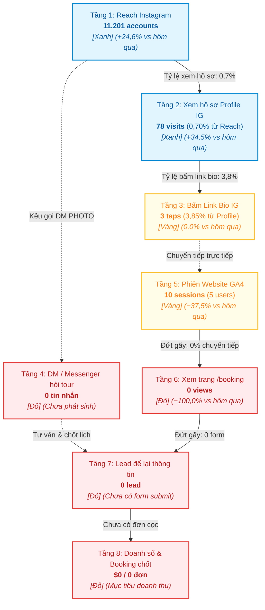
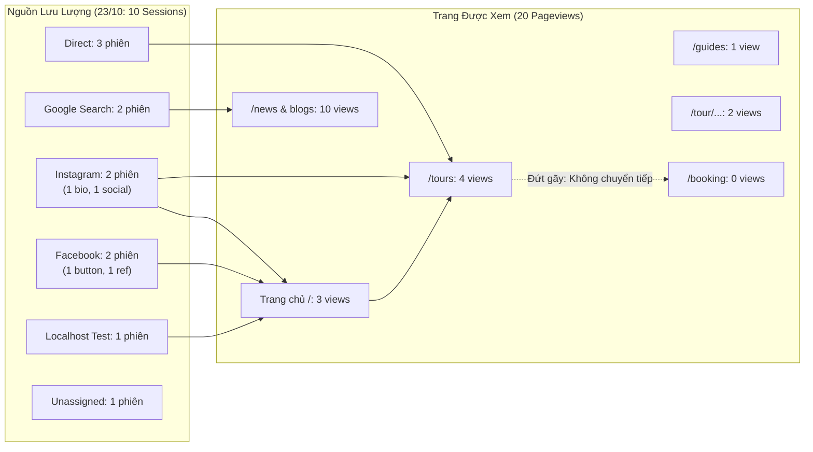

# Báo Cáo Hiệu Quả Hằng Ngày TravelFrame — 24/10/2026
*Khung thời gian chụp số liệu: 08:30 ICT ngày 24/10/2026*  
*Mốc đối chiếu: Hôm qua cùng khung giờ (23/10) và 7 ngày trước (17/10/2026)*  
*Quy chuẩn áp dụng: [Data-Analytics/Daily-Reporting-Standard.md](../Daily-Reporting-Standard.md)*

---

### 1. Tóm Tắt
1. **[Xanh]** Độ phủ Instagram 24h phục hồi đạt 11.201 tài khoản tiếp cận, tăng +24,6% so với 8.987 ngày 23/10 (tuy nhiên vẫn thấp hơn −26,6% so với 15.255 ngày 17/10).
2. **[Xanh]** Lượt lưu bài (Saves) Instagram 24h tiếp tục tăng lên 383 lượt lưu (+19,3% so với 321 ngày 23/10 và +571,9% so với 57 ngày 17/10); tỷ lệ lưu bài trên tổng tương tác đạt 30,4%.
3. **[Xanh]** Lượt xem trang cá nhân Instagram (Profile visits) đạt 78 lượt, tăng +34,5% so với 58 lượt ngày 23/10; Facebook Fanpage tăng thêm +45 người theo dõi mới (đạt 2.487 followers, +10,5% so với 17/10).
4. **[Đỏ]** Tầng đáy phễu tiếp tục đứt gãy: Lượt xem trang `/booking` giảm về 0 (so với 1 ngày 23/10), số lead thu thập được bằng 0 và doanh số đối soát tiếp tục bằng $0.

---

### 2. Phễu Doanh Số (Khung 24 giờ qua: 08:30 hôm qua – 08:30 hôm nay)

| Bước chuyển đổi | Hôm nay (24/10) | Hôm qua (23/10) | 7 ngày trước (17/10) | So với hôm qua | So với 7 ngày trước | Trạng thái |
|:---|:---:|:---:|:---:|:---:|:---:|:---:|
| 1. Reach Instagram (accounts) | 11.201 | 8.987 | 15.255 | +24,6% | −26,6% | [Xanh] |
| 2. Lượt xem trang cá nhân IG | 78 | 58 | Chưa đo* | +34,5% | Chưa đo | [Xanh] |
| 3. Lượt bấm link bio IG | 3 | 3 | Chưa đo* | 0,0% | Chưa đo | [Vàng] |
| 4. DM / Messenger hỏi tour | 0 | 0 | 0 | 0% | 0% | [Đỏ] |
| 5. Phiên website (Sessions 24h) | 10 | 16 | 5 | −37,5% | +100,0% | [Vàng]** |
| 6. Lượt xem `/booking` (24h) | 0 | 1 (6 gồm details) | 1 | −100,0% | −100,0% | [Đỏ] |
| 7. Lead thu thập được | 0 | 0 | 0 | 0% | 0% | [Đỏ] |
| 8. Doanh thu (USD) & Đơn chốt | $0 / 0 đơn | $0 / 0 đơn | $0 / 0 đơn | 0% | 0% | [Đỏ] |

*\* Chỉ số Lượt xem profile và Link bio bắt đầu được đo lường tự động qua Meta Graph API từ 22/10.*  
*\*\* Chỉ số phiên website được xếp tối đa là [Vàng] do chưa lọc traffic nội bộ (admin/localhost:8093 chiếm 1 phiên) và mẫu <30 phiên.*

---

### 3. Chỉ Số Kênh

#### A. Mạng xã hội Meta (Instagram & Facebook Fanpage)
- **Instagram Followers:** 573 người theo dõi (+3 người so với 23/10; +29 người so với 17/10 (+5,3%)).
- **Instagram Media Count:** 181 bài xuất bản.
- **Instagram Reach (24h):** 11.201 tài khoản tiếp cận (+24,6% so với 8.987 ngày 23/10; −26,6% so với 15.255 ngày 17/10).
- **Instagram Views (24h):** 18.557 lượt xem (+32,4% so với 14.014 ngày 23/10; −22,8% so với 24.032 ngày 17/10).
- **Instagram Saves (24h):** 383 lượt lưu (+19,3% so với 321 ngày 23/10; +571,9% so với 57 ngày 17/10).
- **Instagram Shares (24h):** 251 lượt chia sẻ (+14,1% so với 220 ngày 23/10; +263,8% so với 69 ngày 17/10).
- **Instagram Accounts Engaged (24h):** 775 tài khoản tương tác (+90,9% so với 406 tài khoản ngày 17/10).
- **Instagram Content Interactions (24h):** 1.260 lượt tương tác (348 thích, 383 lưu, 251 chia sẻ, 16 bình luận).
- **Tỷ lệ Lưu bài trên tương tác (Saves / Total Interactions):** 30,4% (duy trì ngưỡng cao >30% phản ánh nhu cầu lưu lại địa điểm và lịch trình chụp ảnh của du khách).
- **Facebook Fanpage Followers:** 2.487 người theo dõi (+45 người so với 2.442 ngày 23/10; +236 người so với 2.251 ngày 17/10 (+10,5%)).
- **Facebook Fanpage Likes:** 2.487 lượt thích trang.

#### B. Website (Google Analytics 4 — Property `552867189`)
- **Phiên 24 giờ qua (Ngày 23/10 trọn vẹn):** 10 phiên, 5 người dùng hoạt động (chưa lọc traffic nội bộ).
- **Phân tách nguồn lưu lượng 24 giờ qua:**
  - Direct: 3 phiên (1 người dùng).
  - Organic Search (Google): 2 phiên (1 người dùng).
  - Instagram: 2 phiên (`ig / social`: 1 phiên, `instagram / bio`: 1 phiên).
  - Facebook: 2 phiên (`facebook / page_button`: 1 phiên, `l.facebook.com / referral`: 1 phiên).
  - Referral kiểm thử: 1 phiên (`localhost:8093 / referral` — traffic nội bộ).
  - Unassigned: 1 phiên (1 người dùng).
- **Hành vi xem trang ngày 23/10 (20 lượt xem trang):**
  - Danh mục tour (`/tours`): 4 lượt xem (2 người dùng).
  - Trang chủ (`/`): 3 lượt xem (1 người dùng).
  - Trang tin tức cẩm nang (`/news`): 3 lượt xem (1 người dùng).
  - Hướng dẫn viên (`/guides`): 1 lượt xem (1 người dùng).
  - Các bài viết blog & cẩm nang góc chụp (`/news/...`): 7 lượt xem.
  - Các trang tour chi tiết (`/tour/...`): 2 lượt xem.
  - Trang đặt tour chính (`/booking`): 0 lượt xem.
- **Hoạt động ngày 24/10 (tính đến 08:30 ICT):** 0 phiên mới. Realtime hiện tại: 0 người dùng hoạt động.
- **Lũy kế Tháng 10 MTD (01–24/10 lúc 08:30 ICT):**
  - Người dùng (Active Users): 366 người dùng.
  - Số phiên (Sessions): 641 phiên.
  - Lượt xem trang (Pageviews): 1.824 lượt xem.
  - Tỷ lệ thoát (Bounce Rate): 57,25%.
  - Thời lượng phiên trung bình: 244,34 giây (~4,07 phút).

---

### 4. Nội Dung Đã Đăng & Seed Comment

#### A. Các nội dung mới xuất bản ngày 23/10
| Thời gian đăng | Kênh | Định dạng | Mã bài / Bằng chứng nền tảng | Reach | Views | Saves | Shares | Tình trạng Seed Comment | Trạng thái |
|:---|:---:|:---:|:---|:---:|:---:|:---:|:---:|:---|:---:|
| 13:25 ICT 23/10 | IG | Reel | ID: `18074320403756942` ([Xem bài](https://www.instagram.com/reel/De06DE_Nitj/)) | 1.227 | 1.446 | 6 | 3 | C1: Chưa cấy / C2: Chưa | Published |
| 13:25 ICT 23/10 | FB | Reel | ID: `122122071123479755` ([Xem bài](https://www.facebook.com/reel/1377488467527332/)) | Mới đăng | Mới đăng | — | 0 | C1: Chưa cấy / C2: Chưa | Published |
| 14:49 ICT 23/10 | IG | Carousel | ID: `18130820170829240` ([Xem bài](https://www.instagram.com/p/De1Dz-BFloc/)) | 104 | — | 0 | 1 | C1: Chưa cấy / C2: Chưa | Published |
| 14:49 ICT 23/10 | FB | Post | ID: `122122087743479755` ([Xem bài](https://www.facebook.com/122097476025479755/posts/122122087743479755)) | Mới đăng | Mới đăng | — | 0 | C1: Chưa cấy / C2: Chưa | Published |

#### B. Đánh giá hiệu suất các bài đăng đạt mốc 24h, 48h & 72h
1. **Reel Quán Flambé hoàng hôn (`Dew7ECmSuNq` — Đăng 00:17 ICT 22/10, mốc 56h):**
   - Đạt **4.127 reach**, **5.240 views**, **213 lượt lưu**, **131 lượt chia sẻ**, **94 likes**, **441 lượt tương tác**.
   - Tỷ lệ lưu bài đạt 5,16% trên reach; đây là bài viết thu hút lượng lưu cao nhất tuần qua, khẳng định sức hút của nội dung ẩm thực kết hợp góc chụp lãng mạn.
2. **Reel Private Photo Walk $8/h (`Deyy868Np94` — Đăng 17:44 ICT 22/10, mốc 39h):**
   - Đạt **2.875 reach**, **3.709 views**, **86 lượt lưu**, **50 lượt chia sẻ**, **33 likes**, **173 lượt tương tác**.
   - Tỷ lệ lưu bài đạt 2,99% trên reach; cần nhanh chóng chuẩn hóa mức giá trên các video kế tiếp sang bảng giá $30/h theo quyết định đã duyệt.
3. **Reel Ngõ nhỏ phố cổ (`DeyeKo2tOKs` — Đăng 14:43 ICT 22/10, mốc 42h):**
   - Đạt **1.777 reach**, **2.164 views**, **31 lượt lưu**, **34 lượt chia sẻ**, **46 likes**, **117 lượt tương tác**.
4. **Reel Bún Riêu vỉa hè (`DewnVEZyxdP` — Đăng 21:23 ICT 21/10, mốc 60h):**
   - Đạt **1.735 reach**, **2.369 views**, **8 lượt lưu**, **17 lượt chia sẻ**, **32 likes**.
5. **Reel Sang đường Hà Nội (`DewgIddt-wE` — Đăng 20:21 ICT 21/10, mốc 61h):**
   - Đạt **1.309 reach**, **1.614 views**, **0 lượt lưu**, **2 lượt chia sẻ**, **18 likes**.
6. **Reel Phan Đình Phùng mùa thu (`De06DE_Nitj` — Đăng 13:25 ICT 23/10, mốc 19h):**
   - Đạt **1.227 reach**, **1.446 views**, **6 lượt lưu**, **3 lượt chia sẻ**, **9 likes**. Tốc độ tăng trưởng reach tốt sau 19h đầu.
7. **Reel Lưu ý an toàn Train Street (`Dey5Z25SgAW` — Đăng 18:40 ICT 22/10, mốc 38h):**
   - Đạt **252 reach**, **315 views**, **3 lượt lưu**, **1 lượt chia sẻ**, **2 likes**.

*Ghi chú Seed comment:* Toàn bộ các bài đăng ngày 21–22/10 đã cấy comment C1 hoàn tất trong `Data-Analytics/Seed-Comment-Tracker.csv`. Cụm bài đăng 23/10 hiện chưa cấy comment mồi C1 và chuyển đổi C2.

---

### 5. Cảnh Báo Dữ Liệu
1. **Quy mô mẫu chưa đủ:** Ngày 23/10 ghi nhận 10 phiên website (<30 phiên). Do đó, thời lượng phiên (286,1s) và tỷ lệ thoát (70,0%) chưa đủ ý nghĩa thống kê để đưa ra kết luận về hành vi sâu theo Quy tắc 5.
2. **Định danh đối tượng:** Người xem danh mục `/tours` và các bài viết cẩm nang chỉ được định danh là "người xem trang", không gọi là "khách mua" vì chưa có hành động gửi thông tin liên hệ hay giao dịch.
3. **Chưa lọc traffic nội bộ:** GA4 vẫn bao gồm 1 phiên kiểm thử từ `localhost:8093 / referral`.
4. **Giới hạn API tin nhắn:** Quyền `pages_messaging` trên Meta App chưa được kích hoạt cho token System User nên số tin nhắn Messenger/DM phải kiểm tra thủ công.
5. **Chi phí quảng cáo:** Chiến dịch Meta Ads `WARM-PHOTO-DM` chưa chạy live, chi phí ghi nhận: 0 VND.

---

### 6. Việc Cần Làm (Tối đa 5 việc, xếp theo mức độ gần doanh thu)

1. **Rà soát liên kết và bổ sung nút kêu gọi tư vấn trực tiếp từ trang `/tours`:**
   - *Vị trí trong phễu:* Tầng 5 sang Tầng 7 (Từ 4 lượt xem danh mục `/tours` nhưng rơi rụng hoàn toàn trước khi vào `/booking`).
   - *Chỉ số đo lường:* Số lượt bấm vào form liên hệ / Lượt xem `/booking` (mục tiêu >= 3 views/ngày).
   - *Phê duyệt:* Tự vận hành (bộ phận Web QA / Dev).
   - *Tài liệu tham chiếu:* Operations/SOPs/
2. **Cập nhật Bảng Giá Theo Giờ ($30/$60/$99) lên giao diện trang `/tours` và `/booking`:**
   - *Vị trí trong phễu:* Tầng 6 sang Tầng 7 (Người xem cân nhắc dịch vụ sang Đặt tour). Xử lý dứt điểm mâu thuẫn giữa nội dung video Reels cũ ($8/h) và bảng giá chuẩn $30/h.
   - *Chỉ số đo lường:* Tỷ lệ chuyển tiếp từ `/tours` sang `/booking`; số inquiry gửi về.
   - *Phê duyệt:* **Cần Rocky duyệt giao diện trước khi publish**.
   - *Tài liệu tham chiếu:* Executive/DEC-20261021-HOURLY-TIER-PRICING.md
3. **Cấy Seed Comment C1 và C2 cho cụm bài đăng ngày 23/10 (Reel Phan Đình Phùng & Train Street):**
   - *Vị trí trong phễu:* Tầng 1 sang Tầng 3 (Từ 1.227 reach của Reel Phan Đình Phùng kích hoạt thảo luận và kéo bấm link bio).
   - *Chỉ số đo lường:* Tỷ lệ cấy comment C1/C2 hoàn thành; số lượt click link bio từ Instagram.
   - *Phê duyệt:* Tự vận hành theo playbook đã duyệt.
   - *Tài liệu tham chiếu:* Marketing-Growth/Guidelines/2026-10-07-Seed-Comment-Playbook.md
4. **Cấu hình bộ lọc IP / Admin / Localhost nội bộ trong Google Analytics 4:**
   - *Vị trí trong phễu:* Vệ sinh dữ liệu Tầng 5 & Tầng 6.
   - *Chỉ số đo lường:* Tỷ lệ traffic sạch của phiên website (loại bỏ hoàn toàn các phiên `localhost:8093`).
   - *Phê duyệt:* **Cần Rocky duyệt cấu hình bộ lọc trên GA4 console**.
   - *Tài liệu tham chiếu:* Data-Analytics/Measurement-Framework.md
5. **Cấp bổ sung quyền `pages_messaging` cho token System User Meta:**
   - *Vị trí trong phễu:* Tầng 4 (Tự động hóa theo dõi tin nhắn hỏi tour và giảm thiểu độ trễ trả lời lead).
   - *Chỉ số đo lường:* Tỷ lệ lấy dữ liệu hội thoại tự động qua API (tránh sót lead).
   - *Phê duyệt:* **Cần Rocky tự thực hiện theo runbook (agent không cầm secret)**.
   - *Tài liệu tham chiếu:* Technology-Automation/Runbooks/Meta-Connection-And-Publishing-Runbook.md
