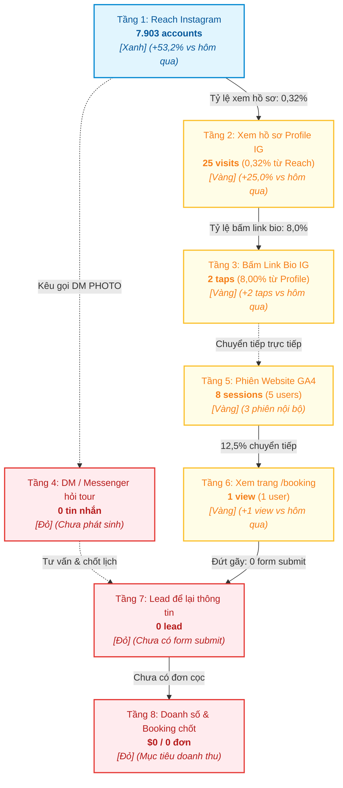
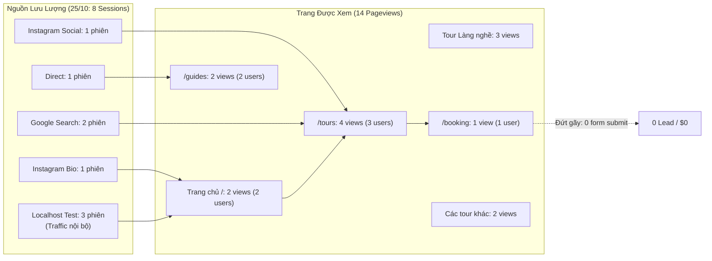

# Báo Cáo Hiệu Quả Hằng Ngày TravelFrame — 26/10/2026
*Khung thời gian chụp số liệu: 08:30 ICT ngày 26/10/2026*  
*Mốc đối chiếu: Hôm qua cùng khung giờ (25/10) và 7 ngày trước (19/10/2026)*  
*Quy chuẩn áp dụng: [Data-Analytics/Daily-Reporting-Standard.md](../Daily-Reporting-Standard.md)*

---

### 1. Tóm Tắt
1. **[Xanh]** Độ phủ Instagram 24h tăng trưởng đạt 7.903 tài khoản tiếp cận (+53,2% so với 5.157 ngày 25/10 và +39,5% so với 5.665 ngày 19/10). Lượt xem nội dung (Views) đạt 12.929 lượt (+64,7% so với 7.850 ngày 25/10).
2. **[Xanh]** Lượt lưu bài (Saves) Instagram 24h tăng mạnh lên 178 lượt lưu (+178,1% so với 64 ngày 25/10 và +235,8% so với 53 ngày 19/10); tỷ lệ lưu bài trên tổng tương tác đạt 36,5% (phản ánh nhu cầu cao đối với video cẩm nang "Hanoi Survival Guide" và "Photo Cheat Sheet").
3. **[Xanh]** Facebook Fanpage tăng thêm +90 người theo dõi mới trong 48h qua, nâng tổng số người theo dõi lên 2.577 followers (+14,5% so với 2.251 ngày 17/10); Instagram đạt 586 followers (+13 người so với 573 ngày 24/10).
4. **[Đỏ]** Tầng đáy phễu tiếp tục đứt gãy hoàn toàn: Mặc dù website ghi nhận 1 lượt xem trang `/booking` và 4 lượt xem `/tours`, số lead thu thập được vẫn bằng 0 và doanh số đối soát tiếp tục bằng $0.

---

### 2. Phễu Doanh Số (Khung 24 giờ qua: 08:30 hôm qua – 08:30 hôm nay)

| Bước chuyển đổi | Hôm nay (26/10) | Hôm qua (25/10) | 7 ngày trước (19/10) | So với hôm qua | So với 7 ngày trước | Trạng thái |
|:---|:---:|:---:|:---:|:---:|:---:|:---:|
| 1. Reach Instagram (accounts) | 7.903 | 5.157 | 5.665 | +53,2% | +39,5% | [Xanh] |
| 2. Lượt xem trang cá nhân IG | 25 | 20 | 30 | +25,0% | −16,7% | [Vàng] |
| 3. Lượt bấm link bio IG | 2 | 0 | 6 | +2 taps | −66,7% | [Vàng] |
| 4. DM / Messenger hỏi tour | 0 | 0 | 0 | 0% | 0% | [Đỏ] |
| 5. Phiên website (Sessions 24h) | 8 | 3 | 12 | +166,7% | −33,3% | [Vàng]** |
| 6. Lượt xem `/booking` (24h) | 1 | 0 | 1 | +1 view | 0,0% | [Vàng] |
| 7. Lead thu thập được | 0 | 0 | 0 | 0% | 0% | [Đỏ] |
| 8. Doanh thu (USD) & Đơn chốt | $0 / 0 đơn | $0 / 0 đơn | $0 / 0 đơn | 0% | 0% | [Đỏ] |

*\* Chỉ số Lượt xem profile và Link bio đo lường tự động qua Meta Graph API (mốc 24h).*  
*\*\* Chỉ số phiên website được xếp tối đa là [Vàng] do chưa lọc traffic nội bộ (admin/localhost:8093 chiếm 3/8 phiên) và quy mô mẫu <30 phiên.*

---

### 3. Chỉ Số Kênh

#### A. Mạng xã hội Meta (Instagram & Facebook Fanpage)
- **Instagram Followers:** 586 người theo dõi (+13 người so với 573 ngày 24/10; +27 người so với 559 ngày 21/10 (+4,8% MTD)).
- **Instagram Media Count:** 187 bài xuất bản (+4 bài so với 24/10).
- **Instagram Reach (24h):** 7.903 tài khoản tiếp cận (+53,2% so với 5.157 ngày 25/10; +39,5% so với 5.665 ngày 19/10).
- **Instagram Views (24h):** 12.929 lượt xem (+64,7% so với 7.850 ngày 25/10; +49,8% so với 8.630 ngày 19/10).
- **Instagram Saves (24h):** 178 lượt lưu (+178,1% so với 64 ngày 25/10; +235,8% so với 53 ngày 19/10).
- **Instagram Shares (24h):** 80 lượt chia sẻ (+100,0% so với 40 ngày 25/10; +105,1% so với 39 ngày 19/10).
- **Instagram Accounts Engaged (24h):** 335 tài khoản tương tác (+19,6% so với 280 ngày 25/10; +69,2% so với 198 ngày 19/10).
- **Instagram Content Interactions (24h):** 488 lượt tương tác (144 thích, 178 lưu, 80 chia sẻ, 0 bình luận).
- **Tỷ lệ Lưu bài trên tương tác (Saves / Total Interactions):** 36,5% (tiếp tục duy trì ở mức cao >35%, khẳng định dạng nội dung cẩm nang ảnh và bí quyết thực chiến được du khách lưu trữ tích cực).
- **Facebook Fanpage Followers:** 2.577 người theo dõi (+90 người so với 2.487 ngày 24/10; +326 người so với 2.251 ngày 17/10 (+14,5%)).
- **Facebook Fanpage Likes:** 2.577 lượt thích trang.

#### B. Website (Google Analytics 4 — Property `552867189`)
- **Phiên 24 giờ qua (Ngày 25/10 trọn vẹn):** 8 phiên, 5 người dùng hoạt động (chưa lọc traffic nội bộ).
- **Phân tách nguồn lưu lượng 24 giờ qua:**
  - Referral kiểm thử (Traffic nội bộ): 3 phiên (`localhost:8093 / referral` — 1 user).
  - Organic Search (Google): 2 phiên (`google / organic` — 1 user).
  - Direct: 1 phiên (`(direct) / (none)` — 1 user).
  - Instagram Bio: 1 phiên (`instagram / bio` — 1 user).
  - Instagram Social: 1 phiên (`ig / social` — 1 user).
- **Hành vi xem trang ngày 25/10 (14 lượt xem trang):**
  - Danh mục tour (`/tours`): 4 lượt xem (3 users).
  - Trang chủ (`/`): 2 lượt xem (2 users).
  - Hướng dẫn viên (`/guides`): 2 lượt xem (2 users).
  - Tour làng nghề (`/tour/colors-delta-craft-villages-expedition`): 3 lượt xem (1 user).
  - Trang đặt tour chính (`/booking`): 1 lượt xem (1 user).
  - Tour Khu phố Pháp (`/tour/french-colonial-historical-footsteps`): 1 lượt xem (1 user).
  - Tour đời sống Hà Nội (`/tour/hanoi-unfiltered-local-life-documentary`): 1 lượt xem (1 user).
- **Hoạt động ngày 26/10 (tính đến 08:30 ICT):** 0 phiên mới. Realtime hiện tại: 0 người dùng hoạt động.
- **Lũy kế Tháng 10 MTD (01–26/10 lúc 08:30 ICT):**
  - Người dùng (Active Users): 371 người dùng.
  - Số phiên (Sessions): 652 phiên.
  - Lượt xem trang (Pageviews): 1.843 lượt xem.
  - Tỷ lệ thoát (Bounce Rate): 57,36%.
  - Thời lượng phiên trung bình: 239,85 giây (~4,00 phút).

---

### 4. Nội Dung Đã Đăng & Seed Comment

#### A. Các nội dung mới xuất bản ngày 25/10
| Thời gian đăng | Kênh | Định dạng | Mã bài / Bằng chứng nền tảng | Reach | Views | Saves | Shares | Tình trạng Seed Comment | Trạng thái |
|:---|:---:|:---:|:---|:---:|:---:|:---:|:---:|:---|:---:|
| 16:01 ICT 25/10 | IG | Reel | ID: `18193215652396153` ([Xem bài](https://www.instagram.com/reel/De6VmZBtZU6/)) | 2.454 | 4.208 | 77 | 26 | C1: Chưa cấy / C2: Chưa | Published |
| 16:01 ICT 25/10 | FB | Reel | ID: `1409099405611405_122122848597479755` ([Xem bài](https://www.facebook.com/reel/2536749556792980/)) | Mới đăng | Mới đăng | — | 3 | C1: Chưa cấy / C2: Chưa | Published |
| 21:26 ICT 25/10 | IG | Reel | ID: `17967143313317152` ([Xem bài](https://www.instagram.com/reel/De66gwCy2l2/)) | 1.016 | 1.325 | 25 | 9 | C1: Chưa cấy / C2: Chưa | Published |
| 21:27 ICT 25/10 | FB | Reel | ID: `1409099405611405_122122924197479755` ([Xem bài](https://www.facebook.com/reel/1133345182612519/)) | Mới đăng | Mới đăng | — | 0 | C1: Chưa cấy / C2: Chưa | Published |
| 14:10 ICT 25/10 | IG | Reel | ID: `18502267930103922` ([Xem bài](https://www.instagram.com/reel/De6I8UCt8Mu/)) | 990 | 1.200 | 31 | 6 | C1: Chưa cấy / C2: Chưa | Published |
| 14:11 ICT 25/10 | FB | Reel | ID: `1409099405611405_122122826109479755` ([Xem bài](https://www.facebook.com/reel/2134394617171240/)) | Mới đăng | Mới đăng | — | 2 | C1: Chưa cấy / C2: Chưa | Published |
| 18:50 ICT 25/10 | IG | Reel | ID: `18120436645952106` ([Xem bài](https://www.instagram.com/reel/De6o3WbS1qk/)) | 169 | 225 | 0 | 0 | C1: Chưa cấy / C2: Chưa | Published |
| 18:50 ICT 25/10 | FB | Reel | ID: `1409099405611405_122122887249479755` ([Xem bài](https://www.facebook.com/reel/2605067923344530/)) | Mới đăng | Mới đăng | — | 0 | C1: Chưa cấy / C2: Chưa | Published |

#### B. Đánh giá hiệu suất các bài đăng đạt mốc 24h, 48h & 72h
1. **Reel Hanoi Survival Guide (`De6VmZBtZU6` — Đăng 16:01 ICT 25/10, mốc ~16h):**
   - Đạt **2.454 reach**, **4.208 views**, **77 lượt lưu**, **26 lượt chia sẻ**, **14 likes**.
   - Video có tốc độ tăng trưởng nhanh nhất trong ngày 25/10, tỷ lệ lưu trên reach đạt 3,14%.
2. **Reel Hanoi Photo Cheat Sheet (`De66gwCy2l2` — Đăng 21:26 ICT 25/10, mốc ~11h):**
   - Đạt **1.016 reach**, **1.325 views**, **25 lượt lưu**, **9 lượt chia sẻ**, **6 likes**.
3. **Reel Hello Hanoi Restaurant (`De6I8UCt8Mu` — Đăng 14:10 ICT 25/10, mốc ~18h):**
   - Đạt **990 reach**, **1.200 views**, **31 lượt lưu**, **6 lượt chia sẻ**, **12 likes**.
4. **Reel Free photo spots in Hanoi (`De3sH9nNdQG` — Đăng 15:20 ICT 24/10, mốc 41h):**
   - Đạt **741 reach**, **892 views**, **15 lượt lưu**, **9 lượt chia sẻ**, **13 likes**.
5. **Reel Quiet beauty of Hanoi (`De3w7gZNrHi` — Đăng 16:02 ICT 24/10, mốc 40h):**
   - Đạt **626 reach**, **775 views**, **1 lượt lưu**, **0 lượt chia sẻ**, **25 likes**.
6. **Reel Phan Đình Phùng mùa thu (`De06DE_Nitj` — Đăng 13:25 ICT 23/10, mốc 67h ~ 72h):**
   - Đạt **1.316 reach**, **1.560 views**, **6 lượt lưu**, **3 lượt chia sẻ**, **9 likes**, **1 comment**.
7. **Reel Private Photo Walk $8/h (`Deyy868Np94` — Đăng 17:44 ICT 22/10, mốc 86h > 72h):**
   - Đạt **3.049 reach**, **3.941 views**, **90 lượt lưu**, **50 lượt chia sẻ**, **35 likes**, **1 comment**.

*Ghi chú Seed comment:* Toàn bộ cụm bài đăng ngày 23/10 và 25/10 hiện chưa cấy comment mồi C1 và chuyển đổi C2 trong `Data-Analytics/Seed-Comment-Tracker.csv`. Cần khẩn trương triển khai theo playbook để chuyển đổi reach thành lượt bấm link bio.

---

### 5. Cảnh Báo Dữ Liệu
1. **Quy mô mẫu chưa đủ:** Ngày 25/10 ghi nhận 8 phiên website (<30 phiên). Do đó, thời lượng phiên (23,8s) và tỷ lệ thoát (75,0%) chưa đủ ý nghĩa thống kê để đưa ra kết luận về hành vi sâu theo Quy tắc 5.
2. **Định danh đối tượng:** Người xem danh mục `/tours` và trang `/booking` chỉ được định danh là "người xem trang", không gọi là "khách mua" vì chưa có giao dịch hoặc liên hệ để lại thông tin.
3. **Chưa lọc traffic nội bộ:** GA4 vẫn bao gồm 3 phiên kiểm thử từ `localhost:8093 / referral` chiếm 37,5% tổng số phiên trong ngày.
4. **Giới hạn API tin nhắn:** Quyền `pages_messaging` trên Meta App chưa được kích hoạt cho token System User nên số tin nhắn Messenger/DM phải kiểm tra thủ công.
5. **Chi phí quảng cáo:** Chiến dịch Meta Ads `WARM-PHOTO-DM` chưa chạy live, chi phí ghi nhận: 0 VND.

---

### 6. Việc Cần Làm (Tối đa 5 việc, xếp theo mức độ gần doanh thu)

1. **Rà soát và tối ưu nút gửi đăng ký trên trang `/booking` và `/tours`:**
   - *Vị trí trong phễu:* Tầng 6 sang Tầng 7 (Ngày 25/10 đã có 1 người xem vào trang `/booking` và 4 lượt xem `/tours` nhưng không có form đăng ký nào được hoàn thành).
   - *Chỉ số đo lường:* Số form booking submit thành công / Inquiries gửi về (mục tiêu ≥ 1 inquiry/tuần).
   - *Phê duyệt:* Tự vận hành (bộ phận Web QA / Dev).
   - *Tài liệu tham chiếu:* Operations/SOPs/
2. **Cập nhật Bảng Giá Theo Giờ ($30/$60/$99) lên giao diện trang `/tours` và `/booking`:**
   - *Vị trí trong phễu:* Tầng 6 sang Tầng 7 (Người xem cân nhắc dịch vụ sang Đặt tour). Loại bỏ khoảng vênh thông tin giữa video Reels cũ ($8/h) và bảng giá chuẩn $30/h.
   - *Chỉ số đo lường:* Tỷ lệ chuyển tiếp từ `/tours` sang `/booking`; số inquiry gửi về.
   - *Phê duyệt:* **Cần Rocky duyệt giao diện trước khi publish**.
   - *Tài liệu tham chiếu:* Executive/DEC-20261021-HOURLY-TIER-PRICING.md
3. **Cấy Seed Comment C1 và C2 cho cụm 4 video Reels đăng ngày 25/10:**
   - *Vị trí trong phễu:* Tầng 1 sang Tầng 3 (Khai thác 4.208 views của Reel Survival Guide và 1.325 views của Cheat Sheet để kích hoạt thảo luận và kéo bấm link bio).
   - *Chỉ số đo lường:* Tỷ lệ cấy comment C1/C2 hoàn thành; số lượt click link bio từ Instagram.
   - *Phê duyệt:* Tự vận hành theo playbook đã duyệt.
   - *Tài liệu tham chiếu:* Marketing-Growth/Guidelines/2026-10-07-Seed-Comment-Playbook.md
4. **Cấu hình bộ lọc IP / Admin / Localhost nội bộ trong Google Analytics 4:**
   - *Vị trí trong phễu:* Vệ sinh dữ liệu Tầng 5 & Tầng 6.
   - *Chỉ số đo lường:* Tỷ lệ traffic sạch của phiên website (loại bỏ hoàn toàn các phiên `localhost:8093`).
   - *Phê duyệt:* **Cần Rocky duyệt cấu hình bộ lọc trên GA4 console**.
   - *Tài liệu tham chiếu:* Data-Analytics/Measurement-Framework.md
5. **Cấp bổ sung quyền `pages_messaging` cho token System User Meta:**
   - *Vị trí trong phễu:* Tầng 4 (Tự động hóa theo dõi tin nhắn hỏi tour và giảm thiểu độ trễ trả lời lead).
   - *Chỉ số đo lường:* Tỷ lệ lấy dữ liệu hội thoại tự động qua API (tránh sót lead).
   - *Phê duyệt:* **Cần Rocky tự thực hiện theo runbook (agent không cầm secret)**.
   - *Tài liệu tham chiếu:* Technology-Automation/Runbooks/Meta-Connection-And-Publishing-Runbook.md
