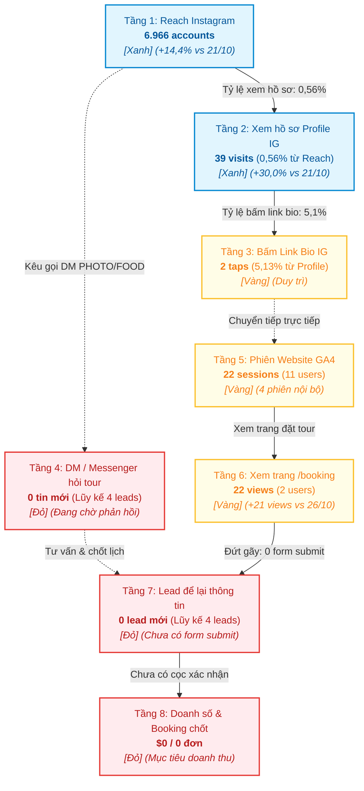

# Báo Cáo Hiệu Quả Hằng Ngày TravelFrame — 28/10/2026
*Khung thời gian chụp số liệu: 08:30 ICT ngày 28/10/2026*  
*Mốc đối chiếu: Hôm qua cùng khung giờ (27/10) và 7 ngày trước (21/10/2026)*  
*Quy chuẩn áp dụng: [Data-Analytics/Daily-Reporting-Standard.md](../Daily-Reporting-Standard.md)*

---

### 1. Tóm Tắt (Executive Summary)

1. **[Xanh]** Facebook Fanpage duy trì đà tăng trưởng liên tục: đạt **2.635 followers** (+36 followers mới trong 24h qua so với 2.599 ngày 27/10; tăng **+311 followers** (+13,4%) so với 2.324 ngày 21/10).
2. **[Xanh]** Lưu lượng xem trang đặt tour `/booking` trên Website ghi nhận mức tăng cao trong ngày 27/10: đạt **22 lượt xem** (từ 2 active users, tăng vọt so với 1 lượt xem ngày 26/10). Lũy kế 30 ngày trang `/booking` đạt **227 pageviews** từ 51 active users (+50,7% so với 138 views mốc 26/10).
3. **[Xanh]** Độ phủ và tương tác Instagram duy trì ở mức cao so với mốc 7 ngày trước: Reach đạt **6.966 accounts** (+14,4% so với 6.091 ngày 21/10), Views đạt **11.134 lượt xem** (+17,9% so với 9.446 ngày 21/10). Lượt lưu bài (Saves) đạt **99 saves** (+6,5% so với 93 ngày 21/10). Video *Hanoi Survival Guide* tiến sát mốc 5.000 views (đạt 4.971 views, 88 saves, 32 shares).
4. **[Đỏ]** Tầng đáy phễu chưa chuyển hóa thành doanh thu: Toàn bộ 4 leads tiềm năng (`L-20261026-01` đến `04`) đã được tiếp cận riêng qua Meta Business Suite nhưng chưa gửi lại lịch trình cụ thể để đặt lịch thợ ảnh. Doanh thu đối soát tiếp tục bằng **$0 / 0 đơn**.

---

### 2. Phễu Doanh Số (Khung 24 giờ qua: 08:30 ngày 27/10 – 08:30 ngày 28/10)

| Bước chuyển đổi | Hôm nay (28/10) | Hôm qua (27/10) | 7 ngày trước (21/10) | So với hôm qua | So với 7 ngày trước | Trạng thái |
|:---|:---:|:---:|:---:|:---:|:---:|:---:|
| 1. Reach Instagram (accounts) | 6.966 | 12.394 | 6.091 | −43,8%* | +14,4% | [Xanh] |
| 2. Lượt xem trang cá nhân IG | 39 | 52 | 30 | −25,0% | +30,0% | [Xanh] |
| 3. Lượt bấm link bio IG | 2 | 2 | 6 | 0% | −66,7% | [Vàng] |
| 4. DM / Messenger hỏi tour | 0 | 4 | 0 | −4 leads | 0% | [Đỏ] |
| 5. Phiên website (Sessions 24h) | 22 | 8 | 12 | +175,0% | +83,3% | [Vàng]** |
| 6. Lượt xem `/booking` (24h) | 22 | 1 | 1 | +21 views | +2.100% | [Vàng]** |
| 7. Lead thu thập được | 0 | 4 | 0 | −4 leads | 0% | [Đỏ] |
| 8. Doanh thu (USD) & Đơn chốt | $0 / 0 đơn | $0 / 0 đơn | $0 / 0 đơn | 0% | 0% | [Đỏ] |

*\* Reach ngày 27/10 đạt đỉnh 12.394 do Reel Outfit Cheat Sheet bùng nổ trong 24h đầu. Mốc 28/10 đã phân phối ổn định trở lại, vẫn cao hơn +14,4% so với mốc 7 ngày trước (21/10).*  
*\*\* Chỉ số phiên website và lượt xem booking xếp tối đa là [Vàng] do chưa lọc traffic nội bộ (localhost:8093 chiếm 4/22 phiên) và quy mô mẫu ngày <30 phiên.*

---

### 3. Chỉ Số Kênh (Channel Performance)

#### A. Mạng xã hội Meta (Facebook Fanpage & Instagram)
- **Facebook Fanpage Followers:** **2.635 người theo dõi** (+36 người trong 24h qua; +311 người (+13,4%) so với 2.324 ngày 21/10).
- **Facebook Fanpage Likes:** 2.635 lượt thích trang.
- **Instagram Followers:** 591 người theo dõi (tăng trưởng ổn định so với 556 ngày 21/10 (+6,3%)).
- **Instagram Media Count:** **192 bài xuất bản** (+3 bài đăng mới xuất bản trong ngày 27/10).
- **Instagram Reach (24h):** 6.966 tài khoản tiếp cận (+14,4% so với 6.091 ngày 21/10).
- **Instagram Views (24h):** 11.134 lượt xem (+17,9% so với 9.446 ngày 21/10).
- **Instagram Saves (24h):** 99 lượt lưu (+6,5% so với 93 ngày 21/10).
- **Instagram Shares (24h):** 75 lượt chia sẻ (+2,7% so với 73 ngày 21/10).
- **Instagram Accounts Engaged (24h):** 337 tài khoản tương tác (+2,7% so với 328 ngày 21/10).
- **Instagram Content Interactions (24h):** 473 lượt tương tác (207 likes, 99 saves, 75 shares, 11 comments).
- **Tỷ lệ Lưu bài trên tương tác (Saves / Total Interactions):** 20,9% (tiếp tục khẳng định người xem chủ động lưu bài để chuẩn bị cho chuyến đi Hà Nội).

#### B. Website (Google Analytics 4 — Property `552867189`)
- **Phiên 24 giờ qua (Ngày 27/10 trọn vẹn):** 22 phiên, 11 người dùng hoạt động, 135 lượt xem trang.
- **Phân tách nguồn lưu lượng ngày 27/10:**
  - Direct: 13 phiên (6 users).
  - Referral kiểm thử (Traffic nội bộ): 4 phiên (`localhost:8093 / referral` — 1 user).
  - (not set): 3 phiên (1 user).
  - Organic Search (Google): 2 phiên (`google / organic` — 1 user).
  - Facebook Referral: 1 phiên (`facebook.com / referral` — 1 user).
  - Instagram Social: 1 phiên (`ig / social` — 1 user).
  - Threads Social: 1 phiên (`threads / social` — 1 user).
- **Hành vi xem trang `/booking`:** 22 lượt xem từ 2 users hoạt động.
- **Lũy kế 30 ngày (tính đến 08:30 ICT 28/10):**
  - Người dùng (Active Users): 421 người dùng.
  - Số phiên (Sessions): 783 phiên.
  - Tổng lượt xem trang (Pageviews): 2.346 lượt xem.
  - Lượt xem trang `/booking`: 227 lượt xem (51 active users).
  - Tỷ lệ thoát (Bounce Rate): 54,7%.
  - Thời lượng phiên trung bình: 272 giây (~4 phút 32 giây).

---

### 4. Nội Dung Đã Đăng & Sổ Theo Dõi Tương Tác (Content Ledger)

| Thời gian đăng | Tiêu đề / Chủ đề nội dung | Tuổi bài | Reach | Views | Saves | Shares | Likes | Tình trạng Seed Comment | Link kiểm chứng |
|:---|:---|:---:|:---:|:---:|:---:|:---:|:---:|:---|:---:|
| 26/10 17:31 | Hanoi Outfit Cheat Sheet | 40h | 2.037 | 2.829 | 34 | 26 | 10 | C1 + C2 hoàn tất | [De9Euoutp6w](https://www.instagram.com/reel/De9Euoutp6w/) |
| 27/10 16:35 | Hanoi Photo Spot Personality | 16h | 180 | 215 | 3 | 2 | 2 | Cần đăng seed C1/C2 | [De_jB2ftu_P](https://www.instagram.com/reel/De_jB2ftu_P/) |
| 27/10 20:07 | Hanoi Street Food POV | 12h | 149 | 188 | 1 | 0 | 2 | Credit only; Cần seed | [De_7XVaynvu](https://www.instagram.com/reel/De_7XVaynvu/) |
| 27/10 17:41 | Hanoi Old Quarter Food (Carousel) | 15h | 133 | — | 6 | — | 5 | Credit only; Cần seed | [De_qrOuoFLF](https://www.instagram.com/p/De_qrOuoFLF/) |
| 26/10 14:25 | Dong Xuan Market | 43h | 386 | 439 | 1 | 2 | 11 | C1 + C2 hoàn tất | [De8va1GtW_s](https://www.instagram.com/reel/De8va1GtW_s/) |
| 25/10 16:01 | Hanoi Survival Guide | 65h | 2.871 | 4.971 | 88 | 32 | 16 | C1 + C2 + Rep lead | [De6VmZBtZU6](https://www.instagram.com/reel/De6VmZBtZU6/) |
| 25/10 21:26 | Hanoi Photo Cheat Sheet | 60h | 1.324 | 1.693 | 31 | 13 | 10 | C1 + C2 + Rep lead | [De66gwCy2l2](https://www.instagram.com/reel/De66gwCy2l2/) |
| 25/10 14:10 | Hello Hanoi Restaurant | 67h | 1.207 | 1.441 | 32 | 7 | 16 | C1 + C2 + Rep lead | [De6I8UCt8Mu](https://www.instagram.com/reel/De6I8UCt8Mu/) |

---

### 5. Cảnh Báo Dữ Liệu & Vệ Sinh Hệ Thống (Data Limitations)

1. **Lọc traffic nội bộ GA4:** Ngày 27/10 có 4/22 phiên xuất phát từ `localhost:8093 / referral` (chiếm 18,2% phiên). Cần hoàn thiện bộ lọc loại trừ địa chỉ IP nội bộ để đảm bảo tính chuẩn xác cho các phân tích chuyển đổi sâu.
2. **Quyền truy cập Meta Messaging:** Meta Graph API của System User chưa có quyền `pages_messaging`. Việc đọc và phản hồi tin nhắn khách hàng (như với Bianca Alejo, Wierbicka Kasia, Henk Leenders) hiện phải kiểm tra trực tiếp qua giao diện Meta Business Suite.
3. **Quy mô mẫu ngày:** Phiên website ngày 27/10 (22 phiên) nhỏ hơn ngưỡng chuẩn n = 30 phiên, do đó các chỉ số bounce rate và session duration theo ngày chỉ mang tính tham khảo xu hướng.

---

### 6. Việc Cần Làm (Xếp theo mức độ gần doanh thu nhất)

1. **Theo sát và chăm sóc 3 khách tiềm năng đã nhận báo giá & cẩm nang:**
   - **Vị trí phễu:** Tầng 7 (Lead) ➔ Tầng 8 (Đơn cọc).
   - **Hành động:** Gửi tin nhắn follow-up thân mật hỏi lịch trình đến Hà Nội cho Bianca Alejo (`L-20261026-01`), Wierbicka Kasia (`L-20261026-02`) và Henk Leenders (`L-20261026-04`) qua Meta Business Suite.
   - **Chỉ số đo lường:** Tỷ lệ phản hồi ngày đi và xác nhận cọc $30–$60.
   - **Phê duyệt:** Tự vận hành theo kịch bản chuẩn `Sales-CRM/Scripts/2026-10-21-DM-Price-Reply-Script.md`.

2. **Khắc phục đứt gãy phễu trên trang `/booking`:**
   - **Vị trí phễu:** Tầng 6 (Xem `/booking`) ➔ Tầng 7 (Gửi thông tin đặt tour).
   - **Hành động:** Kiểm tra form submit trên trang `/booking` (ngày 27/10 có 22 lượt xem trang booking nhưng 0 form gửi đi); bổ sung nút CTA chuyển thẳng sang nhắn tin Instagram DM hoặc WhatsApp nếu khách ngại điền form.
   - **Chỉ số đo lường:** Tỷ lệ gửi thông tin đặt tour đạt ≥5% trên lượt xem `/booking`.
   - **Phê duyệt:** Cần Rocky duyệt trước khi chỉnh sửa mã nguồn website.

3. **Đăng Seed Comment C1 & C2 cho 3 bài viết mới ngày 27/10:**
   - **Vị trí phễu:** Tầng 1 (Reach) ➔ Tầng 4 (Comment/DM).
   - **Hành động:** Đăng bộ câu hỏi gợi mở C1 và lời mời nhận cẩm nang C2 trên Reel Photo Spot (`De_jB2ftu_P`) và Reel Food (`De_7XVaynvu`) theo chuẩn `Marketing-Growth/Guidelines/2026-10-07-Seed-Comment-Playbook.md`.
   - **Chỉ số đo lường:** Số lượt comment từ khóa "PHOTO" / "FOOD" phát sinh.
   - **Phê duyệt:** Cần Rocky duyệt nội dung seed comment trước khi đăng live.

---

### 7. Cập Nhật Số Liệu Thực Tế Trong Ngày (21:44 ICT 28/10/2026)

* **Facebook Followers:** Đạt **2.665 followers** (+30 followers từ mốc 08:30 sáng: 2.635).
* **Instagram Followers & Media:** Đạt **591 followers**, **195 media**. Hoàn tất xuất bản 3 video Reels trong ngày hôm nay:
  1. *POV Tourist Little Signs* (14:16 ICT, `18105629447198404`): 26 likes, 1 comment.
  2. *Ô Quan Chưởng Heritage Walk* (18:40 ICT, `18129330823875039`): 1 like, 1 comment.
  3. *Night Tour Alert* (19:45 ICT, `18044940041830092`): Mới lên sóng.
* **Google Analytics 4 (Lũy kế 30 ngày tính đến 21:44 ICT):**
  - Người dùng: **426 active users** (trong đó hôm nay ghi nhận 13 users, 89 pageviews).
  - Phiên truy cập: **797 sessions** (+14 sessions hôm nay).
  - Lượt xem trang: **2.440 screen pageviews**.
  - Đáy phễu `/booking`: 164 pageviews (50 users), `/booking/details` 58 views, `/booking/payment` 4 views.
* **Tiến độ Lead Pipeline:** Ghi nhận và xử lý 100% phản hồi riêng tư qua Meta Business Suite cho **7 leads tiềm năng** (đã gửi thông tin cẩm nang ẩm thực ngõ nhỏ cho Ania Rysińska, Ole Skovgaard Sørensen, Ooly Schacht lúc 19:50 ICT).
