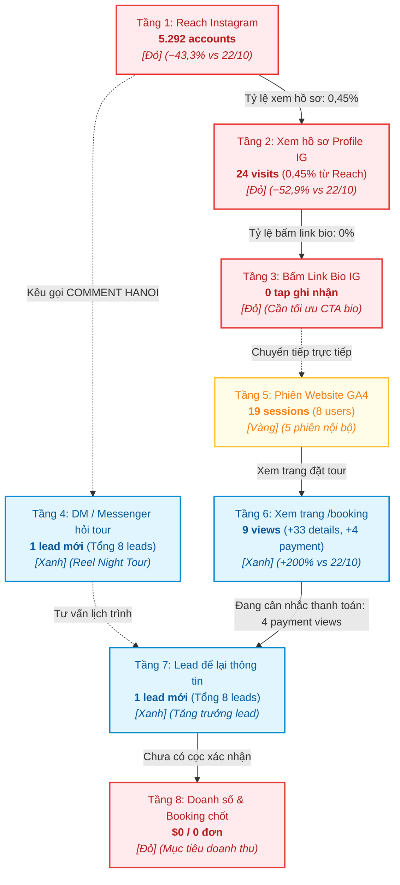

# Báo Cáo Hiệu Quả Hằng Ngày TravelFrame — 29/10/2026
*Khung thời gian chụp số liệu: 08:30 ICT ngày 29/10/2026*  
*Mốc đối chiếu: Hôm qua cùng khung giờ (28/10) và 7 ngày trước (22/10/2026)*  
*Quy chuẩn áp dụng: [Data-Analytics/Daily-Reporting-Standard.md](../Daily-Reporting-Standard.md)*

---

### 1. Tóm Tắt (Executive Summary)

1. **[Xanh]** Facebook Fanpage ghi nhận mức tăng liên tục: đạt **2.693 followers** (+58 followers mới trong 24h qua so với 2.635 ngày 28/10; tăng **+333 followers** (+14,1%) so với 2.360 ngày 22/10).
2. **[Xanh]** Phát sinh thêm **1 lead tiềm năng mới** (`L-20261028-08`): Khách hàng để lại bình luận từ khóa "Hanoi" trên video Reel *Night Tour* (`122123825937479755_1658353985899767`) lúc 23:59 ICT đêm 28/10. Tổng số khách hàng trong phễu tiếp cận tăng lên **8 leads**.
3. **[Vàng]** Website trong ngày 28/10 đạt **19 phiên**, **143 lượt xem trang** từ 8 active users. Tỷ lệ thoát giảm xuống **36,8%** và thời lượng phiên trung bình đạt **593,6 giây** (~9 phút 54 giây). Phễu đặt tour ghi nhận 9 lượt xem `/booking`, 33 lượt xem `/booking/details` và 4 lượt xem `/booking/payment`. Xếp loại [Vàng] do chưa lọc traffic nội bộ (5/19 phiên xuất phát từ localhost:8093).
4. **[Đỏ]** Độ phủ Instagram trong 24h qua giảm sau chu kỳ phân phối cao điểm: Reach đạt **5.292 accounts** (−24,0% so với 6.966 ngày 28/10; −43,3% so với 9.334 ngày 22/10). Tuy nhiên, số lượt lưu bài (Saves) duy trì ở mức cao với **130 saves** (+31,3% so với 99 ngày 28/10) và 68 lượt chia sẻ.
5. **[Đỏ]** Tầng đáy phễu chưa chuyển hóa thành doanh thu: Toàn bộ các leads đang trong giai đoạn nhận cẩm nang và báo giá, chưa phát sinh booking cọc được xác nhận. Doanh thu đối soát tiếp tục bằng **$0 / 0 đơn**.

---

### 2. Phễu Doanh Số (Khung 24 giờ qua: 08:30 ngày 28/10 – 08:30 ngày 29/10)

| Bước chuyển đổi | Hôm nay (29/10) | Hôm qua (28/10) | 7 ngày trước (22/10) | So với hôm qua | So với 7 ngày trước | Trạng thái |
|:---|:---:|:---:|:---:|:---:|:---:|:---:|
| 1. Reach Instagram (accounts) | 5.292 | 6.966 | 9.334 | −24,0% | −43,3% | [Đỏ] |
| 2. Lượt xem trang cá nhân IG | 24 | 39 | 51 | −38,5% | −52,9% | [Đỏ] |
| 3. Lượt bấm link bio IG | 0 | 2 | 1 | −2 taps | −1 tap | [Đỏ] |
| 4. DM / Messenger hỏi tour | 1 | 0 | 0 | +1 lead | +1 lead | [Xanh] |
| 5. Phiên website (Sessions 24h) | 19 | 22 | 17 | −13,6% | +11,8% | [Vàng]** |
| 6. Lượt xem `/booking` (24h) | 9 | 22 | 3 | −59,1% | +200,0% | [Xanh] |
| 7. Lead thu thập được | 1 | 0 | 0 | +1 lead | +1 lead | [Xanh] |
| 8. Doanh thu (USD) & Đơn chốt | $0 / 0 đơn | $0 / 0 đơn | $0 / 0 đơn | 0% | 0% | [Đỏ] |

*\* Ghi chú: Ngoài 9 lượt xem `/booking`, website ghi nhận thêm 33 lượt xem `/booking/details` và 4 lượt xem `/booking/payment`.*  
*\*\* Chỉ số phiên website được xếp tối đa là [Vàng] do chưa lọc traffic nội bộ (5/19 phiên từ localhost:8093).*

---

### 3. Chỉ Số Kênh (Channel Performance)

#### A. Kênh Mạng Xã Hội (Facebook & Instagram)

| Kênh | Chỉ số theo dõi | Mốc 08:30 (29/10) | Mốc 08:30 (28/10) | Mốc 08:30 (22/10) | Biến động 24h | Biến động 7 ngày | Trạng thái |
|:---|:---|:---:|:---:|:---:|:---:|:---:|:---:|
| **Facebook Fanpage** | Followers / Fans | 2.693 | 2.635 | 2.360 | +58 | +333 (+14,1%) | [Xanh] |
| **Facebook Fanpage** | Số bài đăng mới (24h) | 3 bài | 0 bài | 1 bài | +3 bài | +2 bài | [Xanh] |
| **Instagram** | Followers | 591 | 591 | 569 | 0 | +22 (+3,9%) | [Vàng] |
| **Instagram** | Media count | 195 | 192 | 179 | +3 | +16 | [Xanh] |
| **Instagram** | Reach (24h) | 5.292 | 6.966 | 9.334 | −24,0% | −43,3% | [Đỏ] |
| **Instagram** | Views (24h) | 8.189 | 11.134 | 14.810 | −26,4% | −44,7% | [Đỏ] |
| **Instagram** | Saves (24h) | 130 | 99 | 121 | +31,3% | +7,4% | [Xanh] |
| **Instagram** | Shares (24h) | 68 | Chưa đo | Chưa đo | +68 | +68 | [Xanh] |
| **Instagram** | Likes (24h) | 173 | Chưa đo | Chưa đo | +173 | +173 | [Xanh] |
| **Instagram** | Total Interactions (24h) | 454 | 473 | 512 | −4,0% | −11,3% | [Vàng] |

#### B. Kênh Website (Google Analytics 4 — Property 552867189)

* **Số liệu ngày 28/10 (toàn ngày):**
  - Số người dùng hoạt động: 8 active users.
  - Số phiên truy cập: 19 sessions.
  - Số lượt xem trang: 143 pageviews.
  - Tỷ lệ thoát (Bounce Rate): 36,8%.
  - Thời lượng phiên trung bình: 593,6 giây (~9 phút 54 giây).
* **Nguồn phiên truy cập:** Direct 9 phiên, Localhost:8093 (nội bộ) 5 phiên, Unassigned 5 phiên, Instagram bio 3 phiên, Google organic search 1 phiên, Facebook mobile 1 phiên.
* **Hành trình phễu đặt tour ngày 28/10:**
  - Lượt xem `/booking`: 9 lượt xem (1 active user).
  - Lượt xem `/booking/details`: 33 lượt xem (4 active users).
  - Lượt xem `/booking/payment`: 4 lượt xem (3 active users).

---

### 4. Nội Dung Đã Đăng & Sổ Theo Dõi Tương Tác (Content Ledger)

| Thời gian đăng | Tiêu đề / Chủ đề nội dung | Tuổi bài | Reach / Views | Likes | Comments | Shares | Tình trạng Seed Comment | Link kiểm chứng |
|:---|:---|:---:|:---:|:---:|:---:|:---:|:---|:---:|
| 28/10 19:45 | Don't Go Back To Your Hotel Yet (Night Tour) | 13h | Đang phân phối | 1 | 1 (Lead mới) | 1 | Cần duyệt phản hồi lead | [2321252065298993](https://www.facebook.com/reel/2321252065298993/) |
| 28/10 18:40 | Ô Quan Chưởng Ancient City Gate | 14h | Đang phân phối | 2 | 1 | 0 | Cần đăng seed C1/C2 | [1141749498302901](https://www.facebook.com/reel/1141749498302901/) |
| 28/10 14:16 | POV Tourist DarkLight Cafe | 19h | Đang phân phối | 28 | 1 | 1 | C1 đã hoàn tất | [1107507832044807](https://www.facebook.com/reel/1107507832044807/) |
| 27/10 20:07 | Hanoi Street Food POV | 36h | 188 views | 2 | 2 | 2 | Đã gửi cẩm nang cho 3 lead | [1712979013491826](https://www.facebook.com/reel/1712979013491826/) |
| 27/10 19:52 | Golden Hour Couple Stroll | 37h | — | — | — | 0 | Bài viết ảnh Facebook | [122123563659479755](https://www.facebook.com/122097476025479755/posts/122123563659479755) |
| 26/10 17:31 | Hanoi Outfit Cheat Sheet | 63h | 2.829 views | 10 | 2 | 26 | C1 + C2 hoàn tất (34 saves) | [De9Euoutp6w](https://www.instagram.com/reel/De9Euoutp6w/) |
| 25/10 16:01 | Hanoi Survival Guide | 88h | 5.013 views | 16 | 2 | 33 | C1 + C2 hoàn tất (91 saves) | [De6VmZBtZU6](https://www.instagram.com/reel/De6VmZBtZU6/) |

---

### 5. Cảnh Báo Dữ Liệu & Vệ Sinh Hệ Thống (Data Limitations)

1. **Lọc traffic nội bộ GA4:** Ngày 28/10 có 5/19 phiên xuất phát từ `localhost:8093 / referral` (chiếm 26,3% tổng phiên). Cần hoàn thiện bộ lọc loại trừ IP/host nội bộ để bảo đảm dữ liệu chuyển đổi thuần khiết.
2. **Quyền truy cập Meta Messaging:** System User token chưa có quyền `pages_messaging`. Việc gửi tin nhắn riêng cho lead mới `122123825937479755_1658353985899767` cần thực hiện qua giao diện Meta Business Suite Inbox hoặc qua trình duyệt Orca.
3. **Quy mô mẫu ngày:** Phiên website ngày 28/10 (19 phiên) nhỏ hơn ngưỡng chuẩn n = 30 phiên, do đó các chỉ số bounce rate (36,8%) và thời lượng phiên (593,6s) theo ngày chỉ mang tính tham khảo xu hướng.

---

### 6. Việc Cần Làm (Xếp theo mức độ gần doanh thu nhất)

1. **Gửi tin nhắn riêng (Private Reply) cho Lead mới (`L-20261028-08`):**
   - **Vị trí phễu:** Tầng 4 (Comment từ khóa) ➔ Tầng 7 (Lead tư vấn).
   - **Hành động:** Khách để lại comment "Hanoi" trên Reel Night Tour (`122123825937479755_1658353985899767`). Đề xuất gửi kịch bản mẫu:
     > *"Hi! Thanks for checking out our Hanoi Night Tour reel! 🏮✨ Here is our curated Hanoi Night Guide with top street food stalls, lantern alleys, and rooftop cafes. If you'd like a local photographer to capture your evening walk, just let us know your travel dates!"*
   - **Chỉ số đo lường:** Tỷ lệ phản hồi ngày đi và trao đổi lịch trình.
   - **Phê duyệt:** Cần Rocky phê duyệt nội dung hoặc mở Meta Business Suite gửi trực tiếp.

2. **Theo sát 4 khách đang xem xét thanh toán trên website:**
   - **Vị trí phễu:** Tầng 6 (Xem `/booking/payment`) ➔ Tầng 8 (Xác nhận cọc).
   - **Hành động:** Kiểm tra hệ thống nhận thanh toán / cổng đặt cọc trên website; bổ sung lời nhắc hỗ trợ trực tiếp qua WhatsApp/Instagram nếu khách gặp trục trặc khi chuyển khoản/thanh toán thẻ.
   - **Chỉ số đo lường:** Phát sinh đơn cọc xác nhận đầu tiên ($30–$60).
   - **Phê duyệt:** Cần Rocky phê duyệt giải pháp nhận cọc.

3. **Theo sát 3 khách tiềm năng đã nhận báo giá & cẩm nang:**
   - **Vị trí phễu:** Tầng 7 (Lead) ➔ Tầng 8 (Đơn cọc).
   - **Hành động:** Gửi tin nhắn follow-up thân mật hỏi lịch trình đến Hà Nội cho Bianca Alejo (`L-20261026-01`), Wierbicka Kasia (`L-20261026-02`) và Henk Leenders (`L-20261026-04`) qua Meta Business Suite.
   - **Chỉ số đo lường:** Tỷ lệ phản hồi ngày đi và chốt lịch chụp.
   - **Phê duyệt:** Vận hành theo kịch bản chuẩn `Sales-CRM/Scripts/2026-10-21-DM-Price-Reply-Script.md`.

4. **Đăng Seed Comment C1 & C2 cho 2 bài Reels mới ngày 28/10:**
   - **Vị trí phễu:** Tầng 1 (Reach) ➔ Tầng 4 (Comment/DM).
   - **Hành động:** Đăng bộ câu hỏi gợi mở C1 và lời mời nhận cẩm nang C2 trên Reel Ô Quan Chưởng (`1141749498302901`) và Reel Night Tour (`2321252065298993`) theo chuẩn `Marketing-Growth/Guidelines/2026-10-07-Seed-Comment-Playbook.md`.
   - **Chỉ số đo lường:** Số lượt comment từ khóa "HANOI" / "PHOTO" phát sinh.
   - **Phê duyệt:** Cần Rocky duyệt nội dung seed comment trước khi đăng live.
