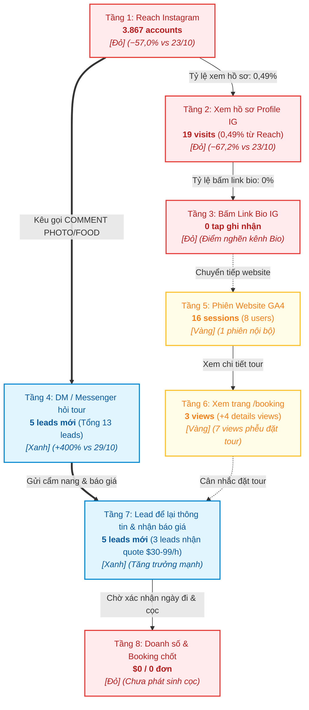

# Báo Cáo Hiệu Quả Hằng Ngày TravelFrame — 30/10/2026
*Khung thời gian chụp số liệu: 19:23 ICT ngày 30/10/2026*  
*Mốc đối chiếu: Hôm qua (29/10/2026) và 7 ngày trước (23/10/2026)*  
*Quy chuẩn áp dụng: [Data-Analytics/Daily-Reporting-Standard.md](../Daily-Reporting-Standard.md)*

---

### 1. Tóm Tắt (Executive Summary)

1. **[Xanh]** Phễu thu thập Lead ghi nhận bước tiến quan trọng nhất trong tháng: Phát sinh thêm **5 leads tiềm năng mới** trong 24h qua (`L-20261029-09` đến `L-20261030-13`), nâng tổng quy mô khách hàng tiềm năng trong phễu lên **13 leads**. Cả 5 leads đều đã được phản hồi công khai qua API và gửi tin nhắn tư vấn/báo giá cá nhân hóa qua Meta Business Suite (3 leads nhận báo giá $30–$99/h, 2 leads nhận cẩm nang ẩm thực và đề xuất photo tour).
2. **[Xanh]** Facebook Fanpage duy trì đà tăng trưởng liên tục: Đạt **2.777 followers** (+84 followers mới trong 24h qua so với 2.693 ngày 29/10; tăng **+335 followers** (+13,7%) so với 2.442 ngày 23/10).
3. **[Vàng]** Website trong ngày 29/10 đạt **16 phiên**, **55 lượt xem trang** từ 8 active users. Traffic từ tìm kiếm tự nhiên (Google Organic Search) tăng lên 5 phiên (chiếm 31,3% tổng phiên). Phễu đặt tour ghi nhận 3 lượt xem `/booking` và 4 lượt xem `/booking/details`. Traffic nội bộ giảm xuống mức tối thiểu (1/16 phiên từ localhost:8093 so với 5/19 phiên ngày hôm trước). Xếp loại [Vàng] do vẫn còn 1 phiên nội bộ và quy mô mẫu <30 phiên.
4. **[Đỏ]** Độ phủ Instagram giảm trong 24h qua: Reach đạt **3.867 accounts** (−27,0% so với 5.292 ngày 29/10; −57,0% so với 8.987 ngày 23/10). Lượt xem đạt **7.328 views** (−10,5% so với 8.189 ngày 29/10). Tuy nhiên, số lượt chia sẻ (Shares) tăng trưởng đạt **92 shares** (+35,3% so với 68 ngày 29/10) và lượt lưu bài (Saves) duy trì ở mức cao với **125 saves**. Lượt bấm link bio Instagram tiếp tục bằng **0**.
5. **[Đỏ]** Tầng đáy phễu chưa chuyển hóa thành doanh thu thực tế: Toàn bộ 13 leads đang trong giai đoạn trao đổi lịch trình và cân nhắc báo giá, chưa phát sinh khoản tiền cọc nào được ghi nhận. Doanh thu đối soát tiếp tục bằng **$0 / 0 đơn**.

---

### 2. Phễu Doanh Số (Khung 24 giờ qua: 29/10 – 30/10)

| Bước chuyển đổi | Hôm nay (30/10) | Hôm qua (29/10) | 7 ngày trước (23/10) | So với hôm qua | So với 7 ngày trước | Trạng thái |
|:---|:---:|:---:|:---:|:---:|:---:|:---:|
| 1. Reach Instagram (accounts) | 3.867 | 5.292 | 8.987 | −27,0% | −57,0% | [Đỏ] |
| 2. Lượt xem trang cá nhân IG | 19 | 24 | 58 | −20,8% | −67,2% | [Đỏ] |
| 3. Lượt bấm link bio IG | 0 | 0 | 3 | 0 taps | −3 taps | [Đỏ] |
| 4. DM / Messenger hỏi tour | 5 | 1 | 0 | +4 leads (+400%) | +5 leads | [Xanh] |
| 5. Phiên website (Sessions 24h) | 16 | 19 | 16 | −15,8% | 0% | [Vàng]** |
| 6. Lượt xem `/booking` (24h) | 3* | 9* | 1* | −66,7% | +200,0% | [Vàng] |
| 7. Lead thu thập được | 5 | 1 | 0 | +4 leads (+400%) | +5 leads | [Xanh] |
| 8. Doanh thu (USD) & Đơn chốt | $0 / 0 đơn | $0 / 0 đơn | $0 / 0 đơn | 0% | 0% | [Đỏ] |

*\* Ghi chú: Ngày 29/10 ghi nhận 3 lượt xem `/booking` và 4 lượt xem `/booking/details` (tổng 7 views hành trình đặt tour).*  
*\*\* Chỉ số phiên website được xếp tối đa là [Vàng] do chưa lọc hoàn toàn traffic nội bộ (1/16 phiên từ localhost:8093).*

---

### 3. Chỉ Số Kênh (Channel Performance)

#### A. Kênh Mạng Xã Hội (Facebook & Instagram)

| Kênh | Chỉ số theo dõi | Mốc 19:23 (30/10) | Mốc 08:30 (29/10) | Mốc 17:04 (23/10) | Biến động 24h | Biến động 7 ngày | Trạng thái |
|:---|:---|:---:|:---:|:---:|:---:|:---:|:---:|
| **Facebook Fanpage** | Followers / Fans | 2.777 | 2.693 | 2.442 | +84 | +335 (+13,7%) | [Xanh] |
| **Facebook Fanpage** | Số bài đăng mới (24h) | 3 bài | 3 bài | 1 bài | 0 | +2 bài | [Xanh] |
| **Instagram** | Followers | 593 | 591 | 570 | +2 | +23 (+4,0%) | [Vàng] |
| **Instagram** | Media count | 201 | 195 | 183 | +6 | +18 | [Xanh] |
| **Instagram** | Reach (24h) | 3.867 | 5.292 | 8.987 | −27,0% | −57,0% | [Đỏ] |
| **Instagram** | Views (24h) | 7.328 | 8.189 | 14.014 | −10,5% | −47,7% | [Đỏ] |
| **Instagram** | Saves (24h) | 125 | 130 | 321 | −3,8% | −61,1% | [Vàng] |
| **Instagram** | Shares (24h) | 92 | 68 | 220 | +35,3% | −58,2% | [Xanh] |
| **Instagram** | Likes (24h) | 145 | 173 | 274 | −16,2% | −47,1% | [Đỏ] |
| **Instagram** | Total Interactions (24h) | 483 | 454 | 1.054 | +6,4% | −54,2% | [Vàng] |
| **Instagram** | Profile Views (24h) | 19 | 24 | 58 | −20,8% | −67,2% | [Đỏ] |
| **Instagram** | Website Link Taps (24h) | 0 | 0 | 3 | 0 | −3 taps | [Đỏ] |

#### B. Kênh Website (Google Analytics 4 — Property `552867189`)

* **Số liệu ngày 29/10 (toàn ngày):**
  - Số người dùng hoạt động: 8 active users.
  - Số phiên truy cập: 16 sessions.
  - Số lượt xem trang: 55 pageviews.
  - Tỷ lệ thoát (Bounce Rate): 62,5%.
  - Thời lượng phiên trung bình: 289,8 giây (~4 phút 50 giây).
* **Nguồn phiên truy cập ngày 29/10:**
  - Direct: 8 phiên (4 active users).
  - Google Organic Search: 5 phiên (2 active users).
  - Facebook (`facebook / page_button`): 1 phiên (1 active user).
  - Instagram (`ig / social`): 1 phiên (1 active user).
  - Localhost:8093 (traffic nội bộ): 1 phiên (0 active users) — giảm mạnh so với 5 phiên ngày 28/10.
* **Hành trình phễu đặt tour ngày 29/10:**
  - Lượt xem `/tours`: 9 lượt xem (5 active users).
  - Lượt xem `/`: 12 lượt xem (7 active users).
  - Lượt xem `/about`: 6 lượt xem (3 active users).
  - Lượt xem `/booking`: 3 lượt xem (3 active users).
  - Lượt xem `/booking/details`: 4 lượt xem (1 active user).
* **Lũy kế MTD Tháng 10 (01/10 – 30/10):**
  - Tổng người dùng hoạt động: 391 active users.
  - Tổng số phiên: 716 sessions.
  - Tổng lượt xem trang: 2.204 pageviews.
  - Lượt xem trang `/booking`: 159 pageviews (+80 pageviews `/booking/details`).

---

### 4. Nội Dung Đã Đăng & Sổ Theo Dõi Tương Tác (Content Ledger)

| Thời gian đăng | Tiêu đề / Chủ đề nội dung | Kênh & Định dạng | Mã bài / URL | Lượt thích | Bình luận | Chia sẻ | Tình trạng Seed Comment & Chuyển đổi Lead | Bằng chứng nền tảng |
|:---|:---|:---:|:---|:---:|:---:|:---:|:---|:---:|
| 30/10 17:15 ICT | POV: Autumn in Hanoi isn’t just a season… it’s a whole DESSERT MENU (Cốm) | FB Reel | [1151078517500460](https://www.facebook.com/reel/1151078517500460/) | 4 | 0 | 0 | Đang phân phối; chuẩn bị seed C1/C2 | Published (API Verified) |
| 30/10 17:14 ICT | Autumn in Hanoi Cốm Dessert Menu | IG Reel | [DfHV6p_teob](https://www.instagram.com/reel/DfHV6p_teob/) | 4 | 0 | 0 | Đang phân phối; chuẩn bị seed C1/C2 | Published (API Verified) |
| 30/10 16:07 ICT | POV: A photoshoot at Hanoi Train Street just hits DIFFERENT | FB Reel | [1169984178932919](https://www.facebook.com/reel/1169984178932919/) | 4 | 0 | 0 | Đang phân phối; chuẩn bị seed C1/C2 | Published (API Verified) |
| 30/10 16:06 ICT | Hanoi Train Street Photoshoot | IG Reel | [DfHOEwJtSHe](https://www.instagram.com/reel/DfHOEwJtSHe/) | 4 | 0 | 0 | Đang phân phối; chuẩn bị seed C1/C2 | Published (API Verified) |
| 29/10 20:38 ICT | Chasing sunsets in Hanoi (139 Alley 464 Au Co) | FB Reel | [1741416443621344](https://www.facebook.com/reel/1741416443621344/) | — | — | 1 | Seed C1 + C2 đã đăng 30/10 | Published (API Verified) |
| 29/10 20:37 ICT | Chasing sunsets in Hanoi (Au Co) | IG Reel | [DfFIa_Qy59O](https://www.instagram.com/reel/DfFIa_Qy59O/) | 4 | 2 | — | Seed C1 (ID …6560) + C2 (ID …2456) | Published (API Verified) |
| 29/10 20:00 ICT | The best way to discover Hanoi? Get lost on foot | FB Reel | [1145540444830655](https://www.facebook.com/reel/1145540444830655/) | — | 2 | 1 | Có 1 comment khen ngợi trải nghiệm và 1 endorsement độ an toàn | Published (API Verified) |
| 29/10 19:59 ICT | Get lost on foot in Hanoi Old Quarter | IG Reel | [DfFECG5yYXY](https://www.instagram.com/reel/DfFECG5yYXY/) | 60 | 3 | — | Seed C1 (ID …8049) + C2 (ID …07234) | Published (API Verified) |
| 29/10 18:07 ICT | I owe myself a life full of beautiful places | FB Reel | [1616389433561059](https://www.facebook.com/reel/1616389433561059/) | — | — | 2 | Seed C1 + C2 đã hoàn tất | Published (API Verified) |
| 29/10 18:07 ICT | Life is an adventure | IG Reel | [DfE3NhcyqNE](https://www.instagram.com/reel/DfE3NhcyqNE/) | 4 | 3 | — | Seed C1 (ID …69985) + C2 (ID …568392) | Published (API Verified) |

---

### 5. Cảnh Báo Dữ Liệu & Vệ Sinh Hệ Thống (Data Limitations)

1. **Quy mô mẫu ngày dưới ngưỡng chuẩn:** Ngày 29/10 có 16 phiên website (<30 phiên), do đó tỷ lệ thoát (62,5%) và thời lượng phiên trung bình (289,8s) chỉ phản ánh biến động ngắn hạn, chưa đủ cơ sở thống kê để đánh giá chất lượng toàn diện của landing page.
2. **Traffic nội bộ GA4:** Đã giảm từ 5 phiên xuống còn 1 phiên localhost:8093 trong ngày 29/10 (chiếm 6,25% tổng phiên). Tuy nhiên vẫn cần bổ sung bộ lọc IP/host nội bộ hoàn chỉnh trên GA4 để loại bỏ 100% traffic phát triển/kiểm thử.
3. **Phân loại hành vi xem trang đặt tour:** 3 lượt xem `/booking` và 4 lượt xem `/booking/details` ngày 29/10 là lượt xem của người dùng quan tâm tìm hiểu thông tin tour, chưa thể xác định là khách mua thực tế do chưa hoàn tất gửi form.
4. **Giới hạn API tin nhắn cá nhân:** Do System User token chưa có quyền `pages_messaging`, việc gửi tin nhắn riêng cho lead mới (Private Reply) vẫn được đội ngũ thực hiện qua trình duyệt Orca / Meta Business Suite Inbox. Toàn bộ tin nhắn công khai đã được trả lời tự động qua API.

---

### 6. Việc Cần Làm (Tối đa 5 việc, xếp theo mức độ gần doanh thu nhất)

1. **Chốt ngày đi và gửi form xác nhận cọc cho 5 leads mới vừa nhận báo giá/cẩm nang:**
   - **Vị trí phễu:** Tầng 7 (Lead tư vấn) ➔ Tầng 8 (Cọc doanh thu).
   - **Hành động:** Theo sát phản hồi của Estee Solly (`L-20261030-13`, quan tâm food & photo tour $30/h), Tracey Gracey (`L-20261029-09`, quan tâm night photo tour), @thefoodiboy_aku (`L-20261030-12`), Katrina Elizabeth (`L-20261030-10`) và Niamh Boyle (`L-20261030-11`) qua Meta Business Suite; hỏi ngày đến Hà Nội và số lượng người để gửi link cọc giữ lịch thợ ảnh.
   - **Chỉ số đo lường:** Tỷ lệ phản hồi ngày đi và phát sinh tối thiểu 1 đơn cọc xác nhận ($30–$60).
   - **Yêu cầu phê duyệt:** Tự vận hành theo kịch bản chuẩn `Sales-CRM/Scripts/2026-10-21-DM-Price-Reply-Script.md` và bảng giá đã duyệt `Executive/DEC-20261021-HOURLY-TIER-PRICING.md`.

2. **Thiết lập cơ chế thu tiền cọc trực tuyến linh hoạt cho khách quốc tế:**
   - **Vị trí phễu:** Tầng 6 (Xem `/booking/payment`) ➔ Tầng 8 (Xác nhận cọc).
   - **Hành động:** Hiện tại website đã có 4 lượt xem `/booking/payment` (từ ngày 28/10) nhưng chưa có thanh toán hoàn tất. Cần chuẩn bị sẵn đường link thanh toán thẻ quốc tế (Stripe/PayPal/Revolut/Wise) hoặc tài khoản ngân hàng để gửi ngay trong tin nhắn khi khách đồng ý đặt lịch.
   - **Chỉ số đo lường:** Thời gian từ lúc khách đồng ý đến khi nhận cọc thành công <2 giờ.
   - **Yêu cầu phê duyệt:** Cần Rocky phê duyệt lựa chọn cổng nhận thanh toán cọc.

3. **Phản hồi tương tác chứng thực (Customer Endorsement) trên Reel "Get Lost on Foot":**
   - **Vị trí phễu:** Tầng 1 (Reach & Social Proof) ➔ Tầng 4 (Hội thoại/Lead).
   - **Hành động:** Trả lời bình luận của người dùng Facebook (`ID: 122124098817479755_1443684083870089`) trên Reel Get Lost on Foot:
     > *"Spot on! That’s exactly what makes Hanoi so special — safe, welcoming, and full of hidden charms once you start wandering. So glad you had such a memorable experience in Vietnam! 🇻🇳✨"*
   - **Chỉ số đo lường:** Tăng độ uy tín cộng đồng và tỷ lệ bình luận tự nhiên của người xem khác.
   - **Yêu cầu phê duyệt:** Tự vận hành theo hướng dẫn `Sales-CRM/Scripts/2026-09-26-Customer-Segment-Interaction-Playbooks.md`.

4. **Đăng bộ Seed Comment C1 & C2 cho 2 Reels mới xuất bản ngày 30/10:**
   - **Vị trí phễu:** Tầng 1 (Reach) ➔ Tầng 4 (Comment từ khóa phát sinh Lead).
   - **Hành động:** Đăng câu hỏi mồi C1 và lời mời nhận cẩm nang/đặt tour C2 trên Reel *Autumn Cốm Dessert* (`1151078517500460` / `DfHV6p_teob`) và Reel *Hanoi Train Street Photoshoot* (`1169984178932919` / `DfHOEwJtSHe`) theo chuẩn `Marketing-Growth/Guidelines/2026-10-07-Seed-Comment-Playbook.md`.
   - **Chỉ số đo lường:** Phát sinh bình luận từ khóa "FOOD" và "PHOTO" từ khán giả trong 24h.
   - **Yêu cầu phê duyệt:** Cần Rocky duyệt nội dung seed comment trước khi đăng live.

5. **Tối ưu lại đường dẫn Link Bio Instagram để phá vỡ điểm nghẽn 0 tap:**
   - **Vị trí phễu:** Tầng 2 (Lượt xem profile IG) ➔ Tầng 3 (Bấm link bio) ➔ Tầng 5 (Phiên website).
   - **Hành động:** Trong 48h qua có 43 lượt xem profile Instagram nhưng 0 lượt bấm link bio. Đề xuất cập nhật lại dòng kêu gọi hành động trong bio IG: thay vì link rút gọn `tinyurl.com/travelframe-tours`, chuyển sang định dạng link trực tiếp `travelframe.vn/tours` hoặc thêm dòng chỉ dẫn rõ ràng "📸 Book your private photo walk in Hanoi 👇".
   - **Chỉ số đo lường:** Số lượt bấm link bio (Website clicks) tăng từ 0 lên ≥2 taps/ngày.
   - **Yêu cầu phê duyệt:** Cần Rocky duyệt thay đổi text bio Instagram.
