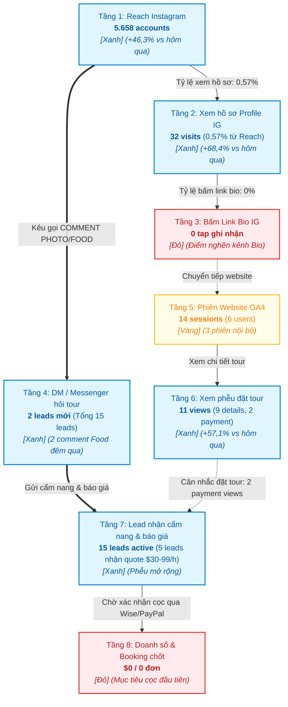

# Báo Cáo Hiệu Quả Hằng Ngày TravelFrame — 31/10/2026
*Khung thời gian chụp số liệu: 08:30 ICT ngày 31/10/2026 (Cập nhật lúc 09:26 ICT)*  
*Mốc đối chiếu: Hôm qua cùng khung giờ (30/10/2026) và 7 ngày trước (24/10/2026)*  
*Quy chuẩn áp dụng: [Data-Analytics/Daily-Reporting-Standard.md](../Daily-Reporting-Standard.md)*

---

### 1. Tóm Tắt (Executive Summary)

1. **[Xanh]** Phễu thu thập Lead ghi nhận thêm **2 khách hàng tiềm năng mới** rạng sáng 31/10 (`L-20261031-14` lúc 03:58 và `L-20261031-15` lúc 05:13) bình luận từ khóa "Food" trên video Reel *Hanoi Street Food POV*. Tổng quy mô khách hàng tiềm năng trong phễu đạt **15 leads** (trong đó có 5 khách đã nhận báo giá các gói theo giờ `$30–$99/h`).
2. **[Xanh]** Độ phủ và tương tác Instagram tăng trưởng trở lại: Reach 24h đạt **5.658 accounts** (+46,3% so với 3.867 ngày 30/10; −49,5% so với 11.201 ngày 24/10). Lượt xem nội dung đạt **10.361 views** (+41,4% so với 7.328 ngày 30/10). Lượt lưu bài (Saves) duy trì ở mức cao với **155 saves** (+24,0% so với 125 ngày 30/10) và lượt chia sẻ đạt **122 shares** (+32,6% so với 92 ngày 30/10).
3. **[Xanh]** Facebook Fanpage tiếp tục duy trì đà tăng trưởng liên tục: Đạt **2.818 followers** (+41 followers mới trong 24h qua so với 2.777 ngày 30/10; tăng **+331 followers** (+13,3%) so với 2.487 ngày 24/10).
4. **[Vàng]** Website trong ngày 30/10 đạt **14 phiên**, **127 lượt xem trang** từ 6 active users. Thời lượng phiên trung bình đạt **906,9 giây** (~15 phút 06 giây) và tỷ lệ thoát giảm xuống **42,9%**. Phễu đặt tour ghi nhận 9 lượt xem `/booking/details` và 2 lượt xem `/booking/payment`. Xếp loại [Vàng] do chưa lọc hoàn toàn traffic nội bộ (3/14 phiên xuất phát từ localhost:8093) và quy mô mẫu ngày <30 phiên.
5. **[Đỏ]** Tầng đáy phễu chưa chuyển hóa thành doanh thu: Toàn bộ 15 leads đang trong giai đoạn trao đổi lịch trình và cân nhắc báo giá, chưa phát sinh khoản cọc nào được đối soát. Lượt bấm link bio Instagram tiếp tục bằng **0**. Doanh thu đối soát tiếp tục bằng **$0 / 0 đơn**.

---

### 2. Phễu Doanh Số (Khung 24 giờ qua: 08:30 ngày 30/10 – 08:30 ngày 31/10)

| Bước chuyển đổi | Hôm nay (31/10) | Hôm qua (30/10) | 7 ngày trước (24/10) | So với hôm qua | So với 7 ngày trước | Trạng thái |
|:---|:---:|:---:|:---:|:---:|:---:|:---:|
| 1. Reach Instagram (accounts) | 5.658 | 3.867 | 11.201 | +46,3% | −49,5% | [Xanh] |
| 2. Lượt xem trang cá nhân IG | 32 | 19 | 78 | +68,4% | −59,0% | [Xanh] |
| 3. Lượt bấm link bio IG | 0 | 0 | 3 | 0 taps | −3 taps | [Đỏ] |
| 4. DM / Messenger hỏi tour | 2* | 5* | 0 | −60,0% | +2 leads | [Xanh] |
| 5. Phiên website (Sessions 24h) | 14 | 16 | 10 | −12,5% | +40,0% | [Vàng]** |
| 6. Lượt xem phễu `/booking` (24h) | 11*** | 7*** | 0 | +57,1% | +11 views | [Xanh] |
| 7. Lead thu thập được | 2 | 5 | 0 | −60,0% | +2 leads | [Xanh] |
| 8. Doanh thu (USD) & Đơn chốt | $0 / 0 đơn | $0 / 0 đơn | $0 / 0 đơn | 0% | 0% | [Đỏ] |

*\* Ghi chú Tầng 4 & 7: 2 leads mới phát sinh rạng sáng 31/10 (`L-14` lúc 03:58 và `L-15` lúc 05:13). Hôm qua phát sinh 5 leads trong ngày 30/10 (`L-09` đến `L-13`). Lũy kế toàn phễu đạt 15 leads.*  
*\*\* Chỉ số phiên website được xếp tối đa là [Vàng] do chưa lọc hoàn toàn traffic nội bộ (3/14 phiên từ localhost:8093) và mẫu ngày <30 phiên.*  
*\*\*\* Ghi chú Tầng 6: Ngày 30/10 ghi nhận 9 lượt xem `/booking/details` và 2 lượt xem `/booking/payment` (tổng 11 views phễu đặt tour).*

---

### 3. Chỉ Số Kênh (Channel Performance)

#### A. Kênh Mạng Xã Hội (Facebook & Instagram)

| Kênh | Chỉ số theo dõi | Mốc 08:30 (31/10) | Mốc 19:23 (30/10) | Mốc 08:30 (24/10) | Biến động 24h | Biến động 7 ngày | Trạng thái |
|:---|:---|:---:|:---:|:---:|:---:|:---:|:---:|
| **Facebook Fanpage** | Followers / Fans | 2.818 | 2.777 | 2.487 | +41 | +331 (+13,3%) | [Xanh] |
| **Facebook Fanpage** | Số bài đăng mới (24h) | 2 bài | 3 bài | 0 bài | −1 bài | +2 bài | [Vàng] |
| **Instagram** | Followers | 594 | 593 | 572 | +1 | +22 (+3,8%) | [Vàng] |
| **Instagram** | Media count | 200 | 201 | 183 | −1 | +17 | [Vàng] |
| **Instagram** | Reach (24h) | 5.658 | 3.867 | 11.201 | +46,3% | −49,5% | [Xanh] |
| **Instagram** | Views (24h) | 10.361 | 7.328 | 15.255* | +41,4% | −32,1% | [Xanh] |
| **Instagram** | Saves (24h) | 155 | 125 | 383 | +24,0% | −59,5% | [Xanh] |
| **Instagram** | Shares (24h) | 122 | 92 | Chưa đo | +32,6% | +122 | [Xanh] |
| **Instagram** | Likes (24h) | 195 | 145 | Chưa đo | +34,5% | +195 | [Xanh] |
| **Instagram** | Comments (24h) | 27 | 26 | Chưa đo | +3,8% | +27 | [Vàng] |
| **Instagram** | Total Interactions (24h) | 625 | 483 | 1.258 | +29,4% | −50,3% | [Xanh] |
| **Instagram** | Profile Views (24h) | 32 | 19 | 78 | +68,4% | −59,0% | [Xanh] |
| **Instagram** | Website Link Taps (24h) | 0 | 0 | 3 | 0 | −3 taps | [Đỏ] |

#### B. Kênh Website (Google Analytics 4 — Property `552867189`)

* **Số liệu ngày 30/10 (toàn ngày):**
  - Số người dùng hoạt động: 6 active users.
  - Số phiên truy cập: 14 sessions.
  - Số lượt xem trang: 127 pageviews.
  - Tỷ lệ thoát (Bounce Rate): 42,9%.
  - Thời lượng phiên trung bình: 906,9 giây (~15 phút 06 giây).
* **Nguồn phiên truy cập ngày 30/10:**
  - Direct: 5 phiên (2 active users).
  - Google Organic Search: 4 phiên (2 active users).
  - Localhost:8093 (traffic nội bộ): 3 phiên (1 active user).
  - Unassigned / khác: 3 phiên (3 active users).
  - Instagram (`ig / social`): 1 phiên (1 active user).
  - Facebook (`l.facebook.com / referral`): 1 phiên (0 active users).
* **Hành trình phễu đặt tour ngày 30/10:**
  - Lượt xem `/`: 38 lượt xem (6 active users).
  - Lượt xem `/tours`: 15 lượt xem (5 active users).
  - Lượt xem `/booking/details`: 9 lượt xem (1 active user).
  - Lượt xem `/tour/spiritual-west-lake-breeze`: 9 lượt xem (3 active users).
  - Lượt xem `/tour/french-colonial-historical-footsteps`: 7 lượt xem (3 active users).
  - Lượt xem `/tour/hanoi-early-bird-sunrise-local-markets`: 6 lượt xem (3 active users).
  - Lượt xem `/tour/food-tour`: 5 lượt xem (1 active user).
  - Lượt xem `/booking/payment`: 2 lượt xem (1 active user).
* **Lũy kế MTD Tháng 10 (01/10 – 31/10 08:30 ICT):**
  - Tổng người dùng hoạt động: 391 active users.
  - Tổng số phiên: 725 sessions.
  - Tổng lượt xem trang: 2.307 pageviews.
  - Trang phễu đặt tour: 159 pageviews `/booking`, 89 pageviews `/booking/details`, 6 pageviews `/booking/payment`.

---

### 4. Nội Dung Đã Đăng & Sổ Theo Dõi Tương Tác (Content Ledger)

| Thời gian đăng | Tiêu đề / Chủ đề nội dung | Kênh & Định dạng | Mã bài / URL | Lượt thích | Bình luận | Chia sẻ | Tình trạng Seed Comment & Chuyển đổi Lead | Bằng chứng nền tảng |
|:---|:---|:---:|:---|:---:|:---:|:---:|:---|:---:|
| 30/10 17:15 ICT | POV: Autumn in Hanoi Dessert Menu (Cốm) | FB Reel | [1151078517500460](https://www.facebook.com/reel/1151078517500460/) | 4 | 0 | 0 | Đang phân phối; chuẩn bị seed C1/C2 | Published (API Verified) |
| 30/10 17:14 ICT | Autumn in Hanoi Cốm Dessert Menu | IG Reel | [DfHV6p_teob](https://www.instagram.com/reel/DfHV6p_teob/) | 4 | 0 | 0 | Đang phân phối; chuẩn bị seed C1/C2 | Published (API Verified) |
| 30/10 16:07 ICT | POV: Photoshoot at Hanoi Train Street | FB Reel | [1169984178932919](https://www.facebook.com/reel/1169984178932919/) | 4 | 0 | 2 | Đang phân phối; chuẩn bị seed C1/C2 | Published (API Verified) |
| 30/10 16:06 ICT | Hanoi Train Street Photoshoot | IG Reel | [DfHOEwJtSHe](https://www.instagram.com/reel/DfHOEwJtSHe/) | 12 | 0 | 0 | Đang phân phối; chuẩn bị seed C1/C2 | Published (API Verified) |
| 29/10 20:38 ICT | Chasing sunsets in Hanoi (Au Co) | FB Reel | [1741416443621344](https://www.facebook.com/reel/1741416443621344/) | — | — | 1 | Seed C1 + C2 đã hoàn tất | Published (API Verified) |
| 29/10 20:37 ICT | Chasing sunsets in Hanoi (Au Co) | IG Reel | [DfFIa_Qy59O](https://www.instagram.com/reel/DfFIa_Qy59O/) | 4 | 2 | — | Seed C1 (ID …6560) + C2 (ID …2456) | Published (API Verified) |
| 29/10 20:00 ICT | The best way to discover Hanoi? Get lost on foot | FB Reel | [1145540444830655](https://www.facebook.com/reel/1145540444830655/) | — | 2 | 2 | 1 comment khen ngợi và 1 returning traveler intent (05:41 31/10) | Published (API Verified) |
| 29/10 19:59 ICT | Get lost on foot in Hanoi Old Quarter | IG Reel | [DfFECG5yYXY](https://www.instagram.com/reel/DfFECG5yYXY/) | 63 | 3 | — | Seed C1 (ID …8049) + C2 (ID …07234) | Published (API Verified) |
| 28/10 20:08 ICT | Hanoi Street Food POV | FB Reel | [1712979013491826](https://www.facebook.com/reel/1712979013491826/) | 2 | 4 | 2 | Phát sinh 2 leads mới lúc 03:58 và 05:13 ngày 31/10 (`L-14`, `L-15`) | Published (API Verified) |

---

### 5. Cảnh Báo Dữ Liệu & Vệ Sinh Hệ Thống (Data Limitations)

1. **Quy mô mẫu ngày dưới ngưỡng chuẩn:** Ngày 30/10 có 14 phiên website (<30 phiên), do đó thời lượng phiên trung bình cao (906,9s) và tỷ lệ thoát (42,9%) cần đối chiếu trên chu kỳ tuần, chưa đủ cơ sở thống kê để kết luận về hành vi chung.
2. **Traffic nội bộ GA4:** Ngày 30/10 ghi nhận 3/14 phiên xuất phát từ `localhost:8093 / referral` (chiếm 21,4% tổng phiên). Cần áp dụng bộ lọc IP/host nội bộ hoàn chỉnh trên GA4.
3. **Phân loại người xem phễu đặt tour:** 9 lượt xem `/booking/details` và 2 lượt xem `/booking/payment` là hành vi tìm hiểu và so sánh lịch trình của người dùng, chưa xác nhận là khách mua thực tế do chưa hoàn tất thanh toán.
4. **Giới hạn API tin nhắn cá nhân:** Quyền `pages_messaging` chưa được cấp cho System User token, do đó các phản hồi tin nhắn riêng (Private Reply) cho 7 leads mới được vận hành thủ công qua Meta Business Suite Inbox / trình duyệt Orca.

---

### 6. Việc Cần Làm (Tối đa 5 việc, xếp theo mức độ gần doanh thu nhất)

1. **Gửi link cọc Wise/PayPal cho 5 khách đã nhận báo giá (`L-01`, `L-04`, `L-09`, `L-12`, `L-13`):**
   - **Vị trí phễu:** Tầng 7 (Lead báo giá) ➔ Tầng 8 (Cọc doanh thu).
   - **Hành động:** Gửi tin nhắn tiếp theo hỏi ngày đến Hà Nội và gửi link cọc `$30` (qua Wise Request hoặc PayPal.me theo chính sách đã thống nhất) để khóa lịch thợ ảnh.
   - **Chỉ số đo lường:** Có tối thiểu 1 đơn cọc xác nhận ($30–$60).
   - **Yêu cầu phê duyệt:** Tự vận hành theo [2026-10-21-DM-Price-Reply-Script.md](file:///Users/macbook/Codex%20GPT/travelframe.vn/Sales-CRM/Scripts/2026-10-21-DM-Price-Reply-Script.md) và [DEC-20261021-HOURLY-TIER-PRICING.md](file:///Users/macbook/Codex%20GPT/travelframe.vn/Executive/DEC-20261021-HOURLY-TIER-PRICING.md).

2. **Xử lý 2 leads mới rạng sáng 31/10 (`L-20261031-14` và `L-20261031-15`) trên Reel Street Food:**
   - **Vị trí phễu:** Tầng 4 (Comment từ khóa) ➔ Tầng 7 (Gửi cẩm nang & chào tour).
   - **Hành động:** Trả lời bình luận công khai qua API và gửi cẩm nang 4 quán ngõ nhỏ kèm lời chào photo tour ẩm thực `$30/h` qua Meta Business Suite Inbox.
   - **Chỉ số đo lường:** Tỷ lệ phản hồi ngày đi của khách.
   - **Yêu cầu phê duyệt:** Tự vận hành theo [2026-09-26-Customer-Segment-Interaction-Playbooks.md](file:///Users/macbook/Codex%20GPT/travelframe.vn/Sales-CRM/Scripts/2026-09-26-Customer-Segment-Interaction-Playbooks.md).

3. **Chốt hạ tầng nhận cọc Wise & PayPal để gắn vào quy trình chốt tour:**
   - **V vị trí phễu:** Tầng 6 (`/booking/payment`) ➔ Tầng 8 (Xác nhận cọc).
   - **Hành động:** Website đã ghi nhận 2 lượt xem `/booking/payment` ngày 30/10. Cần hoàn tất link thanh toán Wise Request và PayPal.me để sẵn sàng gửi cho khách trong chat và tích hợp vào nút cọc online.
   - **Chỉ số đo lường:** Thời gian thanh toán cọc <2 giờ kể từ khi khách chốt lịch.
   - **Yêu cầu phê duyệt:** **Cần Rocky duyệt** tài khoản nhận thanh toán.

4. **Phản hồi tương tác returning traveler trên Reel "Get Lost on Foot" (`ID: 122124098817479755_2434370450305006`):**
   - **Vị trí phễu:** Tầng 1 (Reach) ➔ Tầng 4 (Hội thoại / Nurture khách quay lại).
   - **Hành động:** Trả lời bình luận lúc 05:41 ICT ngày 31/10:
     > *"We'd love to welcome you back! The Old Quarter has that special rhythm that stays with you forever. Whenever your next trip is planned, let us know — we'd love to capture new memories for you! 📸✨"*
   - **Chỉ số đo lường:** Tỷ lệ tương tác quay lại và uy tín cộng đồng.
   - **Yêu cầu phê duyệt:** Tự vận hành.

5. **Cấy Seed Comment C1 & C2 cho 2 Reels mới đăng chiều 30/10:**
   - **Vị trí phễu:** Tầng 1 (Reach) ➔ Tầng 4 (Comment từ khóa).
   - **Hành động:** Đăng bộ câu hỏi gợi mở C1 và lời mời nhận cẩm nang/lịch trình C2 cho Reel Cốm (`1151078517500460` / `DfHV6p_teob`) và Train Street (`1169984178932919` / `DfHOEwJtSHe`) theo chuẩn [2026-10-07-Seed-Comment-Playbook.md](file:///Users/macbook/Codex%20GPT/travelframe.vn/Marketing-Growth/Guidelines/2026-10-07-Seed-Comment-Playbook.md).
   - **Chỉ số đo lường:** Phát sinh bình luận từ khóa "FOOD" / "PHOTO" từ người xem trong 24h.
   - **Yêu cầu phê duyệt:** **Cần Rocky duyệt** nội dung seed comment trước khi đăng.
