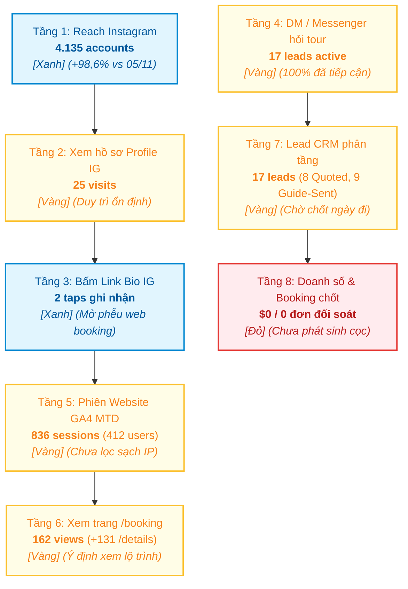

# Báo Cáo Hiệu Quả Hằng Ngày TravelFrame — 06/11/2026
*Khung thời gian chụp số liệu: 08:30 – 09:00 ICT ngày 06/11/2026*  
*Mốc đối chiếu: Hôm qua (05/11/2026) và 7 ngày trước (30/10/2026)*  
*Quy chuẩn áp dụng: [Data-Analytics/Daily-Reporting-Standard.md](../Daily-Reporting-Standard.md)*

---

### 1. Tóm Tắt (Executive Summary)

1. **[Xanh] Phân phối Instagram tăng trưởng vượt bậc trong 24 giờ qua:** Reach 24h đạt **4.135 accounts** (+98,6% so với 2.082 ngày 05/11; +6,9% so với 3.867 ngày 30/10). Lượt xem đạt **6.495 views** (+92,4% so với 3.376 ngày 05/11). Số tài khoản tương tác (Accounts engaged) đạt **241 accounts** (+74,6% so với 138 ngày 05/11), thúc đẩy bởi các Reels đời sống và trải nghiệm ẩm thực phố cổ.
2. **[Vàng] Facebook Fanpage tiếp tục tăng trưởng ổn định:** Đạt **3.087 followers** và **3.087 page likes** (+13 followers trong 24h qua so với 3.074 ngày 05/11; +310 followers (+11,2%) so với 2.777 ngày 30/10; tăng lũy kế +727 followers (+30,8%) so với 2.360 ngày 23/10).
3. **[Vàng] Website GA4 MTD đạt 836 sessions và 2.946 pageviews:** Danh mục lộ trình `/tours` đạt 428 views, trang đặt tour `/booking` đạt 162 views và `/booking/details` đạt 131 views. Thời lượng phiên trung bình duy trì mức cao 345,4s (~5 phút 45 giây) và tỷ lệ thoát (Bounce Rate) giữ ở mức 53,11%. Xếp loại [Vàng] do traffic chưa được lọc hoàn toàn và quy mô mẫu theo ngày <30 phiên.
4. **[Đỏ] Tầng chuyển đổi doanh số đối soát chưa phát sinh:** Toàn bộ 17 leads trong Lead Pipeline đang ở trạng thái tư vấn kịch bản và báo giá, chưa ghi nhận khoản cọc hoặc booking đối soát có chứng từ thanh toán. Doanh thu đối soát tiếp tục bằng **$0 / 0 đơn**.

---

### 2. Phễu Doanh Số (Khung 24 giờ qua: 05/11 – 06/11)

| Bước chuyển đổi | Hôm nay (06/11) | Hôm qua (05/11) | 7 ngày trước (30/10) | So với hôm qua | So với 7 ngày trước | Trạng thái |
|:---|:---:|:---:|:---:|:---:|:---:|:---:|
| 1. Reach Instagram (accounts) | 4.135 | 2.082 | 3.867 | +98,6% | +6,9% | [Xanh] |
| 2. Lượt xem trang cá nhân IG | 25 | 25 | 19 | 0% | +31,6% | [Vàng] |
| 3. Lượt bấm link bio IG | 2 | 2 | 0 | 0% | +2 taps | [Xanh] |
| 4. DM / Messenger hỏi tour | 17 (lũy kế) | 17 | 13 | 0 mới | +4 leads | [Vàng] |
| 5. Phiên website (Sessions 24h) | 6* | 15* | 16* | Chưa đủ mẫu | Chưa đủ mẫu | [Vàng]** |
| 6. Lượt xem `/booking` (24h) | 1* | 2* | 3* | Người xem | Người xem | [Vàng] |
| 7. Lead thu thập được | 17 (100% đã tiếp cận) | 17 | 13 | 0 mới | +4 leads | [Vàng] |
| 8. Doanh thu (USD) & Đơn chốt | $0 / 0 đơn | $0 / 0 đơn | $0 / 0 đơn | 0% | 0% | [Đỏ] |

*\* Ghi chú: Số liệu theo ngày lịch GA4 chưa lọc hoàn toàn nội bộ và có độ trễ tổng hợp; xem chi tiết MTD tại Mục 3B.*  
*\*\* Chỉ số website xếp loại [Vàng] theo Quy tắc 3 và 5 do chưa lọc hoàn toàn traffic nội bộ và mẫu ngày <30 phiên.*

---

### 3. Chỉ Số Kênh

#### A. Mạng xã hội (Meta) — Khung 24 giờ & Lũy kế

* **Instagram (@travelframe.vn):**
  * Followers: **601** (giữ vững mốc 601; vs 05/11: +1 follower; vs 30/10: +5 followers).
  * Media count: **212** (+3 bài so với 209 bài ngày 05/11).
  * Reach (24h): **4.135 accounts** (vs 05/11: +98,6%; vs 30/10: +6,9%) [Xanh].
  * Views (24h): **6.495 views** (vs 05/11: +92,4%) [Xanh].
  * Accounts engaged (24h): **241 accounts** (vs 05/11: +74,6%) [Xanh].
  * Profile visits (24h): **25 visits** [Vàng].
  * Website link taps (24h): **2 taps** [Xanh].

* **Facebook Fanpage (travelframe.vn):**
  * Followers: **3.087** (+13 trong 24h; +310 vs 2.777 ngày 30/10; +727 vs 2.360 ngày 23/10) [Vàng].
  * Page Likes: **3.087** [Vàng].

#### B. Website (Google Analytics 4 — Property 552867189) — Khung MTD (01/10 – 06/11)

* Active Users: **412 users** (418 users 30 ngày qua).
* Sessions MTD: **836 sessions** (+6 sessions so với mốc sáng 05/11 là 830).
* Screen Pageviews MTD: **2.946 pageviews** (+12 views so với mốc sáng 05/11 là 2.934).
* Thời lượng phiên trung bình: **345,4 giây (~5 phút 45 giây)**.
* Tỷ lệ thoát (Bounce Rate): **53,11%** (Duy trì mức thấp kỷ lục).
* Phân bổ trang chính:
  * `/tours` (Danh mục tour): **428 views** (99 active users).
  * `/` (Trang chủ): **501 views** (278 views biến thể 1 + 223 views biến thể 2).
  * `/booking` (Đặt tour): **162 views** (48 active users).
  * `/tour/spiritual-west-lake-breeze`: **161 views** (24 active users).
  * `/booking/details` (Chi tiết booking): **131 views** (16 active users).
  * `/tour/food-tour`: **125 views** (5 active users).
  * `/tour/french-colonial-historical-footsteps`: **100 views** (18 active users).

---

### 4. Nội Dung Đã Đăng & Hiệu Suất Reels

| Thời gian đăng | Kênh | Định dạng | Mã bài / URL | Tuổi bài | Likes | Comments | Tình trạng Seed | Trạng thái |
|:---|:---:|:---:|:---|:---:|:---:|:---:|:---|:---:|
| 23:25 05/11 | IG | Reel | [DfXdGBotndN](https://www.instagram.com/reel/DfXdGBotndN/) | 9h | 1 | 1 | C1: Đã cấy | Published |
| 22:35 05/11 | IG | Reel | [DfXXZhINF9M](https://www.instagram.com/reel/DfXXZhINF9M/) | 10h | 3 | 1 | C1: Đã cấy | Published |
| 17:23 05/11 | IG | Reel | [DfWzrDVNqfP](https://www.instagram.com/reel/DfWzrDVNqfP/) | 15h | 2 | 1 | C1: Đã cấy | Published |
| 16:49 05/11 | IG | Reel | [DfWv0DFNnhG](https://www.instagram.com/reel/DfWv0DFNnhG/) | 16h | 14 | 1 | C1: Đã cấy | Published |
| 20:18 04/11 | IG | Reel | [DfUjA8-tl_U](https://www.instagram.com/reel/DfUjA8-tl_U/) | 36h | 18 | 1 | C1: Đã cấy | Published |

*Ghi chú nội dung:*
- Reel *Phơmen cocktail sanctuary Tây Hồ* (`DfWv0DFNnhG`) tăng mạnh từ 7 likes lên **14 likes** sau đêm 05/11.
- Reel *Craving the perfect crispy Bánh Mì in Hanoi?* (`DfUjA8-tl_U`) tiếp tục tăng trưởng lên **18 likes** sau 36 giờ đăng.

---

### 5. Cảnh Báo Dữ Liệu (Data Limitations & Hygiene)

1. **Mẫu dữ liệu website theo ngày:** Lượng truy cập ngày gần nhất <30 phiên, chưa đủ mẫu kết luận về tỷ lệ thoát hay thời lượng phiên ngắn hạn theo ngày; toàn bộ nhận định dựa trên mẫu lũy kế MTD 836 sessions.
2. **Phân loại người xem `/booking`:** Người dùng xem trang `/booking` (162 views) và `/booking/details` (131 views) chỉ được ghi nhận là "người xem trang", chưa xác định là khách có ý định đặt tour thực tế khi chưa gửi form.
3. **Bộ lọc traffic nội bộ:** GA4 vẫn ghi nhận một phần lưu lượng kiểm thử nội bộ (localhost / staging) chưa được tạo bộ lọc loại trừ IP hoàn toàn.
4. **Giới hạn API:** Quyền `pages_messaging` trên Meta App chưa được cấp xét duyệt nâng cao, thông tin tương tác hộp thư được theo dõi kết hợp qua `Data-Analytics/Lead-Pipeline-Tracker.csv` và Meta Business Suite.

---

### 6. Việc Cần Làm (Xếp theo mức độ gần doanh thu)

1. **Chăm sóc và chốt ngày đi cho 8 Lead đã nhận báo giá (`Quoted`):**
   - Vị trí trong phễu: Tầng 7 (Lead sang Cọc / Doanh số).
   - Chỉ số đo: Tỷ lệ phản hồi ngày đi và số khách chốt cọc ($30/$60/$99).
   - Phê duyệt: Tự vận hành theo kịch bản Sales-CRM đã duyệt.
   - Tài liệu tham chiếu: `Sales-CRM/Scripts/2026-10-21-DM-Price-Reply-Script.md` & `Data-Analytics/Lead-Pipeline-Tracker.csv`.

2. **Cập nhật chính sách đặt cọc và phương thức thanh toán quốc tế:**
   - Vị trí trong phễu: Tầng 8 (Chuyển đổi thanh toán thực tế).
   - Chỉ số đo: Cơ chế nhận tiền cọc hợp lệ (Wise/Stripe/PayPal hoặc tài khoản nội địa).
   - Phê duyệt: **Cần Rocky duyệt** (Open P0).
   - Tài liệu tham chiếu: `Executive/Current-State.md` & `Executive/DEC-20261021-HOURLY-TIER-PRICING.md`.

3. **Kích hoạt seed comment C2 (CTA & giá trị chuyển đổi) cho 4 Reels mới đăng 05/11:**
   - Vị trí trong phễu: Tầng 1 sang Tầng 3 & 4 (Phân phối sang Link Bio / DM).
   - Chỉ số đo: Số lượt bình luận từ khóa (MAP, FOOD, PHOTO) và số lượt bấm link bio.
   - Phê duyệt: Tự vận hành theo Seed Comment Playbook.
   - Tài liệu tham chiếu: `Marketing-Growth/Guidelines/2026-10-07-Seed-Comment-Playbook.md` & `Data-Analytics/Seed-Comment-Tracker.csv`.

4. **Tạo bộ lọc loại trừ IP nội bộ trên Google Analytics 4:**
   - Vị trí trong phễu: Tầng 5 (Vệ sinh dữ liệu phiên website).
   - Chỉ số đo: 100% phiên website trên GA4 là traffic người dùng bên ngoài.
   - Phê duyệt: Tự vận hành (Data-Analytics).
   - Tài liệu tham chiếu: `Data-Analytics/Daily-Reporting-Standard.md`.
