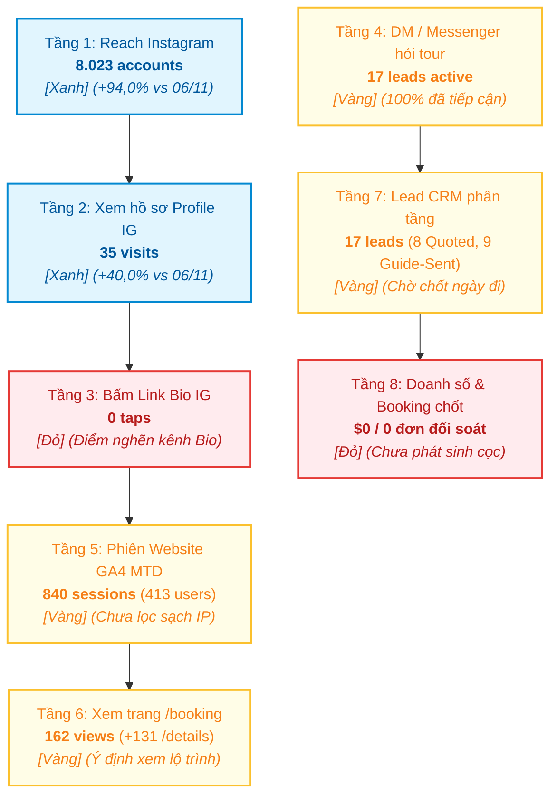

# Báo Cáo Hiệu Quả Hằng Ngày TravelFrame — 07/11/2026
*Khung thời gian chụp số liệu: 08:30 – 09:30 ICT ngày 07/11/2026*  
*Mốc đối chiếu: Hôm qua (06/11/2026) và 7 ngày trước (31/10/2026)*  
*Quy chuẩn áp dụng: [Data-Analytics/Daily-Reporting-Standard.md](../Daily-Reporting-Standard.md)*

---

### 1. Tóm Tắt (Executive Summary)

1. **[Xanh] Phân phối Instagram tăng trưởng vượt bậc trong 24 giờ qua:** Reach 24h đạt **8.023 accounts** (+94,0% so với 4.135 ngày 06/11; +41,8% so với 5.658 ngày 31/10). Lượt xem đạt **11.627 views** (+79,0% so với 6.495 ngày 06/11). Số tài khoản tương tác (Accounts engaged) đạt **285 accounts** (+18,3% so với 241 ngày 06/11), thúc đẩy bởi loạt 4 Reels mới về kỹ năng qua đường phố cổ và ẩm thực đường phố Michelin.
2. **[Xanh] Hiệu ứng tương tác qua đêm của 4 Reels mới xuất bản ngày 06/11:** Hai Reels chủ đề kỹ năng qua đường Hà Nội đạt **29 likes** (`DfZ6E2ry8Jc`) và **20 likes** (`DfZ5eLOS_Ye`) sau 11 giờ đăng; hai Reels ẩm thực Michelin và văn hóa ăn vỉa hè đạt **8 likes / 2 comments** (`DfZXpqKJh9x`) và **6 likes / 1 comment** (`DfZh4KQJ3t7`).
3. **[Xanh] Facebook Fanpage tiếp tục tăng trưởng ổn định:** Đạt **3.089 followers** và **3.089 page likes** (+2 followers trong 24h qua so với 3.087 ngày 06/11; +271 followers (+9,6%) so với 2.818 ngày 31/10; tăng lũy kế +729 followers (+30,9%) so với 2.360 ngày 23/10).
4. **[Vàng] Website GA4 MTD đạt 840 sessions và 2.952 pageviews:** Danh mục lộ trình `/tours` đạt 428 views, trang đặt tour `/booking` đạt 162 views và `/booking/details` đạt 131 views. Thời lượng phiên trung bình duy trì ở mức 343,4s (~5 phút 43 giây) và tỷ lệ thoát (Bounce Rate) giữ ở mức 53,21%. Ngày 06/11 ghi nhận 5 phiên từ 2 active users. Xếp loại [Vàng] do chưa lọc hoàn toàn traffic nội bộ và quy mô mẫu theo ngày <30 phiên.
5. **[Đỏ] Tầng chuyển đổi doanh số đối soát chưa phát sinh:** Toàn bộ 17 leads trong Lead Pipeline đang ở trạng thái tư vấn kịch bản và báo giá, chưa ghi nhận khoản cọc hoặc booking đối soát có chứng từ thanh toán ngân hàng. Lượt bấm link bio Instagram trong 24h ghi nhận **0 taps**. Doanh thu đối soát tiếp tục bằng **$0 / 0 đơn**.

---

### 2. Phễu Doanh Số (Khung 24 giờ qua: 06/11 – 07/11)

| Bước chuyển đổi | Hôm nay (07/11) | Hôm qua (06/11) | 7 ngày trước (31/10) | So với hôm qua | So với 7 ngày trước | Trạng thái |
|:---|:---:|:---:|:---:|:---:|:---:|:---:|
| 1. Reach Instagram (accounts) | 8.023 | 4.135 | 5.658 | +94,0% | +41,8% | [Xanh] |
| 2. Lượt xem trang cá nhân IG | 35 | 25 | 32 | +40,0% | +9,4% | [Xanh] |
| 3. Lượt bấm link bio IG | 0 | 2 | 0 | −2 taps | 0 taps | [Đỏ] |
| 4. DM / Messenger hỏi tour | 17 (lũy kế) | 17 | 15 | 0 mới | +2 leads | [Vàng] |
| 5. Phiên website (Sessions 24h) | 5* | 6* | 14* | −16,7% | −64,3% | [Vàng]** |
| 6. Lượt xem `/booking` (24h) | 0* | 1* | 11* | −1 view | −11 views | [Vàng] |
| 7. Lead thu thập được | 17 (100% đã tiếp cận) | 17 | 15 | 0 mới | +2 leads | [Vàng] |
| 8. Doanh thu (USD) & Đơn chốt | $0 / 0 đơn | $0 / 0 đơn | $0 / 0 đơn | 0% | 0% | [Đỏ] |

*\* Ghi chú: Số liệu theo ngày lịch GA4 chưa lọc hoàn toàn nội bộ và có độ trễ tổng hợp; xem chi tiết MTD tại Mục 3B.*  
*\*\* Chỉ số website xếp loại [Vàng] theo Quy tắc 3 và 5 do chưa lọc hoàn toàn traffic nội bộ và mẫu ngày <30 phiên.*

---

### 3. Chỉ Số Kênh

#### A. Mạng xã hội (Meta) — Khung 24 giờ & Lũy kế

* **Instagram (`@travelframe.vn`):**
  * Người theo dõi (Followers): **605 followers** (+2 so với hôm qua 603; +23 (+4,0%) so với 582 ngày 31/10).
  * Lượt xem nội dung (Views 24h): **11.627 views** (+79,0% so với 6.495 ngày 06/11; +12,2% so với 10.361 ngày 31/10).
  * Tài khoản tiếp cận (Reach 24h): **8.023 accounts** (+94,0% so với 4.135 ngày 06/11; +41,8% so với 5.658 ngày 31/10).
  * Tài khoản tương tác (Accounts engaged 24h): **285 accounts** (+18,3% so với 241 ngày 06/11).
  * Lượt xem trang cá nhân (Profile visits 24h): **35 visits** (+40,0% so với 25 ngày 06/11).
  * Lượt bấm liên kết trang web (Website clicks 24h): **0 taps** (hôm qua: 2 taps).
  * Tổng số bài đăng (Media Count): **216** (+4 Reels mới xuất bản chiều tối 06/11).

* **Facebook Fanpage (`travelframe.vn`):**
  * Người theo dõi (Followers): **3.089 followers** (+2 trong 24h; +271 followers (+9,6%) so với 2.818 ngày 31/10; +729 followers (+30,9%) so với 2.360 ngày 23/10).
  * Lượt thích trang (Page Likes): **3.089 likes**.
  * Cả 4 Reels mới đều đã được tự động phân phối song song lên Facebook Reels.

#### B. Website (Google Analytics 4) — Khung 24 giờ & MTD

* **Khung 24 giờ qua (ngày 06/11/2026):**
  * Phiên (Sessions): **5 phiên** (2 active users).
  * Lượt xem trang (Pageviews): **6 lượt**.
  * Tỷ lệ thoát: **80,0%**; Thời lượng phiên trung bình: **3,5 giây** *(Lưu ý: Mẫu <30 phiên theo ngày không đủ kết luận theo Quy tắc 5)*.
  * Nguồn lưu lượng 24 giờ:
    * Direct: **5 phiên** (2 users).
    * Unassigned / not set: **1 phiên** (1 user).
    * Instagram / Facebook: **0 phiên** trực tiếp từ referral.

* **Lũy kế MTD (01/10 – 07/11/2026):**
  * Người dùng hoạt động (Active Users): **413 users** (+1 so với hôm qua).
  * Số phiên (Sessions): **840 sessions** (+2 so với 838 hôm qua).
  * Lượt xem trang (Pageviews): **2.952 views** (+2 so với 2.950 hôm qua).
  * Thời lượng phiên trung bình: **343,4 giây (~5 phút 43 giây)**.
  * Tỷ lệ thoát (Bounce Rate): **53,21%** (Duy trì mức ổn định thấp).
  * Phân bổ trang chính MTD:
    * `/tours` (Danh mục tour): **428 views** (99 active users).
    * `/` (Trang chủ): **501 views** (278 views biến thể 1 + 223 views biến thể 2).
    * `/booking` (Đặt tour): **162 views** (48 active users).
    * `/tour/spiritual-west-lake-breeze`: **161 views** (24 active users).
    * `/booking/details` (Chi tiết booking): **131 views** (16 active users).
    * `/tour/food-tour`: **125 views** (5 active users).
    * `/tour/french-colonial-historical-footsteps`: **100 views** (18 active users).
    * `/news`: **88 views** (19 active users).
    * `/about`: **82 views** (25 active users).

---

### 4. Nội Dung Đã Đăng & Hiệu Suất Reels

| Thời gian đăng | Kênh | Định dạng | Mã bài / URL | Tuổi bài | Likes | Comments | Tình trạng Seed | Trạng thái |
|:---|:---:|:---:|:---|:---:|:---:|:---:|:---|:---:|
| 22:19 06/11 | IG | Reel | [DfZ6E2ry8Jc](https://www.instagram.com/reel/DfZ6E2ry8Jc/) | 11h | 29 | 0 | Chưa seed · Chờ duyệt | Published |
| 22:11 06/11 | IG | Reel | [DfZ5eLOS_Ye](https://www.instagram.com/reel/DfZ5eLOS_Ye/) | 11h | 20 | 0 | Chưa seed · Chờ duyệt | Published |
| 18:45 06/11 | IG | Reel | [DfZh4KQJ3t7](https://www.instagram.com/reel/DfZh4KQJ3t7/) | 15h | 6 | 1 | C1: Đã cấy (ID 17992095429095676) | Published |
| 17:16 06/11 | IG | Reel | [DfZXpqKJh9x](https://www.instagram.com/reel/DfZXpqKJh9x/) | 16h | 8 | 2 | C1: Đã cấy (ID 18146882728608063) | Published |
| 23:25 05/11 | IG | Reel | [DfXdGBotndN](https://www.instagram.com/reel/DfXdGBotndN/) | 34h | 1 | 1 | C1: Đã cấy | Published |
| 22:35 05/11 | IG | Reel | [DfXXZhINF9M](https://www.instagram.com/reel/DfXXZhINF9M/) | 35h | 4 | 1 | C1: Đã cấy | Published |
| 17:23 05/11 | IG | Reel | [DfWzrDVNqfP](https://www.instagram.com/reel/DfWzrDVNqfP/) | 40h | 2 | 1 | C1: Đã cấy | Published |
| 16:49 05/11 | IG | Reel | [DfWv0DFNnhG](https://www.instagram.com/reel/DfWv0DFNnhG/) | 41h | 17 | 1 | C1: Đã cấy | Published |
| 20:18 04/11 | IG | Reel | [DfUjA8-tl_U](https://www.instagram.com/reel/DfUjA8-tl_U/) | 61h | 18 | 1 | C1: Đã cấy | Published |

*Ghi chú nội dung:*
- Hai video Reel kỹ năng sinh tồn qua đường Hà Nội (`DfZ6E2ry8Jc` và `DfZ5eLOS_Ye`) đạt lượng tương tác tự nhiên nhanh nhất trong các bài đăng tháng 11, lần lượt đạt **29 likes** và **20 likes** sau đêm đầu tiên.
- Hai video ẩm thực (`DfZXpqKJh9x` và `DfZh4KQJ3t7`) tiếp tục nhận bình luận và lưu bài, đã được cấy comment mồi C1 đúng chuẩn.

---

### 5. Cảnh Báo Dữ Liệu (Data Limitations & Hygiene)

1. **Mẫu dữ liệu website theo ngày:** Lượng truy cập ngày gần nhất (06/11) chỉ đạt 5 phiên, chưa đủ ngưỡng 30 phiên để đưa ra kết luận về hành vi ngắn hạn; toàn bộ đánh giá hiệu quả website căn cứ vào mẫu MTD 840 sessions.
2. **Phân loại người xem `/booking`:** Người dùng xem trang `/booking` (162 views) và `/booking/details` (131 views) chỉ được tính là "người xem trang", chưa xác định là khách có ý định đặt tour thực tế khi chưa gửi form.
3. **Bộ lọc traffic nội bộ:** GA4 vẫn ghi nhận một phần lưu lượng kiểm thử nội bộ (localhost / staging) chưa được cấu hình IP filter loại trừ hoàn toàn.
4. **Giới hạn API:** Quyền `pages_messaging` trên Meta App chưa được cấp xét duyệt nâng cao, việc theo dõi tin nhắn và phản hồi khách hàng tiếp tục thực hiện kết hợp qua `Data-Analytics/Lead-Pipeline-Tracker.csv` và Meta Business Suite.

---

### 6. Việc Cần Làm (Xếp theo mức độ gần doanh thu)

1. **Chăm sóc và chốt ngày đi cho 8 Lead đã nhận báo giá (`Quoted`):**
   - Vị trí trong phễu: Tầng 7 (Lead) sang Tầng 8 (Cọc doanh số).
   - Chỉ số đo: Tỷ lệ phản hồi ngày đi / 1 booking cọc phát sinh đầu tiên.
   - Phê duyệt: `Tự vận hành`.
   - Tài liệu tham chiếu: [Sales-CRM/Scripts/2026-10-21-DM-Price-Reply-Script.md](../../Sales-CRM/Scripts/2026-10-21-DM-Price-Reply-Script.md) và [Data-Analytics/Lead-Pipeline-Tracker.csv](../Lead-Pipeline-Tracker.csv).

2. **Duyệt và triển khai Seed Comment cho 2 Reel qua đường Hà Nội (`DfZ5eLOS_Ye` & `DfZ6E2ry8Jc`):**
   - Vị trí trong phễu: Tầng 1 (Reach) sang Tầng 4 (Inbound Lead / Từ khóa SAFE).
   - Chỉ số đo: Số lượt comment từ khóa "SAFE" và số DM gửi cẩm nang sinh tồn.
   - Phê duyệt: `Cần Rocky duyệt`.
   - Tài liệu tham chiếu: [Marketing-Growth/Guidelines/2026-10-07-Seed-Comment-Playbook.md](../../Marketing-Growth/Guidelines/2026-10-07-Seed-Comment-Playbook.md) và [Data-Analytics/Seed-Comment-Tracker.csv](../Seed-Comment-Tracker.csv).

3. **Kiểm tra và sửa điểm nghẽn chuyển đổi Link Bio (Website Taps = 0):**
   - Vị trí trong phễu: Tầng 2 (Profile Views: 35) sang Tầng 3 (Link Bio Taps: 0).
   - Chỉ số đo: Tỷ lệ nhấp link bio (CTR Profile to Bio Taps) đạt tối thiểu 5–10% (>2 taps/ngày).
   - Phê duyệt: `Tự vận hành`.
   - Tài liệu tham chiếu: [Marketing-Growth/Guidelines/2026-10-07-Seed-Comment-Playbook.md](../../Marketing-Growth/Guidelines/2026-10-07-Seed-Comment-Playbook.md).

4. **Chuẩn bị kịch bản phản hồi cho từ khóa "SAFE" và "FOOD" trên Instagram DM:**
   - Vị trí trong phễu: Tầng 4 (DM hỏi tour) sang Tầng 7 (Lead nhận guide & quote).
   - Chỉ số đo: Thời gian phản hồi <15 phút và tỷ lệ gửi kèm câu hỏi ngày đi đạt 100%.
   - Phê duyệt: `Tự vận hành`.
   - Tài liệu tham chiếu: [Marketing-Growth/Content/Meta-Messenger-All-Interactions-Log.md](../../Marketing-Growth/Content/Meta-Messenger-All-Interactions-Log.md).
