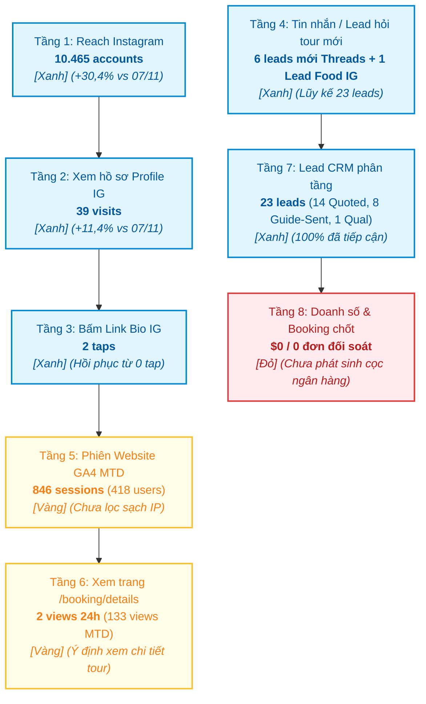

# Báo Cáo Hiệu Quả Hằng Ngày TravelFrame — 08/11/2026
*Khung thời gian chụp số liệu: 08:30 – 09:40 ICT ngày 08/11/2026*  
*Mốc đối chiếu: Hôm qua (07/11/2026) và 7 ngày trước (31/10/2026)*  
*Quy chuẩn áp dụng: [Data-Analytics/Daily-Reporting-Standard.md](../Daily-Reporting-Standard.md)*

---

### 1. Tóm Tắt (Executive Summary)

1. **[Xanh] Phân phối Instagram vượt mốc 10.000 accounts trong 24 giờ qua:** Reach 24h đạt **10.465 accounts** (+30,4% so với 8.023 ngày 07/11; +85,0% so với 5.658 ngày 31/10). Lượt xem đạt **16.560 views** (+42,4% so với 11.627 ngày 07/11). Số tài khoản tương tác (Accounts engaged) đạt **498 accounts** (+74,7% so với 285 ngày 07/11), mức cao nhất ghi nhận trong tháng 11.
2. **[Xanh] Reel Bít tết phố cổ đạt tương tác tự nhiên nhanh nhất tháng 11:** Reel *Steak for breakfast? (Bít tết)* (`DfbjmGMtQgH`, ID `18117105824325548`, đăng 13:40 ICT ngày 07/11) đạt **67 likes** và **2 comments** (1 comment từ khóa "Food", 1 comment "Ngon") trên Instagram sau ~20 giờ; bản đăng song song trên Facebook đạt **5 lượt chia sẻ**.
3. **[Xanh] Phễu Lead ghi nhận thêm 6 khách hàng tiềm năng phân khúc chụp ảnh kỷ yếu/tốt nghiệp:** Lũy kế danh sách Lead đạt **23 leads** (+6 leads phát sinh ngày 07/11 từ kênh Threads, mã `L-20261107-18` đến `L-20261107-23`). Toàn bộ 6 khách đã được tư vấn và gửi báo giá gói 650.000 – 800.000 VND; trong đó 1 khách cần lịch gấp chiều 08/11 (`@conbolata`).
4. **[Xanh] Facebook Fanpage vượt mốc 3.100 followers & Link Bio Instagram hồi phục:** Facebook Fanpage đạt **3.106 followers** (+17 followers trong 24h qua so với 3.089 ngày 07/11; +288 followers (+10,2%) so với 2.818 ngày 31/10). Instagram followers đạt đỉnh mới **606 followers** (+1). Lượt bấm liên kết trang web (Website clicks) trên Instagram hồi phục lên **2 taps** (so với 0 tap ngày 07/11).
5. **[Đỏ] Tầng chuyển đổi doanh số đối soát chưa phát sinh cọc ngân hàng:** Mặc dù phễu lead mở rộng lên 23 leads (14 Quoted, 8 Guide-Sent, 1 Qualified-unconfirmed), hệ thống kế toán chưa ghi nhận khoản tiền cọc nào có chứng từ đối soát ngân hàng. Doanh thu đối soát tiếp tục bằng **$0 / 0 đơn**.

---

### 2. Phễu Doanh Số (Khung 24 giờ qua: 07/11 – 08/11)

| Bước chuyển đổi | Hôm nay (08/11) | Hôm qua (07/11) | 7 ngày trước (31/10) | So với hôm qua | So với 7 ngày trước | Trạng thái |
|:---|:---:|:---:|:---:|:---:|:---:|:---:|
| 1. Reach Instagram (accounts) | 10.465 | 8.023 | 5.658 | +30,4% | +85,0% | [Xanh] |
| 2. Lượt xem trang cá nhân IG | 39 | 35 | 32 | +11,4% | +21,9% | [Xanh] |
| 3. Lượt bấm link bio IG | 2 | 0 | 0 | +2 taps | +2 taps | [Xanh] |
| 4. DM / Tin nhắn hỏi tour mới | 6* | 0 | 2 | +6 leads | +4 leads | [Xanh] |
| 5. Phiên website (Sessions 24h) | 6** | 5** | 14** | +20,0% | −57,1% | [Vàng]*** |
| 6. Lượt xem `/booking/details` (24h) | 2** | 0** | 11** | +2 views | −81,8% | [Vàng] |
| 7. Lead thu thập được (lũy kế) | 23 (100% đã tiếp cận) | 17 | 15 | +35,3% | +53,3% | [Xanh] |
| 8. Doanh thu (USD) & Đơn chốt | $0 / 0 đơn | $0 / 0 đơn | $0 / 0 đơn | 0% | 0% | [Đỏ] |

*\* Ghi chú Tầng 4: 6 leads mới phát sinh ngày 07/11 từ kênh Threads (`L-18` đến `L-23`), cộng thêm 1 comment từ khóa "Food" trên Reel Bít tết đang chờ gửi bản đồ ẩm thực.*  
*\*\* Ghi chú Tầng 5 & 6: Số liệu ngày 07/11/2026 từ GA4 Data API: 6 phiên, 17 pageviews, trong đó ghi nhận traffic từ `ig / social` và `m.facebook.com / referral`.*  
*\*\*\* Chỉ số website xếp loại [Vàng] theo Quy tắc 3 và 5 do chưa lọc hoàn toàn traffic nội bộ và mẫu ngày <30 phiên.*

---

### 3. Chỉ Số Kênh

#### A. Mạng xã hội (Meta) — Khung 24 giờ & Lũy kế

* **Instagram (`@travelframe.vn`):**
  * Người theo dõi (Followers): **606 followers** (+1 so với hôm qua 605; +24 (+4,1%) so với 582 ngày 31/10).
  * Lượt xem nội dung (Views 24h): **16.560 views** (+42,4% so với 11.627 ngày 07/11; +59,8% so với 10.361 ngày 31/10).
  * Tài khoản tiếp cận (Reach 24h): **10.465 accounts** (+30,4% so với 8.023 ngày 07/11; +85,0% so với 5.658 ngày 31/10).
  * Tài khoản tương tác (Accounts engaged 24h): **498 accounts** (+74,7% so với 285 ngày 07/11).
  * Lượt xem trang cá nhân (Profile visits 24h): **39 visits** (+11,4% so với 35 ngày 07/11).
  * Lượt bấm liên kết trang web (Website clicks 24h): **2 taps** (hôm qua: 0 tap; ngày 31/10: 0 tap).
  * Tổng số bài đăng (Media Count): **218** (+2 bài đăng).

* **Facebook Fanpage (`travelframe.vn`):**
  * Người theo dõi (Followers): **3.106 followers** (+17 trong 24h; +288 followers (+10,2%) so với 2.818 ngày 31/10; +746 followers (+31,6%) so với 2.360 ngày 23/10).
  * Lượt thích trang (Page Likes): **3.106 likes**.
  * Bài đăng Reel Bít tết (`1509818901002655`) ghi nhận **5 lượt chia sẻ (shares)** tự nhiên.

#### B. Website (Google Analytics 4) — Khung 24 giờ & MTD

* **Khung 24 giờ qua (ngày 07/11/2026):**
  * Phiên (Sessions): **6 phiên** (5 active users).
  * Lượt xem trang (Pageviews): **17 lượt**.
  * Tỷ lệ thoát: **66,67%**; Thời lượng phiên trung bình: **320,7 giây (~5 phút 21 giây)** *(Lưu ý: Mẫu <30 phiên theo ngày không đủ kết luận theo Quy tắc 5)*.
  * Nguồn lưu lượng 24 giờ:
    * Organic Social (zalo / zalo): **3 phiên** (3 users).
    * Organic Social (ig / social): **1 phiên** (1 user).
    * Organic Social (m.facebook.com / referral): **1 phiên** (1 user).
    * Direct ((direct) / (none)): **1 phiên** (0 user).
  * Trang có lượt xem nhiều nhất ngày 07/11:
    * `/` (Trang chủ): **5 views** (4 users).
    * `/tours` (Danh mục lộ trình): **4 views** (3 users).
    * `/booking/details` (Chi tiết booking): **2 views** (1 user).
    * `/tour/taste-hanoi-culinary-delights-street-vibes`: **2 views** (1 user).
    * `/about`, `/gallery`, `/news`: mỗi trang **1 view**.

* **Lũy kế MTD (01/10 – 08/11/2026):**
  * Người dùng hoạt động (Active Users): **418 users** (+5 so với hôm qua).
  * Số phiên (Sessions): **846 sessions** (+6 so với 840 hôm qua).
  * Lượt xem trang (Pageviews): **2.969 views** (+17 so với 2.952 hôm qua).
  * Thời lượng phiên trung bình: **343,3 giây (~5 phút 43 giây)**.
  * Tỷ lệ thoát (Bounce Rate): **53,31%**.
  * Phân bổ trang chính MTD:
    * `/` (Trang chủ): **506 views**.
    * `/tours` (Danh mục tour): **432 views**.
    * `/booking` (Đặt tour): **162 views**.
    * `/booking/details` (Chi tiết booking): **133 views**.
    * `/tour/spiritual-west-lake-breeze`: **161 views**.
    * `/tour/taste-hanoi-culinary-delights-street-vibes`: **127 views**.
    * `/tour/french-colonial-historical-footsteps`: **100 views**.
    * `/news`: **89 views**.
    * `/about`: **84 views**.

---

### 4. Nội Dung Đã Đăng & Hiệu Suất Reels

| Thời gian đăng | Kênh | Định dạng | Mã bài / URL | Tuổi bài | Likes | Comments | Tình trạng Seed | Trạng thái |
|:---|:---:|:---:|:---|:---:|:---:|:---:|:---|:---:|
| 13:40 07/11 | IG | Reel | [DfbjmGMtQgH](https://www.instagram.com/reel/DfbjmGMtQgH/) | 20h | 67 | 2 | Chưa seed · Có 1 comment "Food" chờ rep | Published |
| 13:40 07/11 | FB | Reel | [1509818901002655](https://www.facebook.com/reel/1509818901002655/) | 20h | — | 0 | 5 shares · Chưa seed · Chờ duyệt | Published |
| 22:19 06/11 | IG | Reel | [DfZ6E2ry8Jc](https://www.instagram.com/reel/DfZ6E2ry8Jc/) | 35h | 31 | 2 | Seed C1 & C2 đã cấy live 07/11 | Published |
| 22:11 06/11 | IG | Reel | [DfZ5eLOS_Ye](https://www.instagram.com/reel/DfZ5eLOS_Ye/) | 35h | 22 | 2 | Seed C1 & C2 đã cấy live 07/11 | Published |
| 18:45 06/11 | IG | Reel | [DfZh4KQJ3t7](https://www.instagram.com/reel/DfZh4KQJ3t7/) | 39h | 6 | 2 | Seed C1 & C2 đã cấy | Published |
| 17:16 06/11 | IG | Reel | [DfZXpqKJh9x](https://www.instagram.com/reel/DfZXpqKJh9x/) | 40h | 8 | 3 | Seed C1 & C2 đã cấy | Published |
| 16:49 05/11 | IG | Reel | [DfWv0DFNnhG](https://www.instagram.com/reel/DfWv0DFNnhG/) | 65h | 18 | 2 | Seed C1 & C2 đã cấy | Published |
| 20:18 04/11 | IG | Reel | [DfUjA8-tl_U](https://www.instagram.com/reel/DfUjA8-tl_U/) | 85h | 19 | 1 | Seed C1: Đã cấy | Published |
| 22:35 05/11 | IG | Reel | [DfXXZhINF9M](https://www.instagram.com/reel/DfXXZhINF9M/) | 59h | 4 | 2 | Seed C1 & C2 đã cấy | Published |
| 17:23 05/11 | IG | Reel | [DfWzrDVNqfP](https://www.instagram.com/reel/DfWzrDVNqfP/) | 64h | 2 | 2 | Seed C1 & C2 đã cấy | Published |
| 23:25 05/11 | IG | Reel | [DfXdGBotndN](https://www.instagram.com/reel/DfXdGBotndN/) | 58h | 1 | 2 | Seed C1 & C2 đã cấy | Published |

*Ghi chú nội dung:*
- Video Reel *Steak for breakfast? (Bít tết)* (`DfbjmGMtQgH`) đạt tốc độ tăng lượt thích và tương tác nhanh nhất kể từ đầu tháng 11 với **67 likes** trong 20 giờ đầu tiên. Đã phát sinh 1 bình luận từ khóa "Food" (ID: 18002692125008535) theo đúng lời kêu gọi trong caption.
- Hai video Reel kỹ năng sang đường phố cổ (`DfZ6E2ry8Jc` và `DfZ5eLOS_Ye`) duy trì lượt thích tăng đều lên lần lượt **31 likes** và **22 likes**, đã hoàn thành cấy seed comment C1 & C2 trong ngày 07/11.

---

### 5. Cảnh Báo Dữ Liệu (Data Limitations & Hygiene)

1. **Mẫu dữ liệu website theo ngày:** Lượng truy cập ngày 07/11 đạt 6 phiên, chưa đủ ngưỡng 30 phiên để đưa ra kết luận hành vi sâu theo Quy tắc 5; toàn bộ đánh giá xu hướng website căn cứ vào mẫu MTD 846 sessions.
2. **Phân loại người xem `/booking/details`:** 2 lượt xem `/booking/details` trong ngày 07/11 chỉ được xếp loại "người xem trang", không xác định là khách mua thực tế do chưa gửi form hoàn tất.
3. **Bộ lọc traffic nội bộ:** GA4 vẫn ghi nhận lưu lượng kiểm thử nội bộ chưa được cấu hình IP filter loại trừ hoàn toàn, xếp hạng website tối đa ở mức [Vàng].
4. **Giới hạn API:** Quyền `pages_messaging` trên Meta App chưa được cấp xét duyệt nâng cao, việc theo dõi tin nhắn và chăm sóc khách hàng tiếp tục thực hiện kết hợp qua `Data-Analytics/Lead-Pipeline-Tracker.csv` và Meta Business Suite.

---

### 6. Việc Cần Làm (Xếp theo mức độ gần doanh thu)

1. **Chốt lịch & thu cọc cho lead gấp ngày 08/11 (`@conbolata`) và nhóm 5 lead tốt nghiệp:**
   - Vị trí trong phễu: Tầng 7 (Lead) sang Tầng 8 (Cọc doanh số).
   - Chỉ số đo: 1 khoản tiền cọc chuyển khoản đầu tiên phát sinh trước 12:00 ICT ngày 08/11.
   - Phê duyệt: `Tự vận hành`.
   - Tài liệu tham chiếu: [Data-Analytics/Lead-Pipeline-Tracker.csv](../Lead-Pipeline-Tracker.csv) và [Sales-CRM/Scripts/2026-10-21-DM-Price-Reply-Script.md](../../Sales-CRM/Scripts/2026-10-21-DM-Price-Reply-Script.md).

2. **Chăm sóc và chốt ngày đi cho 8 Lead tour quốc tế đã nhận báo giá (`Quoted`):**
   - Vị trí trong phễu: Tầng 7 (Lead) sang Tầng 8 (Cọc doanh số).
   - Chỉ số đo: Số lượt khách phản hồi ngày đi / tỷ lệ chốt booking thợ ảnh theo giờ ($30–$99/h).
   - Phê duyệt: `Tự vận hành`.
   - Tài liệu tham chiếu: [Data-Analytics/Lead-Pipeline-Tracker.csv](../Lead-Pipeline-Tracker.csv) và [Sales-CRM/Scripts/2026-10-21-DM-Price-Reply-Script.md](../../Sales-CRM/Scripts/2026-10-21-DM-Price-Reply-Script.md).

3. **Phản hồi bình luận và gửi DM bản đồ ẩm thực cho lead bình luận "Food" trên Reel Bít tết (`DfbjmGMtQgH`):**
   - Vị trí trong phễu: Tầng 4 (Tin nhắn/bình luận hỏi tour) sang Tầng 7 (Lead nhận guide & tư vấn lộ trình).
   - Chỉ số đo: Gửi thành công bản đồ quán ăn qua Instagram DM và đặt câu hỏi ngày đến Hà Nội.
   - Phê duyệt: `Cần Rocky duyệt`.
   - Tài liệu tham chiếu: [Data-Analytics/Seed-Comment-Tracker.csv](../Seed-Comment-Tracker.csv) và [Marketing-Growth/Content/Meta-Messenger-All-Interactions-Log.md](../../Marketing-Growth/Content/Meta-Messenger-All-Interactions-Log.md).

4. **Duyệt và triển khai Seed Comment C1 & C2 cho Reel Bít tết (`DfbjmGMtQgH` & FB `1509818901002655`):**
   - Vị trí trong phễu: Tầng 1 (Reach) sang Tầng 4 (Inbound Lead / Từ khóa FOOD).
   - Chỉ số đo: Đăng và ghim C1 câu hỏi mồi trong ngày 08/11; đăng C2 mẹo gọi món bít tết kèm từ khóa FOOD.
   - Phê duyệt: `Cần Rocky duyệt`.
   - Tài liệu tham chiếu: [Marketing-Growth/Guidelines/2026-10-07-Seed-Comment-Playbook.md](../../Marketing-Growth/Guidelines/2026-10-07-Seed-Comment-Playbook.md) và [Data-Analytics/Seed-Comment-Tracker.csv](../Seed-Comment-Tracker.csv).

5. **Giữ đà tăng trưởng link bio và tối ưu trang đích `/tours`:**
   - Vị trí trong phễu: Tầng 2 (Profile Views: 39) sang Tầng 3 (Bio Taps: 2) và Tầng 5 (Website Sessions).
   - Chỉ số đo: Duy trì tối thiểu ≥2 taps/ngày từ bio link và kéo thời lượng xem trang tour >3 phút.
   - Phê duyệt: `Tự vận hành`.
   - Tài liệu tham chiếu: [Marketing-Growth/Guidelines/2026-10-07-Seed-Comment-Playbook.md](../../Marketing-Growth/Guidelines/2026-10-07-Seed-Comment-Playbook.md).
