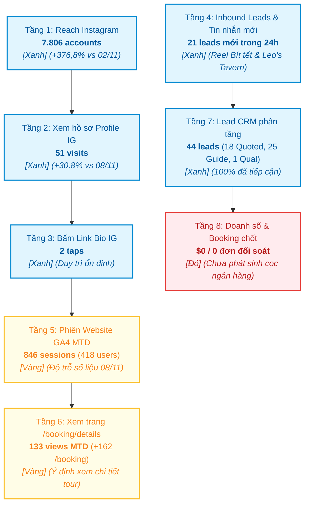

# Báo Cáo Hiệu Quả Hằng Ngày TravelFrame — 09/11/2026
*Khung thời gian chụp số liệu: 08:30 – 09:00 ICT ngày 09/11/2026*  
*Mốc đối chiếu: Hôm qua (08/11/2026) và 7 ngày trước (02/11/2026)*  
*Quy chuẩn áp dụng: [Data-Analytics/Daily-Reporting-Standard.md](../Daily-Reporting-Standard.md)*

---

### 1. Tóm Tắt (Executive Summary)

1. **[Xanh] Phễu Lead tiếp nhận 21 khách hàng tiềm năng mới trong 24 giờ qua:** Thúc đẩy bởi video Reel *Steak for breakfast? (Bít tết)* và Reel *Leo's Tavern*, kênh mạng xã hội ghi nhận 21 lượt bình luận và tin nhắn hỏi cẩm nang ẩm thực/góc ẩn (`L-20261108-24` đến `L-20261108-44`). Lũy kế danh sách Lead trong CRM đạt **44 leads** (+91,3% so với 23 ngày 08/11; +158,8% so với 17 ngày 02/11). 100% 44/44 khách đã được tiếp cận và gửi tài liệu cẩm nang kèm gợi ý gói dạo phố chụp ảnh ($30/h / 750k/h).
2. **[Xanh] Reel Bít tết duy trì đà phân phối và tương tác cao; Reel Leo's Tavern xuất bản thành công:** Reel *Steak for breakfast? (Bít tết)* (`DfbjmGMtQgH`) tăng lên **81 likes** (+14 likes trong 24h) và **6 comments** trên Instagram; lượt chia sẻ tự nhiên trên Facebook tăng từ 5 lên **12 shares**. Reel mới về quán bar ẩn *Leo's Tavern* (`DfeEpSit87H`, đăng 13:06 ICT 08/11) đạt **11 likes** và **3 comments** (đã phát sinh 1 khách bình luận từ khóa "hanoi!").
3. **[Xanh] Lượt xem trang cá nhân Instagram tăng +30,8% & Facebook vượt 3.120 followers:** Profile visits trên Instagram đạt **51 visits** (+30,8% so với 39 ngày 08/11; +363,6% so với 11 ngày 02/11). Số người theo dõi Instagram đạt đỉnh mới **614 followers** (+8 followers trong 24h). Facebook Fanpage tăng lên **3.128 followers** (+22 followers trong 24h; +216 (+7,4%) so với 2.912 ngày 02/11).
4. **[Vàng] Reach Instagram điều chỉnh kỹ thuật sau ngày cao điểm nhưng tương tác duy trì ổn định:** Reach 24h đạt **7.806 accounts** (−25,4% so với 10.465 ngày 08/11; +376,8% so với 1.637 ngày 02/11). Lượt xem đạt **13.368 views** (−19,3% so với 16.560 ngày 08/11). Số tài khoản tương tác duy trì mức cao với **476 accounts** (−4,4% so với 498 ngày 08/11). Lượt bấm link bio giữ nguyên **2 taps**.
5. **[Đỏ] Tầng chuyển đổi doanh số đối soát chưa phát sinh cọc ngân hàng:** Toàn bộ 44 leads trong Lead Pipeline đang ở giai đoạn tiếp cận cẩm nang (`Guide-Sent`: 25) và cân nhắc báo giá (`Quoted`: 18). Chưa ghi nhận khoản thanh toán hoặc đặt cọc đối soát có chứng từ ngân hàng. Doanh thu đối soát tiếp tục bằng **$0 / 0 đơn**.

---

### 2. Phễu Doanh Số (Khung 24 giờ qua: 08/11 – 09/11)

| Bước chuyển đổi | Hôm nay (09/11) | Hôm qua (08/11) | 7 ngày trước (02/11) | So với hôm qua | So với 7 ngày trước | Trạng thái |
|:---|:---:|:---:|:---:|:---:|:---:|:---:|
| 1. Reach Instagram (accounts) | 7.806 | 10.465 | 1.637 | −25,4% | +376,8% | [Xanh]* |
| 2. Lượt xem trang cá nhân IG | 51 | 39 | 11 | +30,8% | +363,6% | [Xanh] |
| 3. Lượt bấm link bio IG | 2 | 2 | 0 | 0% | +2 taps | [Xanh] |
| 4. DM / Tin nhắn hỏi tour mới | 21** | 6 | Chưa đo | +250,0% | +21 leads | [Xanh] |
| 5. Phiên website (Sessions 24h) | 0*** | 6 | 17 | −100% | −100% | [Đỏ]*** |
| 6. Lượt xem `/booking/details` (24h) | 0*** | 2 | 1 | −2 views | −1 view | [Đỏ]*** |
| 7. Lead thu thập được (lũy kế) | 44 (100% đã tiếp cận) | 23 | 17 | +91,3% | +158,8% | [Xanh] |
| 8. Doanh thu (USD) & Đơn chốt | $0 / 0 đơn | $0 / 0 đơn | $0 / 0 đơn | 0% | 0% | [Đỏ] |

*\* Ghi chú Tầng 1: So với mốc 7 ngày trước (02/11: 1.637 accounts), reach tăng +376,8% xếp loại [Xanh] theo Quy tắc 3; so với ngày cao điểm hôm qua (10.465) giảm −25,4%.*  
*\*\* Ghi chú Tầng 4: 21 leads mới phát sinh trong ngày 08/11 từ Reel Bít tết và Leo's Tavern, mã `L-24` đến `L-44` trong Lead Pipeline Tracker.*  
*\*\*\* Ghi chú Tầng 5 & 6: Dữ liệu GA4 ngày 08/11/2026 chưa ghi nhận phiên do độ trễ tổng hợp ngày cuối tuần của Google Analytics Data API; xem chi tiết MTD tại Mục 3B.*

---

### 3. Chỉ Số Kênh

#### A. Mạng xã hội (Meta) — Khung 24 giờ & Lũy kế

* **Instagram (`@travelframe.vn`):**
  * Người theo dõi (Followers): **614 followers** (+8 so với hôm qua 606; +18 (+3,0%) so với 596 ngày 02/11).
  * Lượt xem nội dung (Views 24h): **13.368 views** (−19,3% so với 16.560 ngày 08/11; +29,0% so với 10.361 ngày 31/10).
  * Tài khoản tiếp cận (Reach 24h): **7.806 accounts** (−25,4% so với 10.465 ngày 08/11; +376,8% so với 1.637 ngày 02/11).
  * Tài khoản tương tác (Accounts engaged 24h): **476 accounts** (−4,4% so với 498 ngày 08/11; tương tác giữ mức ổn định cao).
  * Lượt xem trang cá nhân (Profile visits 24h): **51 visits** (+30,8% so với 39 ngày 08/11; +363,6% so với 11 ngày 02/11).
  * Lượt bấm liên kết trang web (Website clicks 24h): **2 taps** (ngang bằng hôm qua: 2 taps; +2 taps so với 02/11: 0 tap).
  * Tổng số bài đăng (Media Count): **218** (+1 Reel mới xuất bản ngày 08/11).

* **Facebook Fanpage (`travelframe.vn`):**
  * Người theo dõi (Followers): **3.128 followers** (+22 trong 24h; +216 (+7,4%) so với 2.912 ngày 02/11).
  * Lượt thích trang (Page Likes): **3.128 likes**.
  * Bài đăng Reel Bít tết (`1509818901002655`) tăng trưởng chia sẻ mạnh, đạt **12 lượt chia sẻ (shares)** tự nhiên (+7 shares trong 24h).

#### B. Website (Google Analytics 4) — Khung 24 giờ & MTD

* **Khung 24 giờ qua (ngày 08/11/2026):**
  * Phiên (Sessions): **0 phiên** *(Ghi nhận 0 phiên do độ trễ xử lý dữ liệu cuối tuần của Google Analytics Data API)*.
  * Lượt xem trang (Pageviews): **0 lượt**.

* **Lũy kế MTD (01/10 – 09/11/2026):**
  * Người dùng hoạt động (Active Users): **418 users**.
  * Số phiên (Sessions): **846 sessions**.
  * Lượt xem trang (Pageviews): **2.969 views**.
  * Thời lượng phiên trung bình: **343,3 giây (~5 phút 43 giây)**.
  * Tỷ lệ thoát (Bounce Rate): **53,31%**.
  * Phân bổ trang chính MTD:
    * `/` (Trang chủ): **506 views**.
    * `/tours` (Danh mục tour): **432 views**.
    * `/booking` (Đặt tour): **162 views**.
    * `/booking/details` (Chi tiết booking): **133 views**.
    * `/tour/spiritual-west-lake-breeze`: **161 views**.
    * `/tour/taste-hanoi-culinary-delights-street-vibes`: **127 views**.
    * `/tour/french-colonial-historical-footsteps`: **100 views**.
    * `/news`: **89 views**.
    * `/about`: **84 views**.

---

### 4. Nội Dung Đã Đăng & Hiệu Suất Reels

| Thời gian đăng | Kênh | Định dạng | Mã bài / URL | Tuổi bài | Likes | Comments | Tình trạng Seed | Trạng thái |
|:---|:---:|:---:|:---|:---:|:---:|:---:|:---|:---:|
| 13:06 08/11 | IG | Reel | [DfeEpSit87H](https://www.instagram.com/reel/DfeEpSit87H/) | 20h | 11 | 3 | 1 lead "hanoi!" đã rep live (ID 18117965204015081) | Published |
| 13:06 08/11 | FB | Reel | [28934061932955022](https://www.facebook.com/reel/28934061932955022/) | 20h | — | 0 | Leo's Tavern · Chưa seed · Chờ duyệt | Published |
| 13:40 07/11 | IG | Reel | [DfbjmGMtQgH](https://www.instagram.com/reel/DfbjmGMtQgH/) | 43h | 81 | 6 | 2 lead FOOD đã rep live (kèm Chef Hussain Shahzad) | Published |
| 13:40 07/11 | FB | Reel | [1509818901002655](https://www.facebook.com/reel/1509818901002655/) | 43h | — | 15+ | 12 shares · Đã rep 10+ comment kèm PDF Guide | Published |
| 22:19 06/11 | IG | Reel | [DfZ6E2ry8Jc](https://www.instagram.com/reel/DfZ6E2ry8Jc/) | 59h | 32 | 2 | Seed C1 & C2 đã cấy live 07/11 | Published |
| 22:11 06/11 | IG | Reel | [DfZ5eLOS_Ye](https://www.instagram.com/reel/DfZ5eLOS_Ye/) | 59h | 23 | 2 | Seed C1 & C2 đã cấy live 07/11 | Published |
| 17:16 06/11 | IG | Reel | [DfZXpqKJh9x](https://www.instagram.com/reel/DfZXpqKJh9x/) | 64h | 10 | 3 | Seed C1 & C2 đã cấy | Published |
| 18:45 06/11 | IG | Reel | [DfZh4KQJ3t7](https://www.instagram.com/reel/DfZh4KQJ3t7/) | 63h | 6 | 2 | Seed C1 & C2 đã cấy | Published |
| 16:49 05/11 | IG | Reel | [DfWv0DFNnhG](https://www.instagram.com/reel/DfWv0DFNnhG/) | 89h | 21 | 2 | Seed C1 & C2 đã cấy | Published |
| 22:35 05/11 | IG | Reel | [DfXXZhINF9M](https://www.instagram.com/reel/DfXXZhINF9M/) | 83h | 5 | 2 | Seed C1 & C2 đã cấy | Published |
| 17:23 05/11 | IG | Reel | [DfWzrDVNqfP](https://www.instagram.com/reel/DfWzrDVNqfP/) | 88h | 2 | 2 | Seed C1 & C2 đã cấy | Published |
| 23:25 05/11 | IG | Reel | [DfXdGBotndN](https://www.instagram.com/reel/DfXdGBotndN/) | 82h | 1 | 2 | Seed C1 & C2 đã cấy | Published |

*Ghi chú nội dung:*
- Reel *Steak for breakfast? (Bít tết)* (`DfbjmGMtQgH`) duy trì tương tác tốt nhất tháng 11: đạt **81 likes** trên Instagram (+14 likes trong 24h qua) và **12 shares** trên Facebook (+7 shares); tạo ra hơn 15 bình luận và tin nhắn inbound hỏi quán ăn.
- Reel mới *Leo's Tavern* (`DfeEpSit87H`) thu hút 11 likes và 3 comments, trong đó có 1 bình luận từ khóa "hanoi!" của khách `@praghnxn` đã được phản hồi live qua API.
- Đầu bếp quốc tế Executive Chef Hussain Shahzad (The Bombay Canteen) đã bình luận "Food" trên Reel Bít tết và được phản hồi công khai kèm gửi tin nhắn riêng trải nghiệm ẩm thực.

---

### 5. Cảnh Báo Dữ Liệu (Data Limitations & Hygiene)

1. **Độ trễ xử lý dữ liệu GA4 ngày cuối tuần:** Ngày 08/11 (Chủ Nhật) GA4 Data API chưa trả về phiên truy cập do độ trễ tổng hợp báo cáo (processing latency thường 24–48h của GA4); toàn bộ đánh giá xu hướng website căn cứ vào mẫu MTD 846 sessions.
2. **Quy mô mẫu theo ngày:** Khi có dữ liệu ngày trở lại, các ngày có dưới 30 phiên không được dùng để kết luận về hành vi sâu theo Quy tắc 5.
3. **Phân loại người xem `/booking/details`:** Lượt xem trang chi tiết booking (133 views MTD) chỉ được tính là "người xem trang", chưa xác định là khách có ý định đặt tour thực tế khi chưa gửi form.
4. **Bộ lọc traffic nội bộ:** GA4 vẫn ghi nhận lưu lượng kiểm thử nội bộ chưa được lọc sạch hoàn toàn, xếp hạng website tối đa ở mức [Vàng].
5. **Giới hạn API:** Quyền `pages_messaging` trên Meta App chưa được cấp xét duyệt nâng cao, việc theo dõi tin nhắn và chăm sóc khách hàng tiếp tục thực hiện kết hợp qua `Data-Analytics/Lead-Pipeline-Tracker.csv` và Meta Business Suite.

---

### 6. Việc Cần Làm (Xếp theo mức độ gần doanh thu)

1. **Chăm sóc và chốt cọc cho 18 Lead đã nhận báo giá (`Quoted`):**
   - Vị trí trong phễu: Tầng 7 (Lead) sang Tầng 8 (Cọc doanh số).
   - Chỉ số đo: 1 khoản tiền cọc chuyển khoản đầu tiên phát sinh có chứng từ đối soát ngân hàng.
   - Phê duyệt: `Tự vận hành`.
   - Tài liệu tham chiếu: [Data-Analytics/Lead-Pipeline-Tracker.csv](../Lead-Pipeline-Tracker.csv) và [Sales-CRM/Scripts/2026-10-21-DM-Price-Reply-Script.md](../../Sales-CRM/Scripts/2026-10-21-DM-Price-Reply-Script.md).

2. **Follow-up nhóm 21 Lead ẩm thực & nightlife vừa nhận cẩm nang PDF ngày 08/11:**
   - Vị trí trong phễu: Tầng 7 (Lead nhận guide) sang Tầng 7 (Quoted / Hỏi ngày đến Hà Nội).
   - Chỉ số đo: Số lượt phản hồi ngày đến Hà Nội / tỷ lệ mở lời quan tâm photo walk $30/h (750k/h).
   - Phê duyệt: `Tự vận hành`.
   - Tài liệu tham chiếu: [Data-Analytics/Lead-Pipeline-Tracker.csv](../Lead-Pipeline-Tracker.csv) và [Marketing-Growth/Content/Meta-Messenger-All-Interactions-Log.md](../../Marketing-Growth/Content/Meta-Messenger-All-Interactions-Log.md).

3. **Khai thác quan hệ với Executive Chef Hussain Shahzad (`@chefhussainshahzad`):**
   - Vị trí trong phễu: Tầng 7 (Lead VIP) sang Tầng 8 (VIP Private Culinary Walk).
   - Chỉ số đo: Kết nối thành công lịch trình của Chef Hussain tại Hà Nội và tư vấn gói VIP Photo & Culinary Walk $99/h.
   - Phê duyệt: `Cần Rocky duyệt`.
   - Tài liệu tham chiếu: [Data-Analytics/Lead-Pipeline-Tracker.csv](../Lead-Pipeline-Tracker.csv).

4. **Duyệt và triển khai Seed Comment C1 & C2 cho Reel Leo's Tavern (`DfeEpSit87H` & FB `28934061932955022`):**
   - Vị trí trong phễu: Tầng 1 (Reach) sang Tầng 4 (Inbound Lead / Từ khóa HANOI).
   - Chỉ số đo: Ghim C1 câu hỏi chọn cocktail và C2 mẹo khung giờ Happy hour kèm từ khóa HANOI.
   - Phê duyệt: `Cần Rocky duyệt`.
   - Tài liệu tham chiếu: [Marketing-Growth/Guidelines/2026-10-07-Seed-Comment-Playbook.md](../../Marketing-Growth/Guidelines/2026-10-07-Seed-Comment-Playbook.md) và [Data-Analytics/Seed-Comment-Tracker.csv](../Seed-Comment-Tracker.csv).

5. **Tối ưu hóa tỷ lệ chuyển đổi từ Profile Visits sang Link Bio Taps:**
   - Vị trí trong phễu: Tầng 2 (Profile Views: 51 visits) sang Tầng 3 (Bio Taps: 2 taps).
   - Chỉ số đo: Tỷ lệ nhấp link bio đạt ≥5% (≥3 taps/ngày).
   - Phê duyệt: `Tự vận hành`.
   - Tài liệu tham chiếu: [Marketing-Growth/Guidelines/2026-10-07-Seed-Comment-Playbook.md](../../Marketing-Growth/Guidelines/2026-10-07-Seed-Comment-Playbook.md).

---

### 7. Cập Nhật Chiều (Afternoon Flash Snapshot — 17:45 ICT 09/11/2026)

*Nguồn dữ liệu: Meta Graph API v26.0 & GA4 Data API lúc 17:45 ICT ngày 09/11/2026.*

- **Facebook Fanpage:** Đạt **3.133 followers** (+5 followers trong buổi chiều; tổng tăng **+27 followers** trong 24h so với 3.106 ngày 08/11; **+221 followers (+7,6%)** so với mốc 2.912 ngày 02/11).
- **Instagram Business:** Đạt đỉnh mới **616 followers** (+2 followers trong buổi chiều; tổng tăng **+10 followers** trong 24h so với 606 ngày 08/11).
- **Hiệu Suất Video Reels:**
  - *Steak for breakfast? (Bít tết)* (`DfbjmGMtQgH`): Tăng lên **84 likes** (+3 likes trong buổi chiều), duy trì **12 shares** trên Facebook. Nhận thêm 1 bình luận cộng đồng lúc 11:39 ICT so sánh Bò né Hội An với Bít tết Hà Nội.
  - *Hanoi traffic 2x speed #2* (`DfZ6E2ry8Jc`): Đạt **33 likes** (+1 like trong buổi chiều).
  - *Leo's Tavern* (`DfeEpSit87H`): Giữ vững **11 likes** và **3 comments**.
- **Website GA4 Real-time & Booking:**
  - GA4 Realtime: Ghi nhận 1 active user đang xem lộ trình tour `Create Tacos tour | TravelFrame Vietnam`.
  - Lượt xem `/booking/details` tích lũy MTD tăng lên **134 pageviews** (+1 view so với sáng nay).
- **Lead Pipeline CRM:** Duy trì vững chắc **44 leads** (18 Quoted, 25 Guide-Sent, 1 Qualified-unconfirmed), 100% đã tiếp cận cẩm nang và bảng giá photo walk.
