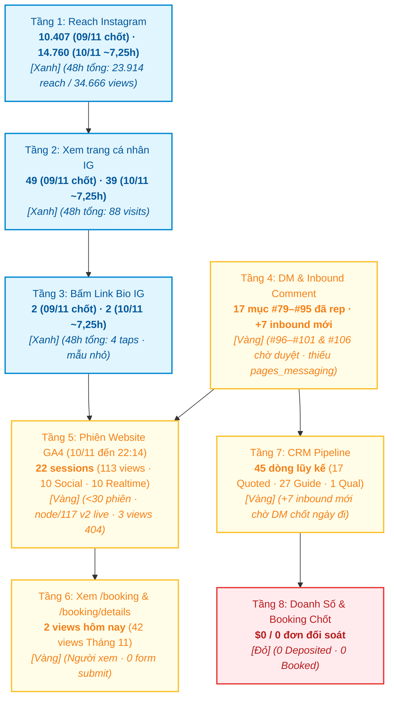

# Báo Cáo Hiệu Quả Hằng Ngày TravelFrame — 10/11/2026 (Cập nhật 22:13 ICT)

*Thời điểm chụp số liệu: 22:13 ICT ngày 10/11/2026 (Tách rõ bucket Meta `09/11 PST` đã chốt đủ 24h lúc 15:00 ICT, bucket `10/11 PST` đang mở `15:00–22:15 ICT`, và log GA4 ngày `10/11` tính đến 22:14 ICT; mốc noon 12:38 ICT và 20:54 ICT ghi chú riêng)*  
*Mốc đối chiếu: Hôm qua (`09/11/2026` / `08/11 PST`) và 7 ngày trước (`03/11/2026` / `02/11 PST` & `03/11 PST`)*  
*Quy chuẩn áp dụng: [Data-Analytics/Daily-Reporting-Standard.md](../Daily-Reporting-Standard.md)*

---

### 1. Tóm Tắt (Executive Summary)

1. **[Xanh] Instagram tăng thêm 5.970 reach trong ~1,3 giờ qua, nâng `10/11 PST` đang mở lên 14.760 reach:** Bucket `09/11 PST` trọn 24h chốt tại **10.407 reach** (`+205,5%` vs `3.407` của `08/11 PST`; `+516,5%` vs `1.688` của `02/11 PST`) và **14.222 views**. Bucket `10/11 PST` đang mở (`15:00–22:15 ICT`, ~7,25 giờ) tăng từ `8.790` (20:55 ICT) lên **14.760 reach** (`+682,2%` vs trọn ngày `03/11 PST` `1.887`), **20.444 views**, **276 shares** (`+100` shares sau 20:55 ICT) và **169 saves**. Hai Reels tối `10/11` tăng nhanh tương tác: *Hàng Mã* đạt **148 likes IG** (`+45` sau 20:54 ICT), *Tạ Hiện* đạt **76 likes IG** (`+46`), *Chợ Đông Tác* đạt **90 likes / 12 cmt IG**.
2. **[Xanh] Follower tiếp tục tăng trên cả Facebook và Instagram, phát sinh thêm 1 inbound `Map` lúc 21:32 ICT:** Facebook Fanpage đạt **3.167 followers** (`+5` vs 20:54 ICT; `+39` vs sáng `09/11`; `+255 / +8,8%` vs `2.912` ngày `02/11`). Instagram đạt **642 followers** (`+3` vs 20:54 ICT; `+28` vs sáng `09/11`; `223 media`). Ngoài 17 luồng `#79–#95` đã xử lý live lúc `14:01–14:11 ICT`, tổng hàng chờ phát sinh sau `14:11 ICT` hiện là **7 bình luận inbound** (`3 Map` — mới thêm `#106` lúc 21:32 ICT, `3 Food`, `1 "보내주세요"`) và **4 bình luận cộng đồng** (`#96–#106`).
3. **[Vàng] Website đạt 22 phiên (113 views), `node/117` đã cập nhật bản v2 live và nộp 49 URL lên Bing Webmaster:** Sau bản kiểm tra lúc `21:40 ICT`, Rocky đã duyệt cập nhật live `node/117` bản v2 lúc `22:13 ICT` (khớp SLA ảnh chỉnh sửa 48h, gắn 6 link Google Maps, thay ảnh cover v2 + PDF v2 `3.547.503 bytes`, thêm CTA Messenger `m.me/travelframe.vn` & chèn 2 link nội bộ từ `node/105` và `node/65`). GA4 ngày `10/11` đạt **22 sessions**, **16 users**, **113 views** (gồm **10 Organic Social**: 8 FB, 2 IG; **10 active users Realtime** tại Việt Nam lúc 22:13 ICT; còn **22/96 top views** quản trị CMS). Đồng thời trong ngày `10/11` đã nộp `sitemap.xml` (66 URL) và **49 URL** lên Bing Webmaster Tools (`21/66` URL hiện đã có trên Bing).
4. **[Đỏ] Doanh số và đặt cọc đối soát bằng \$0 / 0 đơn:** `Data-Analytics/Lead-Pipeline-Tracker.csv` giữ **45 dòng** (`17 Quoted`, `27 Guide-Sent`, `1 Qualified-unconfirmed`; `0/45` đủ ngày đi + số khách; 0 `Deposited`, 0 `Booked`, 0 `Delivered`), chưa phát sinh chứng từ cọc ngân hàng.

---

### 2. Phễu Doanh Số (Khung 24 giờ gần nhất & Đối chiếu 09/11, 03/11)

| Bước chuyển đổi | `09/11 PST` trọn 24h (đóng 15:00 ICT 10/11) | `10/11 PST` đang mở (`15:00–22:15 ICT` · ~7,25h)* | Hôm qua (`08/11 PST` / 08–09/11) | 7 ngày trước (`02/11 PST` · `03/11 PST` / GA4 03/11) | Biến động (so với hôm qua & 7 ngày) | Trạng thái |
|:---|:---:|:---:|:---:|:---:|:---:|:---:|
| 1. Reach Instagram (accounts) | 10.407 | **14.760** | 3.407 (`08/11 PST`) | 1.688 (`02/11 PST`) / 1.887 (`03/11 PST`) | `09/11`: `+205,5%` vs `08/11` · `10/11`: `+682,2%` vs `03/11` | [Xanh] |
| 2. Lượt xem trang cá nhân IG | 49 | **39** | 34 | 10 (`02/11`) / 6 (`03/11`) | `+44,1%` (`09/11` vs `08/11`) · `48h`: **88 visits** | [Xanh] |
| 3. Lượt bấm link bio IG | 2 | **2** | 1 | 0 (`02/11`) / 0 (`03/11`) | `+100,0%` (`09/11` vs `08/11`) · `48h`: **4 taps** ** | [Xanh] |
| 4. DM / Messenger hỏi tour | Chưa đo đầy đủ*** | **+7 cmt inbound mới (`14:12–21:32 ICT`)** | 21 (lô 08/11) | Chưa đo | `#79–#95` đã rep lúc `14:01–14:11 ICT`; thêm `#96–#101, #106` chờ duyệt | [Vàng] |
| 5. Phiên website (GA4 Sessions) | 15 (trọn ngày 09/11) | **22** (`10/11` đến 22:14 ICT) | 0 (ngày 08/11) | 21 (trọn ngày 03/11) | `+46,7%` vs `09/11` · `+4,8%` vs `03/11` (gồm 10 Social, 22 admin/96 top views) | [Vàng]**** |
| 6. Lượt xem `/booking` & `/booking/details` | 2 (`/details`: 2) | **2** (`/details`: 2 · `/booking`: 0) | 0 (ngày 08/11) | 9 (`/details`: 9 · `/booking`: 0) | Ngang `09/11` · `−77,8%` vs `03/11` (Tháng 11: 42 `/details`) | [Vàng]**** |
| 7. Lead thu thập được (CRM) | 45 dòng lũy kế | 45 dòng lũy kế (+11 dispatch `14:01–14:11`) | 45 dòng lũy kế | Chưa đo | `17 Quoted`, `27 Guide-Sent`, `1 Qual`; +7 inbound chờ duyệt | [Vàng]***** |
| 8. Doanh thu (USD) & Đơn chốt | \$0 / 0 đơn | \$0 / 0 đơn | \$0 / 0 đơn | \$0 / 0 đơn | `0%` (`0 Deposited · 0 Booked · 0 Delivered`) | [Đỏ] |

*\* Tách riêng theo Quy tắc 2: Không trộn số liệu chụp trưa (`12:38 ICT`), tối sớm (`20:54 ICT`: `10/11 PST` là `8.790` reach) và khuya (`22:13 ICT`: `10/11 PST` là `14.760` reach). `09/11 PST` (`10.407` reach) là cửa sổ 24h hoàn chỉnh đã đóng lúc `15:00 ICT 10/11`. Truy vấn mặc định 48h không truyền `since`/`until` lúc `22:13 ICT` trả tổng `23.914` reach và `34.666` views.*  
*\*\* Cỡ mẫu Website link taps còn nhỏ (`2` taps mỗi bucket); theo dõi thêm chu kỳ 7 ngày.*  
*\*\*\* Messenger trực tiếp chưa đọc tự động qua API do thiếu quyền `pages_messaging` (lỗi `#200`).*  
*\*\*\*\* GA4 ngày `10/11` đạt `22` phiên (`<30` phiên) và chứa lượt truy cập quản trị CMS (`22/96` top views) nên giữ tối đa trạng thái `[Vàng]` theo Quy tắc 3 và 5.*  
*\*\*\*\*\* `Data-Analytics/Lead-Pipeline-Tracker.csv` giữ 45 dòng (`0/45` đủ ngày đi + số khách). Theo `Data-Analytics/Lead-Pipeline-Tracker-README.md`, Tier 2 PDF không tự cộng vào pipeline chính khi chưa hỏi giá/ngày đi.*

---

### 3. Chỉ Số Kênh (Channel Performance)

#### A. Mạng xã hội (Meta) — Snapshot 22:13 ICT 10/11/2026

* **Instagram (`@travelframe.vn`):**
  * **Followers:** **642** (`+3` vs 20:54 ICT; `+15` vs 12:38 ICT; `+28` vs 614 sáng `09/11`; `+46` / `+7,7%` vs 596 ngày `02/11`).
  * **Media count:** **223** (`+2` Reels đăng tối `10/11`).
  * **Bucket `09/11 PST` trọn 24h (`15:00 ICT 09/11 – 15:00 ICT 10/11`):** **10.407 reach** (`+205,5%` vs `3.407`; `+516,5%` vs `1.688`), **14.222 views**, **635 accounts engaged**, **942 content interactions**, **390 saves** (`37,5 saves / 1.000 reach`), **187 shares**.
  * **Bucket `10/11 PST` đang mở (`15:00–22:15 ICT 10/11`, ~7,25 giờ):** **14.760 reach** (`+682,2%` vs trọn ngày `03/11 PST` `1.887`), **20.444 views** (`+579,0%` vs `3.011`), **575 accounts engaged**, **987 interactions**, **169 saves**, **276 shares** (`+100` shares so với 20:55 ICT).
  * **Cộng gộp 48h mặc định tại 22:13 ICT:** **23.914 reach**, **34.666 views**, **1.193 accounts engaged**, **1.929 interactions**, **559 saves**, **463 shares**, **88 profile visits**, **4 website link taps**.

* **Facebook Fanpage (`travelframe.vn`):**
  * **Followers & Page Likes (`fan_count`):** **3.167** (`+5` vs 3.162 lúc 20:54 ICT; `+14` vs 3.153 lúc 12:38 ICT; `+39` vs 3.128 sáng `09/11`; **+255 / +8,8%** vs 2.912 chiều `02/11`).
  * **Facebook Reach / Views / Saves (24h):** **Chưa đo** qua MCP `travelframe-meta`. Qua post feed: `Chợ Đông Tác` `5 shares`, `Ngan cháy tỏi` `2 shares`, `Bít tết` `12 shares`.

#### B. Website (Google Analytics 4 — Property `552867189`) — Ngày 10/11 (đến 22:14 ICT) & SEO

* **Ngày `10/11/2026` (00:00–22:14 ICT):**
  * **Active Users:** **16** | **Sessions:** **22** (`+1` vs 20:55 ICT) | **Screen Pageviews:** **113** (`+9` vs 20:55 ICT; `bounceRate: 36,36%`, `avgSessionDuration: 557,1s`).
  * **Phân tách sạch vs quản trị (top 30 dòng = `96` views + `17` views ở `20` dòng dài hơn):** **74 public views** vs **22 admin/partner views** trong top 30 dòng.
  * **Nguồn lưu lượng `10/11`:** Organic Social **10 phiên** (`m.facebook.com`: 5, `facebook.com`: 3, `ig / social`: 2), Direct **12 phiên**, Unassigned **7 phiên** *(tổng 29 vs 22 phiên khử trùng do đa nguồn)*.
  * **Trang đáng chú ý `10/11`:** `/tours` (**16 views**), `/news/hanoi-secret-food-photo-map` (**8 views** across 2 titles trước v2), `/booking/details` (**2 views**), `/hanoi-photoshoot` (**2 views**), `/news/hanoi-old-quarter-guide` (**2 views**); vẫn ghi nhận các 404 trước đó (`/toursLet`: 2 views, `/news/hanoi-secret-food-photo-map📸`: 1 view).
  * **Realtime tại `22:13 ICT`:** **10 active users** tại Việt Nam (gồm lượt mở `node/117`, `node/105`, `/tours`, `The Honest Hanoi Street Food Guide`, `Overview · TravelFrame Partner`, v.v. sau khi cập nhật v2 & chèn 2 internal links).
* **Cập nhật kỹ thuật Website (`Marketing-Growth/Content/Drafts/2026-11-10-Hanoi-Secret-Food-Map/Publication.md` & `SEO/2026-11-10-Bing-IndexNow-Check.md`):**
  * **22:13 ICT:** Bản **v2 của `node/117`** đã lên live (`HTTP 200`): đổi title sang `Hanoi Secret Food Map: 6 Local Street Food Spots (Free PDF) | TravelFrame Vietnam`, lead chuẩn `Six Hanoi street food spots`, SLA `within 48 hours` khớp DEC, gắn **6 link Google Maps**, ảnh cover v2 (`39.192 bytes`) + PDF v2 (`3.547.503 bytes`), CTA Messenger `m.me/travelframe.vn` & Instagram mở tab mới, cộng thêm **2 link nội bộ trỏ về `node/117`** từ `node/105` và `node/65` *(vẫn chưa hiện trên `/news` và trang chủ — chờ ticket D13)*.
  * **Bing SEO (10/11):** Đã nộp `/sitemap.xml` (66 URL) và submit **49 URL** trên Bing Webmaster Tools (`21/66` URL hiện đã có trên Bing; `IndexNow` chờ developer file khóa ticket D12).
* **Tháng 11 MTD (`01–10/11`):** **52 users**, **130 sessions**, **652 pageviews** (`38,46%` bounce). **Lũy kế `01/10–10/11`:** **436 users**, **883 sessions**, **3.149 views** (`52,32%` bounce, `356,0s`) — chưa lọc traffic nội bộ/admin.

---

### 4. Nội Dung Đã Đăng & Seed Comment (Content & Engagement Ledger)

Ghi chú tuân thủ Quy tắc 6 & 7: Các trường Reach, Views, Saves cấp từng bài không có trong response của MCP `travelframe-meta` hiện tại nên ghi **Chưa đo (API)**; bảng không ghi tên cá nhân người bình luận.

| Thời gian đăng (ICT) | Kênh | Định dạng | Mã bài / URL | Mốc tuổi bài (tại 22:13 10/11) | Reach (24h/72h) | Views (24h/72h) | Saves | Shares | Likes / Comments (API) & Seed Comment | Trạng thái |
|:---|:---:|:---:|:---|:---:|:---:|:---:|:---:|:---:|:---|:---:|
| 19:15 10/11 | IG | Reel | [Dfj4fADSff7](https://www.instagram.com/reel/Dfj4fADSff7/) | ~3,0h | Chưa đo (API) | Chưa đo (API) | Chưa đo (API) | Chưa đo (API) | **76 likes** (+46 vs 20:54) · 2 cmt (C1 +1p, C2 +26p; `SAFE`) | Published |
| 19:16 10/11 | FB | Reel | [1865726904422696](https://www.facebook.com/reel/1865726904422696/) | ~3,0h | Chưa đo (API) | Chưa đo (API) | Chưa đo (API) | 0 | 0 cmt · Chưa thấy Seed C1 & C2 qua API | Published |
| 17:18 10/11 | IG | Reel | [Dfjq4KWtyAH](https://www.instagram.com/reel/Dfjq4KWtyAH/) | ~4,9h | Chưa đo (API) | Chưa đo (API) | Chưa đo (API) | Chưa đo (API) | **148 likes** (+45 vs 20:54) · 3 cmt (C1 +1p, C2 +25p, +1 Pháp chờ duyệt) | Published |
| 17:19 10/11 | FB | Reel | [991036764063782](https://www.facebook.com/reel/991036764063782/) | ~4,9h | Chưa đo (API) | Chưa đo (API) | Chưa đo (API) | 0 | 1 cmt tiếng Việt (`1152362740665834`) chờ duyệt · Chưa thấy Seed FB | Published |
| 21:17 09/11 | IG | Reel | [DfhhrgcypHf](https://www.instagram.com/reel/DfhhrgcypHf/) | ~24,9h (>24h) | Chưa đo (API) | Chưa đo (API) | Chưa đo (API) | Chưa đo (API) | 20 likes · 2 cmt (C1 & C2 đã cấy; keyword `SAFE`) | Published |
| 21:17 09/11 | FB | Reel | [1104948095905420](https://www.facebook.com/reel/1104948095905420/) | ~24,9h (>24h) | Chưa đo (API) | Chưa đo (API) | Chưa đo (API) | 0 | 1 `Safe` (`#93` đã rep) · Chưa thấy Seed C1 & C2 qua API | Published |
| 20:55 09/11 | IG | Reel | [DfhfFILS-dK](https://www.instagram.com/reel/DfhfFILS-dK/) | ~25,3h (>24h) | Chưa đo (API) | Chưa đo (API) | Chưa đo (API) | Chưa đo (API) | **90 likes** (+4 vs 20:54) · **12 cmt** (4 `MAP` đã rep; **+2 `Map` chờ duyệt** gồm `17981260719005471` lúc 21:32) | Published |
| 20:55 09/11 | FB | Reel | [1446188516931637](https://www.facebook.com/reel/1446188516931637/) | ~25,3h (>24h) | Chưa đo (API) | Chưa đo (API) | Chưa đo (API) | **5** | **+1 `Map` mới** (`2017964102918481`) chờ duyệt · Chưa thấy Seed FB | Published |
| 20:28 09/11 | IG | Reel | [Dfhb8a2yScH](https://www.instagram.com/reel/Dfhb8a2yScH/) | ~25,7h (>24h) | Chưa đo (API) | Chưa đo (API) | Chưa đo (API) | Chưa đo (API) | **49 likes** · **7 cmt** (`#86` đã rep; **+3 mới**: `Food`, `"보내주세요"`, `food` chờ duyệt) | Published |
| 20:28 09/11 | FB | Reel | [2268308380773075](https://www.facebook.com/reel/2268308380773075/) | ~25,7h (>24h) | Chưa đo (API) | Chưa đo (API) | Chưa đo (API) | 2 | `#82/#86/#87` đã rep · **+1 `Food` + 1 cmt tiếng Việt** chờ duyệt · Chưa thấy Seed FB | Published |
| 13:06 08/11 | IG | Reel | [DfeEpSit87H](https://www.instagram.com/reel/DfeEpSit87H/) | ~57,1h | Chưa đo (API) | Chưa đo (API) | Chưa đo (API) | Chưa đo (API) | 11 likes · 3 cmt (`#73/#95` đã rep & follow-up) | Published |
| 13:40 07/11 | IG | Reel | [DfbjmGMtQgH](https://www.instagram.com/reel/DfbjmGMtQgH/) | ~80,5h (>72h) | 3.690* | 4.302* | 38* | 81* | 85 likes · 6 cmt (`#74/#95` đã rep & follow-up) | Published |
| 13:40 07/11 | FB | Reel | [1509818901002655](https://www.facebook.com/reel/1509818901002655/) | ~80,5h (>72h) | 25.885 viewers* | 31.398* | Chưa đo | 12 | `#79/#82/#85/#88/#90–#92` đã rep · **+1 cmt mới** `"Had that in Dalat..."` chờ duyệt | Published |

*\* Nguồn bổ sung cấp bài viết:* Các số Reach/Views/Saves/Shares đánh dấu `*` là lũy kế đến `18:13–18:17 ICT ngày 09/11/2026` từ bản xuất Meta Business Suite trong `Data-Analytics/Reports/2026-11-09-TravelFrame-Instagram-Facebook-Content-Winners.md`.

---

### 5. Cảnh Báo Dữ Liệu (Data Limitations & Hygiene)

1. **Ranh giới ngày Meta PST (`15:00 ICT`) và tốc độ tăng trưởng đang mở của `10/11 PST`:** Bucket `10/11 PST` đang tích lũy từ `15:00 ICT 10/11` (đã đạt `14.760` reach lúc 22:15 ICT, tăng `+5.970` so với `8.790` lúc 20:55 ICT) và chỉ chốt đủ 24h lúc `15:00 ICT 11/11`. Bảng phễu giữ tách biệt hoàn toàn với `09/11 PST` (`10.407` reach) để tuân thủ Quy tắc 2.
2. **Thiếu số liệu cấp bài viết & hộp thư Messenger trên API:** Nhóm 3 Reels `09/11` đã vượt mốc 24h (`24,9–25,7h`) nhưng MCP `travelframe-meta` chưa trả được Reach/Views/Saves cấp từng bài; Messenger trực tiếp vẫn thiếu quyền `pages_messaging`.
3. **Traffic quản trị/biên tập CMS trong GA4 & dấu vết 404 cũ:** Trong top 30 dòng của ngày `10/11` (`96` views) có **22 views** quản trị CMS và cụm **10 Realtime users** lúc `22:13 ICT` bao gồm các phiên kiểm tra ngay sau khi lưu `node/117` v2, `node/105` và `node/65`. Đồng thời các lượt 404 `/toursLet` (2) và `/news/hanoi-secret-food-photo-map📸` (1) vẫn nằm trong tổng ngày `10/11`.
4. **Còn một số hạng mục website/CRM đang mở:** `node/117` đã lên bản v2 nhưng vẫn chưa hiển thị trên `/news` và trang chủ (ticket D13), còn IndexNow vẫn cần file khóa gốc (ticket D12). `Lead-Pipeline-Tracker.csv` giữ 45 dòng (`0/45` đủ ngày đi + số khách).

---

### 6. Việc Cần Làm (Action Items — Xếp theo mức độ gần doanh thu)

1. **Nhắn follow-up chốt cọc cho 17 dòng `Quoted`, 1 dòng `Qualified-unconfirmed` và `#94` trong CRM/Messenger:**
   - **Vị trí trong phễu:** Tầng 7 (CRM Lead) sang Tầng 8 (`Deposited` / `Booked`).
   - **Chỉ số đo lường hiệu quả:** Phát sinh ít nhất 1 giao dịch cọc có `payment_evidence` và `booking_ref` trong `Data-Analytics/Lead-Pipeline-Tracker.csv`.
   - **Yêu cầu phê duyệt:** `Tự vận hành` (nhắn nhắc theo bảng giá Approved; mọi chốt lịch/đổi giá `Cần Rocky duyệt`).
   - **Tài liệu:** `Data-Analytics/Lead-Pipeline-Tracker.csv`, `Sales-CRM/Scripts/2026-10-21-DM-Price-Reply-Script.md`.

2. **Duyệt trả lời công khai + gửi DM/Private Reply kèm link sạch `node/117` v2 cho 7 inbound mới (`#96–#101`, `#106`):**
   - **Vị trí trong phễu:** Tầng 4 (Comment từ khóa) sang Tầng 5/7 (Truy cập trang PDF v2 + mở hội thoại ngày đi & gói `\$30/h`).
   - **Chỉ số đo lường hiệu quả:** 7/7 bình luận (`3 Map` trên Chợ Đông Tác IG/FB gồm `#106` lúc 21:32 ICT; `3 Food` + `1 "보내주세요"` trên Ngan cháy tỏi IG/FB) nhận phản hồi công khai + DM URL tách dấu cách rõ ràng (tránh lặp lỗi `/toursLet` hoặc dính emoji).
   - **Yêu cầu phê duyệt:** `Cần Rocky duyệt`.
   - **Tài liệu:** `Marketing-Growth/Content/Meta-Messenger-All-Interactions-Log.md` (`#96–#101`, `#106`).

3. **Duyệt cấy Seed Comment C1 & C2 trên Facebook cho 5 Reels chưa có seed FB và phản hồi 4 bình luận cộng đồng (`#102–#105`):**
   - **Vị trí trong phễu:** Tầng 1 (Tương tác sớm trên Reels đạt 76–148 likes IG) sang Tầng 4 (Bình luận từ khóa `MAP`, `SAFE`, `FOOD`).
   - **Chỉ số đo lường hiệu quả:** 5/5 FB Reels (`991036764063782`, `1865726904422696`, `2268308380773075`, `1446188516931637`, `1104948095905420`) có đủ C1/C2 cập nhật vào `Data-Analytics/Seed-Comment-Tracker.csv`; 4/4 bình luận `#102–#105` được trả lời.
   - **Yêu cầu phê duyệt:** `Cần Rocky duyệt`.
   - **Tài liệu:** `Marketing-Growth/Guidelines/2026-10-07-Seed-Comment-Playbook.md`, `Data-Analytics/Seed-Comment-Tracker.csv`, `Marketing-Growth/Content/Meta-Messenger-All-Interactions-Log.md`.

4. **Xuất số liệu 24h từng bài cho 3 Reels `09/11` (đã vượt mốc 24h) và kiểm tra 48h Bing Webmaster (`12/11`):**
   - **Vị trí trong phễu:** Tầng 1 & Tầng 5 (Đo hiệu quả thực của *Chợ Đông Tác*, *Ngan cháy tỏi*, *Cyclo đêm* và theo dõi 49 URL đã nộp Bing).
   - **Chỉ số đo lường hiệu quả:** Điền đủ Reach/Views/Saves mốc 24h vào báo cáo và `Data-Analytics/Seed-Comment-Tracker.csv`; xác nhận trạng thái crawl của 49 URL trên Bing sau 48h.
   - **Yêu cầu phê duyệt:** `Tự vận hành` (đọc và ghi nhận số liệu).
   - **Tài liệu:** `Technology-Automation/Runbooks/Meta-Connection-And-Publishing-Runbook.md`, `Marketing-Growth/SEO/2026-11-10-Bing-IndexNow-Check.md`.

5. **Giao developer xử lý ticket D12 (file khóa IndexNow), D13 (hiện `node/116–117` trên `/news`) và tách lọc admin CMS trên GA4:**
   - **Vị trí trong phễu:** Tầng 5 (Phiên website tự nhiên & SEO).
   - **Chỉ số đo lường hiệu quả:** `node/117` xuất hiện trên `/news` & trang chủ; `/df54ec0e2916426d9d891ebc93ebf940.txt` trả HTTP 200; GA4 tách sạch `22–53` views quản trị CMS.
   - **Yêu cầu phê duyệt:** `Cần Rocky duyệt` (trước khi deploy thay đổi website/GA4).
   - **Tài liệu:** `Marketing-Growth/SEO/2026-10-14-Developer-SEO-Ticket.md`, `Marketing-Growth/Content/Drafts/2026-11-10-Hanoi-Secret-Food-Map/Publication.md`.
