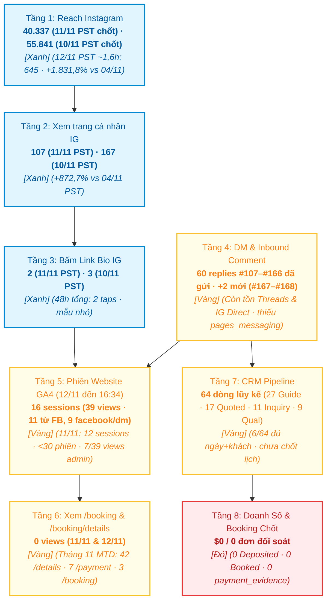

# Báo Cáo Hiệu Quả Hằng Ngày TravelFrame — 12/11/2026 (Cập nhật 16:32 ICT)

*Thời điểm chụp số liệu: 16:32 ICT ngày 12/11/2026 (Tách rõ hai cửa sổ Meta đã đóng đủ 24h là `10/11 PST` và `11/11 PST` đóng lúc `15:00 ICT 12/11`, cửa sổ `12/11 PST` đang mở `15:00–16:35 ICT` ~1,6 giờ, và log GA4 ngày `11/11` trọn ngày + ngày `12/11` tính đến `16:34 ICT`)*  
*Mốc đối chiếu: Hôm qua (`11/11/2026` / `10/11 PST`) và 7 ngày trước (`05/11/2026` / `04/11 PST` & `05/11 PST`)*  
*Quy chuẩn áp dụng: [Data-Analytics/Daily-Reporting-Standard.md](../Daily-Reporting-Standard.md)*

---

### 1. Tóm Tắt (Executive Summary)

1. **[Xanh] Instagram đạt 55.841 reach (`10/11 PST`) và 40.337 reach (`11/11 PST`), gấp 19,3 lần cùng kỳ 7 ngày trước:** Hai cửa sổ 24h hoàn chỉnh liên tiếp ghi nhận phân phối cao trên Instagram nhờ Reel *Hàng Mã* (`2.152 likes`, `56 comments` trên IG; `28 shares` trên FB) và *Tạ Hiện* (`483 likes` trên IG). Riêng `11/11 PST` chốt **40.337 reach** (`+1.831,8%` vs `2.088` của `04/11 PST`; `-27,8%` so với đỉnh `55.841` của `10/11 PST`), **50.714 views**, **1.972 accounts engaged**, **207 saves** và **820 shares**. Instagram đạt **720 followers** (`+78 / +12,1%` vs `642` tối 10/11; `+124 / +20,8%` vs `596` ngày `02/11`); Facebook Fanpage đạt **3.398 followers** (`+231 / +7,3%` vs `3.167` tối 10/11; `+486 / +16,7%` vs `2.912` ngày `02/11`).
2. **[Vàng] Đã gửi live 60 phản hồi sáng 12/11 (`#107–#166`), xuất hiện 9 phiên `facebook / dm` trên GA4 và phát sinh 2 bình luận FB mới chờ duyệt:** Buổi sáng `12/11`, vận hành đã xử lý xong `38` lead/Q&A (`#107–#144`) và `22` tương tác cộng đồng (`#145–#166`). Trong ngày `12/11` (tính đến `16:34 ICT`), GA4 ghi nhận **16 sessions** / **39 views**, trong đó **11 phiên Organic Social từ Facebook** gồm **9 phiên gắn UTM `facebook / dm`**, `1 facebook / comment_reply` và `1 facebook.com / referral`. Kiểm tra lúc `16:36 ICT` phát hiện thêm `1` comment từ khóa `"Hello. Food"` (`#167`, lúc `13:30 ICT 12/11`) trên FB *Ngan cháy tỏi* và `1` bình luận trên FB *Crossing the street* (`#168`, lúc `17:06 ICT 11/11`) đang chờ Rocky duyệt.
3. **[Vàng] CRM mở rộng lên 64 dòng và ra mắt bài SEO `node/124` + ebook `Hanoi Handbook v04` ($12 Coming soon):** [Data-Analytics/Lead-Pipeline-Tracker.csv](../Lead-Pipeline-Tracker.csv) đồng bộ từ `45` lên **64 dòng** (`27 Guide-Sent`, `17 Quoted`, `11 Inquiry`, `9 Qualified-unconfirmed`; `6/64` dòng đủ cả ngày đi và số khách), nhưng còn nhiều hội thoại Direct chưa phản hồi trên Threads và IG Direct. Website đã xuất bản [node/124 — Where to Eat in Hanoi Old Quarter](../../Marketing-Growth/Content/Drafts/2026-11-12-Hanoi-Old-Quarter-Food-Guide/Publication.md) (`HTTP 200`, có trong `/sitemap.xml`, đã gửi Google Search Console & Bing Webmaster hôm nay) và cập nhật *The Hanoi Handbook v04* lên ô 02 `/ebooks` ở trạng thái `Coming soon` (chờ cấu hình `file_private_path` và PayPal để mở bán).
4. **[Đỏ] Doanh số và đặt cọc đối soát bằng \$0 / 0 đơn:** Dù lượt xem `/booking/details` lũy kế tháng 11 đạt **42 views** (`13 users`) và `/booking/payment` đạt **7 views** (`6 users`), cả hai ngày `11/11` và `12/11` chưa ghi nhận lượt xem trang đặt tour mới nào và vẫn có **0 Deposited / 0 Booked / 0 Delivered** trong CRM.

---

### 2. Phễu Doanh Số (Khung 24 giờ gần nhất & Đối chiếu 11/11, 04–05/11)

| Bước chuyển đổi | `11/11 PST` chốt 24h (đóng 15:00 ICT 12/11) | `12/11 PST` đang mở (`15:00–16:35 ICT` · ~1,6h)* | Hôm qua (`10/11 PST` chốt / GA4 `11/11`) | 7 ngày trước (`04/11 PST` chốt / GA4 `05/11`) | Biến động (`11/11 PST` vs `10/11 PST` & `04/11 PST`) | Trạng thái |
|:---|:---:|:---:|:---:|:---:|:---:|:---:|
| 1. Reach Instagram (accounts) | **40.337** | 645 | 55.841 (`10/11 PST`) | 2.088 (`04/11 PST`) / 2.518 (`05/11 PST`) | `-27,8%` vs `10/11` · `+1.831,8%` vs `04/11` | [Xanh] |
| 2. Lượt xem trang cá nhân IG | **107** | 2 | 167 (`10/11 PST`) | 11 (`04/11 PST`) / 25 (`05/11 PST`) | `-35,9%` vs `10/11` · `+872,7%` vs `04/11` | [Xanh] |
| 3. Lượt bấm link bio IG | **2** | 0 | 3 (`10/11 PST`) | 0 (`04/11 PST`) / 0 (`05/11 PST`) | `-33,3%` vs `10/11` · `+2` vs `04/11` (mẫu nhỏ)** | [Xanh] |
| 4. DM / Messenger hỏi tour | **60 replies đã gửi (`#107–#166`)** | +1 inbound `#167` (`13:30 ICT 12/11`)*** | +49 comment sau scan `09:18 ICT` | Chưa đo | `38` lead/Q&A + `22` engagement đã rep; còn tồn Threads & IG Direct | [Vàng] |
| 5. Phiên website (GA4 Sessions) | **16** (`12/11` đến 16:34 · 39 views) | *(nằm trong 16 phiên `12/11`)* | 12 (`11/11` trọn ngày · 38 views) | 10 (`05/11` trọn ngày · 51 views) | `+33,3%` vs `11/11` · `+60,0%` vs `05/11` (`11` FB sessions; `<30`) | [Vàng]**** |
| 6. Lượt xem `/booking` & `/booking/details` | **0** (`12/11` đến 16:34) | *(0 trên cả `/booking` & `/details`)* | 0 (`11/11` trọn ngày) | Chưa tách 05/11 | Ngang `11/11` (Tháng 11 MTD: **42** `/details`, **7** `/payment`, **3** `/booking`) | [Vàng]**** |
| 7. Lead thu thập được (CRM) | **64 dòng lũy kế** (`+19` vs `08/11`) | **64 dòng lũy kế** | 45 -> 64 dòng (audit sáng `12/11`) | Chưa đo đối xứng | `27 Guide`, `17 Quoted`, `11 Inquiry`, `9 Qual`; `6/64` đủ ngày+khách | [Vàng]***** |
| 8. Doanh thu (USD) & Đơn chốt | \$0 / 0 đơn | \$0 / 0 đơn | \$0 / 0 đơn | \$0 / 0 đơn | `0%` (`0 Deposited · 0 Booked · 0 Delivered`) | [Đỏ] |

*\* Tách riêng theo Quy tắc 2: `11/11 PST` (`40.337` reach) là cửa sổ 24h hoàn chỉnh mới nhất đóng lúc `15:00 ICT 12/11`; `10/11 PST` (`55.841` reach) là cửa sổ 24h hoàn chỉnh của ngày hôm qua đóng lúc `15:00 ICT 11/11`; `12/11 PST` mới mở ~1,6 giờ (`645` reach). Truy vấn mặc định 48h không truyền `since`/`until` lúc `16:33 ICT 12/11` trả tổng `40.724` reach và `51.503` views.*  
*\*\* Cỡ mẫu Website link taps còn nhỏ (`2–3` taps/24h); theo dõi thêm chuỗi 7 ngày.*  
*\*\*\* Messenger trực tiếp chưa đọc tự động qua API do thiếu quyền `pages_messaging` (lỗi `#200`).*  
*\*\*\*\* GA4 ngày `12/11` đạt `16` phiên (`<30` phiên), chứa `7/39` views quản trị/đối tác và `0` view `/booking` trong `11–12/11`, nên giữ trạng thái `[Vàng]`.*  
*\*\*\*\*\* Trong [Data-Analytics/Lead-Pipeline-Tracker.csv](../Lead-Pipeline-Tracker.csv), cột `payment_evidence` rỗng (`0` giao dịch cọc); một số dòng `Guide-Sent` cũ bị ghi ngày báo giá vào cột `deposit_usd`, không phải tiền cọc thực tế.*

---

### 3. Chỉ Số Kênh (Channel Performance)

#### A. Mạng xã hội (Meta) — Snapshot 16:33–16:36 ICT 12/11/2026

* **Instagram (`@travelframe.vn`):**
  * **Followers:** **720** (`+5` vs `715` lúc 10:34 ICT 12/11; `+78 / +12,1%` vs `642` tối `10/11`; `+124 / +20,8%` vs `596` ngày `02/11`).
  * **Following / Media count:** **124** following / **224** media (`+1` Reel *Old Quarter street crossing* đăng `12:23 ICT 11/11`).
  * **Cửa sổ `10/11 PST` trọn 24h (`15:00 ICT 10/11 – 15:00 ICT 11/11`):** **55.841 reach**, **74.748 views**, **167 profile visits**, **3 website link taps**, **4.357 total interactions**, **2.494 accounts engaged**, **418 saves**, **1.210 shares**.
  * **Cửa sổ `11/11 PST` trọn 24h (`15:00 ICT 11/11 – 15:00 ICT 12/11`):** **40.337 reach** (`+1.831,8%` vs `2.088` của `04/11 PST`; `-27,8%` vs `10/11 PST`), **50.714 views** (`+1.453,7%` vs `3.264`), **107 profile visits** (`+872,7%` vs `11`), **2 website link taps**, **3.256 total interactions** (`+1.519,9%` vs `201`), **1.972 accounts engaged** (`+1.393,9%` vs `132`), **207 saves** (`+245,0%` vs `60`), **820 shares** (`+1.900,0%` vs `41`).
  * **Cửa sổ `12/11 PST` đang mở (`15:00–16:35 ICT 12/11`, ~1,6 giờ):** **645 reach**, **789 views**, **2 profile visits**, **0 website link taps**, **42 interactions**, **28 accounts engaged**, **5 saves**, **12 shares** *(đối chiếu trọn ngày `05/11 PST`: `2.518` reach, `3.808` views)*.
  * **Cộng gộp 48h mặc định tại `16:33 ICT 12/11`:** **40.724 reach**, **51.503 views**, **1.998 accounts engaged**, **3.298 interactions**, **212 saves**, **832 shares**, **109 profile visits**, **2 website link taps**.

* **Facebook Fanpage (`travelframe.vn`):**
  * **Followers & Page Likes (`fan_count`):** **3.398** (`+29` vs `3.369` lúc 10:34 ICT 12/11; `+231 / +7,3%` vs `3.167` tối `10/11`; **+486 / +16,7%** vs `2.912` ngày `02/11`; **+1.038 / +44,0%** vs `2.360` ngày `23/10`).
  * **Facebook Reach / Views / Saves (24h):** **Chưa đo (API)** qua MCP `travelframe-meta`. Qua post feed trực tiếp: *Hàng Mã Christmas* (`991036764063782`) đạt **28 shares FB**, *Bít tết* (`1509818901002655`) **13 shares FB** (`+1`), *Ngan cháy tỏi* (`2268308380773075`) **8 shares FB** (`+6`), *Chợ Đông Tác* (`1446188516931637`) **5 shares FB**, *Old Quarter street crossing* (`1764296934674552`) **2 shares FB**.

#### B. Website (Google Analytics 4 — Property `552867189`) & Sản phẩm / SEO

* **Ngày `12/11/2026` (00:00–16:34 ICT):**
  * **Active Users:** **16** | **Sessions:** **16** (`+33,3%` vs `12` ngày `11/11`; `+60,0%` vs `10` ngày `05/11`) | **Views:** **39** (`bounceRate: 43,75%`, `avgSessionDuration: 151,2s`).
  * **Nguồn lưu lượng `12/11`:** **11 phiên từ Facebook** (**`facebook / dm`: 9 sessions / 9 users**, `facebook / comment_reply`: 1, `facebook.com / referral`: 1), **Direct**: `4`, **Cross-network**: `1`, **Unassigned**: `1` *(tổng 17 dòng nguồn vs 16 phiên khử trùng)*. Tín hiệu UTM từ loạt gửi DM sáng `12/11` đã ghi nhận trực tiếp trên GA4.
  * **Phân tách sạch vs quản trị `12/11` (`39` views trên `19` dòng):** **32 public views** vs **7 admin/partner views** (`/node/124/edit`: 4, `/son-bui-user`: 2, `/node/add/news`: 1). Trang dẫn đầu: [Where to Eat in Hanoi Old Quarter (`node/124`)](../../Marketing-Growth/Content/Drafts/2026-11-12-Hanoi-Old-Quarter-Food-Guide/Publication.md) (**7 public views** qua 2 title), `/` (**4**), `/news/15-best-photo-spots-hanoi-old-quarter` (**3**), `/tours` (**2**), `/about` (**2**). `/booking` và `/booking/details`: **0 views**.
  * **Realtime tại `16:34 ICT`:** **1 active user** tại Việt Nam (trang chủ `/`).
* **Ngày `11/11/2026` (trọn ngày):** **8 activeUsers**, **12 sessions**, **38 views** (`bounceRate: 41,67%`, `avgSessionDuration: 138,8s`); nguồn: Direct `8`, `l.facebook.com / referral`: `2`, `facebook.com / referral`: `1`, `threads / social`: `1`, Unassigned `2`; gồm **5/38** views partner (`/son-bui-user`: 4, `/nguyen-tuan-linh-user`: 1); `/booking` & `/booking/details`: **0 views**.
* **Tháng 11 MTD (`01–12/11`):** **70 users**, **166 sessions**, **765 views** (`bounceRate: 39,76%`, `avgSessionDuration: 624,1s`). Top trang thương mại trong top 50 dòng (`691` views): `/tours` (`149` views / `26 users`), `/` (`75` views), `/booking/details` (`42` views / `13 users`), `/booking/payment` (`7` views / `6 users`), `/booking` (`3` views / `2 users`).
* **Lũy kế `01/10–12/11`:** **453 users**, **919 sessions**, **3.262 views** (`bounceRate: 52,01%`, `avgSessionDuration: 361,5s`) — chưa lọc traffic nội bộ/admin.
* **Sản phẩm & SEO `12/11`:**
  * Đã xuất bản [node/124](../../Marketing-Growth/Published-Ledger.md) (`/news/where-to-eat-hanoi-old-quarter`, `HTTP 200`, 10 link nội bộ + 11 link Google Maps `200 OK`, có trong `/sitemap.xml`, đã bấm yêu cầu lập chỉ mục trên Google Search Console và nộp URL lên Bing Webmaster Tools hôm nay; dùng ảnh Wikimedia Commons tạm chờ bộ ảnh tự chụp).
  * *The Hanoi Handbook v04* (25 trang A4) đã được Rocky duyệt bán `\$12` trên ô 02 `/ebooks` ở trạng thái `Coming soon` ([Hanoi-Handbook-Ebook-2026 README](../../Creative-Production/Projects/Hanoi-Handbook-Ebook-2026/README.md)), hiện chờ cấu hình `file_private_path` và PayPal phía server.
  * Tồn đọng kỹ thuật website: `node/117` và `node/124` cùng chờ ticket `D13` để hiện trên `/news`, IndexNow chờ ticket `D12`, và hôm nay đến hạn kiểm tra sau 48h cho 49 URL đã nộp Bing ngày `10/11`.

---

### 4. Nội Dung Đã Đăng & Seed Comment (Content & Engagement Ledger)

Ghi chú tuân thủ Quy tắc 6 & 7: Các trường Reach, Views, Saves cấp từng bài không có trong response của MCP `travelframe-meta` hiện tại nên ghi **Chưa đo (API)**; bảng không ghi tên cá nhân hoặc handle người bình luận. Xem nhật ký đầy đủ tại [Data-Analytics/Seed-Comment-Tracker.csv](../Seed-Comment-Tracker.csv) và [Marketing-Growth/Content/Meta-Messenger-All-Interactions-Log.md](../../Marketing-Growth/Content/Meta-Messenger-All-Interactions-Log.md).

| Thời gian đăng (ICT) | Kênh | Định dạng | Mã bài / URL | Mốc tuổi bài (tại 16:33 12/11) | Reach (24h/72h) | Views (24h/72h) | Saves | Shares | Likes / Comments (API) & Seed Comment | Trạng thái |
|:---|:---:|:---:|:---|:---:|:---:|:---:|:---:|:---:|:---|:---:|
| 12:23 11/11 | IG | Reel | [DfluB5MNDG9](https://www.instagram.com/reel/DfluB5MNDG9/) | ~28,2h (>24h) | Chưa đo (API) | Chưa đo (API) | Chưa đo (API) | Chưa đo (API) | **20 likes** · 4 cmt (`C1` +1p, `C2` +24p; `SAFE`; `#164` đã rep 12/11) | Published |
| 12:23 11/11 | FB | Reel | [1764296934674552](https://www.facebook.com/reel/1764296934674552/) | ~28,2h (>24h) | Chưa đo (API) | Chưa đo (API) | Chưa đo (API) | **2** | 4 cmt (`#162/#163` đã rep 12/11; `+1` `#168` chờ duyệt; `1` spam dài) · Chưa thấy Seed FB qua API | Published |
| 19:15 10/11 | IG | Reel | [Dfj4fADSff7](https://www.instagram.com/reel/Dfj4fADSff7/) | ~45,3h | Chưa đo (API) | Chưa đo (API) | Chưa đo (API) | Chưa đo (API) | **483 likes** (`+407` vs 22:13 10/11) · 4 cmt (`C1/C2`; `#165` đã rep 12/11) | Published |
| 19:16 10/11 | FB | Reel | [1865726904422696](https://www.facebook.com/reel/1865726904422696/) | ~45,3h | Chưa đo (API) | Chưa đo (API) | Chưa đo (API) | 0 | 0 cmt · Chưa thấy Seed C1 & C2 qua API | Published |
| 17:18 10/11 | IG | Reel | [Dfjq4KWtyAH](https://www.instagram.com/reel/Dfjq4KWtyAH/) | ~47,2h | Chưa đo (API) | Chưa đo (API) | Chưa đo (API) | Chưa đo (API) | **2.152 likes** (`+2.004` vs 10/11) · **56 cmt** (`C1/C2`; `#107–#119`, `#144–#160` đã rep 12/11; còn `L-57`, `L-61` nested dưới seed cần follow-up DM) | Published |
| 17:19 10/11 | FB | Reel | [991036764063782](https://www.facebook.com/reel/991036764063782/) | ~47,2h | Chưa đo (API) | Chưa đo (API) | Chưa đo (API) | **28** | **23 cmt khách** (`#120–#124`, `#145–#161` đã rep 12/11) · Chưa thấy Seed FB qua API | Published |
| 21:17 09/11 | IG | Reel | [DfhhrgcypHf](https://www.instagram.com/reel/DfhhrgcypHf/) | ~67,3h | Chưa đo (API) | Chưa đo (API) | Chưa đo (API) | Chưa đo (API) | 20 likes · 2 cmt (`C1` & `C2`; keyword `SAFE`) | Published |
| 21:17 09/11 | FB | Reel | [1104948095905420](https://www.facebook.com/reel/1104948095905420/) | ~67,3h | Chưa đo (API) | Chưa đo (API) | Chưa đo (API) | 0 | 1 `Safe` (`#93` đã rep 10/11) · Chưa thấy Seed FB qua API | Published |
| 20:55 09/11 | IG | Reel | [DfhfFILS-dK](https://www.instagram.com/reel/DfhfFILS-dK/) | ~67,6h | Chưa đo (API) | Chưa đo (API) | Chưa đo (API) | Chưa đo (API) | **111 likes** (`+21`) · **18 cmt** (`C1/C2` + `#80–#84` 10/11 + `#131–#143` 12/11) | Published |
| 20:55 09/11 | FB | Reel | [1446188516931637](https://www.facebook.com/reel/1446188516931637/) | ~67,6h | Chưa đo (API) | Chưa đo (API) | Chưa đo (API) | **5** | 1 `Map` (`#135` đã rep 12/11) · Chưa thấy Seed FB qua API | Published |
| 20:28 09/11 | IG | Reel | [Dfhb8a2yScH](https://www.instagram.com/reel/Dfhb8a2yScH/) | ~68,1h | Chưa đo (API) | Chưa đo (API) | Chưa đo (API) | Chưa đo (API) | **52 likes** (`+3`) · **12 cmt** (`C1/C2` + `#86` + `#136–#139` đã rep 12/11) | Published |
| 20:28 09/11 | FB | Reel | [2268308380773075](https://www.facebook.com/reel/2268308380773075/) | ~68,1h | Chưa đo (API) | Chưa đo (API) | Chưa đo (API) | **8** (`+6`) | `#82/#86/#87` & `#125/#126/#133/#134/#154/#155` đã rep · **+1 `Food` mới lúc 13:30 ICT (`#167`)** chờ duyệt | Published |
| 13:40 07/11 | IG | Reel | [DfbjmGMtQgH](https://www.instagram.com/reel/DfbjmGMtQgH/) | ~122,9h | 3.690* | 4.302* | 38* | 81* | **87 likes** (`+2`) · 6 cmt (cũ đã rep đến `08/11`) | Published |
| 13:40 07/11 | FB | Reel | [1509818901002655](https://www.facebook.com/reel/1509818901002655/) | ~122,9h | 25.885 viewers* | 31.398* | Chưa đo | **13** (`+1`) | Đã rep đến `12/11` (lô Food & community) | Published |
| ~10:00 12/11 | Web | Guide SEO | [node/124](../../Marketing-Growth/Content/Drafts/2026-11-12-Hanoi-Old-Quarter-Food-Guide/Publication.md) | ~6,5h | — | 7 public (+4 edit) | — | — | `HTTP 200` · có trong `/sitemap.xml` · Đã gửi GSC & Bing `12/11` | Published |

*\* Nguồn bổ sung cấp bài viết:* Các số Reach/Views/Saves/Shares đánh dấu `*` là lũy kế đến `18:13–18:17 ICT ngày 09/11/2026` trong [Data-Analytics/Reports/2026-11-09-TravelFrame-Instagram-Facebook-Content-Winners.md](2026-11-09-TravelFrame-Instagram-Facebook-Content-Winners.md).

---

### 5. Cảnh Báo Dữ Liệu (Data Limitations & Hygiene)

1. **Tách cửa sổ Meta PST (`15:00 ICT`):** Không gộp hai cửa sổ 24h đã đóng (`10/11 PST` = `55.841` reach; `11/11 PST` = `40.337` reach) với cửa sổ `12/11 PST` mới mở ~1,6 giờ (`645` reach) hay truy vấn mặc định 48h (`40.724` reach).
2. **Thiếu quyền đọc inbox Messenger & số liệu Reach/Views từng Reel trên API:** MCP `travelframe-meta` vẫn chưa trả Reach/Views/Saves cấp từng bài cho nhóm Reel `09/11–11/11` dù đều đã qua 24–68h; hộp thư Messenger trực tiếp vẫn thiếu `pages_messaging`. Cần đối soát thêm trong Meta Business Suite để hoàn tất `Data-Analytics/Seed-Comment-Tracker.csv`.
3. **Traffic quản trị/biên tập CMS trong GA4 & vệ sinh CRM:** Trong `39` views ngày `12/11` có `7` views từ `/node/124/edit`, `/son-bui-user` và `/node/add/news` (và `5/38` views partner ngày `11/11`). Trong `Data-Analytics/Lead-Pipeline-Tracker.csv` (`64` dòng), một số dòng `Guide-Sent` cũ có ngày báo giá bị điền nhầm vào cột `deposit_usd`, trong khi `payment_evidence` bằng rỗng (`0` đơn cọc).
4. **Sự cố nhỏ trong loạt gửi sáng `12/11` và độ lệch thời gian báo cáo:** Mục `#131` (IG Chợ Đông Tác) ghi nhận 1 lần gửi nhầm Private Reply Facebook trùng lặp trong lúc vận hành. Bản báo cáo này chụp lúc `16:32 ICT` (không phải `08:30 ICT` chuẩn sáng) do cập nhật theo yêu cầu trong phiên chiều.

---

### 6. Việc Cần Làm (Action Items — Xếp theo mức độ gần doanh thu)

1. **Phản hồi dứt điểm nhóm lead có ngày đi cụ thể (`6` dòng đủ `travel_date + group_size`, `17 Quoted`, Threads & IG Direct tồn đọng) để tạo đơn cọc đầu tiên:**
   - **Vị trí trong phễu:** Tầng 4 / Tầng 7 (Lead có lịch) sang Tầng 8 (`Deposited` / `Booked`).
   - **Chỉ số đo lường hiệu quả:** Xử lý toàn bộ lead có ngày đi gần (`L-20261110-55`, `L-20261111-56`, `L-20261111-57`, `L-20261111-58`, `L-20261111-61`, `L-20261112-63`) và `17` dòng `Quoted`, ghi nhận ít nhất `1` giao dịch có `payment_evidence` và `booking_ref` trong CRM.
   - **Yêu cầu phê duyệt:** `Tự vận hành` (nhắn nhắc theo bảng giá Approved; mọi chốt lịch/đổi giá `Cần Rocky duyệt`).
   - **Tài liệu:** [Data-Analytics/Lead-Pipeline-Tracker.csv](../Lead-Pipeline-Tracker.csv), [Executive/Current-State.md](../../Executive/Current-State.md).

2. **Duyệt trả lời công khai + Private Reply kèm UTM cho comment mới `#167` (`"Hello. Food"`) và tùy chọn `#168`:**
   - **Vị trí trong phễu:** Tầng 4 (Comment từ khóa sau `09:18 ICT 12/11`) sang Tầng 5 (`facebook / dm` -> `node/117` / `node/124`) & Tầng 7.
   - **Chỉ số đo lường hiệu quả:** `100%` comment inbound mới nhận phản hồi trước cuối ngày, giữ đà chuyển đổi phiên `facebook / dm` (hôm nay đã có `9` phiên).
   - **Yêu cầu phê duyệt:** `Cần Rocky duyệt`.
   - **Tài liệu:** [Marketing-Growth/Content/Meta-Messenger-All-Interactions-Log.md](../../Marketing-Growth/Content/Meta-Messenger-All-Interactions-Log.md) (`#167–#168`).

3. **Hoàn tất cấu hình server cho cửa hàng `/ebooks` (`file_private_path` + PayPal) để mở bán *The Hanoi Handbook v04* (`$12`):**
   - **Vị trí trong phễu:** Tầng 5 (Traffic từ `node/124`, `node/117`, DM) sang Tầng 8 (Doanh thu sản phẩm số `$12`).
   - **Chỉ số đo lường hiệu quả:** Chuyển ô 02 `/ebooks` từ `Coming soon` sang mua được trực tiếp và phát sinh đơn thanh toán đầu tiên.
   - **Yêu cầu phê duyệt:** `Cần Rocky duyệt` (cấu hình server/cổng thanh toán).
   - **Tài liệu:** [Creative-Production/Projects/Hanoi-Handbook-Ebook-2026/README.md](../../Creative-Production/Projects/Hanoi-Handbook-Ebook-2026/README.md).

4. **Duyệt cấy Seed Comment FB còn thiếu (6 Reels `09–11/11`) và kiểm tra lại nguyên nhân sự cố gửi nhầm DM `#131`:**
   - **Vị trí trong phễu:** Tầng 1 (Khai thác tương tác bình luận trên Facebook Reels đang có `2–28` shares) sang Tầng 4.
   - **Chỉ số đo lường hiệu quả:** `6/6` FB Reels `09–11/11` có `C1/C2` cập nhật vào [Data-Analytics/Seed-Comment-Tracker.csv](../Seed-Comment-Tracker.csv); có quy tắc chống gửi nhầm object ID khi chạy batch API.
   - **Yêu cầu phê duyệt:** `Cần Rocky duyệt`.
   - **Tài liệu:** [Marketing-Growth/Guidelines/2026-10-07-Seed-Comment-Playbook.md](../../Marketing-Growth/Guidelines/2026-10-07-Seed-Comment-Playbook.md), [Data-Analytics/Seed-Comment-Tracker.csv](../Seed-Comment-Tracker.csv).

5. **Thực hiện kiểm tra Bing Webmaster 48h cho 49 URL (`10/11 -> 12/11`), xuất số liệu 24h Meta Business Suite cho Reels `09–11/11`, và theo dõi ticket `D12`/`D13`:**
   - **Vị trí trong phễu:** Tầng 1 & Tầng 5 (Vệ sinh dữ liệu đo lường và tăng độ phủ index `/news`).
   - **Chỉ số đo lường hiệu quả:** Cập nhật trạng thái crawl của `49` URL + `node/124` trên Bing/GSC; điền đủ Reach/Views/Saves 24h vào `Seed-Comment-Tracker.csv`; xác nhận tiến độ `D12`/`D13` với developer.
   - **Yêu cầu phê duyệt:** `Tự vận hành` (kiểm tra & ghi nhận dữ liệu) · `Cần Rocky duyệt` trước khi deploy thay đổi website.
   - **Tài liệu:** [Marketing-Growth/SEO/2026-10-14-Developer-SEO-Ticket.md](../../Marketing-Growth/SEO/2026-10-14-Developer-SEO-Ticket.md), [Marketing-Growth/Content/Drafts/2026-11-12-Hanoi-Old-Quarter-Food-Guide/Publication.md](../../Marketing-Growth/Content/Drafts/2026-11-12-Hanoi-Old-Quarter-Food-Guide/Publication.md).
