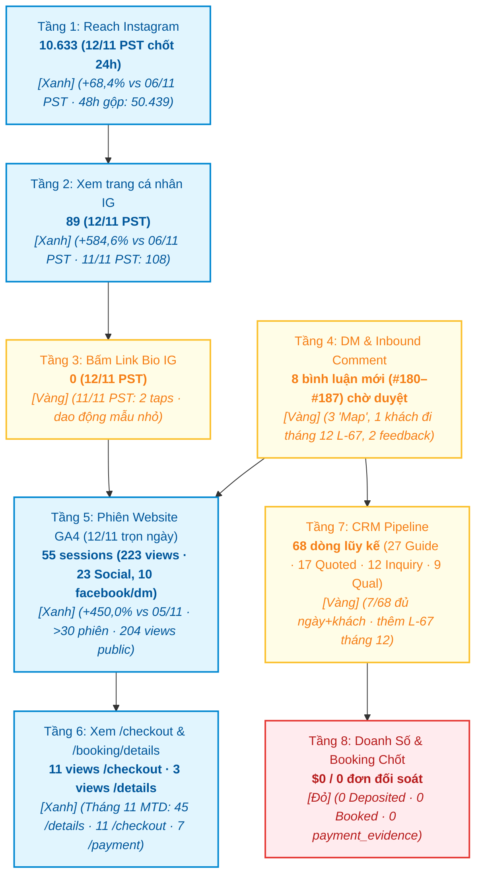

# Báo Cáo Hiệu Quả Hằng Ngày TravelFrame — 13/11/2026 (Cập nhật 10:21 ICT)

*Thời điểm chụp số liệu: 10:21 ICT ngày 13/11/2026 (Tách rõ cửa sổ Meta 24h đã đóng hoàn chỉnh là `12/11 PST` từ 08:30 ICT 12/11 đến 08:30 ICT 13/11, đối chiếu với cửa sổ `11/11 PST` và `06/11 PST`, cùng log GA4 ngày `12/11` trọn ngày và ngày `13/11` tính đến 10:21 ICT)*  
*Mốc đối chiếu: Hôm qua (`12/11/2026` / `11/11 PST`) và 7 ngày trước (`06/11/2026` / `06/11 PST`)*  
*Quy chuẩn áp dụng: [Data-Analytics/Daily-Reporting-Standard.md](../Daily-Reporting-Standard.md)*

---

### 1. Tóm Tắt (Executive Summary)

1. **[Xanh] Phiên website ngày 12/11 tăng lên 55 sessions / 223 views (gấp 5,5 lần ngày 05/11), ghi nhận 23 phiên Organic Social với 10 phiên trực tiếp từ `facebook / dm` và 11 lượt xem `/checkout`:** Chuỗi phản hồi tin nhắn và bình luận sáng 12/11 (`#107–#166`) đã tạo hiệu ứng chuyển đổi trực tiếp vào website. Ngày 12/11 ghi nhận **55 sessions** (`+358,3%` vs 12 phiên ngày 11/11; `+450,0%` vs 10 phiên ngày 05/11) từ **31 active users**, đạt ngưỡng mẫu trên 30 phiên. Nguồn Organic Social mang về **23 sessions**, trong đó dẫn đầu là **`facebook / dm`** (**10 sessions / 10 users**), `instagram / bio` (4 sessions / 2 users), `l.facebook.com` (3), `facebook.com` (2), `ig / social` (2). Lưu lượng đi sâu vào trang sản phẩm thương mại: `/tours` (17 views), `/tour/spiritual-west-lake-breeze` (17 views), `/ebooks` (14 views), đặc biệt là **`/checkout`** (**11 views / 6 users**) và **`/booking/details`** (**3 views / 3 users**). Lượng view quản trị/nội bộ chỉ chiếm 19/223 views (~8,5%), còn lại 204 views người dùng thực tế.
2. **[Xanh] Instagram khép lại cửa sổ 12/11 PST với 10.633 reach và 14.807 views (+68,4% và +65,1% vs 06/11 PST), tổng tương tác giữ mức 737:** Sau hai ngày phân phối cao từ Reel *Hàng Mã* (`55.841` ngày 10/11 và `40.337` ngày 11/11), cửa sổ 24h khép lại lúc 08:30 ICT 13/11 (`12/11 PST`) ghi nhận **10.633 reach** (`+68,4%` vs 6.314 ngày 06/11 PST; `-73,6%` vs 11/11 PST), **14.807 views** (`+65,1%` vs 8.970), **89 profile visits** (`+584,6%` vs 13), **98 saves** (`+78,2%` vs 55) và **174 shares** (`+200,0%` vs 58). Lũy kế người theo dõi tiếp tục tăng: Facebook đạt **3.414 followers** (`+16` vs chiều 12/11; `+247` vs 10/11; `+502 / +17,2%` vs 02/11); Instagram đạt **735 followers** (`+15` vs chiều 12/11; `+93 / +14,5%` vs 10/11; `+139 / +23,3%` vs 02/11).
3. **[Vàng] Xuất bản 1 Reel mới Tạ Hiện đêm 12/11, phát sinh 8 bình luận mới chờ duyệt (#180–#187) và CRM tăng lên 68 lead:** Đêm 12/11 (21:26 ICT), hệ thống đã xuất bản thêm Reel *Tạ Hiện đêm* ([DfpRH8TyNti](https://www.instagram.com/reel/DfpRH8TyNti/) trên IG / [1676563820486169](https://www.facebook.com/reel/1676563820486169/) trên FB), hiện chưa triển khai seed comment. Trong 18 giờ qua ghi nhận **8 bình luận mới** (`#180–#187`) đang chờ Rocky duyệt, bao gồm 3 bình luận từ khóa `"Map"` trên FB *Hàng Mã* (`#181`, `#185`, `#186`), 1 lead du lịch tháng 12 trên IG *Crossing* (`#182`, đã bổ sung mã `L-20261112-67` vào CRM, nâng tổng số lead lên **68 dòng**), 1 phản hồi an toàn giao thông (`#180`), và 1 phản hồi ủng hộ việc đi tour có hướng dẫn (`#187`).
4. **[Đỏ] Doanh số và tiền đặt cọc đối soát vẫn ở mức $0 / 0 đơn:** Dù phễu chuyển đổi ghi nhận tín hiệu rõ nét ở tầng giữa với 11 lượt xem `/checkout` và 3 lượt xem `/booking/details` trong ngày 12/11, hệ thống vẫn chưa ghi nhận đơn cọc tour nào (`0 Deposited / 0 Booked / 0 Delivered`) và gian hàng `/ebooks` vẫn đang chờ cấu hình PayPal để mở bán *The Hanoi Handbook v04* (`$12`).

---

### 2. Phễu Doanh Số (Khung 24 giờ gần nhất & Đối chiếu 11/11, 06/11)

| Bước chuyển đổi | `12/11 PST` chốt 24h (đóng 08:30 ICT 13/11)* | Hôm qua (`11/11 PST` chốt / GA4 `11/11`) | 7 ngày trước (`06/11 PST` chốt / GA4 `05/11` & `06/11`) | Biến động (`12/11 PST` vs `11/11 PST` & `06/11 PST`) | Trạng thái |
|:---|:---:|:---:|:---:|:---:|:---:|
| 1. Reach Instagram (accounts) | **10.633** | 40.337 (`11/11 PST`) | 6.314 (`06/11 PST`) | `-73,6%` vs `11/11` · `+68,4%` vs `06/11` | [Xanh] |
| 2. Lượt xem trang cá nhân IG | **89** | 108 (`11/11 PST`) | 13 (`06/11 PST`) | `-17,6%` vs `11/11` · `+584,6%` vs `06/11` | [Xanh] |
| 3. Lượt bấm link bio IG | **0** | 2 (`11/11 PST`) | 0 (`06/11 PST`) | `-2` vs `11/11` · ngang `06/11` (mẫu nhỏ)** | [Vàng]** |
| 4. DM / Messenger hỏi tour | **8 inbound mới chờ duyệt (`#180–#187`)** | 60 replies đã gửi (`#107–#166`) | Chưa đo | `3` comment "Map", `1` khách đi tháng 12 (`L-67`), `2` feedback giao thông/tour | [Vàng]*** |
| 5. Phiên website (GA4 Sessions) | **55** (`12/11` trọn ngày · 223 views) | 12 (`11/11` trọn ngày · 38 views) | 10 (`05/11` trọn ngày) / 5 (`06/11` trọn ngày) | `+358,3%` vs `11/11` · `+450,0%` vs `05/11` (`23` Social, `10` `fb/dm`; `>30`) | [Xanh] |
| 6. Lượt xem `/checkout` & `/booking/details` | **11** (`/checkout`) · **3** (`/details`) | 0 (`11/11` trọn ngày) | 0 (`05/11` trọn ngày) | `+14` views thương mại sâu (Tháng 11 MTD: **45** `/details`, **11** `/checkout`) | [Xanh] |
| 7. Lead thu thập được (CRM) | **68 dòng lũy kế** (`+1` lead `L-67`) | 64 dòng lũy kế | Chưa đo đối xứng | `27 Guide`, `17 Quoted`, `12 Inquiry`, `9 Qual`; `7/68` đủ ngày+khách | [Vàng]**** |
| 8. Doanh thu (USD) & Đơn chốt | \$0 / 0 đơn | \$0 / 0 đơn | \$0 / 0 đơn | `0%` (`0 Deposited · 0 Booked · 0 payment_evidence`) | [Đỏ] |

*\* Cửa sổ `12/11 PST` (chạy từ `2026-11-12T01:30:00Z` đến `2026-11-13T01:30:00Z`, tương ứng `08:30 ICT 12/11` đến `08:30 ICT 13/11`) đã khép lại trọn 24 giờ tại thời điểm kiểm tra 10:21 ICT ngày 13/11. Truy vấn mặc định 48h không truyền `since`/`until` lúc 10:23 ICT 13/11 trả tổng 50.439 reach và 65.571 views.*  
*\*\* Cỡ mẫu lượt bấm link bio Instagram dao động 0–3 taps/ngày.*  
*\*\*\* Hộp thư Messenger trực tiếp chưa truy vấn tự động qua API do thiếu quyền `pages_messaging` (lỗi `#200`).*  
*\*\*\*\* Trong [Data-Analytics/Lead-Pipeline-Tracker.csv](../Lead-Pipeline-Tracker.csv), cột `payment_evidence` rỗng (`0` giao dịch cọc); một số dòng `Guide-Sent` cũ ghi ngày báo giá vào cột `deposit_usd`, không phải tiền cọc thực tế.*

---

### 3. Chỉ Số Kênh (Channel Performance)

#### A. Mạng xã hội (Meta) — Snapshot 10:21–10:24 ICT 13/11/2026

* **Instagram (`@travelframe.vn`):**
  * **Followers:** **735** (`+15` vs `720` lúc 16:32 ICT 12/11; `+93 / +14,5%` vs `642` tối `10/11`; `+139 / +23,3%` vs `596` ngày `02/11`).
  * **Following / Media count:** **127** following / **225** media (`+1` Reel *When the sun goes down, Ta Hien Street comes alive* đăng `21:26 ICT 12/11`).
  * **Cửa sổ `11/11 PST` trọn 24h (`08:30 ICT 11/11 – 08:30 ICT 12/11`):** **40.337 reach**, **50.764 views**, **108 profile visits**, **2 website link taps**, **3.256 total interactions**, **1.972 accounts engaged**, **207 saves**, **820 shares**.
  * **Cửa sổ `12/11 PST` trọn 24h (`08:30 ICT 12/11 – 08:30 ICT 13/11`):** **10.633 reach** (`+68,4%` vs `6.314` ngày `06/11 PST`; `-73,6%` vs `11/11 PST`), **14.807 views** (`+65,1%` vs `8.970`), **89 profile visits** (`+584,6%` vs `13`), **0 website link taps**, **737 total interactions** (`+129,6%` vs `321`), **464 accounts engaged** (`+141,7%` vs `192`), **98 saves** (`+78,2%` vs `55`), **174 shares** (`+200,0%` vs `58`).
  * **Cộng gộp 48h mặc định tại `10:23 ICT 13/11`:** **50.439 reach**, **65.571 views**, **2.431 accounts engaged**.
  * **Tăng trưởng từng Reel:**
    * Reel *Hàng Mã Christmas* (`Dfjq4KWtyAH`): đạt **2.317 likes** (`+165` vs 12/11), **67 comments** (`+11`).
    * Reel *Tạ Hiện Beer Street* (`Dfj4fADSff7`): đạt **500 likes** (`+17` vs 12/11), 4 comments.
    * Reel *Crossing the street* (`DfluB5MNDG9`): đạt **21 likes**, **8 comments** (`+4`).
    * Reel *Tạ Hiện đêm* (`DfpRH8TyNti`, mới đăng 21:26 12/11): đạt **4 likes**, 0 comments.

* **Facebook Fanpage (`travelframe.vn`):**
  * **Followers & Page Likes (`fan_count`):** **3.414** (`+16` vs `3.398` lúc 16:32 ICT 12/11; `+247 / +7,8%` vs `3.167` tối `10/11`; **+502 / +17,2%** vs `2.912` ngày `02/11`; **+1.054 / +44,7%** vs `2.360` ngày `23/10`).
  * **Tương tác và lan tỏa từng Reel trên Facebook:**
    * *Hàng Mã Christmas* (`991036764063782`): đạt **36 shares** (`+8` vs 12/11), **27 comments** (`+4`).
    * *Ngan cháy tỏi* (`2268308380773075`): đạt **12 shares** (`+4` vs 12/11), **12 comments**.
    * *Chợ Đông Tác* (`1446188516931637`): giữ **5 shares**, 1 comment.
    * *Crossing the street* (`1764296934674552`): giữ **2 shares**, **6 comments** (`+2`).
    * *Tạ Hiện đêm* (`1409099405611405_122127791577479755`, đăng 21:26 12/11): **0 shares**, 0 comments.

#### B. Website (Google Analytics 4 — Property `552867189`) & Sản phẩm / SEO

* **Ngày `12/11/2026` (trọn ngày):**
  * **Active Users:** **31** | **Sessions:** **55** (`+358,3%` vs `12` ngày `11/11`; `+450,0%` vs `10` ngày `05/11`) | **Views:** **223** (`bounceRate: 43,64%`, `avgSessionDuration: 420,6s ~ 7m01s`).
  * **Nguồn lưu lượng `12/11`:**
    * **Organic Social:** **23 sessions** — dẫn đầu bởi **`facebook / dm`** (**10 sessions / 10 users**), `instagram / bio` (4 sessions / 2 users), `l.facebook.com / referral` (3), `facebook.com / referral` (2), `ig / social` (2), `facebook / comment_reply` (1), `instagram.com / referral` (1).
    * **Direct:** **29 sessions / 8 users**.
    * **Organic Search:** **2 sessions** (`google / organic`).
    * **Unassigned:** 7 sessions | **Cross-network:** 1 session.
  * **Lưu lượng các trang chính ngày `12/11` (223 views):**
    * Trang chủ `/`: 17 views.
    * Trang tour và chi tiết tour: `/tours` (17 views), `/tour/spiritual-west-lake-breeze` (17 views), `/tour/french-colonial-historical-footsteps` (8 views).
    * Gian hàng và sản phẩm số: `/ebooks` (14 views), `/ebooks/hanoi-handbook` (4 views).
    * **Trang thanh toán và đặt chỗ:** **`/checkout`** (**11 views / 6 users**), **`/booking/details`** (**3 views / 3 users**).
    * Bài viết tin tức: `/news/where-to-eat-hanoi-old-quarter` (`node/124`: 7 views), `/news/15-best-photo-spots-hanoi-old-quarter` (3 views).
    * Views nội bộ/quản trị: 19/223 views (~8,5%), đảm bảo **204 views người dùng thực tế**.
* **Ngày `13/11/2026` (00:00–10:21 ICT):**
  * **Active Users:** 1 | **Sessions:** 1 | **Views:** 1 (`/news/new-years-eve-hanoi`).
  * **Realtime tại 10:21 ICT:** **7 active users** tại Việt Nam.
* **Lũy kế tháng 11 MTD (`01–13/11` đến 10:21 ICT):**
  * **Active Users:** **82** | **Sessions:** **206** | **Views:** **950** (`bounceRate: 40,29%`, `avgSessionDuration: 604,1s ~ 10m04s`).
  * Top trang thương mại tháng 11: `/tours` (166 views), `/booking/details` (45 views), `/checkout` (11 views), `/booking/payment` (7 views), `/booking` (3 views).
* **Sản phẩm & SEO:**
  * Bài viết [node/124 — Where to Eat in Hanoi Old Quarter](../../Marketing-Growth/Content/Drafts/2026-11-12-Hanoi-Old-Quarter-Food-Guide/Publication.md) đã có index submission trên GSC và Bing Webmaster; ghi nhận 7 views trong ngày 12/11.
  * *The Hanoi Handbook v04* đang hiển thị trên ô 02 `/ebooks` ở trạng thái `Coming soon` ([Hanoi-Handbook-Ebook-2026 README](../../Creative-Production/Projects/Hanoi-Handbook-Ebook-2026/README.md)), tiếp tục chờ cấu hình `file_private_path` và PayPal.
  * Tồn đọng kỹ thuật website: Ticket `D13` (hiển thị `node/117` và `node/124` trên danh mục `/news`), Ticket `D12` (tự động hóa IndexNow) và lịch kiểm tra 48h trên Bing Webmaster cho 49 URL nộp ngày 10/11.

---

### 4. Nội Dung Đã Đăng & Seed Comment (Content & Engagement Ledger)

Ghi chú tuân thủ Quy tắc 6 & 7: Các trường Reach, Views, Saves cấp từng bài không có trong response của MCP `travelframe-meta` hiện tại nên ghi **Chưa đo (API)**; bảng không ghi tên cá nhân hoặc handle người bình luận. Xem chi tiết tại [Data-Analytics/Seed-Comment-Tracker.csv](../Seed-Comment-Tracker.csv) và [Marketing-Growth/Content/Meta-Messenger-All-Interactions-Log.md](../../Marketing-Growth/Content/Meta-Messenger-All-Interactions-Log.md).

| Thời gian đăng (ICT) | Kênh | Định dạng | Mã bài / URL | Mốc tuổi bài (tại 10:21 13/11) | Reach (24h/72h) | Views (24h/72h) | Saves | Shares | Likes / Comments (API) & Tình trạng Seed | Trạng thái |
|:---|:---:|:---:|:---|:---:|:---:|:---:|:---:|:---:|:---|:---:|
| 21:26 12/11 | IG | Reel | [DfpRH8TyNti](https://www.instagram.com/reel/DfpRH8TyNti/) | ~12,9h (<24h) | Chưa đo (API) | Chưa đo (API) | Chưa đo (API) | Chưa đo (API) | **4 likes** · 0 cmt · Chưa cấy seed | Published |
| 21:26 12/11 | FB | Reel | [1676563820486169](https://www.facebook.com/reel/1676563820486169/) | ~12,9h (<24h) | Chưa đo (API) | Chưa đo (API) | Chưa đo (API) | 0 | 0 cmt · Chưa cấy seed | Published |
| 12:23 11/11 | IG | Reel | [DfluB5MNDG9](https://www.instagram.com/reel/DfluB5MNDG9/) | ~46,0h (<48h) | Chưa đo (API) | Chưa đo (API) | Chưa đo (API) | Chưa đo (API) | **21 likes** · **8 cmt** (`C1/C2`; `#182` lead tháng 12 + `#187` review chờ duyệt) | Published |
| 12:23 11/11 | FB | Reel | [1764296934674552](https://www.facebook.com/reel/1764296934674552/) | ~46,0h (<48h) | Chưa đo (API) | Chưa đo (API) | Chưa đo (API) | **2** | **6 cmt** (`#180/#184` chờ duyệt; `#162/#163` đã rep 12/11) · Chưa thấy Seed FB | Published |
| 19:15 10/11 | IG | Reel | [Dfj4fADSff7](https://www.instagram.com/reel/Dfj4fADSff7/) | ~63,1h (<72h) | Chưa đo (API) | Chưa đo (API) | Chưa đo (API) | Chưa đo (API) | **500 likes** · 4 cmt (`C1/C2`; `#165` đã rep 12/11) | Published |
| 19:16 10/11 | FB | Reel | [1865726904422696](https://www.facebook.com/reel/1865726904422696/) | ~63,1h (<72h) | Chưa đo (API) | Chưa đo (API) | Chưa đo (API) | 0 | 0 cmt · Chưa thấy Seed FB qua API | Published |
| 17:18 10/11 | IG | Reel | [Dfjq4KWtyAH](https://www.instagram.com/reel/Dfjq4KWtyAH/) | ~65,0h (<72h) | Chưa đo (API) | Chưa đo (API) | Chưa đo (API) | Chưa đo (API) | **2.317 likes** · **67 cmt** (`C1/C2`; `#183` feedback mới chờ duyệt) | Published |
| 17:19 10/11 | FB | Reel | [991036764063782](https://www.facebook.com/reel/991036764063782/) | ~65,0h (<72h) | Chưa đo (API) | Chưa đo (API) | Chưa đo (API) | **36** (`+8`) | **27 cmt** (`#181/#185/#186` 'Map' mới chờ duyệt) · Chưa thấy Seed FB | Published |
| 21:17 09/11 | IG | Reel | [DfhhrgcypHf](https://www.instagram.com/reel/DfhhrgcypHf/) | ~85,1h (>72h) | Chưa đo (API) | Chưa đo (API) | Chưa đo (API) | Chưa đo (API) | 20 likes · 2 cmt (`C1` & `C2`; keyword `SAFE`) | Published |
| 21:17 09/11 | FB | Reel | [1104948095905420](https://www.facebook.com/reel/1104948095905420/) | ~85,1h (>72h) | Chưa đo (API) | Chưa đo (API) | Chưa đo (API) | 0 | 1 `Safe` (`#93` đã rep 10/11) · Chưa thấy Seed FB | Published |
| 20:55 09/11 | IG | Reel | [DfhfFILS-dK](https://www.instagram.com/reel/DfhfFILS-dK/) | ~85,4h (>72h) | Chưa đo (API) | Chưa đo (API) | Chưa đo (API) | Chưa đo (API) | **112 likes** · **18 cmt** (`C1/C2` + `#80–#84` + `#131–#143` đã rep) | Published |
| 20:55 09/11 | FB | Reel | [1446188516931637](https://www.facebook.com/reel/1446188516931637/) | ~85,4h (>72h) | Chưa đo (API) | Chưa đo (API) | Chưa đo (API) | **5** | 1 `Map` (`#135` đã rep 12/11) · Chưa thấy Seed FB | Published |
| 20:28 09/11 | IG | Reel | [Dfhb8a2yScH](https://www.instagram.com/reel/Dfhb8a2yScH/) | ~85,9h (>72h) | Chưa đo (API) | Chưa đo (API) | Chưa đo (API) | Chưa đo (API) | **52 likes** · **12 cmt** (`C1/C2` + `#86` + `#136–#139` đã rep) | Published |
| 20:28 09/11 | FB | Reel | [2268308380773075](https://www.facebook.com/reel/2268308380773075/) | ~85,9h (>72h) | Chưa đo (API) | Chưa đo (API) | Chưa đo (API) | **12** (`+4`) | **12 cmt** (đã rep `#167` lúc 13:30 12/11) · Chưa thấy Seed FB | Published |
| ~10:00 12/11 | Web | Guide SEO | [node/124](../../Marketing-Growth/Content/Drafts/2026-11-12-Hanoi-Old-Quarter-Food-Guide/Publication.md) | ~24,3h (>24h) | — | 7 public (+8 edit) | — | — | `HTTP 200` · có trong sitemap · 7 views ngày 12/11 | Published |

---

### 5. Cảnh Báo Dữ Liệu (Data Limitations & Hygiene)

1. **Khép cửa sổ Meta PST (`08:30 ICT`):** Cửa sổ 24h `12/11 PST` (từ `2026-11-12T01:30:00Z` đến `2026-11-13T01:30:00Z`, tương ứng `08:30 ICT 12/11` đến `08:30 ICT 13/11`) đã đóng đủ 24 giờ với 10.633 reach và 14.807 views. Tránh nhầm lẫn với tổng 48h mặc định (50.439 reach) hoặc ngày đỉnh `10/11 PST` (55.841 reach).
2. **Thiếu số liệu Reach/Views cấp từng Reel trên API Meta:** MCP `travelframe-meta` không cung cấp trường Reach, Views, Saves cho từng media object id, dẫn đến việc theo dõi mốc 24h/72h cho từng Reel trong `Data-Analytics/Seed-Comment-Tracker.csv` phải ghi "Chưa đo (API)" và cần bù đắp bằng xuất số liệu thủ công từ Meta Business Suite.
3. **Quyền đọc Messenger trực tiếp (`pages_messaging`) chưa được cấp:** API vẫn trả mã lỗi `#200` đối với endpoint hội thoại tin nhắn riêng, khiến việc đếm tin nhắn inbound phụ thuộc vào tổng hợp comment và ghi nhận thủ công qua CRM.
4. **Traffic quản trị và làm sạch trường cọc trong CRM:** Trong 223 pageviews ngày 12/11 có 19 views từ tài khoản admin (`/node/124/edit` và `/admin/*`). Trong `Data-Analytics/Lead-Pipeline-Tracker.csv` (68 dòng), một số dòng cũ có ngày báo giá điền nhầm vào cột `deposit_usd`, cần chuẩn hóa lại trường này về số tiền USD thực thu khi có xác nhận chuyển khoản.

---

### 6. Việc Cần Làm (Action Items — Xếp theo mức độ gần doanh thu)

1. **Phản hồi và chăm sóc 7 lead có ngày đi cụ thể (đặc biệt `L-20261112-67` vừa phát sinh cho tháng 12) cùng 17 lead `Quoted` để chốt đơn cọc đầu tiên:**
   - **Vị trí trong phễu:** Tầng 4 / Tầng 7 (Lead có ngày đi & số khách) sang Tầng 8 (`Deposited` / `Booked`).
   - **Chỉ số đo lường hiệu quả:** Tiếp cận 100% nhóm lead có ngày đi (`L-20261110-55`, `L-20261111-56`, `L-20261111-57`, `L-20261111-58`, `L-20261111-61`, `L-20261112-63`, `L-20261112-67`), ghi nhận tối thiểu 1 giao dịch có `payment_evidence` và `booking_ref` hợp lệ.
   - **Yêu cầu phê duyệt:** `Tự vận hành` (tư vấn theo bảng giá và tour chuẩn đã Approved; mọi thay đổi giá/chính sách hủy `Cần Rocky duyệt`).
   - **Tài liệu:** [Data-Analytics/Lead-Pipeline-Tracker.csv](../Lead-Pipeline-Tracker.csv), [Executive/Current-State.md](../../Executive/Current-State.md).

2. **Duyệt kịch bản phản hồi công khai + Private Reply cho 8 bình luận mới (#180–#187), ưu tiên 3 comment từ khóa "Map" (#181, #185, #186) và lead tháng 12 (#182):**
   - **Vị trí trong phễu:** Tầng 4 (Bình luận inbound từ Reels) sang Tầng 5 (`facebook / dm` -> Landing page map/food) và Tầng 7.
   - **Chỉ số đo lường hiệu quả:** 100% bình luận mới nhận phản hồi trong vòng 24h, duy trì lượng truy cập chất lượng qua UTM `facebook / dm` vào website (ngày 12/11 đã đạt 10 phiên).
   - **Yêu cầu phê duyệt:** `Cần Rocky duyệt`.
   - **Tài liệu:** [Marketing-Growth/Content/Meta-Messenger-All-Interactions-Log.md](../../Marketing-Growth/Content/Meta-Messenger-All-Interactions-Log.md) (`#180–#187`).

3. **Hoàn tất thiết lập thanh toán PayPal và thư mục `file_private_path` cho trang `/ebooks` để mở bán *The Hanoi Handbook v04* ($12):**
   - **Vị trí trong phễu:** Tầng 5 (14 views trên `/ebooks` ngày 12/11) sang Tầng 8 (Doanh thu sản phẩm số \$12).
   - **Chỉ số đo lường hiệu quả:** Gỡ nhãn `Coming soon` trên ô 02 `/ebooks`, kích hoạt nút mua trực tuyến và kiểm thử luồng thanh toán thành công.
   - **Yêu cầu phê duyệt:** `Cần Rocky duyệt` (kết nối tài khoản nhận tiền và cấu hình hạ tầng).
   - **Tài liệu:** [Creative-Production/Projects/Hanoi-Handbook-Ebook-2026/README.md](../../Creative-Production/Projects/Hanoi-Handbook-Ebook-2026/README.md).

4. **Triển khai cặp Seed Comment (C1 câu hỏi mồi, C2 giá trị/CTA) cho Reel mới *Tạ Hiện đêm* (đăng 21:26 12/11) và bổ sung seed FB cho các Reel 09–11/11:**
   - **Vị trí trong phễu:** Tầng 1 (Kích hoạt thảo luận trên video mới) sang Tầng 4 (Tạo comment hỏi tour/bản đồ).
   - **Chỉ số đo lường hiệu quả:** Cập nhật đủ link và mốc thời gian cấy seed vào [Data-Analytics/Seed-Comment-Tracker.csv](../Seed-Comment-Tracker.csv) trong 24h đầu.
   - **Yêu cầu phê duyệt:** `Cần Rocky duyệt`.
   - **Tài liệu:** [Marketing-Growth/Guidelines/2026-10-07-Seed-Comment-Playbook.md](../../Marketing-Growth/Guidelines/2026-10-07-Seed-Comment-Playbook.md), [Data-Analytics/Seed-Comment-Tracker.csv](../Seed-Comment-Tracker.csv).

5. **Theo dõi kết quả lập chỉ mục 49 URL trên Bing Webmaster (đến hạn 48h từ 10/11), kiểm tra Google Search Console cho `node/124`, và đôn đốc ticket kỹ thuật `D12`/`D13`:**
   - **Vị trí trong phễu:** Tầng 1 & Tầng 5 (Độ phủ tìm kiếm tự nhiên và khả năng hiển thị bài viết mới trên trang danh mục `/news`).
   - **Chỉ số đo lường hiệu quả:** Xác nhận tình trạng index của `node/124` và 49 URL nộp trước đó; đưa bài `node/117` và `node/124` xuất hiện tại view danh mục `/news`.
   - **Yêu cầu phê duyệt:** `Tự vận hành` (tra cứu và cập nhật trạng thái index) · `Cần Rocky duyệt` trước khi merge/deploy code website.
   - **Tài liệu:** [Marketing-Growth/SEO/2026-10-14-Developer-SEO-Ticket.md](../../Marketing-Growth/SEO/2026-10-14-Developer-SEO-Ticket.md), [Marketing-Growth/Content/Drafts/2026-11-12-Hanoi-Old-Quarter-Food-Guide/Publication.md](../../Marketing-Growth/Content/Drafts/2026-11-12-Hanoi-Old-Quarter-Food-Guide/Publication.md).
