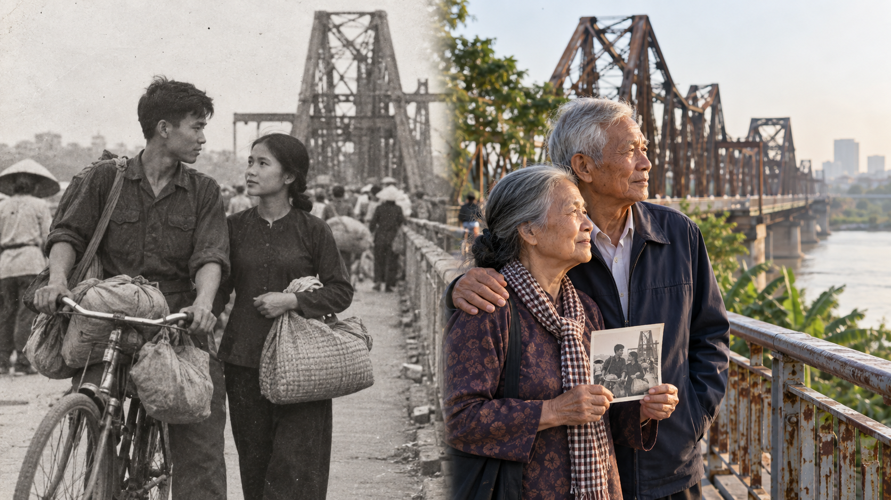

# A Vietnamese Couple Returned to Long Bien Bridge 60 Years After They First Met

*By TravelFrame Editorial Team · October 2026*

*Editorial note: The couple's names have been changed to Mr. Minh and Mrs. Lan
to protect their privacy. The image above is an AI-created editorial
reconstruction based on the family's account. It is not an original photograph
from 1966.*

Long Bien Bridge is often introduced through numbers: its length, its age, the
year it opened, or the damage it endured during wartime.

But a bridge can carry more than trains, bicycles and traffic.

For one Vietnamese couple, it carries the memory of a first meeting.

In 1966, two young people we will call **Mr. Minh and Mrs. Lan** found
themselves near Long Bien Bridge while evacuating from Hanoi. They were moving
through uncertainty, carrying only what they could manage and thinking first
about reaching safety.

They did not know that the person walking beside them would eventually become
their husband or wife.

Sixty years later, in 2026, they returned to the bridge together.

They came back not to recreate a dramatic scene, but to stand once more near
the place where their shared life quietly began.

## A First Meeting During the 1966 Evacuation

The family's account begins in 1966.

Hanoi was living under wartime pressure. Daily routines were shaped by
warnings, preparations and periods of evacuation. People moved away from areas
considered vulnerable, often carrying clothing, food and household essentials
on bicycles or over their shoulders.

Mr. Minh and Mrs. Lan were both part of that movement.

They met near Long Bien Bridge while evacuating. There was no planned
introduction and no carefully arranged first date. Their first shared setting
was a city trying to protect its people.

The family has kept the most personal details private. That boundary matters.
The power of the story does not depend on invented dialogue or a perfect
cinematic moment.

What is known is simple:

- They were Vietnamese.
- They met during an evacuation in 1966.
- The meeting happened near Long Bien Bridge.
- They later married and raised their family in Vietnam.
- In 2026, they returned together, 60 years after that first encounter.

History is often remembered through leaders, battles and official dates. Family
memory works differently. It survives through a location, a repeated sentence,
an old photograph, or the way two people pause when passing a familiar street.

For Mr. Minh and Mrs. Lan, that location was Long Bien Bridge.

## Why Long Bien Bridge Holds So Much of Hanoi's Memory

Long Bien Bridge crosses the Red River between central Hanoi and the eastern
bank. Built at the beginning of the 20th century, it became a critical rail and
road connection for the capital.

Its importance also made it a strategic target during the war. Vietnamese
government sources record that the bridge was attacked repeatedly between 1965
and 1972. Sections were damaged and rebuilt, while the crossing continued to
serve the city.

Those facts explain why the bridge appears so often in accounts of wartime
Hanoi. Yet they do not fully explain what the structure means to local
families.

For generations of residents, Long Bien Bridge was also part of ordinary life:

- A route between home and work.
- A path used during evacuation.
- A crossing for bicycles carrying food and belongings.
- A familiar silhouette seen from the Red River.
- A place connected to departure, return and reunion.

The weathered steel visible today is therefore more than an architectural
background. It belongs to a living city and to thousands of private stories
that may never appear in an archive.

## Returning in 2026

When Mr. Minh and Mrs. Lan returned in 2026, Hanoi was no longer the city they
had moved through as young evacuees.

The skyline had changed. Roads were busier. New bridges crossed the Red River.
The neighborhoods around the old structure had grown and shifted.

Long Bien Bridge remained recognizable.

The iron spans still formed their repeating geometry above the river. Trains,
motorbikes and bicycles still passed through the scene. Morning light still
caught the steel and the water below.

The couple did not need every detail to look exactly as it had in 1966. Memory
rarely works that way.

What mattered was being there together.

They had arrived at the same place as two people carrying six decades of shared
life: marriage, family, work, ordinary days and the changes that come with age.
The bridge connected those years in a single view.

In 1966, they were leaving the city under pressure.

In 2026, they returned by choice.

## A Different Kind of Long Bien Bridge Photography

Most online guides to **Long Bien Bridge photography** focus on sunrise,
industrial leading lines and the rust-colored steel trusses. Those visual
elements are genuinely striking, especially in soft morning light.

But meaningful travel photography is not only about finding the most dramatic
angle.

It can also document a relationship between a person and a place.

For a story like this, the most important photographs are often quiet:

- Two hands resting together on the railing.
- An elderly couple looking toward the eastern bank.
- A close-up of an old photograph held against the modern bridge.
- The same walking path framed across two generations.
- A portrait that includes weathered steel without turning the bridge into a
  decorative prop.

This is the difference between using Hanoi as a backdrop and photographing a
life that is connected to Hanoi.

## Photographing Long Bien Bridge With Respect

Long Bien Bridge is both a heritage structure and active transport
infrastructure. It should be approached as a working public space, not an empty
photo set.

If you plan a **Hanoi Long Bien Bridge photo walk**, keep these principles in
mind:

### Stay within permitted pedestrian areas

Do not stand on active railway tracks for a photograph. Follow local signs,
barriers and instructions, and keep the route flexible if access conditions
change.

### Keep pathways clear

Residents, commuters and workers use the bridge. Avoid blocking narrow paths
with tripods, bags or group poses.

### Let the story guide the composition

A portrait does not need to imitate a wartime scene. Small details can carry
the emotional weight: a family photograph, a familiar direction of travel, or
the couple standing where the bridge first enters view.

### Label reconstructed imagery honestly

When an original archive photograph does not exist, a visual reconstruction
can help readers imagine the setting. It must be clearly identified as a
reconstruction rather than presented as historical evidence.

## Long Bien Bridge as a Place of Living Heritage

Travelers often search for a **Hanoi historical tour** expecting monuments,
dates and preserved buildings. Those things are valuable, but heritage is also
carried by people.

Mr. Minh and Mrs. Lan's return reminds us that a city is not remembered in a
single official version.

One person may see Long Bien Bridge as colonial-era engineering.

Another may see a wartime transport route.

A photographer may see repeating steel lines over the Red River.

A local family may see the place where two young evacuees met and unknowingly
began a life together.

All of those meanings can exist in the same frame.

## Walk Through Hanoi With More Than a Checklist

If you visit Long Bien Bridge, give yourself time to look beyond the landmark.
Notice how people still move across it. Watch the riverbank change with the
light. Think about the departures and returns that have passed through the same
steel structure.

TravelFrame's Hanoi heritage and photography experiences are designed around
that slower way of seeing the city. A local companion can help you explore
historical settings respectfully while creating photographs that feel
connected to your own journey.

Explore the relevant TravelFrame routes:

- [The Cinematic Hanoi: A Visual Storytelling Walk](https://travelframe.sidevn.com/tour/cinematic-hanoi-visual-storytelling-walk)
- [Hanoi Early Bird: Sunrise & Local Markets](https://travelframe.sidevn.com/tour/hanoi-early-bird-sunrise-local-markets)
- [French Colonial & Historical Footsteps](https://travelframe.sidevn.com/tour/french-colonial-historical-footsteps)

Long Bien Bridge has witnessed more than a century of Hanoi history.

For Mr. Minh and Mrs. Lan, one moment remains more important than all the dates
and statistics.

They met there in 1966.

And in 2026, they returned together.

---

## Frequently Asked Questions

### Is the story of Mr. Minh and Mrs. Lan real?

Yes. The core facts were provided as a real family account: the Vietnamese
couple met near Long Bien Bridge while evacuating in 1966 and returned together
in 2026. Their names have been changed for privacy.

### Is the hero image an original photograph from 1966?

No. It is an AI-created editorial reconstruction used to visualize the
then-and-now story. It should not be treated as archival evidence.

### Can visitors take photographs on Long Bien Bridge?

Visitors commonly photograph the bridge from public areas, but it remains
active infrastructure. Follow current signs and local instructions, keep
pedestrian paths clear and never enter active railway space for a photograph.

### What is the best way to photograph a personal story in Hanoi?

Start with the person's relationship to the location. Use details, movement
and environmental portraits rather than relying only on posed landmark shots.
A local photo walk can help with context, pacing and respectful navigation.

