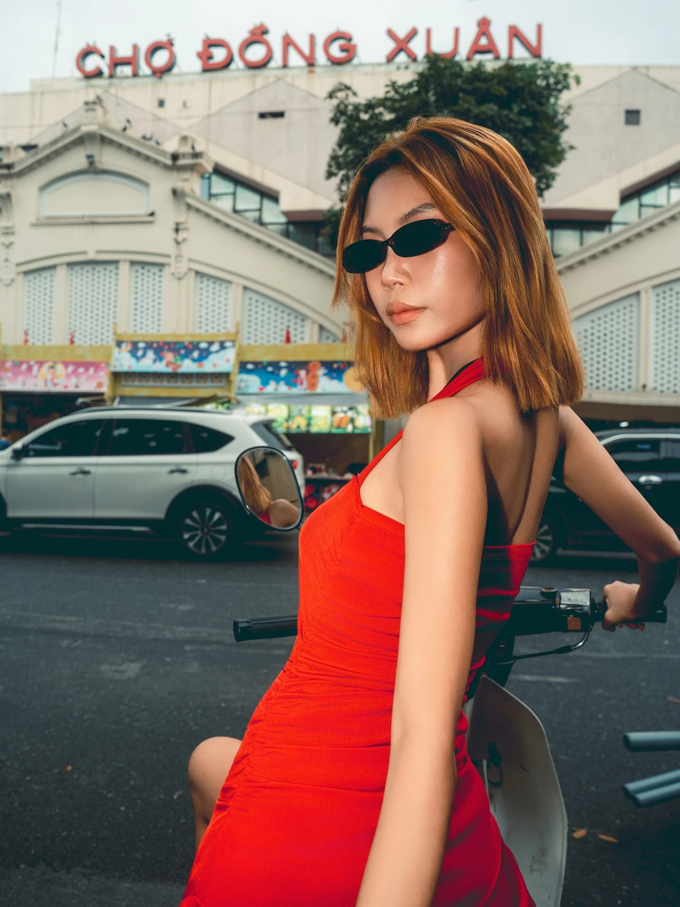
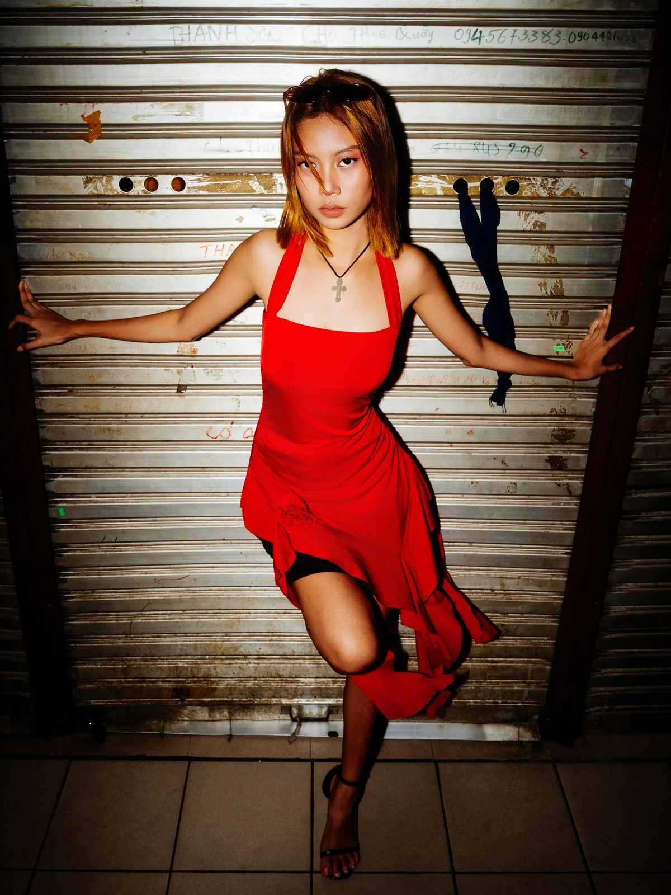
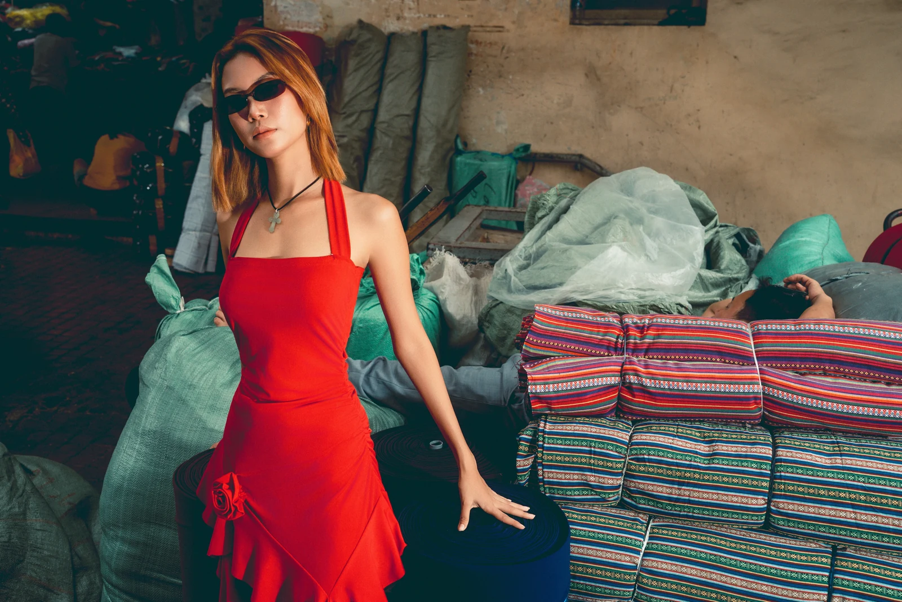
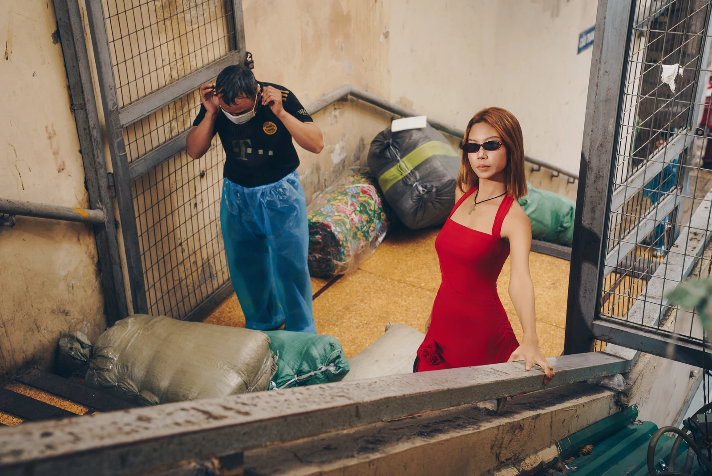

# A Hanoi Old Quarter photoshoot with Harry: Thin in red

A red dress, narrow sunglasses, and the words “Chợ Đồng Xuân” above the street. Thin’s portrait series with Harry brings a fashion mood to a familiar Hanoi market setting. The city stays in the picture, from metal shop shutters to stairways stacked with bundles of goods.

If you are planning a Hanoi Old Quarter photoshoot, this is one way to approach it: bring a look that feels like you, then let the places around you help shape the photographs.

*Thin outside Dong Xuan Market, photographed by Harry. The market sign gives the portrait a clear sense of place.*

## Thin’s red dress meets the market’s everyday textures

The red outfit runs through all three sets. Against pale walls and silver shutters, it draws your eye straight to Thin. Sunglasses add another point of focus. Her pose changes, while the styling holds the photographs together.

In the portrait outside the market, Thin looks back over her shoulder. Behind her, the building and its red lettering remain recognizable. A closer crop could have made this a portrait almost anywhere. Keeping the sign in the frame makes Hanoi part of her photograph.

Harry’s images also make room for less obvious backgrounds. A shutter has horizontal lines, scratches, and handwritten markings. Inside the market setting, railings and sacks of goods give the frame depth. These details give the series its particular character.

## A few changes in pose create a different picture

At the shutter, Thin faces the camera with her arms extended. In another frame, one hand rests near her hair while the other sits at her waist. The background and outfit stay the same, but the shapes change.

Those photographs offer useful references for your own session. Notice where the hands are, which way the shoulders turn, and whether the person looks into the lens. You can show Harry the frame you like and ask for help trying a version that feels comfortable to you.

*A straight-on portrait uses the shutter’s lines and the position of Thin’s arms to shape the image.*

You can also agree how much direction you would like. A clear suggestion about where to put a hand can be easier to follow than trying to invent a whole pose. Leave room to adjust it as you go.

## Let Hanoi’s daily life stay in the frame

The market photographs include bundles of goods, worn surfaces, and people in the background. Thin’s dress stands out against that setting. The wider frames show how close the portrait is to ordinary working space.

That is part of the appeal of a photo walk here. You can notice the city while making photographs of yourself in it. The small details you pass on foot can become the things that make your album feel connected to the trip.

*The red outfit stands out against stacked goods and the muted colors around Thin.*

*A wider photograph keeps the stairway and everyday activity visible around the portrait.*

For your own session, ask before photographing people or using a shop’s space. Keep doorways, stairs, and working areas clear. Discuss suitable locations with Harry before you start, and stay flexible when a place is busy.

## Choose the mood you want to bring home

Harry’s captions describe these sets as editorial portraits with a cinematic film look. The shutter portraits use strong light and defined shadows. Elsewhere, warm skin tones sit against darker backgrounds, with the red dress linking the images.

Use the series to talk about what you like. Perhaps it is the direct gaze, the bold color, or the amount of Hanoi visible behind Thin. A few reference photographs will help explain your preference when you [plan your Hanoi photoshoot](https://travelframe.sidevn.com/hanoi-photoshoot).

Your outfit can be something you already enjoy wearing. Bring comfortable shoes for moving between locations, and discuss any outfit changes beforehand. The final route and arrangements should fit your session.

## Plan your own photo walk with Harry

Thin’s series is a starting point for a conversation about your photographs. You might want a bold street-style set, or something softer with more of the city around you. Tell us what you would like to remember about Hanoi.

Send **PHOTO** to [TravelFrame on Instagram](https://www.instagram.com/travelframe.vn/) with your travel date and a favorite image from this series. Let us know you would like to shoot with Harry so we can discuss his availability and your plans.

*Photographs: Harry Pham. Featured: Thin (@thin.m.mon.52459).*
