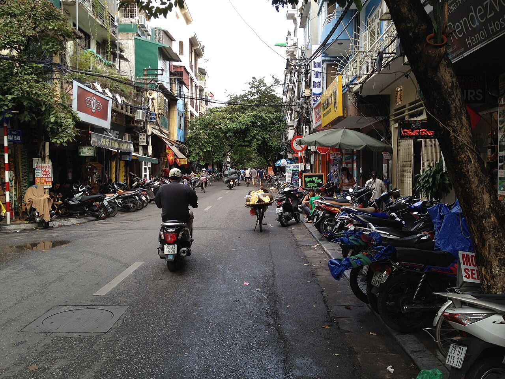
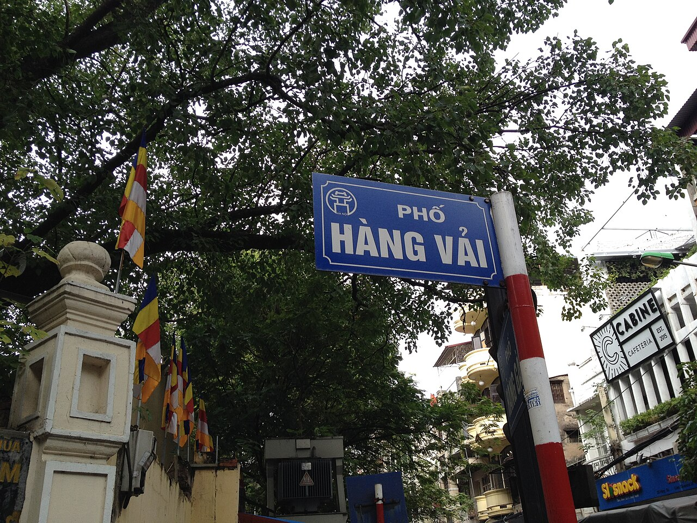
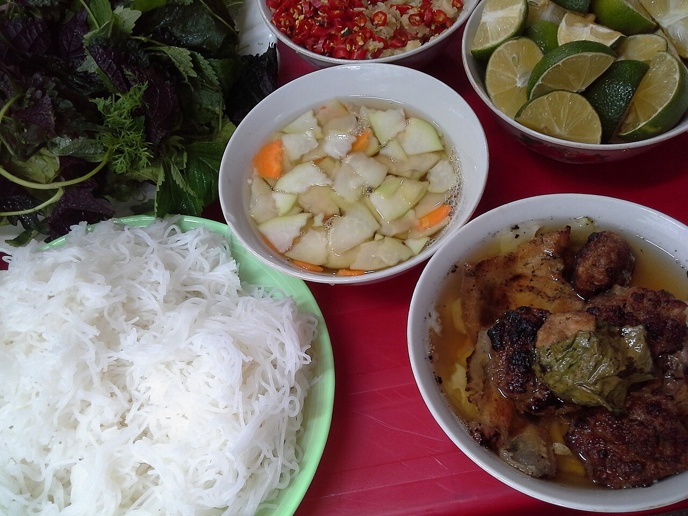
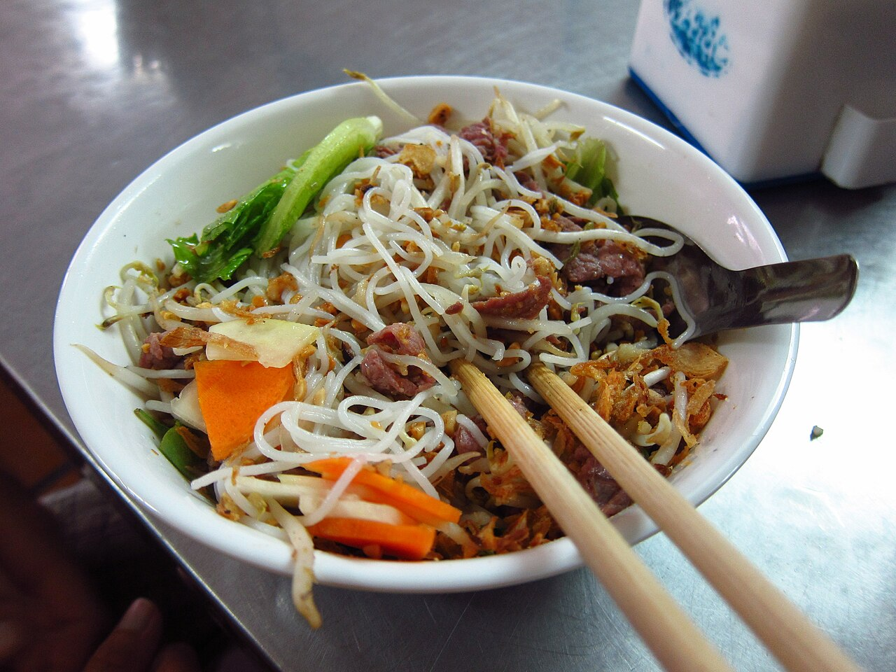
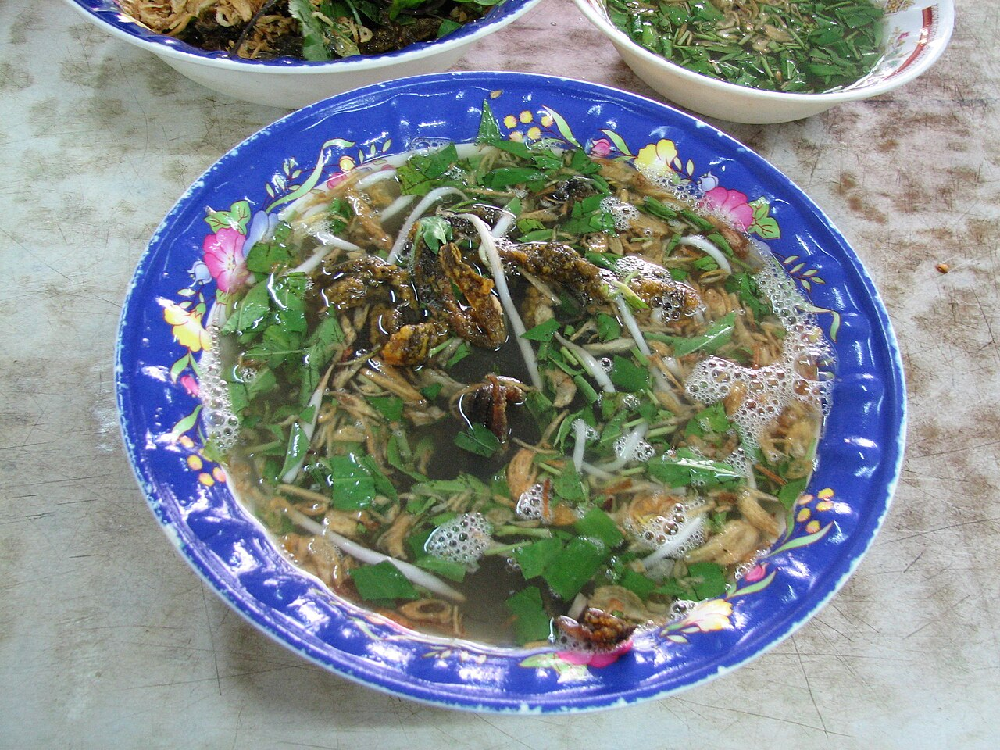
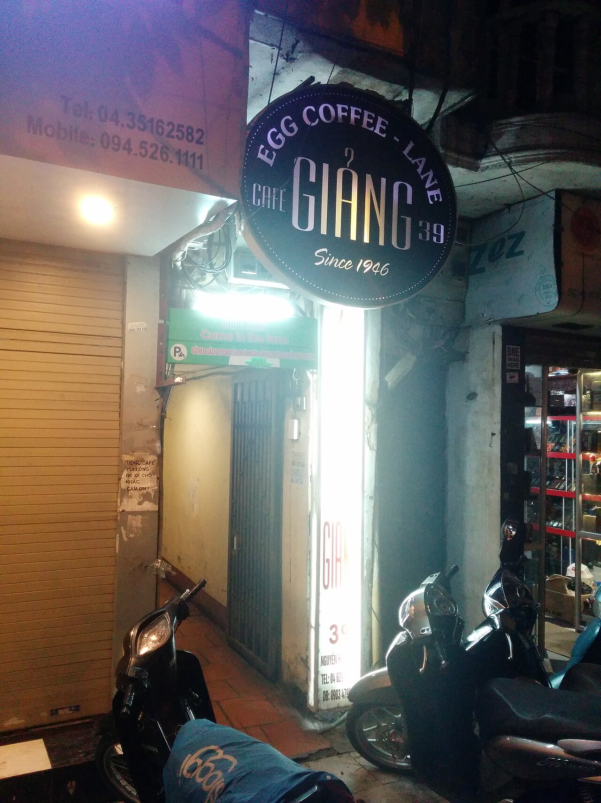
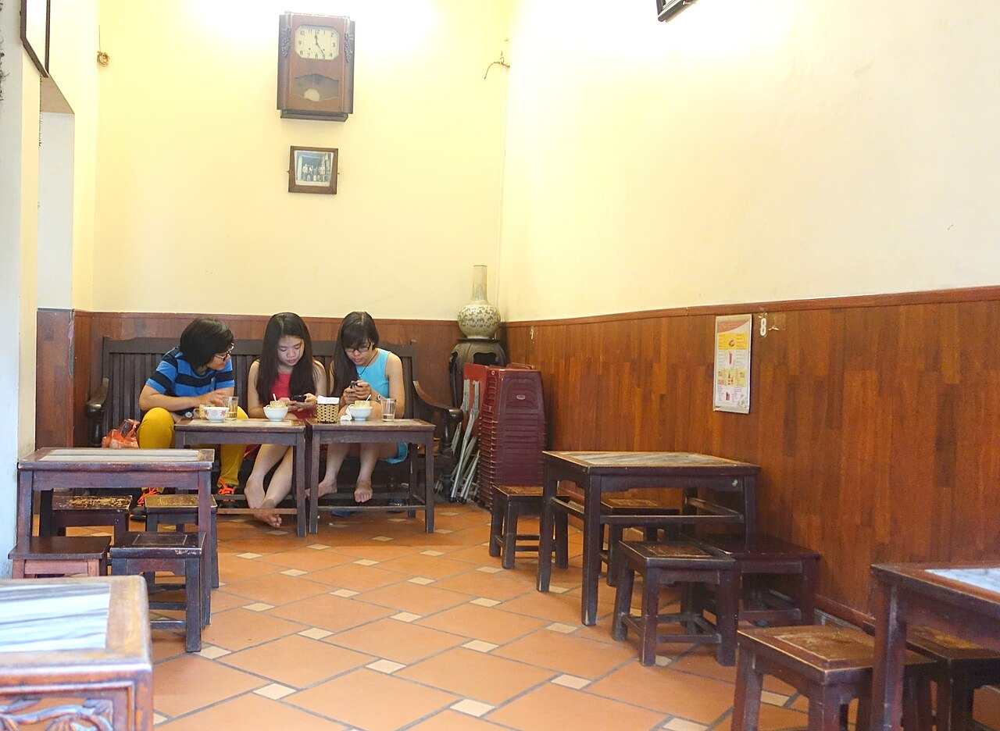
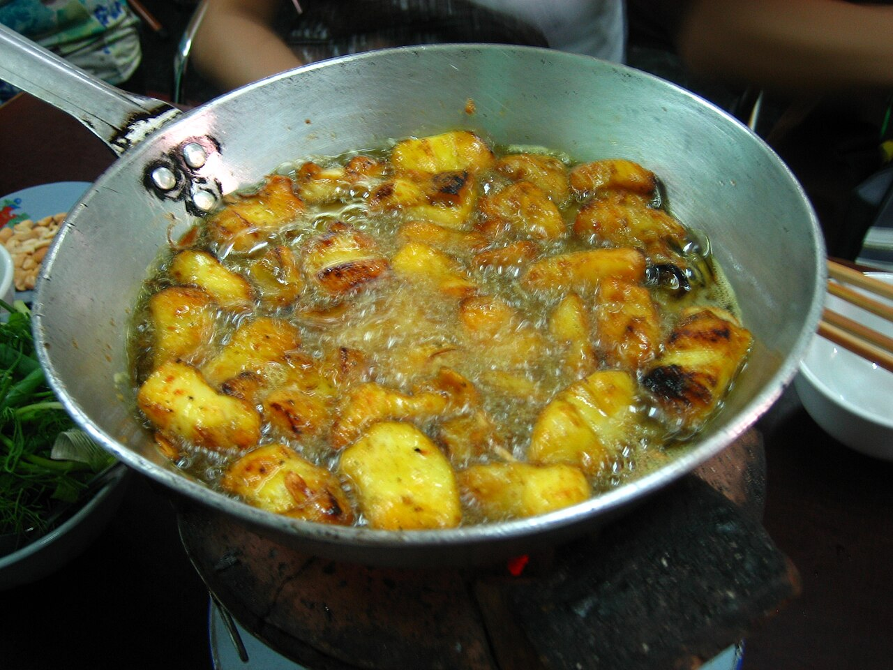
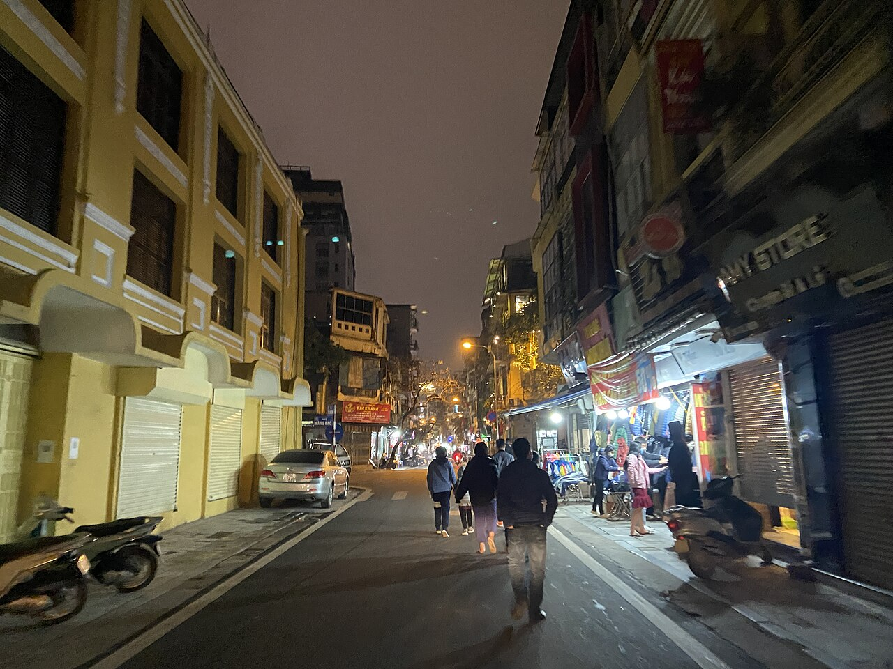

# Where to Eat in Hanoi Old Quarter: 12 Local Spots with Addresses (2026)

Hanoi's Old Quarter feeds you on a schedule. Pho at 6am. Bun cha at noon. Egg coffee in the slow afternoon. Grilled fish and chicken noodles after dark.

This guide to where to eat in Hanoi's Old Quarter follows that clock, from street food stalls to one sit-down fish dinner. Every spot below has a street address, rough hours, a price range and a short note on what other travelers said after eating there. Seven of the twelve entries appear in the MICHELIN Guide. The others have fed the neighborhood for decades.

Two honest notes before you go:

- **Hours and prices move.** We checked them on November 12, 2026 against several sources. Small shops close early when the pot is empty.
- **Cash is still king.** Most of these places take cash or a Vietnamese bank transfer only. Carry small notes.

*Bat Dan Street, home of Pho Gia Truyen at number 49. Photo: Phan Minh Tuấn, CC BY-SA 4.0, via Wikimedia Commons.*

## Hanoi Old Quarter food at a glance

| # | Spot | Dish | Address | Best time | Price (VND) |
|---|---|---|---|---|---|
| 1 | Phở Gia Truyền | Beef pho | 49 Bát Đàn | 6–10am, 6–8:30pm | 55,000–70,000 |
| 2 | Phở Khôi Hói / Phở Bò Lâm | Beef pho | 50 & 48 Hàng Vải | 5:30–10am | 40,000–90,000 |
| 3 | Xôi Yến | Sticky rice | 35B Nguyễn Hữu Huân | Breakfast or late night | 35,000–72,000 |
| 4 | Bún Chả Đắc Kim | Bun cha | 1 Hàng Mành | Lunch | 70,000–120,000 |
| 5 | Bún Chả Ta | Bun cha, crab rolls | 21 Nguyễn Hữu Huân | All day | 50,000–100,000 |
| 6 | Bún Bò Nam Bộ Bách Phương | Beef noodle salad | 73–75 Hàng Điếu | Lunch | ~60,000 |
| 7 | Miến Lươn Đông Thịnh | Eel glass noodles | 87 Hàng Điếu | Breakfast or lunch | 30,000–60,000 |
| 8 | Bánh Mì 25 | Banh mi | 25 Hàng Cá | Breakfast | 30,000–45,000 |
| 9 | Café Giảng | Egg coffee | 39 Nguyễn Hữu Huân | Afternoon | 35,000–55,000 |
| 10 | Chè Bốn Mùa | Sweet soups | 4 Hàng Cân | Afternoon or evening | 15,000–25,000 |
| 11 | Chả Cá Thăng Long | Turmeric fish | 6B Đường Thành | Dinner | 180,000–250,000 per person |
| 12 | Phở Gà Nguyệt | Chicken pho | 5B Phủ Doãn | Dinner or late night | 35,000–65,000 |

At 26,000 VND to the dollar, most bowls here cost between $1.50 and $4.

## Breakfast: 6am to 10am

Hanoians eat breakfast out. The best pho pots are at their richest early and often sold out by mid-morning.

### 1. Phở Gia Truyền (Pho Bat Dan), 49 Bát Đàn: the pho people queue for

- **Address:** 49 Bát Đàn, Hoàn Kiếm, Hanoi (the sign may read 49A)
- **Hours:** about 6:00–10:00 and 18:00–20:30, daily
- **Price:** about 55,000–70,000 VND ($2.10–$2.70)
- **Order:** *phở tái nạm* (rare beef and flank). Add *quẩy* (fried dough sticks) and, if you like it rich, a raw egg yolk.
- **Recognition:** MICHELIN Bib Gourmand, 2025 guide

One menu, one dish, one system. You queue, order and pay at the counter, then carry your own bowl. There are no waiters. Expect a deeply beefy broth, tender slices and a fast-moving room.

**What travelers say:** A Trip.com reviewer arrived at 6pm and found the room already full; by the time they finished, the line was long again. They also noticed the local rule: eat, then give up your stool to the next person. A Google reviewer summed it up in a line: "Long queue at all times... worth the wait."

**Pro move:** Arrive before 7am or right at 6pm when the evening session opens. Have small notes ready, since cards are not accepted.

### 2. Phở Khôi Hói and Phở Bò Lâm, Hàng Vải: two Bib Gourmand bowls, one corner

- **Phở Khôi Hói:** 50 Hàng Vải. About 6:00–21:00. 45,000–90,000 VND ($1.70–$3.50). Known for *phở lõi*, a firm, slightly crunchy beef shank cut.
- **Phở Bò Lâm:** 48 Hàng Vải. Opens about 5:30 and closes when the broth runs out, usually mid-morning. 40,000–70,000 VND ($1.50–$2.70).
- **Recognition:** both MICHELIN Bib Gourmand, 2025 guide

These two sit side by side on Hàng Vải, with stools spilling onto the pavement. If the queue at Bát Đàn looks hopeless, walk five minutes here.

*Hàng Vải street, where two Bib Gourmand pho shops share a corner. Photo: Phan Minh Tuấn, CC BY-SA 4.0, via Wikimedia Commons.*

**What travelers say:** On Foody, Vietnam's big food review site, a local diner who came at 9am on a weekday found the corner packed, ordered the beef core and said it was worth it. Another found the broth a little salty for the price. Both agree on the beef.

**Pro move:** Khôi Hói stays open into the evening, so it is the backup when you miss breakfast. Prefer a clear, lighter broth? Phở 10 Lý Quốc Sư, near St. Joseph's Cathedral, appears in MICHELIN's 2026 round-up of where to eat pho in Hanoi.

### 3. Xôi Yến, 35B Nguyễn Hữu Huân: sticky rice, morning or midnight

- **Address:** 35B Nguyễn Hữu Huân, Hoàn Kiếm (second branch: 29A Trần Hưng Đạo)
- **Hours:** about 6:00–midnight
- **Price:** 35,000–72,000 VND ($1.35–$2.80), depending on toppings
- **Order:** *xôi xéo* (yellow mung bean sticky rice with crispy shallots) plus one or two toppings: braised pork, Chinese sausage or a fried egg

Xôi Yến has sold sticky rice with build-your-own toppings since 1997. The original corner shop is two floors of tight tables. It is one of the few breakfast places that also works after a late night.

**What travelers say:** Reviews on Foody are mixed in a useful way. One regular liked the shredded chicken and pâté best. Another found a full "everything" bowl too heavy. Our reading: pick one or two toppings, not six.

**Pro move:** The menu has pictures. Point, and say *ít thôi* ("just a little") if you want a smaller portion.

## Lunch: 11am to 2pm

Lunch is bun cha hour. Follow the charcoal smoke.

### 4. Bun Cha Dac Kim (Bún Chả Đắc Kim), 1 Hàng Mành: the old-school bun cha

*A bun cha set at Hàng Mành: noodles, grilled pork patties in warm fish sauce broth, pickles and herbs. Photo: Viethavvh, CC BY-SA 4.0, via Wikimedia Commons (2016).*

- **Address:** 1 Hàng Mành, Hoàn Kiếm (second branch: 67 Đường Thành)
- **Hours:** roughly 9:00–21:00; busiest at lunch
- **Price:** 70,000–120,000 VND ($2.70–$4.60) for bun cha with crab spring rolls
- **Order:** *bún chả* with a side of *nem cua bể* (crab spring rolls)
- **Recognition:** MICHELIN Guide, Selected, 2025

Đắc Kim has grilled pork on this corner since the 1960s. Portions are big: a bowl of patties and sliced belly in warm fish-sauce broth, a plate of noodles and a basket of herbs.

**What travelers say:** Several Foody reviewers walked into the wrong shop. Another bun cha place sits right next door, also at number 1, and they only noticed after eating. One Vietnamese visitor wrote that the shop next door served less meat at a similar price. A recent Google reviewer was not impressed by the hygiene (the salad greens looked reused) but found the price fair and the bun cha good.

**Pro move:** Read the sign before you sit. You want the one that says **Đắc Kim**. If someone waves you in from the pavement, check the name first.

### 5. Bun Cha Ta, 21 Nguyễn Hữu Huân: bun cha for any hour

- **Address:** 21 Nguyễn Hữu Huân, Hoàn Kiếm
- **Hours:** about 8:00–22:00 (some listings say 20:00)
- **Price:** 50,000–100,000 VND ($1.90–$3.80)
- **Order:** classic bun cha plus crab spring rolls; vegetarian rolls are on the menu
- **Recognition:** MICHELIN Bib Gourmand, 2025 guide

Bún Chả Ta is the easy version. It stays open past lunch, has several floors, and the MICHELIN Guide notes that it is popular with tourists. Purists may call it less gritty than Đắc Kim. If you land in Hanoi at 4pm and want bun cha now, this is your place.

**Pro move:** Order one bun cha per person and one plate of crab rolls to share. That is how locals do it.

### 6. Bún Bò Nam Bộ Bách Phương, 73–75 Hàng Điếu: a noodle salad worth crossing town for

*Bun bo Nam Bo, a dry noodle bowl with stir-fried beef. Photo taken in Hanoi; venue not confirmed. Photo: fabulousfabs, CC BY 2.0, via Wikimedia Commons.*

- **Address:** 73–75 Hàng Điếu, Hoàn Kiếm (relatives run a near-identical shop a few doors away at 67)
- **Hours:** about 7:00–22:30
- **Price:** about 60,000 VND ($2.30)
- **Order:** the only dish, *bún bò Nam Bộ*: warm beef, noodles, herbs, peanuts and fried shallots, dressed with sweet-sour fish sauce

There is no soup here. Mix everything from the bottom up before the first bite. You share long metal tables with strangers, and the turnover is fast.

**What travelers say:** On Foursquare, one traveler with a peanut allergy said the staff happily left the peanuts off when asked in advance. Another felt the bowl had too many noodles for the price. A local host on Airbnb's guide tip: vegetarians can say *ăn chay* and get a meat-free version.

**Pro move:** Say *không lạc* (no peanuts) if you have an allergy, and point to the word on your phone.

### 7. Miến Lươn Đông Thịnh, 87 Hàng Điếu: crispy eel and glass noodles

*Miến lươn (eel with glass noodles) on Hàng Điếu. Photo: Rungbachduong, CC BY-SA 3.0, via Wikimedia Commons (2007).*

- **Address:** 87 Hàng Điếu, Hoàn Kiếm
- **Hours:** about 6:30–21:30
- **Price:** 30,000–60,000 VND ($1.15–$2.30)
- **Order:** *miến lươn trộn* (dry glass noodles with crispy fried eel); soup and eel porridge are also on the menu
- **Recognition:** listed in the MICHELIN Guide's Old Quarter selection

Eel sounds bold. Here it is fried into thin, crunchy strips that taste closer to a savory snack than to fish. The MICHELIN Guide calls the dry version the must-order.

**What travelers say:** A longtime Foody regular said they have eaten the stir-fried eel noodles since childhood and still come back for the fast service. Another diner found a takeaway portion too oily. Eat in, and eat it hot.

**Pro move:** The house chili sauce is fierce. Try a dot first.

### 8. Banh Mi 25 (Bánh Mì 25), 25 Hàng Cá: the easy first banh mi

- **Address:** 25 Hàng Cá, Hoàn Kiếm
- **Hours:** about 7:00–21:00 (earlier close on Sundays per some listings)
- **Price:** 30,000–45,000 VND ($1.15–$1.75)
- **Order:** *bánh mì thập cẩm* (mixed: pâté, barbecued pork, sausage) or a vegan tofu version

This is not the most local banh mi in the city, and it doesn't pretend to be. It has an English menu, a numbered-ticket system, two seating areas and several vegan fillings. Hanoi-style banh mi is smaller and simpler than the Saigon kind. This one is fuller, built for first-timers.

**What travelers say:** On Tripadvisor, a traveler from Perth (March 2025) passed the long queue several times, then came at breakfast and walked straight in. A family from Lisbon (July 2025) called it a perfect first meal and paid under €15 for five people. On HappyCow, one reviewer called it "made for tourists" but clean and good.

**Pro move:** Go before 9am. Want something more local after? Walk to [Bami Bread on Hàng Bạc](https://travelframe.sidevn.com/news/hoi-bread-best-banh-mi-world).

## Afternoon: coffee and something sweet

### 9. Cafe Giang (Café Giảng), 39 Nguyễn Hữu Huân: egg coffee where it started

*The way in: the Café Giảng sign above the narrow lane at 39 Nguyễn Hữu Huân. Photo: Amenoc, CC0, via Wikimedia Commons (2017).*

- **Address:** 39 Nguyễn Hữu Huân, Hoàn Kiếm (enter through the narrow lane)
- **Hours:** about 7:00–22:00
- **Price:** 35,000–55,000 VND ($1.35–$2.10)
- **Order:** hot *cà phê trứng* (egg coffee), served in a cup sitting in warm water

The story goes back to 1946, when Nguyễn Văn Giảng whipped egg yolk into coffee during a milk shortage. His family still runs the café. Upstairs rooms are small, wooden and usually full.

**What travelers say:** A Korean travel blogger who visited on their first morning in Hanoi said the door was easy to walk past. Inside, they described the foam as soft and creamy, with no eggy taste. Pay downstairs, then climb.

**Pro move:** Stir only the top third. Eat the foam with the spoon first, then drink. More on the café and how to photograph it in our [Café Giảng egg coffee guide](https://travelframe.sidevn.com/news/hanoi-egg-coffee-cafe-giang-photography-guide).

*Inside Café Giảng: low tables, wooden stools, yellow walls. Photo: Daderot, CC0, via Wikimedia Commons (2014).*

### 10. Chè Bốn Mùa, 4 Hàng Cân: sweet soups since 1975

- **Address:** 4 Hàng Cân, Hoàn Kiếm
- **Hours:** about 9:00–22:00
- **Price:** 15,000–25,000 VND ($0.60–$1)
- **Order:** *chè thập cẩm* (a mixed cup of beans, jelly and coconut) or lotus seed *chè sen* in summer

*Chè* is Vietnam's answer to dessert: sweet bean soups and jellies, hot in winter and iced in summer. This small counter has served the same handful of them for decades, scented with jasmine and banana oil.

**What travelers say:** Foody reviewers like the old-Hanoi feel and the jasmine scent. One found it a bit too sweet. Another said the inside gets stuffy and the sidewalk seats are nicer.

**Pro move:** Ask for *ít ngọt* (less sweet).

## Dinner and late night

### 11. Cha Ca Thang Long (Chả Cá Thăng Long), 6B Đường Thành: turmeric fish at your table

*Chả cá: turmeric fish sizzling on a tabletop burner. Dish photo for illustration, not taken at Chả Cá Thăng Long. Photo: Lionel Ng, CC BY-SA 2.0, via Wikimedia Commons.*

- **Address:** 6B Đường Thành, Hoàn Kiếm
- **Hours:** about 10:00–22:00; last orders around 21:15
- **Price:** about 180,000–250,000 VND ($7–$9.60) per person
- **Order:** the set. It is the only main dish.
- **Recognition:** listed in the MICHELIN Guide's Old Quarter selection

A pan of turmeric fish arrives on a small burner. You add dill and spring onion, let them wilt, then eat it all with rice noodles, peanuts and herbs. It is the most "sit-down dinner" spot on this list.

Several shops on Đường Thành use the name "Thăng Long". The main branch is at **6B**. Check the number.

**What travelers say:** The JetSettingFools travel blog found the staff patient with first-timers and happy to show the cooking steps. A local Airbnb host's tip is shorter: don't wash your hair before you come. The smell follows you home.

**Pro move:** Go between 2pm and 5pm or after 8pm to skip the rush. Want the history? Read our [chả cá Lã Vọng story](https://travelframe.sidevn.com/news/la-vong-grilled-fish-origins-and-authentic-ways-eat-it).

### 12. Phở Gà Nguyệt, 5B Phủ Doãn: chicken pho for the late shift

- **Address:** 5B Phủ Doãn, Hoàn Kiếm (on the cathedral side of the Old Quarter)
- **Hours:** about 6:30 until late; MICHELIN notes it stays open to midnight
- **Price:** 35,000–65,000 VND ($1.35–$2.50)
- **Order:** *phở gà đùi* (thigh) in soup, or *phở gà trộn*, the dry version tossed with sweet-salty sauce and peanuts
- **Recognition:** MICHELIN Bib Gourmand, 2025 guide

Beef pho gets the fame. Chicken pho is what many Hanoians want at 11pm. Pick your cut (thigh, breast or wing), and the dry version is worth trying at least once.

**What travelers say:** Local hosts on Airbnb send guests here for dinner or a late bowl after a long day of walking.

**Pro move:** Have a beer on Tạ Hiện first, then walk about 15 minutes here.

*Tạ Hiện after dark, about 15 minutes on foot from Phở Gà Nguyệt. Photo: Ltn12345, CC BY-SA 4.0, via Wikimedia Commons (2022).*

## A simple one-day Old Quarter food walk

1. **6:30am:** pho at 49 Bát Đàn (or Hàng Vải if the line is long).
2. **9:30am:** egg coffee at Café Giảng.
3. **12:00pm:** bun cha at 1 Hàng Mành.
4. **3:30pm:** *chè* at 4 Hàng Cân.
5. **7:00pm:** chả cá at 6B Đường Thành.
6. **10:00pm:** a bowl of chicken pho at 5B Phủ Doãn.

All six stops sit within about 1.5 km of each other. Want the nights mapped too? See our [Tạ Hiện street guide](https://travelframe.sidevn.com/news/ta-hien-street-where-hanoi-nights-come-alive).

## How to eat in the Old Quarter without stress

- **Look for one dish on the sign.** Shops named after a single dish usually cook it all day.
- **Check the price first.** Most famous shops print one price. If there is no menu, ask *bao nhiêu tiền?* ("how much?") before you order.
- **Stools are low on purpose.** Sit, eat, leave. Long lingering is for cafés.
- **Herbs are for tearing.** Rip them into your bowl by hand.
- **Watch for name copies.** Famous names attract lookalikes on the same street. Check the house number.

For dish-by-dish explanations, read our [honest Hanoi street food guide](https://travelframe.sidevn.com/news/honest-hanoi-street-food-guide-2026-what-eat-where-sit-and-how-eat-local). Want six of these spots on one printable page? Download the free [Hanoi Secret Food Map](https://travelframe.sidevn.com/news/hanoi-secret-food-photo-map).

## Frequently asked questions

### Where is the best pho in Hanoi's Old Quarter?
For rich beef pho, start with Phở Gia Truyền at 49 Bát Đàn or the two Bib Gourmand shops on Hàng Vải. For chicken pho, go to Phở Gà Nguyệt at 5B Phủ Doãn. All are in the 2025 MICHELIN Guide. Go early: beef pho is a breakfast dish here.

### What is the best food to try in Hanoi's Old Quarter?
Start with beef pho for breakfast, bun cha for lunch and egg coffee in the afternoon. If you have a second day, add chả cá, eel glass noodles and bun bo Nam Bo.

### How much does a meal cost in the Hanoi Old Quarter?
Most street food bowls cost 35,000–90,000 VND ($1.35–$3.50). A chả cá dinner runs about 180,000–250,000 VND per person. Prices at famous shops are higher than in other districts.

### Is street food in the Old Quarter safe to eat?
Busy shops with fast turnover are the safer bet. Hot soups and freshly grilled meat are lower risk than raw herbs if your stomach is sensitive. On your first day, you can ask for no herbs: *không rau*.

### Where can I eat late at night in the Old Quarter?
Phở Gà Nguyệt on Phủ Doãn and Xôi Yến on Nguyễn Hữu Huân both serve close to midnight, according to their listings. Tạ Hiện stays busy with snacks and beer until late.

### Is there vegetarian food in the Old Quarter?
Yes. Bún Chả Ta has vegetarian spring rolls, Bánh Mì 25 has vegan fillings and Bún Bò Nam Bộ Bách Phương will make a meat-free bowl if you say *ăn chay*.

## Eat it, and take the story home

Our Old Quarter photo walks cross most of these streets. If you want photos of yourself laughing over a bowl at Hàng Vải, not just a photo of the bowl, our hosts can plan a route around your meals. See our [private Hanoi photoshoot](https://travelframe.sidevn.com/hanoi-photoshoot), or send us the word **FOOD** on [Instagram](https://www.instagram.com/travelframe.vn/) and we'll send the map.

TravelFrame — your local friend in Hanoi
