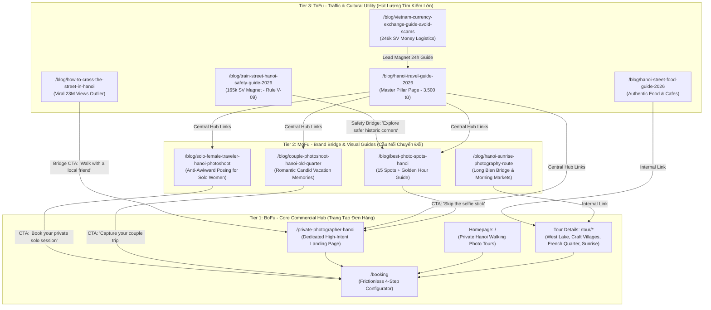

# Kế Hoạch Chiến Lược & Phương Án Sản Xuất Nội Dung SEO Website TravelFrame (2026)

- **Mã kế hoạch:** `PLN-20260922-WEBSITE-SEO-CONTENT-STRATEGY`
- **Phòng ban chủ trì:** Marketing-Growth
- **Phòng ban phối hợp:** Research-Insights, Creative-Production, Technology-Automation, Sales-CRM
- **Domain mục tiêu:** `travelframe.vn` (CMS: Drupal 11)
- **Ngày lập:** 2026-09-22
- **Trạng thái:** `Review` (Sẵn sàng trình Rocky duyệt thực thi)
- **Cơ sở dữ liệu & Tri thức tham chiếu:**
  - Báo cáo dữ liệu thị trường: `Research-Insights/Library/knowledge/2026-09-22-seo-market-intelligence-and-dataset-synthesis.md`
  - Ngữ cảnh dự án OpenSEO: `Marketing-Growth/Plans/OpenSEO-TravelFrame-Project-Context.md`
  - Hiện trạng website & GA4: `Data-Analytics/Snapshots/2026-09-17-GA4-Website-Analytics.md`
  - Kế hoạch chuyển đổi website: `Operations/Change-Management/2026-09-19-travelframe-website-conversion-recovery-implementation-plan.md`
  - Phân tích đối thủ Mindtrip: `Research-Insights/Library/analysis/2026-09-21-mindtrip-ai-competitor-analysis-and-learnings.md`
  - Nghiên cứu video viral & Social Outliers: `Research-Insights/Library/knowledge/link-video.xlsx` & `2026-09-18-vietnam-street-crossing-scraped-data.json`
  - Bằng chứng khách hàng: `Research-Insights/Library/knowledge/2026-09-17-customer-evidence-synthesis.md`

---

## 1. Tóm Tắt Chiến Lược (Executive Summary)

### 1.1. Hiện Trạng & Vị Thế Của TravelFrame
- **Website Live:** Đang chạy Drupal 11 (`travelframe.vn`), đang tiến hành chuẩn hóa trải nghiệm đặt chỗ và khắc phục ma sát chuyển đổi.
- **Tín hiệu GA4 (Baseline):** 13 active users/tuần, thời gian phiên trung bình đạt **5 phút 15 giây** (rất sâu). Người dùng tập trung cao độ vào trang chủ (`/`), trang đặt tour (`/booking`) và các tour văn hóa ngách (*Spiritual & West Lake Breeze*, *Craft Villages*, *French Colonial Footsteps*, *Early Bird Sunrise*).
- **Thách thức thị trường từ dữ liệu SEO:** Các tập đoàn OTA (TripAdvisor với 2,5 tỷ ETV/tháng, Booking.com, Agoda, Klook) thống trị hoàn toàn các từ khóa ngắn diện rộng (`hanoi tours`, `vietnam travel`). Cạnh tranh trực diện ở nhóm này là không khả thi.
- **Lợi thế cạnh tranh độc quyền (USP):** TravelFrame không bán tour ghép đông đúc hay studio chụp ảnh rập khuôn. TravelFrame cung cấp **"Private Walking Photo Tour & Local Cultural Companion"** (tour dạo bộ riêng tư, thong thả sống chậm, nhận 35-50 ảnh chỉnh màu đẹp tự nhiên trong 24 giờ).

### 1.2. Mục Tiêu Tăng Trưởng SEO (KPIs)
- **Top 1–3 Google Organic Search:** Đối với các từ khóa thương mại ngách (`private photographer in hanoi`, `solo traveler photo tour hanoi`, `couple photoshoot hanoi old quarter`).
- **Top 5–10 Google Organic Search:** Đối với từ khóa dịch vụ chính (`hanoi photo tour`).
- **Lượng truy cập hữu cơ (Organic Sessions):** Tăng từ baseline hiện tại lên **1.000+ sessions/tháng** sau 90 ngày.
- **Tỷ lệ chuyển đổi tự nhiên (Organic Conversion Rate):** Đạt 2–3% truy cập organic thực hiện hành động liên hệ (bấm chat WhatsApp, gửi Instagram DM hoặc hoàn tất yêu cầu đặt tour trên website).

---

## 2. Kiến Trúc Nội Dung 3 Tầng (The 3-Tier Topic Cluster Architecture)

Mô hình triển khai theo cấu trúc **Hub-and-Spoke**, gắn kết chặt chẽ giữa nội dung hút traffic (Top of Funnel), bài viết định hướng thương hiệu (Middle of Funnel) và trang tạo doanh thu trực tiếp (Bottom of Funnel):

---

## 3. Chi Tiết Từng Tầng Nội Dung & Danh Mục Bài Viết

### 3.1. Tầng 1: BoFu (Core Commercial Hub — Trang Bán Hàng Trực Tiếp)
- **Mục tiêu:** Đón du khách đang chủ động tìm người chụp ảnh tại Hà Nội. Tỷ lệ chuyển đổi cao nhất.
- **Trang 1: Dedicated Service Page — `/private-photographer-hanoi`**
  - *Từ khóa chính:* `private photographer in hanoi` (SV: 390, KD: 18), `hire photographer hanoi` (SV: 260), `hanoi vacation photographer` (SV: 320).
  - *Nội dung:* Bảng so sánh 3 phong cách (Studio đám cưới vs Tour bus đông đúc vs TravelFrame Private Photo Walk); Giới thiệu thợ ảnh bản địa nói tiếng Anh lưu loát; Thư viện ảnh mẫu thực tế; Bảng giá trọn gói minh bạch (Solo 1.5h, Couple 2h); Cam kết trả ảnh đã chỉnh màu trong 24h.
  - *Hành động CTA:* Nút bấm *"Check Available Dates"* dẫn thẳng vào `/booking?tour=private-photo-walk` và floating icon WhatsApp.
- **Trang 2: Tối ưu On-page cho 4 Tour Đang Có Lượt Xem Cao Trên Website**
  - `/tour/spiritual-west-lake-breeze`: Tối ưu từ khóa `hanoi pagoda temple photo tour`, bổ sung mốc giờ chụp đẹp tại Chùa Trấn Quốc và Phủ Tây Hồ.
  - `/tour/colors-delta-craft-villages-expedition`: Tối ưu từ khóa `quang phu cau incense village photography tour`, `bat trang pottery photo tour`.
  - `/tour/french-colonial-historical-footsteps`: Tối ưu từ khóa `hanoi french quarter architecture walking tour`.
  - `/tour/hanoi-early-bird-sunrise-local-markets`: Tối ưu từ khóa `long bien bridge sunrise photo walk`, `hanoi morning street market photography`.
  - *Kỹ thuật On-Page:* Cài đặt Schema `TouristTrip` và `Offer` đầy đủ cho từng trang.

---

### 3.2. Tầng 2: MoFu (Brand Bridge & Visual Guides — Cầu Nối Cảm Xúc)
- **Mục tiêu:** Tiếp cận du khách đang tìm kiếm địa điểm chụp ảnh đẹp hoặc chuẩn bị trang phục, giải quyết nỗi sợ chụp ảnh bị đơ và gượng gạo.
- **Bài 1: `/blog/best-photo-spots-hanoi` (Pillar 2)**
  - *Từ khóa:* `best photo spots hanoi` (SV: 1.600, KD: 28), `hanoi instagram spots`, `hanoi photography locations`.
  - *Cấu trúc:* 15 điểm chụp ảnh đẹp nhất chia theo 3 nhóm (Góc phố cổ ngàn năm, Công trình Pháp cổ điển, Góc ẩn ít người biết do TravelFrame khám phá).
  - *Điểm nhấn E-E-A-T:* Mỗi điểm đều có toạ độ Google Maps, hướng dẫn giờ ánh sáng đẹp nhất (Golden Hour vs Blue Hour), góc đứng chụp không bị vướng dây điện, và ảnh mẫu thực tế.
  - *Bridge CTA:* *"Don't want to struggle with selfie sticks and awkward angles? Let our friendly local photographer guide you through these exact spots."*
- **Bài 2: `/blog/solo-female-traveler-hanoi-photoshoot`**
  - *Từ khóa:* `solo female traveler photo tour hanoi`, `solo photoshoot hanoi`, `hanoi solo travel tips`.
  - *Insight khách hàng (P1):* Du khách nữ đi một mình ngại làm phiền người lạ chụp hộ ảnh, lo sợ máy ảnh/điện thoại bị giật khi đứng tạo dáng, không biết biểu cảm trước ống kính.
  - *Nội dung:* Lời khuyên về trang phục (tone màu linen, be, kem tương phản với tường vàng Hà Nội); Mẹo đi đứng tự nhiên (Candid poses); Khẳng định sự an toàn và đồng hành tận tâm của người dẫn đường bản địa.
- **Bài 3: `/blog/couple-photoshoot-hanoi-old-quarter`**
  - *Từ khóa:* `couple photoshoot hanoi`, `honeymoon photography hanoi vietnam`.
  - *Insight khách hàng (P2):* Các cặp đôi muốn ảnh kỷ niệm tình cảm nhưng ghét kiểu ảnh cưới dàn dựng cứng nhắc.
  - *Nội dung:* Lộ trình 2 giờ dạo bộ qua ngõ nhỏ, dừng chân uống cà phê trứng tại ban công nhìn ra Hồ Gươm, ghi lại nụ cười và ánh mắt tự nhiên.

---

### 3.3. Tầng 3: ToFu (Cultural Utility & Massive Traffic Hub — Chuyển Thể Các Bài Win)
- **Mục tiêu:** Đón đầu lượng tìm kiếm khổng lồ từ các chủ đề sinh tồn, văn hóa và địa điểm nổi tiếng đã được kiểm chứng qua các video viral triệu view.
- **Bài 1: `/blog/how-to-cross-the-street-in-hanoi` (Chuyển thể từ hiện tượng video 23 triệu view)**
  - *Từ khóa:* `how to cross the street in hanoi`, `crossing roads in vietnam`, `hanoi traffic survival guide`.
  - *Ý nghĩa:* Dữ liệu nghiên cứu tại `link-video.xlsx` ghi nhận các video về sang đường ở Việt Nam đạt từ 1 triệu đến **23,3 triệu lượt xem** trên TikTok và 957.000 lượt thích trên Instagram Reels. Đây là cú sốc văn hóa và nỗi sợ số 1 của du khách phương Tây khi bước chân ra khỏi khách sạn.
  - *Nội dung chuẩn E-E-A-T:*
    - Giải mã triết lý giao thông xe máy: "Trật tự trong sự hỗn loạn" (Order in chaos).
    - Ẩn dụ kinh điển: *"Be like a rock in a flowing river"* (Hãy vững vàng như hòn đá giữa dòng nước — xe máy sẽ tự động né bạn).
    - Quy tắc 4 bước sinh tồn: Không lùi bước đột ngột, giữ nhịp bước đều, giao tiếp bằng mắt (eye contact), hoặc bám sát một người bán hàng rong địa phương.
  - *Bridge CTA độc đáo:* *"Still nervous about stepping into Hanoi's scooter stream? Book a morning walk with TravelFrame — your local guide will walk beside you, keep you safe, and capture cinematic candid shots along the way."*
- **Bài 2: `/blog/train-street-hanoi-safety-guide-2026` (Đón đầu 165.000 SV/tháng — Chuẩn hóa V-09)**
  - *Từ khóa:* `train street hanoi`, `hanoi train street schedule 2026`, `is hanoi train street open`.
  - *Tuân thủ quy tắc Voice Playbook (V-07 & V-09):* Tuyệt đối không hứa hẹn giờ tàu chính xác hoặc cam kết đưa khách vào khu vực cấm; thông tin rõ ràng về các barie an ninh của chính quyền; hướng dẫn cách ngồi tại các quán cà phê hợp pháp cách xa đường ray; gợi ý các góc ngõ đường sắt cổ kính thay thế an toàn và hợp pháp 100%.
- **Bài 3: `/blog/vietnam-currency-exchange-guide-avoid-scams` (Đón đầu 246.000 SV/tháng)**
  - *Từ khóa:* `usd to vietnam dong`, `vietnam currency exchange`, `vietnam travel money tips`.
  - *Nội dung:* Hướng dẫn cách phân biệt tờ tiền polymer dễ nhầm lẫn (20.000đ vs 500.000đ màu xanh lam); Địa chỉ đổi tiền uy tín tại phố Hà Trung; Mẹo mang tiền lẻ uống cà phê vỉa hè (V-08); Cảnh báo các thủ thuật tráo tiền taxi dù.
- **Bài 4: `/blog/hanoi-street-food-guide-2026`**
  - *Từ khóa:* `hanoi street food guide`, `what to eat in hanoi old quarter`, `best egg coffee hanoi`.
  - *Nội dung:* 8 món ăn biểu tượng (Phở gà/bò, Bún chả, Bánh cuốn nóng, Bún ốc, Cà phê trứng Đinh/Giảng) kèm mức giá tham khảo trung thực (Indicative ranges per V-08); Quy tắc văn hóa hỏi giá trước khi ngồi (V-07).
- **Bài 5: Master Pillar Page — `/blog/hanoi-travel-guide-2026` (3.500 từ)**
  - Cẩm nang toàn diện nhất về thời tiết các mùa, visa, di chuyển từ sân bay Nội Bài về trung tâm, lưu trú và lịch trình 24h/48h tại Hà Nội. Là trung tâm phân phối liên kết nội bộ (Internal Linking Hub) cho toàn bộ website.

---

## 4. Khác Biệt Hóa "Ground-Truth" Để Thắng AI Search (Google SGE / Overviews Defense)

Các cỗ máy AI (như Mindtrip.ai hay ChatGPT) chỉ có thể tổng hợp văn bản từ dữ liệu cũ trên web, dẫn đến các sai sót nghiêm trọng (ảo giác về giờ mở cửa, barie đường tàu đã đóng, quán đã chuyển đi). TravelFrame giành chiến thắng bằng **"Human-Vetted Local Truth" (Trải nghiệm thực địa được người bản địa xác thực)**:

1. **100% Ảnh Độc Quyền Có Bằng Chứng Thực Tế (Proof of Presence):**
   - Không sử dụng ảnh stock giả tạo. Toàn bộ hình ảnh minh họa trong các bài blog được lấy từ kho ảnh chụp thực tế của TravelFrame (`Creative-Production/Assets/`).
   - Ảnh có thông số kỹ thuật, góc chụp và chú thích rõ ràng: *"Captured by TravelFrame photo guide at 6:45 AM on Phan Dinh Phung Street"*.
2. **Mốc Thời Gian Thực Địa (Ground Truth Timestamps):**
   - Mọi lịch trình đều ghi rõ nhịp đi bộ và giờ giấc thực tế: 6:00 AM ngắm dưỡng sinh ven hồ; 7:30 AM ăn phở không phải xếp hàng; 8:30 AM khi phố cổ bắt đầu đông đúc.
3. **Khung Ghi Chú Thực Tế "Pro Move:" (Pattern P-005):**
   - Mỗi bài viết chứa 3–5 khung nổi bật "Pro Move:" đúc kết kinh nghiệm đường phố (ví dụ: mẹo chuẩn bị tiền lẻ 10k-20k, cách nói *"Em ơi"* thân thiện, cách đứng tránh nắng phản chiếu).
4. **Cấu Trúc Dữ Liệu Chuyên Sâu (Schema.org Markup):**
   - Triển khai `Article`, `FAQPage`, `TouristTrip`, `TouristAttraction`, và `HowTo` (cho bài sang đường) để Google hiển thị Rich Snippets (ngôi sao đánh giá, lịch trình, bảng giá, câu hỏi thường gặp) ngay trên trang kết quả tìm kiếm.

---

## 5. Lộ Trình Triển Khai 90 Ngày (Execution Roadmap)

| Giai đoạn | Thời gian | Trọng tâm công việc | Bài viết / Trang đích bàn giao | Mục tiêu cần đạt |
|---|---|---|---|---|
| **Sprint 1: Quick Wins & Money Pages** | Tuần 1 – Tuần 2 | Tối ưu On-page BoFu, thông điệp thương hiệu, cài đặt Schema | - Trang dịch vụ `/private-photographer-hanoi` - Cập nhật Title/Meta & Schema cho Homepage và 4 Tour Pages | Trang đích bán hàng hoàn chỉnh, sẵn sàng nhận traffic và chốt booking. |
| **Sprint 2: Visual Guides & Viral Outlier** | Tuần 3 – Tuần 4 | Triển khai cầu nối MoFu và bài viết chuyển thể Outlier triệu view | - `/blog/best-photo-spots-hanoi` - `/blog/how-to-cross-the-street-in-hanoi` - `/blog/solo-female-traveler-hanoi-photoshoot` | Hoàn thiện cầu nối "Bỏ gậy selfie -> Đặt tour ảnh". Bắt đầu có traffic từ từ khóa du lịch solo. |
| **Sprint 3: High-Volume Magnets & Utility** | Tuần 5 – Tuần 8 | Đón đầu lượng tìm kiếm lớn (Train Street, Money, Food) | - `/blog/train-street-hanoi-safety-guide-2026` - `/blog/vietnam-currency-exchange-guide-avoid-scams` - `/blog/hanoi-street-food-guide-2026` - `/faq` chuyên sâu | Kéo lượng Organic Impressions tăng vọt trên Google Search Console. |
| **Sprint 4: Master Pillar & Entity Authority** | Tuần 9 – Tuần 12 | Xuất bản Pillar 3.500 từ, hoàn thiện Internal Linking và Digital PR | - `/blog/hanoi-travel-guide-2026` - `/blog/couple-photoshoot-hanoi-old-quarter` - Tích hợp link từ Instagram Bio, Pinterest & Creator Magic Links | Đạt mốc 1.000+ organic sessions/tháng. Lọt Top 1-3 các từ khóa ngách. |

---

## 6. Bộ Content Briefs Chuẩn SEO (Mẫu Thực Thi Ngay)

Dưới đây là Content Brief chi tiết cho 2 bài viết chiến lược quan trọng nhất cần xuất bản ngay trong Sprint 1 & 2:

### Brief Mẫu #1: Dịch Vụ Thuê Thợ Ảnh Riêng (BoFu Money Page)
- **URL Slug:** `/private-photographer-hanoi`
- **Target Keywords:** `private photographer in hanoi` (Primary), `hanoi photo tour`, `hire photographer hanoi`, `candid photoshoot hanoi old quarter`.
- **Độ dài:** 1.800 – 2.200 từ.
- **Search Intent:** Transactional / High Commercial Intent (Du khách muốn thuê người dẫn đường chụp ảnh tự nhiên).
- **Cấu trúc bài viết (Heading Hierarchy):**
  - **H1:** Private Photographer in Hanoi: Natural Candid Photo Walks for Travelers (2026 Guide)
  - **H2: Why Hire a Local Photographer in Hanoi?**
    - The limitation of selfie sticks and asking strangers on crowded streets.
    - Walking with a friend vs being herded on a 45-passenger tour bus.
  - **H2: What to Expect During a TravelFrame Photo Walk**
    - The 7:00 AM soft light window in the Old Quarter.
    - Unscripted, documentary-style photography (no stiff studio poses).
    - 24-hour turnaround for color-graded digital gallery.
  - **H2: Transparent Rates & Packages (No Hidden Fees)**
    - Solo Traveler Walk (1.5 Hours, 35+ edited photos).
    - Couple / Honeymoon Walk (2 Hours, 50+ edited photos).
    - What is always included (Host, photo direction, color grading, high-res download).
  - **H2: Best Photography Routes in Hanoi**
    - Route A: Historic Old Quarter & Hidden Alleys.
    - Route B: French Quarter Elegance & Metropole Perimeter.
    - Route C: Long Bien Bridge Sunrise & Local Market Texture.
  - **H2: What to Wear for Your Hanoi Shoot (Pro Tips)**
    - Contrast colors against yellow heritage walls (Linen, cream, terracotta).
  - **H2: Frequently Asked Questions (FAQPage Schema)**
    - What happens if it rains?
    - How quickly do I receive my photos?
    - Do you accommodate people who feel awkward in front of the camera?
  - **H2: Ready to Capture Your Hanoi Memories?**
    - Booking Configurator Widget + WhatsApp Direct Contact Button.

---

### Brief Mẫu #2: Cẩm Nang Sang Đường & Sinh Tồn Giao Thông (ToFu Viral Winner)
- **URL Slug:** `/blog/how-to-cross-the-street-in-hanoi`
- **Target Keywords:** `how to cross the street in hanoi` (Primary), `crossing roads in vietnam`, `hanoi traffic survival`, `vietnam street crossing rules`.
- **Độ dài:** 1.800 – 2.500 từ.
- **Search Intent:** Informational / Cultural Survival (Du khách sợ hãi giao thông xe máy Hà Nội, muốn tìm cẩm nang thực tế).
- **Cấu trúc bài viết (Heading Hierarchy):**
  - **H1:** How to Cross the Street in Hanoi: A Survival Guide to Conquering Vietnam’s Scooter Seas
  - **H2: The Culture Shock: Why Hanoi Traffic Feels Impossible at First**
    - The sensory overload: Honking horns, scooters on sidewalks, and zebra crossings that seem purely decorative.
    - The psychology of the Vietnamese rider: Predictability over speed.
  - **H2: The Golden Rule: Be Like a Rock in a Flowing River**
    - Explanation of the metaphor (scooters flow around steady obstacles).
    - Why stopping dead or jumping backward is the only dangerous move.
  - **H2: The 4-Step Technique for Crossing with Confidence**
    - Step 1: Pick your spot and assess the flow (never cross blindly around large buses).
    - Step 2: Step forward with measured, predictable pace.
    - Step 3: Make subtle eye contact with approaching motorbikes.
    - Step 4: Pro Move: "The Human Shield" — shadow a local elder or fruit vendor across the lane.
  - **H2: What NOT to Do (Common Tourist Traps)**
    - Running across the street (destroys the riders' calculation).
    - Looking down at Google Maps while stepping off the curb.
  - **H2: Still Nervous? Explore Hanoi with a Local Friend by Your Side**
    - **Brand Bridge Section:** Introduce TravelFrame's mindful walking photo tours.
    - *"When you walk with TravelFrame, you never have to navigate Hanoi's bustling streets alone. Your local guide navigates the traffic, finds quiet hidden corners, and captures natural, stress-free photographs of your journey."*
  - **H2: FAQ About Hanoi Traffic & Getting Around**
    - Are pedestrian crossings respected?
    - Is Grab safe for getting around Hanoi?
    - Which areas of Hanoi are completely pedestrianized? (Hoan Kiem Lake weekend walking street).
  - **CTA Box:** Link to `/blog/best-photo-spots-hanoi` and `/private-photographer-hanoi`.

---

## 7. Quy Chuẩn Đảm Bảo Chất Lượng (Quality Assurance & Policy Gates)

Mọi bài viết trước khi bấm Publish trên website `travelframe.vn` bắt buộc phải vượt qua các chốt chặn kiểm soát:
1. **Fact & Claim Verification (V-07):**
   - Giá tiền phải có tối thiểu 2 nguồn kiểm chứng hoặc ghi rõ nhãn `Indicative range` (V-08).
   - Tuyệt đối không đăng tải thông tin sai lệch về việc "bao trọn gói vào đường tàu Train Street" (V-09).
2. **Brand Voice Check (V-01 & V-02):**
   - Sử dụng giọng văn người bạn bản địa ấm áp (Warm local friend), câu văn ngắn gọn, súc tích (dưới 14 từ/mệnh đề), mang tính thực hành cao.
3. **Technical SEO Gate (SEO Audit):**
   - Điểm PageSpeed Mobile > 85, LCP < 2.5 giây.
   - Hình ảnh định dạng WebP, dung lượng dưới 150KB/ảnh, thẻ Alt chứa từ khóa ngữ cảnh tự nhiên.
   - Hoàn tất Schema Markup JSON-LD không có lỗi cảnh báo trên Google Rich Results Test.
4. **Phê Duyệt Cuối Cùng (Rocky Approval):**
   - Theo quy định tại `AGENTS.md`, mọi nội dung xuất bản lên website production đều cần Rocky phê duyệt bản thảo cuối.
