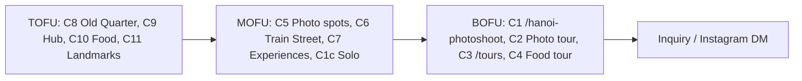

# Hệ thống keyword TravelFrame từ nghiên cứu mettavoyage.com

**Trạng thái:** Draft. Chưa lưu keyword nào vào OpenSEO và chưa sửa trang live.

**File trong thư mục này**

| File | Nội dung |
|---|---|
| `keyword-system.csv` | 656 keyword: priority, layer, cluster, intent, trang đích, volume (nếu có), ghi chú |
| `openseo-hydration-list.txt` | 565 keyword P1–P3 chưa có volume, dán thẳng vào OpenSEO `get_keyword_metrics` (giới hạn 700/lần) |
| `raw/` | Bằng chứng gốc: autocomplete JSON, danh sách URL post và tour của mettavoyage |

## 1. Kết luận

1. **Mảng nhiếp ảnh, đối thủ không có gì.** Trong 629 bài, 220 tour và 127 page của mettavoyage, không slug nào chứa "photo" hay "instagram". Họ là blog du lịch đa quốc gia (Việt Nam, Campuchia, Lào, Thái Lan, Myanmar), không phải đối thủ trực tiếp ở mảng photoshoot. Họ chỉ là đối thủ ở phần nội dung TOFU về Hà Nội.
2. **Không nên đuổi theo Sa Pa, Củ Chi, phở hay bánh mì Sài Gòn**, dù đối thủ chỉ đứng trang 3–8 ở các từ này. TravelFrame chỉ phục vụ ở Hà Nội. Traffic từ các từ đó không có tour nào để chuyển đổi, và còn làm loãng chủ đề của site. Mình xếp chúng vào `Defer` (38 keyword), chỉ mở lại khi có tour thật ở các nơi đó.
3. **Phần đáng lấy từ đối thủ là cụm Hà Nội**, nơi họ có 66 bài nhưng thứ hạng yếu: `hanoi old quarter` (8.100 vol, họ đứng 58–81) và `ha noi vietnam` (74.000 vol, họ đứng 36). TravelFrame đã có pillar Old Quarter (live 13/10) và hub Hà Nội để nhận các từ này.
4. **Bài học từ chính đối thủ:** chỉ những trang rất cụ thể mới lên top (`hue markets vietnam` #1, `banh khot vung tau menu` #4). Viết nhiều bài chung chung thì được 1.409 keyword nhưng ~1.500 traffic. TravelFrame nên ít trang hơn, mỗi trang trả lời đúng một câu hỏi cụ thể.
5. **Doanh thu nằm ở BOFU (C1, C2):** `hanoi photographer`, `hanoi photoshoot`, `photographer in hanoi`, `hanoi photo tour`, `hanoi couple photoshoot`, `hanoi pre wedding photoshoot`, `proposal photographer hanoi`. Mettavoyage không đụng tới nhóm này. Đối thủ thật ở đây là Flytographer, Airbnb Experiences và studio địa phương (đã có trang so sánh trong `30-Day-SEO-Execution-Sprint/Week-2-Competitor-Intercept/`).

## 2. Đối thủ đang phủ gì (theo sitemap, 2026-10-13)

| Nhóm | Post | Tour |
|---|---:|---:|
| Sài Gòn và miền Nam (gồm Củ Chi, Mekong, Phú Quốc, Đà Lạt) | 103 | 23 |
| Hội An, Đà Nẵng | 90 | 11 |
| **Hà Nội** | **66** | **19** |
| Campuchia | 47 | 23 |
| Thái Lan | 41 | 9 |
| Sa Pa và miền núi phía Bắc | 34 | 8 |
| Huế | 27 | 3 |
| Hạ Long, Lan Hạ | 23 | 10 |
| Lào | 19 | 21 |
| Ninh Bình | 18 | 2 |
| Khác (wellness, khách sạn, sự kiện, đa quốc gia) | 161 | 91 |
| **Nhiếp ảnh / photoshoot** | **0** | **0** |

Các bài Hà Nội của họ là: things to do, Old Quarter, train street, phố bia, múa rối nước, cà phê Giảng, nhà tù Hỏa Lò, chùa Trấn Quốc, chùa Một Cột, itinerary 2 ngày, street food tour, cyclo, Vespa, day trip. Nhóm này trùng với TOFU của TravelFrame (C9–C11).

*Cách đếm:* phân loại theo slug bằng regex, nên con số chỉ mang tính định hướng. Một slug có thể khớp nhiều loại nội dung, nhưng chỉ được tính vào một điểm đến.

## 3. Kiến trúc hệ thống keyword

Mỗi cluster có **một trang đích chính**. Keyword cùng cluster được gom vào trang đó (H2, FAQ, anchor), không tách thành trang riêng.

| Cluster | Layer | Priority | Số KW | Trang đích | Keyword đầu cụm |
|---|---|---|---:|---|---|
| C1 Hanoi photographer / photoshoot | BOFU | P1 | 32 | `/hanoi-photoshoot` | hanoi photographer, hanoi photoshoot, photographer in hanoi, hire photographer in hanoi |
| C1b Couple / honeymoon / proposal | BOFU | P1 | 18 | `/news/couple-honeymoon-photoshoot-hanoi-relaxed-candid-guide-2026` → link về `/hanoi-photoshoot` | hanoi couple photoshoot, hanoi pre wedding photoshoot, proposal photographer hanoi |
| C1c Solo female traveler | MOFU | P1 | 9 | `/news/solo-female-travel-hanoi-how-get-natural-photos-without-awkward-posing` | solo female travel hanoi, is hanoi safe for solo female travellers, hanoi female tour guide |
| C2 Photo tour / photo walk | BOFU | P1 | 5 | `/tour/cinematic-hanoi-visual-storytelling-walk` | hanoi photo tour, hanoi photography tour, hanoi street photography tour, hanoi instagram tour |
| C6 Train Street | MOFU | P1 | 17 | `/news/hanoi-train-street-2026-safety-first-guide-and-better-railway-photo-spots` | hanoi train street, hanoi train street schedule, hanoi train street photography |
| C3 Private tour / local guide | BOFU | P2 | 112 | `/tours` | hanoi private tour, private tour guide hanoi, private walking tour hanoi, local tour guide in hanoi |
| C4 Food tour | BOFU | P2 | 108 | `/tour/taste-hanoi-culinary-delights-street-vibes` | hanoi food tour, hanoi street food tour private, hanoi walking food tour |
| C5 Photo spots & visual guide | MOFU | P2 | 30 | `/news/15-best-photo-spots-hanoi-local-guide-light-timing-and-uncrowded-angles-2026` | hanoi photo spots, hanoi instagram spots, hanoi street photography spots |
| C7 Signature experiences | MOFU | P2/P3 | 31 | tour tương ứng (sunrise, craft village, Bát Tràng, West Lake, French Quarter) | bat trang pottery village, hanoi craft village tour, hanoi sunrise spots |
| C8 Old Quarter pillar | TOFU | P2 | 7 | `/news/hanoi-old-quarter-guide` | hanoi old quarter (8.100), things to do in hanoi old quarter |
| C9 Hanoi hub / itinerary | TOFU | P3 | 101 | `/news/complete-hanoi-travel-guide-2026-what-do-eat-and-know-you-arrive` + `/news/slow-hanoi-48-hour-itinerary-calm-two-day-walking-guide` | ha noi vietnam (74.000), things to do in hanoi, hanoi itinerary 3 days, is hanoi safe |
| C10 Hanoi food & drink | TOFU | P3 | 24 | street food guide, egg coffee, bún chả, phở | hanoi street food, hanoi egg coffee, bun cha hanoi |
| C11 Landmarks | TOFU | P3 | 73 | bài landmark đang có | temple of literature hanoi, hoan kiem lake, st joseph cathedral hanoi, hanoi water puppet show |
| Z Off-scope destination | — | Defer | 38 | — | Sa Pa, Hạ Long, Ninh Bình, Sài Gòn, Campuchia |
| X Competitor-branded | — | Exclude | 51 | — | ella food tour, mark and tu, hanoikids… |

## 4. Quy tắc vận hành

- **Một keyword chính cho một URL.** `/hanoi-photoshoot` giữ nhóm "photographer / photoshoot". Trang Cinematic tour giữ nhóm "photo tour / photography tour" (title đã đổi ngày 13/10 để hai trang không tranh nhau).
- **TOFU phải dẫn về BOFU.** Mỗi bài C8–C11 có đúng một câu chèn link về C1 hoặc C2, theo bảng link nội bộ trong `2026-10-13-SEO-Implementation-Plan.md` mục C.
- **Keyword có OTA modifier** (`airbnb`, `viator`, `klook`, `tripadvisor`, `get your guide`): không target trên trang tiền. Dùng cho trang so sánh trong Week-2 và cho listing OTA (bước 6 của Implementation Plan).
- **Keyword chứa "free"** (free walking tour, free private tour guide): hạ xuống P3 vì lệch với offer trả phí. Chỉ dùng làm anchor nội bộ nếu thật sự phù hợp.
- **Keyword chứa "reddit"** cho thấy người tìm muốn nghe trải nghiệm thật. Trả lời bằng review hoặc case có consent, không bằng câu quảng cáo.
- **Wedding / studio** (`hanoi wedding photographer`, `hanoi photo studio`): xếp P2 vì SERP có thể nghiêng về khách nội địa. Kiểm tra SERP trước khi viết.

## 5. Khoảng trống nội dung (keyword đã có cầu nhưng chưa có trang phù hợp)

| Khoảng trống | Keyword ví dụ | Đề xuất |
|---|---|---|
| Hồ Hoàn Kiếm (route cũ đã 301 về `/news`) | hoan kiem lake, hoan kiem lake walking street, hoan kiem lake night market | Một bài landmark có góc ảnh và giờ đẹp, hoặc mục lớn trong pillar Old Quarter |
| Cầu Long Biên (chưa có trang riêng, chỉ có album và bài sunrise) | long bien bridge walk, long bien bridge sunset, long bien bridge history | Mở rộng bài sunrise hoặc viết bài riêng |
| Múa rối nước | hanoi water puppet show tickets / schedule / how long | Mục trong hub; giờ diễn và giá phải re-check gần ngày publish |
| Lịch tàu Train Street | hanoi train street schedule 2026 / today / timetable | Thêm mục lịch tàu vào bài Train Street; ghi rõ nguồn và ngày kiểm tra |
| Tour Bát Tràng (`/tour/grand-hanoi-ceramic-heritage` trả 403 ngày 07/10) | bat trang pottery village, bat trang ceramic village | Sửa trang 403 hoặc trỏ về tour craft village |
| Chợ Đồng Xuân (chỉ có album) | dong xuan market what to buy, dong xuan market opening hours | Viết bài ngắn, link sang series Đồng Xuân |
| Hanoi at night | things to do in hanoi at night, is hanoi safe at night | Mục trong hub, link về bài phố Tạ Hiện |

## 6. Số liệu: đã có và còn thiếu

- **Có volume (OpenSEO, US/en, 13/10):** chỉ 11 dòng lấy từ bảng ranked keywords của mettavoyage mà Rocky gửi. 2 dòng thuộc phạm vi Hà Nội (`ha noi vietnam` 74.000, `hanoi old quarter` 8.100); 9 dòng còn lại là ngoài phạm vi.
- **Chưa có volume / KD / CPC:** 565 keyword P1–P3, ghi `unknown` trong CSV. Chúng lấy từ autocomplete, nên chắc chắn có người tìm, nhưng chưa biết bao nhiêu.
- **Không dùng bộ `2026-09-30-travelframe-1000-keywords-jev-classification`** làm số liệu: volume trong đó là ước tính rập khuôn (832/1.307 dòng cùng là 450, 78 dòng cùng là 12.500). Có thể dùng bộ đó làm danh sách ý tưởng, không dùng làm metric.

**Bước hydrate (cần chạy ở nơi có kết nối OpenSEO, ví dụ Codex với plugin `openseo`):**

1. `get_keyword_metrics` với toàn bộ `openseo-hydration-list.txt` (565 dòng, một lần gọi, US/en).
2. Ghi volume, KD, intent và CPC vào CSV; đổi `volume_source` thành `OpenSEO/DataForSEO US-en <ngày>`.
3. Chấm lại điểm trong từng priority: `Opportunity = volume × trọng số layer (BOFU 3, MOFU 2, TOFU 1) × (1 − KD/100)`. Không nâng keyword lên priority cao hơn chỉ vì volume lớn.
4. `get_serp_results` cho khoảng 10 keyword P1 đầu bảng để xác nhận SERP có chỗ cho trang dịch vụ.
5. Hỏi Rocky trước khi `save_keywords`. Tag gợi ý: `cluster:c1`, `intent:transactional`, `page:hanoi-photoshoot`.

## 7. Giới hạn

- Môi trường chạy lần này (Antigravity) không kết nối được OpenSEO MCP: endpoint hosted cần OAuth của Codex, và chưa có self-host tại `localhost:3001`. Vì vậy không có volume mới và mình không lấy được đủ 1.409 dòng của đối thủ.
- Phân cụm làm bằng rule regex, sau đó kiểm tra tay nhóm P1 và P2. P3 mới kiểm tra lướt.
- `robots.txt` của mettavoyage cấm thu thập tự động trừ index tìm kiếm và AI retrieval. Lần này chỉ đọc 9 file sitemap công khai một lần, không crawl nội dung trang.
- Thông tin về trang TravelFrame (live, 403, 301) lấy từ audit 07/10 và Fix Log 13/10, chưa kiểm tra lại live hôm nay.

## 8. Provenance và rollback

| File | SHA-256 |
|---|---|
| `keyword-system.csv` | `17eee9b99cbc91cb0e1db2cd9ffddd265c47d55414b1781a83e2fe3386795019` |
| `openseo-hydration-list.txt` | `435a7f1286f6c316711d292eb8d4c5f14208a506c8778286c7ddc90309ae6ba3` |
| `raw/2026-10-13-autocomplete-en-us.json` | `08b53e4140f08ae0fe96cbbcd3d6696dc2941c90147fddf51ead13f16fa04aa7` |
| `raw/2026-10-13-mettavoyage-post-urls.txt` | `d12aed97745ac5cd94db3f124400e0c75428e6757f3c3d560c38be82af284b6e` |
| `raw/2026-10-13-mettavoyage-tour-urls.txt` | `69f86cd2d9853fa2089e43836e7222018d6374d15575cc62c1567c12201b76f2` |

- **Script dùng để tạo dữ liệu** (lưu ngoài repo, trong scratch của phiên Antigravity `937acf6f`): `autocomplete.py`, `analyze.py`, `build_system.py`.
- **Rollback:** thư mục này chỉ thêm file mới, không sửa file nào khác. Muốn hoàn tác thì bỏ cả thư mục `2026-10-13-Keyword-System-From-Mettavoyage/`.
- **Chưa thực hiện:** save keyword vào OpenSEO, publish, sửa Drupal, gọi API trả phí.
