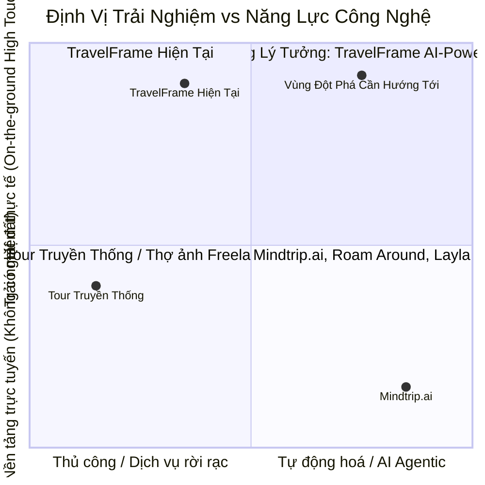

# Nghiên Cứu Đối Thủ: Mindtrip.ai Và Bài Học Chiến Lược Cho TravelFrame

- **Mã tài liệu:** `RES-20260921-MINDTRIP-AI-ANALYSIS`
- **Phòng ban chủ trì:** Research-Insights
- **Phòng ban thụ hưởng:** Brand-Strategy, Marketing-Growth, Sales-CRM, Technology-Automation, Executive
- **Ngày lập:** 2026-09-21
- **Trạng thái:** Draft / Ready for Review
- **Đối tượng nghiên cứu:** Mindtrip.ai (Nền tảng du lịch AI đa phương thức & Hệ sinh thái Creator/B2B)

---

## 1. Tổng Quan Về Mindtrip.ai (Competitor Snapshot)

Mindtrip (mindtrip.ai) là một trong những nền tảng công nghệ du lịch thế hệ mới (Agentic AI Travel Platform) nổi bật nhất trên thế giới, được thành lập năm 2023 bởi các cựu lãnh đạo công nghệ kỳ cựu và nhận hơn 7 triệu USD tài trợ từ Capital One Ventures, American Express Ventures và United Airlines Ventures.

### 1.1. Bản Chất Mô Hình Kinh Doanh
- **Mô hình B2C:** Nền tảng lập kế hoạch du lịch cá nhân hóa hoàn toàn miễn phí cho du khách thông qua giao diện AI hội thoại kết hợp bản đồ tương tác (conversational & visual mapping). Kiếm tiền qua hoa hồng affiliate khi người dùng đặt phòng, vé máy bay, nhà hàng và trải nghiệm (Viator, Priceline, OpenTable).
- **Mô hình B2B ("Mindtrip for Business"):** Cung cấp giải pháp AI Concierge / White-label Trip Planner cho các tổ chức xúc tiến du lịch (DMOs) và chuỗi khách sạn boutique/resort.
- **Hệ sinh thái Creator ("Mindtrip for Creators"):** Cung cấp công cụ "Magic Links" cho các Travel Influencer / Content Creator đóng gói lịch trình thành link tương tác để kiếm tiền từ affiliate booking của người theo dõi.

---

## 2. Ma Trận So Sánh Đối Đầu: Mindtrip.ai vs TravelFrame.vn

| Tiêu chí | Mindtrip.ai | TravelFrame.vn | Nhận định so sánh |
| :--- | :--- | :--- | :--- |
| **Bản chất cốt lõi** | AI Travel Tech Platform / Aggregator / Software | Boutique Travel Experience & Visual Media Agency | Hai mô hình thuộc hai mắt xích khác nhau trong hành trình khách hàng. |
| **Giá trị bàn giao (Deliverables)** | File lịch trình điện tử, link bản đồ, liên kết đặt chỗ | Buổi tour riêng có người dẫn đường bản địa + Bộ ảnh chất lượng cao + Video Reels 4K | TravelFrame tạo ra tài sản kỷ niệm vật lý/số có giá trị cảm xúc cao hơn hẳn. |
| **Năng lực trên thực địa (Ground Truth)** | Kém (Phụ thuộc dữ liệu cào từ web, dễ gặp ảo giác về giờ mở cửa, địa chỉ cũ, rào chắn tàu) | Rất mạnh (Người thật việc thật, cập nhật từng ngõ ngách, thói quen sinh hoạt và an toàn phố cổ) | Lợi thế cạnh tranh phòng thủ tuyệt đối của TravelFrame. |
| **Trải nghiệm lập kế hoạch (UX/UI)** | Xuất sắc (Interactive visual map, tính nhịp độ đi lại, Start Anywhere®) | Trung bình (Configurator dạng checkbox tính tiền theo giờ, thiếu bản đồ hành trình trực quan) | **TravelFrame cần học hỏi triệt để từ Mindtrip.** |
| **Khai thác nội dung mạng xã hội** | Biến link TikTok/IG bất kỳ thành lịch trình trong 30 giây | Sản xuất Reels triệu view nhưng chuyển đổi thành booking còn thủ công | **TravelFrame có thể áp dụng mô hình chuyển đổi trực tiếp này.** |
| **Chiến lược Creator & Đối tác** | Chương trình Creator bài bản với "Magic Links" chia sẻ hoa hồng | Có Media Kit B2B nhưng chưa có cơ chế affiliate tự động cho Creators | Cơ hội mở rộng nguồn khách quốc tế cực lớn cho TravelFrame. |

---

## 3. Điểm Yếu Của Mindtrip.ai – Cơ Hội Để TravelFrame Khẳng Định Vị Thế

1. **Ảo giác AI (AI Hallucinations) & Thiếu ngữ cảnh địa phương sâu:**
   - Mindtrip không thể biết hôm nay quán phở Bát Đàn đông lúc mấy giờ, đoạn đường tàu Train Street bị công an chặn ở barie nào, hay góc phố Phan Đình Phùng mùa nào rụng lá đẹp nhất.
   - *Chiến lược TravelFrame:* Nhấn mạnh định vị **"Human-Vetted Local Truth"** – mọi gợi ý và lịch trình đều được kiểm chứng bởi người bản địa, không phải dữ liệu AI phỏng đoán.

2. **Khoảng cách từ "Lịch trình trên màn hình" đến "Trải nghiệm ngoài đời thực":**
   - Khách du lịch phương Tây đến Hà Nội luôn mang theo nỗi sợ: sợ qua đường xe máy, sợ lừa đảo xích lô, sợ lạc ngõ hẹp và đặc biệt là không ai chụp ảnh cho (phải dùng gậy selfie hoặc nhờ người qua đường chụp méo mó).
   - *Chiến lược TravelFrame:* Đóng vai trò **"Your Warm Local Friend & Personal Visual Creator"** – biến bản kế hoạch lý thuyết thành một ngày dạo chơi thảnh thơi và có ngay bộ ảnh/video điện ảnh mang về.

---

## 4. Sáu (06) Bài Học Đột Phá TravelFrame Có Thể Học Hỏi & Ứng Dụng Ngay

### 4.1. Bài học 1: Công nghệ "Start Anywhere®" – Biến Video Reels Thành Tour 1-Click
- **Cách Mindtrip làm:** Người dùng dán link video TikTok/Instagram vào ô chat, AI tự động nhận diện các địa điểm trong video và tạo thành lịch trình.
- **Ứng dụng cho TravelFrame:**
  - Hiện tại TravelFrame có các video triệu view (Cảnh báo lừa đảo Hà Nội, Train Street 2026, Quán cà phê ẩn). Khách xem xong thường hỏi *"Đi các điểm này như thế nào?"*.
  - **Giải pháp:** Thiết lập kịch bản ManyChat tự động hoặc trang Web Mini-tool: Khách comment từ khoá dưới Reel hoặc gửi link Reel vào DM Instagram, hệ thống phản hồi ngay một **"Interactive Micro-Itinerary"** (Lịch trình 3 giờ đúng các góc quay trong video) kèm nút *"Book this exact photo route with TravelFrame"*.

### 4.2. Bài học 2: Nâng cấp UX "Bản Đồ Cảm Xúc" (Emotional Cartography)
- **Cách Mindtrip làm:** Thay vì liệt kê danh sách gạch đầu dòng, Mindtrip hiển thị lịch trình dạng bản đồ trực quan, tính toán nhịp độ di chuyển (walking time, dwell time) và phân bổ nhịp cảm xúc (buổi sáng yên bình -> trưa ẩm thực -> chiều ngắm hoàng hôn).
- **Ứng dụng cho TravelFrame:**
  - Thay đổi giao diện Booking Configurator hiện tại (vốn chỉ là form tính giá toán học khô khan: Tour base + Visual hourly rate).
  - Bổ sung **"Visual Route Timeline"**: Khách chọn tour sẽ thấy ngay bản đồ các trạm dừng, thời gian tản bộ giữa các trạm, thời gian photoshoot, và đặc biệt là **bộ ảnh mẫu thực tế** được chụp tại chính góc đó. Khách nhìn thấy trước "bộ ảnh tương lai" của mình trước khi bấm đặt chỗ.

### 4.3. Bài học 3: Tích Hợp "AI Local Concierge" Được Huấn Luyện Từ Dữ Liệu Bản Địa Độc Quyền
- **Cách Mindtrip làm:** Chatbot đàm thoại tự nhiên giải đáp mọi thắc mắc du lịch.
- **Ứng dụng cho TravelFrame:**
  - Tận dụng kho tri thức chuẩn hóa sẵn có của TravelFrame (`06-Safety-And-Verified-Travel-Facts.md`, cẩm nang Food Guide, Hidden Gems) để tích hợp một trợ lý AI thông minh trên Website/Instagram DM.
  - Trợ lý này không bị ảo giác như AI chung vì chỉ truy xuất dữ liệu độc quyền của TravelFrame; có thể tư vấn trang phục phù hợp với thời tiết Hà Nội hôm nay, gợi ý thời gian chụp đón bình minh Long Biên, và tự động đề xuất gói Tour + Visual Package chuẩn xác.

### 4.4. Bài học 4: Xây Dựng "TravelFrame Creator Program" Với Cơ Chế "Magic Links"
- **Cách Mindtrip làm:** Hợp tác với travel creators, cấp "Magic Link" để creator gắn vào bio/video. Khi follower bấm vào và đặt dịch vụ, creator nhận hoa hồng.
- **Ứng dụng cho TravelFrame:**
  - Hà Nội đón hàng nghìn travel blogger/creator quốc tế mỗi năm.
  - Triển khai gói **"Hosted Shoot for International Creators"**: Mời creator trải nghiệm 1 buổi tour + chụp ảnh/video miễn phí. Đổi lại, creator đăng video gắn **Custom Link** của họ (ví dụ: `travelframe.vn/c/sarah-travels`).
  - Follower của họ đặt tour được giảm 5-10%, creator nhận hoa hồng 10-15%. Đây là kênh tăng trưởng Organic Viral cực mạnh với chi phí trả trước bằng 0.

### 4.5. Bài học 5: Nâng Cấp B2B Hotel Partnership Thành "Co-Branded Digital Concierge"
- **Cách Mindtrip làm:** Bán gói "Mindtrip for Hotels" để khách sạn có cẩm nang số mang thương hiệu của họ.
- **Ứng dụng cho TravelFrame:**
  - Trong tài liệu B2B Media Kit (`OFF-20260917-MEDIA-KIT-B2B-OFFERS`), TravelFrame đang đề xuất cung cấp standee/tờ rơi cho khách sạn boutique.
  - Thay vì chỉ in ấn giấy, TravelFrame có thể đóng gói thêm một **"Co-branded Interactive Web Guide"** (ví dụ: `guide.travelframe.vn/hotel-de-lopera`). Khách sạn để mã QR trong phòng, khách quét ra ngay bản đồ các quán cà phê ngõ đẹp, tips đi bộ an toàn quanh khách sạn do TravelFrame biên soạn, và có nút đặt tour chụp ảnh ngay tại lễ tân.

### 4.6. Bài học 6: Đưa TravelFrame Lên Mạng Lưới Phân Phối Của Mindtrip (OTA Channel)
- **Cơ chế:** Mindtrip tích hợp cổng đặt chỗ trải nghiệm thông qua **Viator / TripAdvisor**.
- **Hành động ngay:** Niêm yết các gói tour biểu tượng của TravelFrame (*Hanoi Early Bird*, *French Colonial Footsteps*, *Cinematic Hanoi Walk*) lên Viator. Khi du khách dùng Mindtrip lập lịch trình tại Hà Nội, tour của TravelFrame sẽ xuất hiện trực tiếp như một lựa chọn trải nghiệm có thể thanh toán ngay trên ứng dụng Mindtrip.

---

## 5. Lộ Trình Triển Khai Đề Xuất (Next Actions)

1. **Giai đoạn 1 (Quick-wins - 1 đến 2 tuần):**
   - Đưa sản phẩm tour lên Viator để đón đầu luồng traffic từ các AI Planner như Mindtrip.
   - Thiết lập luồng ManyChat: "Xem Reel -> Nhận Micro-Itinerary tương tác -> Nút Book Tour".
2. **Giai đoạn 2 (Product & Web UX - 3 đến 4 tuần):**
   - Bổ sung giao diện Visual Route Timeline trên trang chi tiết tour của website TravelFrame.
   - Thử nghiệm chương trình Creator Affiliate với 3-5 travel blogger quốc tế đầu tiên đến Hà Nội.
3. **Giai đoạn 3 (AI & B2B Expansion - 2 tháng):**
   - Triển khai phiên bản mẫu Co-branded Digital Concierge chào hàng cho 2 khách sạn boutique tại phố cổ.
   - Tích hợp AI Concierge bản địa vào website hỗ trợ khách quốc tế tùy biến lịch trình 24/7.
