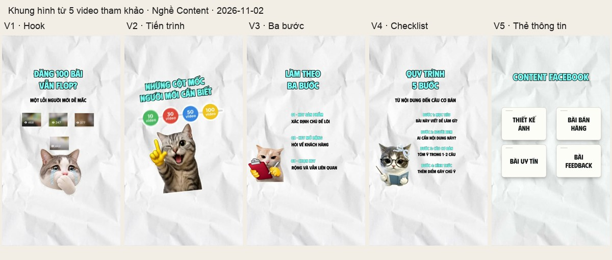

# Nghiên cứu format video TravelFrame

Rocky thích format, effect, hình minh họa và âm thanh của 5 video cung cấp, muốn cùng phát triển cách áp dụng cho TravelFrame. Mục tiêu đã xác nhận trong chat: **xây kênh hướng dẫn du lịch hữu ích cho khách quốc tế**. Đây là bản nghiên cứu và các lựa chọn ban đầu; chưa phải bộ nhận diện hay thiết kế video được duyệt.

## 1. Kết luận để cùng lựa chọn

Năm mẫu dùng chung một hệ trình bày: lời dẫn giải thích, nền giấy nhăn, tiêu đề nổi bật, ảnh cắt nền/meme, ví dụ bằng clip hoặc screenshot, chữ xuất hiện theo ý. Điều đáng học là cách chia một lời giải thích dài thành các đơn vị dễ theo dõi và một bộ quy tắc hình ảnh lặp lại.

Hướng đề xuất: **TravelFrame dùng lời dẫn tiếng Anh gần gũi, cảnh Hà Nội thật, đồ họa minh họa như ghi chú hành trình và một bảng âm thanh gọn**. Đồ họa giúp khách hiểu cách làm; cảnh thật giúp họ nhận ra nơi chốn và cảm nhận chuyến đi. Dành phần lớn nội dung cho hướng dẫn hữu ích, lồng photography khi liên quan trực tiếp đến chủ đề.

## 2. Năm mẫu và phần có thể chuyển sang TravelFrame

Mốc dưới đây là ước lượng. `frames/N`, `hook/N`, `ending/N` trỏ tới index trong bundle của từng video. Chữ quan sát trên hình được phân biệt với lời nói; những câu chuyện, số liệu và lời hứa của tác giả không được coi là kiến thức đã xác minh.

| Mẫu | Độ dài | Điểm quan sát và bằng chứng | Cách ứng dụng đề xuất |
|---|---:|---|---|
| [V1 — Đăng nhiều bài nhưng kênh chưa phát triển](https://www.facebook.com/reel/1645730110389289) | 10:36 | Hook nêu tình huống, screenshot lưới video và mèo biểu cảm: `hook/0–9`. Phân loại lỗi, rồi các ví dụ đối chiếu bằng lưới bài và clip: `frames/4–24`. Cuối video nhắc hành động: `ending/0–3`. | Một hiểu nhầm của du khách → minh họa thực tế → cách xử lý → thẻ tóm tắt. Mỗi tập chỉ chọn một vấn đề. |
| [V2 — Những cột mốc xây kênh](https://www.facebook.com/reel/28549149988100280) | 9:43 | Thanh bốn mốc màu xuất hiện trong hook: `hook/4–8`. Các phần có tiêu đề cố định và ví dụ xen kẽ: `frames/6–19`. Cuối có vòng lặp bốn bước: `frames/31`, `ending/0–1`. | Biến hướng dẫn nhiều bước thành thanh tiến trình: chuẩn bị → thực hiện → kiểm tra → hoàn tất. Dùng cho đọc menu hoặc chuẩn bị một buổi đi chơi. |
| [V3 — Mở rộng tệp khán giả](https://www.facebook.com/reel/1772010184067480) | 3:56 | Nêu lợi ích, minh họa câu chuyện rồi chuyển sang ba bước: `hook/0–9`, `frames/5–7`. Nhiều danh sách ngắn và một ví dụ quay lại ở cuối: `frames/12–24`. | Mở bằng một nhu cầu phổ biến của khách đến Việt Nam, trả lời cụ thể, rồi nối về góc nhìn địa phương/photography khi hợp ngữ cảnh. Đây là cách phát triển đề tài, chưa là bằng chứng hiệu quả của TravelFrame. |
| [V4 — Cách viết hook](https://www.facebook.com/reel/1412336217200297) | 5:46 | Phần đầu đưa thẻ khóa học vào rất sớm: `hook/3–9`. Phần thân chia thành các nhóm và công thức; cuối là quy trình năm bước: `frames/5–29`, `ending/0–2`. | Dùng một câu hỏi rõ và một vật thể/cảnh thật để mở đầu. Học cách chia tầng thông tin và hiện checklist từng dòng; ưu tiên cung cấp giá trị sớm theo mục tiêu đã chọn. |
| [V5 — Lộ trình tự học content](https://www.facebook.com/reel/1097683359660009) | 12:07 | Dùng nhiều thẻ, screenshot, icon, mũi tên, sơ đồ quy trình; ít phụ thuộc vào meme ở nhiều đoạn: `frames/1–31`. Mở đầu chuyển từ hình cắt nền sang b-roll và bước đầu tiên: `hook/0–9`. | Phù hợp nhất để học cách minh họa kiến thức du lịch: so sánh lựa chọn, đọc menu, sơ đồ hành trình, checklist chuẩn bị. |

## 3. Những yếu tố nên giữ và điều chỉnh

| Thành phần | Quan sát từ mẫu | Đề xuất cho TravelFrame |
|---|---|---|
| Cấu trúc kể | Nêu vấn đề → giải thích → ví dụ → bước làm/tổng kết; các biến thể thể hiện ở bảng trên. | Một câu hỏi thực tế/tập. Cho người xem thấy câu trả lời và cách áp dụng ngay trong tập. |
| Bố cục | Tiêu đề thường ở phía trên, minh họa ở giữa, thông tin phụ xuất hiện theo lớp; không phải phụ đề lời nói đầy đủ. | Tiêu đề ngắn, một trọng tâm mỗi cảnh. Tách keyword minh họa khỏi phụ đề tiếng Anh đồng bộ. Để đủ chỗ nhìn hành động và cảnh thật. |
| Hình cắt nền | Mèo thay biểu cảm, có viền sticker; screenshot và clip làm ví dụ. | Ưu tiên món ăn, cốc cà phê, menu, camera, ảnh chụp, bản đồ hoặc biểu cảm local host khi có nguồn phù hợp. Có thể giữ chút meme nếu Rocky muốn; chưa chốt linh vật. |
| Nền giấy | Giấy nhăn trắng lặp xuyên suốt, nhiều khoảng trống. | Thử nền giấy sáng cho đoạn giải thích, xen cảnh thật chiếm toàn màn hình. Chưa chốt texture cụ thể trước khi xem styleframe. |
| Nhận diện | Màu xanh lơ viền đen và kiểu chữ tiêu đề lặp lại. | Đối chiếu hệ TravelFrame đã có; không lấy nguyên font, màu và nét viền của nguồn làm nhận diện mới. |
| Chuyển động | Đổi hình, chữ bật lên, trình bày từng dòng; một số mẫu có clip hoặc thẻ nghiêng. | Một bộ nhỏ để thử: ảnh/thẻ xuất hiện, keyword nhấn một lần, mũi tên vẽ lộ trình, từng dòng checklist và cắt sang cảnh thật. Hiệu ứng gắn với ý nghĩa của cảnh. |
| Độ dài | Nguồn là các video giải thích dài gần 4–12 phút. | Đề xuất thử 45–75 giây cho một mẹo rõ; 90–150 giây nếu cần hướng dẫn nhiều bước. Đây là giả thuyết sản xuất để thử, chưa phải ngưỡng tối ưu được chứng minh. |

## 4. Âm thanh: bằng chứng và hướng thử

Phần này dựa trên **Gemini phân tích audio/video sau khi Rocky cho phép**, kết hợp hình đã xem để kiểm tra ngữ cảnh. Người viết chưa nghe và xác nhận độc lập từng sự kiện SFX. Mốc âm thanh do máy cung cấp là mốc gần đúng; không dùng làm cue đặt âm chính xác khi dựng.

- Gemini mô tả giọng dẫn tiếng Việt có biểu cảm, tương đối nhanh và nhấn các từ quan trọng; các báo cáo đều mô tả có nhạc không lời dưới giọng. Không xác minh giọng là người thật hay AI, tên bản nhạc, tempo, thông số mix hoặc plugin.
- V1 và V3: Gemini không nhận diện SFX riêng rõ tại các đoạn kiểm tra; không suy rộng thành kết luận kỹ thuật rằng không tồn tại bất kỳ SFX nào trên track.
- V2: Gemini ghi nhận các âm kiểu thud/pop/whoosh quanh phần mở đầu và một đoạn meme có audio ở khoảng 1:23–1:25. Chưa tách stem để xác định nguồn âm.
- V4: Gemini mô tả pop khi thẻ xuất hiện, âm nhấn ở ý phủ định và click theo các dòng công thức. Một số mốc mô tả hình chưa khớp focused frames; giữ ở mức nguồn tham khảo thứ cấp.
- V5: Gemini mô tả pop/boing ở đầu, typing khoảng 0:23–0:25, click/pop khi lần lượt giới thiệu thẻ. Chưa xác minh tên hiệu ứng hoặc cue chính xác.

**Bảng âm thanh đề xuất để cùng nghe thử:**

| Lớp âm | Vai trò trong video TravelFrame | Cách dùng thử |
|---|---|---|
| Lời dẫn | Mang thông tin chính, tạo cảm giác local friend. | Tiếng Anh rõ, câu ngắn, ngắt theo ý; cho người dùng English như ngôn ngữ thứ hai đủ thời gian theo dõi. Chưa chốt giọng nam/nữ, thu thật/AI. |
| Âm hiện trường | Tạo cảm giác đang ở Hà Nội. | Giữ một khoảnh khắc pha/rót đồ uống, thao tác tại quán hoặc không khí đường phố khi có audio thật phù hợp. Không trình bày âm dựng như bằng chứng âm thanh của địa điểm. |
| Pop/click mềm | Báo có thông tin mới. | Dùng khi xuất hiện lựa chọn, món đồ hoặc bước cần ghi nhớ. |
| Paper/marker | Gắn với phong cách ghi chú. | Thử ở một lần mở note hoặc vẽ đường; đây là sáng tạo đề xuất, chưa xác nhận là âm của nguồn. |
| Whoosh ngắn | Chuyển sang một ý/cảnh mới. | Chỉ dùng ở điểm đổi phần cần làm rõ. |
| Nhạc nền | Giữ mạch cảm xúc, đỡ khoảng trống. | Chọn nhạc có quyền sử dụng, đặt dưới lời; nghe thử trên loa điện thoại trước khi quyết định. |

Không cần ghép cả sáu lớp trong mọi cảnh. Cần thử bằng một đoạn có lời dẫn để nghe được sự cân bằng; nghiên cứu này chưa có bản phối âm TravelFrame.

## 5. Ba hướng có thể phát triển cùng Rocky

| Hướng | Mô tả | Lợi thế | Đánh đổi |
|---|---|---|---|
| **A — Hướng dẫn du lịch bằng cảnh thật và ghi chú (đề xuất)** | Lời dẫn dẫn chuyện; chuyển qua lại giữa footage Hà Nội và thẻ/sơ đồ minh họa. | Gần mục tiêu hướng dẫn hữu ích, có nét vui từ mẫu, đồng thời giữ đặc trưng địa phương. | Cần footage đúng với từng lời giải thích; cần thống nhất khi nào dùng cảnh thật và khi nào dùng giấy. |
| B — Hướng dẫn trên nền giấy | Đa số thời lượng là nền giấy, hình cắt nền, icon, screenshot, sơ đồ; chỉ có vài đoạn b-roll. | Gần hình thức nguồn hơn, dễ sản xuất các video checklist và quy trình. | Cần chọn ảnh rất sát nghĩa để tránh cảm giác trình chiếu; ít khoảng cho người xem cảm nhận địa điểm. |
| C — Local host trải nghiệm và giải thích | Người dẫn tại chỗ hoặc POV là chính; đồ họa dùng để chỉ dẫn/đối chiếu. | Phù hợp xây kết nối với người địa phương và hệ VJ Field Notes. | Phụ thuộc khả năng quay hiện trường, người dẫn, thu tiếng và lịch sản xuất. |

Ưu tiên A vì mục tiêu đã xác nhận là hướng dẫn hữu ích cho khách quốc tế. B và C là các lựa chọn thật, có thể chọn theo nguồn lực và mức độ Rocky muốn gần mẫu. Chưa đặt tỷ lệ footage/đồ họa thành quy chuẩn.

## 6. Liên hệ với thương hiệu hiện có

Nguồn đã đọc:

- `Executive/Current-State.md`: ưu tiên khách quốc tế, nội dung tự sản xuất và photography/local discovery; các con số hiệu quả trong file không dùng làm bằng chứng cho format này.
- [Bộ nhận diện Field Notes đã duyệt](../../../Brand-Strategy/brand.md): Pop Field Notes; Archivo Black, DM Serif Display, DM Sans; nền Paper White, Field Ink, Signal Pink, Map Lemon; teal là endorsement TravelFrame. Tối đa hai font trên một frame, chữ không che hành động/ánh mắt, không gradient/glow.
- Vault: `/Users/macbook/SideAgency/SA/01-Projects/Hanoi-Expert/TravelFrame/01-Brand-Source-Of-Truth.md`, `05-Content-System.md`, `13-Examples-And-Feedback.md`: warm local friend, practical English, lồng photography khi phù hợp, không hù dọa hoặc hứa quá mức.

**Giới hạn phạm vi:** `Brand-Strategy/brand.md` được duyệt cho series VJ Field Notes; chưa phải phê duyệt tự động cho một series faceless mới. Nếu chọn dùng hệ này cho format mới, cần Rocky xác nhận phạm vi áp dụng. Bộ font Cormorant/Oooh Baby/DM Sans trong dự án travel cards là tài sản khác; nghiên cứu này không tự gộp các hệ thành một bộ nhận diện.

## 7. Gợi ý pilot để thảo luận

Đề tài ứng viên: **giúp khách lần đầu gọi cà phê ở Hà Nội**. Lý do chọn: có vật thể dễ minh họa, có thao tác thực tế, có thể kết bằng một note dễ lưu và một góc chụp. Đây mới là đề tài để phát triển; chưa viết hướng dẫn cụ thể về món, giá hoặc quán.

Khung tham khảo cho bản 45–75 giây: câu hỏi của khách → cảnh thật/vật thể cho thấy vấn đề → hai hoặc ba lựa chọn được minh họa → một lời nhắc thực tế → thẻ tóm tắt và CTA lưu. Thời gian, lời thoại, hình, hiệu ứng và âm sẽ được chốt cùng Rocky sau khi chọn phong cách.

Quyết định cần trao đổi tiếp: mức độ giữ chất hài/meme của nguồn. Sau đó chọn một đề tài, xác nhận tài sản có thể dùng, phác storyboard và thử một đoạn ngắn trước khi nhân rộng.

## 8. Phương pháp, provenance và giới hạn

- Nguồn thu thập 2026-11-02: đúng 5 URL do Rocky cung cấp, tải bằng yt-dlp để phân tích nội bộ. Không lấy thêm video ngoài brief; không đăng lại nội dung nguồn.
- Video gốc và metadata tóm lược: `Research-Insights/Library/videos/nghe-content-format-references/<id>/2026-11-02/`. Metadata giữ ID/caption/canonical URL, không cần giữ các URL media ký tạm trong báo cáo.
- Đã trực tiếp đọc **224 khung hình**: tổng quan 32/32/28/30/32, hook 10 mỗi video, cuối 4 mỗi video. Có contact sheet và index của từng pass. Tổng video khoảng **42 phút 07 giây**; không coi 224 frame là xem liên tục toàn bộ chuyển động.
- Timestamp uniform là ước lượng. Ở fps thấp, ảnh được chọn có thể lệch khỏi nhãn index nhiều giây; ví dụ frame tổng quan đầu của V1 đã là phần sau hook, trong khi focused pass giữ đúng nội dung hook. Ưu tiên focused pass và kiểm tra video tại lúc dựng.
- Gemini được phép phân tích cả 5 tệp. Kết quả máy là nguồn thứ cấp, được lưu riêng. V4 chỉ lưu bản ghi nhận có giới hạn vì đầu ra công cụ bị cắt; không chạy thêm API chỉ để lấy lại toàn văn.
- Transcript Whisper cục bộ có provenance; là bản ASR máy, có lỗi từ và mốc phân đoạn gần đúng. Đặc biệt đoạn cuối V5 từ khoảng 720 giây bị lặp từ không đáng tin, đã loại khỏi bằng chứng về lời kết; V5 mang trạng thái `partial`. Provenance verified chỉ xác nhận file và engine, không xác nhận độ đúng từng từ. Subtitle nền tảng không có trong metadata tải được. Chữ trong khung hình được đọc riêng, không coi transcript là chữ trên màn hình.
- Đã phát hiện mô tả chuyển động của Gemini bỏ sót thẻ nghiêng trong V1 (`frames/15`) và có mốc hook V4 chưa khớp focused frames; không dùng kết quả máy như edit decision list chính xác.
- Không xác minh quyền tái sử dụng meme/clip/nhạc của nguồn, tên font/phần mềm/plugin, retention, nguyên nhân lượt xem hoặc hiệu quả với TravelFrame. Các asset sản xuất mới cần nguồn sử dụng phù hợp.
- Trạng thái nghiên cứu: **analyzed_sampled**, với **audio từ phân tích máy chưa được người nghe độc lập xác nhận**, subtitle nền tảng thiếu, và các lựa chọn sáng tạo còn ở trạng thái đề xuất.

## Hồ sơ từng video

Kiểm tra bàn giao 2026-11-02: 5/5 bundle có media checksum khớp provenance, caption khớp native ID, evidence pointer tồn tại và báo cáo đủ 8 mục; tổng 224 frame. `npm test`: 158 pass. `npm run test:skills`: 15 pass. `npm run workspace:check`: các mục cấu trúc/liên kết đều pass, còn lỗi đường dẫn tuyệt đối tại `Creative-Production/Projects/Hanoi-Things-Not-To-Do-2026-11-02/.hyperframes/video-state.json:189`, thuộc dự án khác có sẵn trong workspace; không sửa file ngoài phạm vi nghiên cứu này. Các đường dẫn media trong source.json của batch đã đổi sang đường dẫn tương đối với workspace để giữ tính di động.

- [V1](facebook-1645730110389289/2026-11-02-format-research/analysis.md)
- [V2](facebook-28549149988100280/2026-11-02-format-research/analysis.md)
- [V3](facebook-1772010184067480/2026-11-02-format-research/analysis.md)
- [V4](facebook-1412336217200297/2026-11-02-format-research/analysis.md)
- [V5](facebook-1097683359660009/2026-11-02-format-research/analysis.md)
