# Phân Tích Chuyên Sâu: Toàn Bộ Thuật Toán Meta Ads (Andromeda) Được Giải Mã

> **Tài liệu nghiên cứu và trích xuất tri thức từ video:** [The Entire (Andromeda) Meta Ads Algorithm Explained](https://www.youtube.com/watch?v=e-dOe-H7Ozs)  
> **Tác giả:** Eric | Ecom Explained (@ecomexplainedyt)  
> **Thời lượng:** 10 phút 14 giây (614s) | Ngày phân tích: 15-09-2026  
> **Mục tiêu:** Giải mã toàn diện kiến trúc kỹ thuật của thuật toán phân phối quảng cáo Meta Andromeda, cơ chế đấu giá thời gian thực 200 mili-giây, phương trình Total Value, và cẩm nang ứng dụng thực chiến cho TravelFrame.

---

## 1. Cỗ Máy Phân Phối 200 Mili-Giây (The 200ms Impression Pipeline)

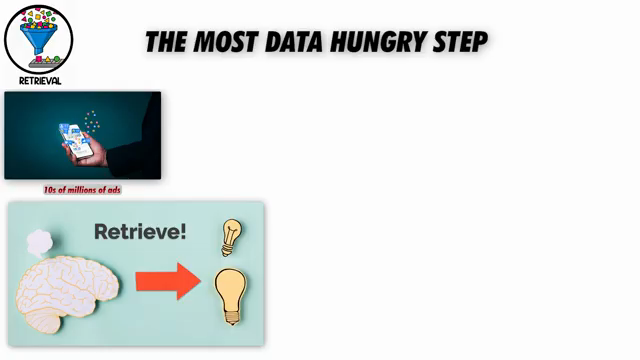

Mỗi khi người dùng mở ứng dụng Instagram hoặc Facebook và lướt qua bảng tin (feed), Meta chỉ có một cửa sổ thời gian cực ngắn khoảng **200 mili-giây (0.2 giây)** để tính toán và quyết định quảng cáo nào sẽ được hiển thị. 

Trong khoảnh khắc chớp mắt đó, **hàng chục triệu quảng cáo** trên toàn cầu cùng cạnh tranh cho đúng một lượt hiển thị (single impression). Để xử lý khối lượng dữ liệu khổng lồ này, Meta vận hành một phễu sàng lọc 4 tầng nghiêm ngặt:

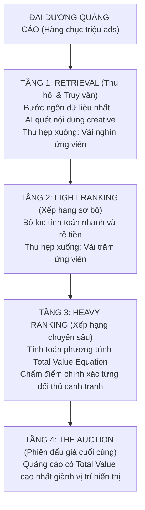

---

## 2. Phân Tích 8 Trụ Cột Cốt Lõi Của Thuật Toán Andromeda

### Trụ Cột 1: Tầng Retrieval — Nơi Khái Niệm "Creative Is Your Targeting" Ra Đời

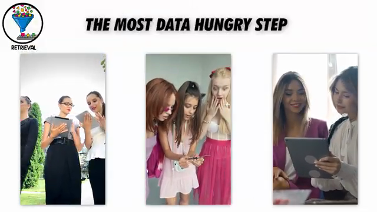

#### 1. Cơ chế hoạt động:
* **Retrieval** là giai đoạn ngốn năng lực tính toán và dữ liệu lớn nhất trong toàn bộ hệ thống. Nhiệm vụ của nó là quét qua đại dương hàng chục triệu quảng cáo để lọc ra vài nghìn quảng cáo "có liên quan trong phạm vi chấp nhận được" đối với người dùng cụ thể đang lướt màn hình.
* Ở bước này, Meta không chỉ nhìn vào cài đặt nhóm quảng cáo, mà **AI trực tiếp đọc và phân tích toàn bộ nội dung Creative**:
  * **Hook:** 3 giây đầu tiên của video hoặc tiêu đề chính của ảnh.
  * **Định dạng (Format):** Video Reels, Static 1:1, Carousel, Story 9:16.
  * **Nhân vật & Hình ảnh trên màn hình:** Độ tuổi, giới tính, bối cảnh, hành động (ví dụ: nếu quảng cáo xuất hiện hình ảnh một phụ nữ 50 tuổi, thuật toán tự động phân phối ưu tiên đến nhóm phụ nữ trung niên).
  * **Ad Copy & Text:** Từ ngữ, chủ đề, góc độ nỗi đau hoặc lợi ích.
  * **Thumbnail:** Khung hình đại diện của quảng cáo.
  * **Landing Page Crawling:** Meta AI thu thập và đọc toàn bộ nội dung trang đích mà quảng cáo trỏ về để xác thực độ liên quan.

#### 2. Cái chết của Stacking Interests & Micro-Segmentation:
* Trước đây, media buyer kiểm soát việc phân phối bằng cách nhồi nhét từ khóa sở thích (Interests) và tệp tương tự (Lookalikes) trong cài đặt Ad Set.
* Dưới thời Andromeda, **cơ chế này đã hoàn toàn lỗi thời**. Bạn không còn là người lựa chọn khán giả nữa; thuật toán đọc nội dung quảng cáo và **tự lựa chọn khán giả thay cho bạn**.
* Đổi Hook = Đổi nhóm người được truy vấn ở bước Retrieval. Đổi Format = Đổi cụm khán giả tiềm năng. Đòn bẩy đã chuyển hoàn toàn từ **Ad Set Settings** sang **Creative Production**.

---

### Trụ Cột 2: Cập Nhật Andromeda (Tháng 12/2024) & Siêu Chip Nvidia Grace Hopper

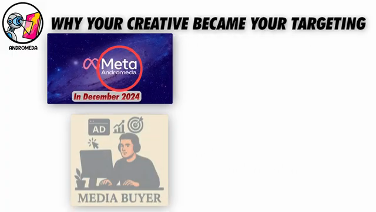

#### 1. Động lực tái cấu trúc:
* Tháng 12 năm 2024, Meta hoàn tất việc đại tu toàn bộ cỗ máy truy vấn quảng cáo và đặt tên là **Andromeda**.
* Lý do bắt buộc: Sự bùng nổ của các công cụ AI tạo sinh (GenAI) đã khiến hàng triệu nhà quảng cáo đổ một lượng nội dung quảng cáo khổng lồ vào nền tảng. Hệ thống cũ bị nghẽn (choking) vì không thể phân loại kịp tốc độ tăng trưởng này.
* Meta đã triển khai hệ thống học máy mới vận hành trực tiếp trên siêu chip **Nvidia Grace Hopper**, cho phép hệ thống phân tích ngữ nghĩa sâu (deep semantic matching) giữa nội dung quảng cáo và hành vi vi mô của người dùng.

#### 2. Từ phân loại thô sang khớp nối siêu vi (Granular Matching):
* **Hệ thống cũ:** "Người dùng này thích giày thể thao" $\rightarrow$ Phân phối quảng cáo giày.
* **Andromeda:** "Người dùng này có thói quen nhấp vào dép lào màu đỏ dùng đi biển vào các buổi tối cuối tuần" $\rightarrow$ Chỉ truy vấn những quảng cáo có hình ảnh cụ thể đó.

#### 3. Thực tế vận hành của Media Buyer:
* Các tệp đối tượng nhỏ (micro-segments) không còn khả năng giữ ngân sách.
* **Broad Targeting (nhắm mục tiêu mở rộng)** đánh bại hoàn toàn các cụm sở thích hẹp.
* Hiệu quả theo ngày dao động mạnh hơn (volatile), nhưng hiệu quả tổng thể theo tuần lại cao hơn và ổn định hơn.
* Chân lý cốt lõi: **"The WHO mattered less, and the WHAT mattered more"** (Đối tượng bạn chọn quan trọng ít hơn, nội dung bạn đưa vào quan trọng nhiều hơn).

---

### Trụ Cột 3: Light Ranking vs. Heavy Ranking — Bộ Đôi Thu Hẹp Ứng Viên

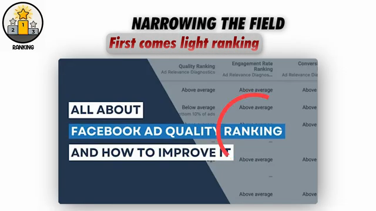

Sau khi tầng Retrieval rút gọn từ hàng chục triệu ads xuống còn vài nghìn ứng viên, quá trình sàng lọc tiếp tục qua 2 giai đoạn:

1. **Light Ranking (Xếp hạng sơ bộ):**
   * Là một bộ lọc tính toán nhanh, chi phí thấp.
   * Quét lướt qua vài nghìn ứng viên để loại bỏ các quảng cáo có độ tương thích yếu, cắt giảm danh sách xuống còn **vài trăm ứng viên sống sót**.
2. **Heavy Ranking (Xếp hạng chuyên sâu):**
   * Đây là nơi toán học thực sự bắt đầu. Meta lấy vài trăm quảng cáo còn lại và đối đầu trực diện giữa các đối thủ cạnh tranh trực tiếp.
   * Hệ thống tính toán điểm số giá trị chính xác cho từng quảng cáo thông qua **Phương Trình Tổng Giá Trị (Total Value Equation)**.
   * Quảng cáo nào đạt điểm cao nhất sẽ bước vào phiên đấu giá cuối cùng để giành lấy vị trí hiển thị.

---

### Trụ Cột 4: Phương Trình Tổng Giá Trị (The Total Value Equation)

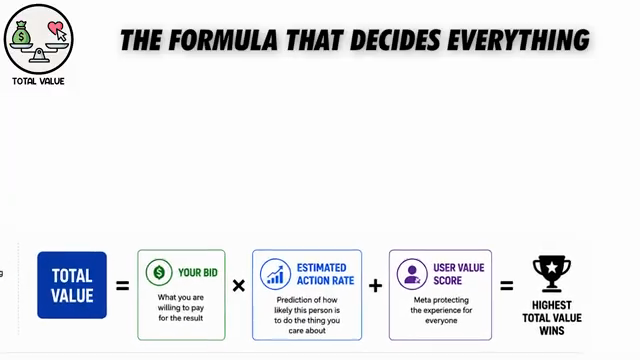

Đây là công thức toán học tối cao của Meta (từng được công bố trong tài liệu chính thức rồi sau đó được ẩn bớt để bảo vệ thuật toán):

$$\mathbf{\text{Total Value}} = \mathbf{\text{Your Bid}} \times \mathbf{\text{Estimated Action Rate (EAR)}} + \mathbf{\text{User Value Score}}$$

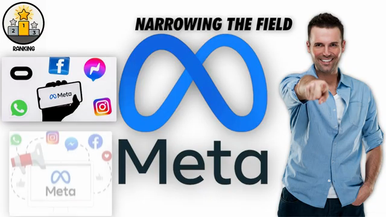

#### 1. Giải mã 3 thành tố:
* **$\text{Your Bid}$ (Giá thầu):** Số tiền nhà quảng cáo sẵn sàng chi trả cho một kết quả mong muốn.
* **$\text{Estimated Action Rate (EAR)}$ (Tỷ lệ hành động ước tính):** Xác suất dự đoán người dùng cụ thể này sẽ thực hiện hành động chuyển đổi mục tiêu:
  $$\text{EAR} = \text{Estimated CTR} \times \text{Estimated CVR}$$
  *(Dự đoán xác suất nhấp chuột $\times$ Dự đoán xác suất chuyển đổi sau khi nhấp).*
* **$\text{User Value Score}$ (Điểm giá trị người dùng):** Cơ chế tự vệ của Meta nhằm bảo vệ trải nghiệm của người dùng trên News Feed:
  * Chất lượng trang đích (tốc độ tải, độ tương thích di động, tính minh bạch).
  * Tỷ lệ thoát trang ngay lập tức (Bounce rate / Dwell time).
  * Lịch sử phản hồi của người dùng đối với quảng cáo (tỷ lệ ẩn bài, báo cáo spam, chặn trang).

#### 2. Chân lý cốt lõi: Kẻ nhiều tiền nhất KHÔNG tự động thắng!
* Một thương hiệu lớn sẵn sàng trả giá thầu cao ($\text{Bid} = \$50$) nhưng có quảng cáo nhàm chán ($\text{EAR} = 1\%$) $\rightarrow$ $\text{Total Value} \approx 0.5$.
* Một nhà quảng cáo nhỏ đặt giá thầu thấp hơn ($\text{Bid} = \$20$) nhưng sở hữu nội dung hấp dẫn, đánh trúng tâm lý ($\text{EAR} = 5\%$) $\rightarrow$ $\text{Total Value} \approx 1.0$.
* **Kết quả:** Nhà quảng cáo nhỏ chiến thắng lượt hiển thị với chi phí rẻ hơn đối thủ lớn gấp nhiều lần.

#### 3. Ngăn xếp chỉ số mềm (The Soft Metrics Stack):
Nửa đầu của phương trình được nuôi dưỡng bởi chuỗi các chỉ số mềm đo lường khả năng thu hút sự chú ý:
* **Hook Rate (3-second view / Impression):** Tỷ lệ giữ chân người xem trong 3 giây đầu.
* **Hold Rate:** Tỷ lệ người xem tiếp tục theo dõi video đến 15s hoặc 50% thời lượng.
* **CTR (Link Click-Through Rate):** Tín hiệu rõ ràng nhất cho thấy quảng cáo có liên quan.
* **CPC (Cost per Click):** Chi phí để kéo một lượt ghé thăm trang.
Nửa sau của phương trình phụ thuộc hoàn toàn vào **sức mạnh của trang đích (Offer, UX, Social Proof, Tốc độ tải)** để biến lượt nhấp thành đơn hàng.

---

### Trụ Cột 5: Phiên Đấu Giá (The Auction) — Lowest Cost vs. Caps

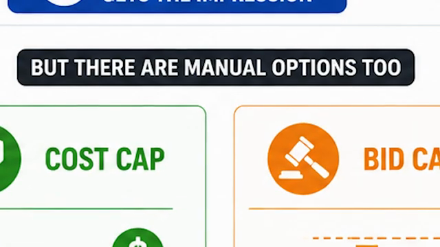

Khi tất cả các quảng cáo được chấm điểm qua phương trình Total Value, phiên đấu giá quyết định ai giành được lượt hiển thị:

* **Lowest Cost (Tự động / Auto Bidding):**
  * Meta tự động điều chỉnh giá thầu để mang lại nhiều kết quả nhất trong phạm vi ngân sách.
  * Phù hợp cho phần lớn các tài khoản từ ngân sách nhỏ đến quy mô lớn hàng chục ngàn đô/ngày.
* **Cost Cap / Bid Cap (Thủ công / Manual Bidding):**
  * **Cost Cap:** Đặt mức trần chi phí trung bình trên mỗi chuyển đổi (ví dụ: tối đa $20/lead).
  * **Bid Cap:** Đặt mức giá thầu trần tuyệt đối trong từng phiên đấu giá.
* **Sự thật về Bidding Tricks:**
  * Giới truyền thông thường thần thánh hóa các thủ thuật đặt bid thủ công.
  * Thực tế: Nhiều tài khoản chi tiêu $\$10,000 – \$100,000/\text{ngày}$ vẫn vận hành hoàn toàn mượt mà trên chế độ **Lowest Cost**.
  * **Bidding chỉ là công cụ điều tiết, không phải cây đũa thần.** Nó không thể giải cứu một sản phẩm tồi, một trang web chậm chạp hay một creative vô vị.

---

### Trụ Cột 6: Bản Chất Của Learning Phase & Phương Châm "When In Doubt, Zoom Out"

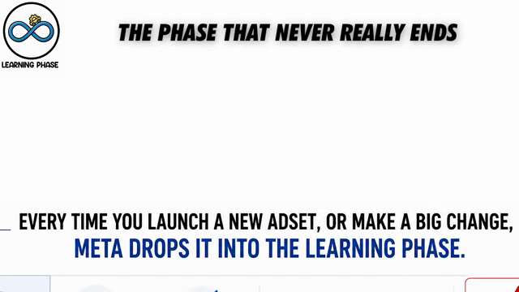

#### 1. Sự thật về ngưỡng 50 chuyển đổi:
* Khuyến cáo chính thức của Meta: Mỗi Ad Set cần đạt khoảng **50 chuyển đổi/tuần** để thoát khỏi giai đoạn máy học (`Learning Phase`) và chuyển sang trạng thái `Active`.
* **Góc nhìn thực chiến từ Media Buyer:** Quảng cáo **không bao giờ thực sự ngừng học**. Không có khoảnh khắc thần kỳ nào mà một nhóm quảng cáo "tốt nghiệp" rồi duy trì sự hoàn hảo mãi mãi. Mọi quảng cáo đều phân rã (decay) theo thời gian.
* Ám ảnh về việc phải đưa ad set thoát learning phase bằng mọi giá là một sự lãng phí năng lượng. Đôi khi, giải pháp thực sự chỉ đơn giản là tạo ra một creative mới tốt hơn.

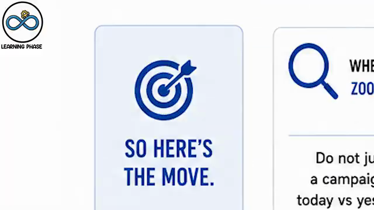

#### 2. Quy luật hình sin (The Sine Wave) & Cửa sổ 7–14 ngày:
* Ở mức ngân sách dưới $\$1,000/\text{ngày}$, kết quả quảng cáo dao động lên xuống như một đường hình sin: hôm nay lãi đậm, ngày mai hòa vốn hoặc lỗ nhẹ.
* Đây là bản chất tự nhiên của phiên đấu giá dựa trên hành vi cảm xúc của con người, không phải lỗi kỹ thuật.
* **Quy tắc vàng:** **"When in doubt, zoom out"**. Tuyệt đối không đánh giá hiệu quả chiến dịch dựa trên so sánh giữa hôm nay và hôm qua. Luôn đánh giá dựa trên dữ liệu tích lũy **7 ngày hoặc 14 ngày** để đưa ra quyết định chuẩn xác, loại bỏ tâm lý hoảng loạn bán tháo.

---

### Trụ Cột 7: Chất Lượng Tín Hiệu (Signal Quality), CAPI & Dư Chấn iOS 14.5 ATT

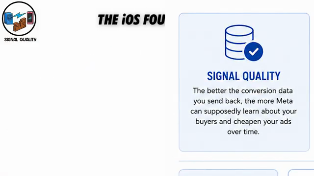

#### 1. Hậu quả của Apple ATT:
* Bản cập nhật Apple iOS 14.5 (tháng 4/2021) với chính sách App Tracking Transparency (ATT) cho phép người dùng từ chối theo dõi. Tại Mỹ, tỷ lệ từ chối vượt quá **80% – 90%**.
* Pixel chạy trên trình duyệt web (browser pixel) bị "mù dở", dữ liệu báo cáo trên Meta trở nên thiếu chính xác.

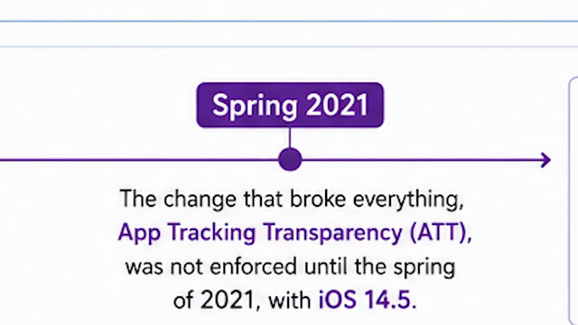

#### 2. Vai trò của Conversions API (CAPI):
* CAPI chuyển dữ liệu chuyển đổi từ máy chủ doanh nghiệp (Server-side) trực tiếp sang máy chủ của Meta, vượt qua các rào cản chặn cookie và chặn quảng cáo trên trình duyệt.
* **Event Match Quality (EMQ):** Thang điểm từ 1 đến 10 trong Events Manager đánh giá mức độ khớp nối giữa dữ liệu gửi đi (Email, số điện thoại, IP, User Agent) với hồ sơ người dùng Meta thật.
* **Thực tế tỉnh táo:** Điểm match quality 10/10 không tự động đảm bảo chiến dịch có lãi, và điểm 5/10 vẫn có thể tạo ra lợi nhuận khổng lồ. Gửi dữ liệu sạch là cần thiết, nhưng luôn phải đối chiếu hiệu quả bằng **MER tổng (Marketing Efficiency Ratio)** từ nguồn độc lập.

---

### Trụ Cột 8: Đa Dạng Hóa Sáng Tạo (Creative Diversity) Dưới Thời Andromeda

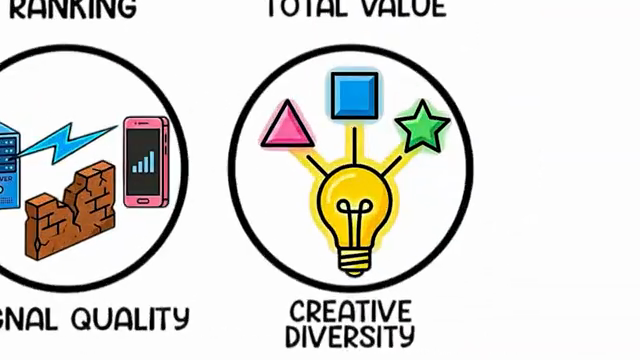

#### 1. Cơ chế gom cụm tương đồng (Creative Similarity Clustering):
* Dưới thời Andromeda, thuật toán được lập trình để phát hiện những quảng cáo có cấu trúc hình ảnh, âm thanh hoặc góc quay tương tự nhau.
* **Hậu quả:** Nếu bạn tải lên 50 biến thể chỉnh sửa nhỏ (ví dụ chỉ đổi màu chữ, đổi một câu phụ đề), Meta sẽ gom toàn bộ 50 biến thể này vào **1 cụm duy nhất (single cluster)** và chỉ cấp **1 vé duy nhất** vào phiên đấu giá!
* Tư duy "làm 50 bản chỉnh sửa nhỏ để hack thuật toán" đã hoàn toàn bị vô hiệu hóa.

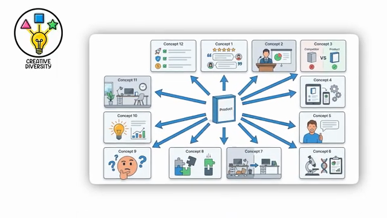

#### 2. Chiến lược chuẩn mực: 8 đến 15 Core Angles hoàn toàn khác biệt:
Thay vì tạo ra các biến thể tương tự, các đội ngũ hàng đầu xây dựng kho tài nguyên gồm **8 đến 15 góc tiếp cận (Angles) độc lập** cho mỗi sản phẩm/dịch vụ:
1. **Social Proof Angle:** Feedback khách hàng, ảnh chụp tin nhắn khen ngợi, review 5 sao.
2. **Founder / Behind-the-Scenes Story:** Câu chuyện sáng lập, quá trình thợ chụp chuẩn bị thiết bị, hậu trường buổi chụp.
3. **Us vs. Them (So sánh trực tiếp):** Tự chụp bằng điện thoại vs. Bộ ảnh chuyên nghiệp của nhiếp ảnh gia bản địa.
4. **Customer Testimonial / Story:** Trải nghiệm thực tế của một du khách hoặc cặp đôi cụ thể.
5. **Product / Service Demo:** Cận cảnh quy trình hướng dẫn tạo dáng, khoảnh khắc bắt trọn nụ cười tự nhiên.
6. **Problem - Solution Hook:** "Đi du lịch một mình làm sao có ảnh đẹp không cần gậy selfie?".
7. **Educational / Value-driven:** "3 góc chụp ảnh không góc chết tại Phố Cổ Hà Nội".
8. **Lifestyle & Aspiration:** Khung hình thơ mộng mùa thu Hà Nội, ánh sáng chiều tà cầu Long Biên.

#### 3. Vai trò thực sự của Variations:
* Đừng bỏ qua variations, mà hãy làm **Hook Variations** thực sự khác biệt.
* Cùng một câu chuyện, nhưng thử nghiệm 3 Hook mở đầu hoàn toàn khác nhau:
  * Hook 1: Đánh vào nỗi sợ ("Đừng đến Hà Nội nếu bạn chưa biết điều này...").
  * Hook 2: Đánh vào thẩm mỹ ("Tone màu phim Hồng Kông giữa lòng phố cổ...").
  * Hook 3: Đánh vào sự tiện lợi ("Có ngay 50 ảnh đẹp mang về chỉ sau 2 tiếng đi dạo").
* Mỗi Hook mở đầu khác nhau sẽ đưa quảng cáo đến **một nhóm đối tượng hoàn toàn mới ở tầng Retrieval**, giúp khai phóng tiềm năng của concept mà không bị đánh gậy trùng lặp.

---

## 3. Cẩm Nang Ứng Dụng Thực Chiến Cho TravelFrame

Từ các nguyên lý gốc rễ của thuật toán Andromeda, dưới đây là kế hoạch hành động cụ thể dành riêng cho TravelFrame (`travelframe.vn`):

### 1. Nâng cao User Value Score trên `travelframe.vn`
* Meta quét toàn bộ Landing Page ở bước Retrieval và chấm điểm User Value Score ở bước Heavy Ranking.
* **Hành động kỹ thuật:**
  * Tối ưu tốc độ tải trang di động của các trang dịch vụ (`/private-photographer-hanoi`, `/pricing`) đạt chuẩn Core Web Vitals (LCP < 2.5s).
  * Đặt bằng chứng xã hội (Social Proof), đánh giá TripAdvisor/Google Reviews và chính sách giá minh bạch rõ ràng ngay phía trên nếp gấp màn hình (above the fold) để giảm tỷ lệ thoát trang (bounce rate).
  * Tuyệt đối không dùng các kỹ thuật giật tít sai sự thật (clickbait) khiến khách bấm vào rồi thoát ra ngay trong 3 giây.

### 2. Xây dựng Thư Viện 8 Core Angles chuẩn Andromeda cho TravelFrame
Triển khai sản xuất 8 góc nội dung khác biệt phục vụ du khách:
* **Angle 1 (Before/After):** Ảnh tự sướng mờ nhòe bằng điện thoại vs Ảnh máy cơ chuyên nghiệp bắt trọn khoảnh khắc dạo phố.
* **Angle 2 (Solo Traveler Companion):** "Đi du lịch một mình đến Việt Nam? Nhiếp ảnh gia của chúng tôi vừa là thợ ảnh, vừa là bạn đồng hành bản địa dẫn bạn đi ăn quán ngon".
* **Angle 3 (Romantic Couples):** Bộ ảnh tình yêu phong cách Cinematic tại cầu Long Biên lúc hoàng hôn.
* **Angle 4 (Old Quarter Morning Stroll):** Trải nghiệm 2 tiếng ngắm Hà Nội thức giấc lúc 6:30 sáng không bóng người.
* **Angle 5 (Cultural Immersion):** Trải nghiệm mặc áo dài truyền thống dạo bước trong Văn Miếu - Quốc Tử Giám.
* **Angle 6 (Local Food & Snapshots):** Vừa đi tour ẩm thực đường phố vừa có ảnh đẹp tự nhiên không gượng gạo.
* **Angle 7 (Family Memories):** Bộ ảnh gia đình lưu giữ kỷ niệm chuyến đi Việt Nam trọn vẹn.
* **Angle 8 (Fast Turnaround Proof):** "Nhận toàn bộ ảnh gốc ngay trong ngày và ảnh chỉnh sửa màu trong 24h trước khi bay sang chặng tiếp theo".

### 3. Quy Trình Sản Xuất Hook Variations
* Mỗi Concept chụp ảnh thành công (Winner) được sản xuất thêm **3 biến thể Hook mở đầu** khác biệt về mặt thị giác và câu chữ:
  * Biến thể A: Câu hỏi tò mò (Text hook: "How to get non-awkward photos in Hanoi?").
  * Biến thể B: Tình huống đời thường (Visual hook: Photographer cúi người bắt góc thấp độc đáo giữa dòng xe máy).
  * Biến thể C: Cam kết dứt khoát (Statement hook: "Your best memories in Vietnam, captured professionally").

### 4. Vận Hành Theo Cửa Sổ Dữ Liệu 7–14 Ngày
* Huấn luyện đội ngũ Media Buyer của TravelFrame từ bỏ thói quen bật/tắt chiến dịch theo từng ngày.
* Khi chạy chiến dịch tìm kiếm khách du lịch Inbound, dữ liệu đặt lịch có độ trễ (khách xem quảng cáo, nhắn tin tư vấn, vài ngày sau mới chốt cọc). Đánh giá hiệu quả trên **cửa sổ tối thiểu 7 ngày**, đối chiếu song song giữa số liệu Meta Ads và doanh thu đặt cọc thực tế đổ về tài khoản.

### 5. Triển khai Server-side CAPI cho hệ thống Đặt Lịch (Booking Engine)
* Kết nối webhook từ hệ thống đặt lịch / form liên hệ của TravelFrame gửi sự kiện `Lead` và `Purchase` qua Conversions API trực tiếp đến Meta với đầy đủ thông tin băm (Hashed Email, Phone, Country, Client User Agent) để đẩy Event Match Quality lên $\ge 8.0/10$.
