# Phân Tích Chuyên Sâu: Toàn Bộ Cấu Trúc Chiến Dịch Meta Ads (Meta Ads Campaign Structures)

> **Tài liệu nghiên cứu và trích xuất tri thức từ video:** [⁠Every Meta Ads Campaign Structure Explained in 10 minutes](https://youtu.be/qmcAZdCaI9A)  
> **Tác giả:** Eric | Ecom Explained (@ecomexplainedyt)  
> **Thời lượng:** 10 phút 34 giây | Ngày phân tích: 15-09-2026  
> **Mục tiêu:** Hệ thống hóa toàn bộ các cấu trúc chiến dịch Meta Ads hiện đại, cơ chế phân bổ thuật toán Andromeda, nguyên tắc vận hành và lộ trình ứng dụng thực chiến cho TravelFrame.

---

## 1. Bản Đồ Tổng Quan 8 Cấu Trúc Chiến Dịch Meta Ads (Master Architecture)

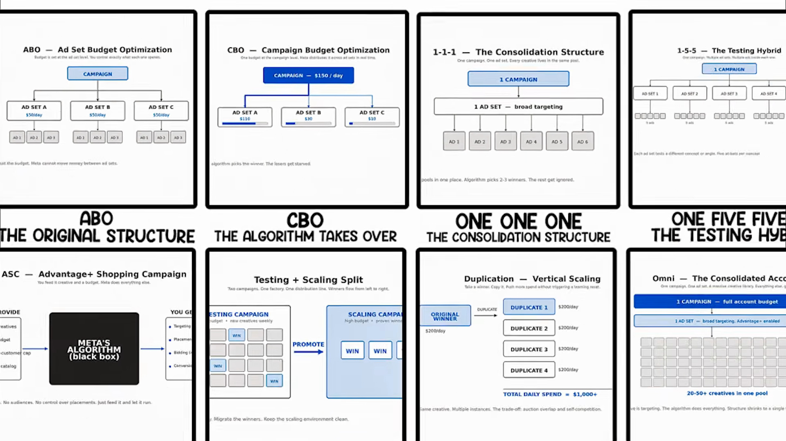

Hệ thống phân cấp 8 cấu trúc chiến dịch Meta Ads từ nền tảng đến hiện đại nhất (2025–2026):

| STT | Cấu trúc | Bản chất | Ngân sách kiểm soát ở đâu? | Ngưỡng phù hợp | Rủi ro lớn nhất |
|---|---|---|---|---|---|
| **1** | **ABO** (Ad Set Budget Optimization) | Thủ công, cô lập tuyệt đối | Từng nhóm quảng cáo (Ad Set) | Tài khoản mới, ngân sách nhỏ, Retargeting bắt buộc | Không tận dụng được machine learning, tốn công quản lý |
| **2** | **CBO** (Advantage Campaign Budget) | Phân bổ thuật toán động | Cấp chiến dịch (Campaign) | Mở rộng quy mô (Scaling), tài khoản có data ổn định | 80% ngân sách dồn vào 1-2 ad set; hủy hoại việc test công bằng |
| **3** | **1-1-1** (Consolidated Structure) | Hợp nhất tín hiệu hậu iOS 14 | Cấp chiến dịch/Ad Set (1 Ad Set gộp 20+ ads) | Giai đoạn thiếu dữ liệu chuyển đổi | Thuật toán chọn 2-3 ads yêu thích, bỏ đói phần còn lại; Ad fatigue |
| **4** | **1-5-5** (The Testing Hybrid) | Khung thử nghiệm chuẩn mực | CBO / ABO (5 Concepts × 5 Variations) | $1,000 – $20,000 / ngày | Phân mảnh nếu tạo quá 5 nhóm (vướng vĩnh viễn trong Learning phase) |
| **5** | **ASC** (Advantage+ Shopping Campaign) | Hộp đen tự động hóa 100% | Toàn chiến dịch (AI tự chọn target, vị trí, bid) | E-commerce có >50 đơn/tuần & Catalog | Nếu thiếu Customer Cap, AI đốt 40-50% ngân sách vào khách cũ |
| **6** | **Two-Campaign Split** (Testing + Scaling) | Phân tách Nhà máy vs Phân phối | Tách riêng: Campaign Test (ABO/CBO nhỏ) & Scale (CBO lớn) | Đội ngũ sản xuất creative liên tục (>20 ads/tháng) | "Thuế chuyển dịch" (Migration tax) khi copy ad từ Test sang Scale |
| **7** | **Duplication** (Vertical/Horizontal Scaling) | Nhân bản nhóm thắng | Giữ nguyên gốc, nhân bản với ngân sách mới | Cần vít ngân sách nhanh mà không reset learning | Trùng lặp phiên đấu giá (Auction Overlap), đẩy CPM tăng vọt |
| **8** | **Omni** (Andromeda End Game) | 1 Chiến dịch - 1 Ad Set - Broad 100% | Cấp toàn tài khoản (Full account budget) | Top tier: Tài khoản chi tiêu $100k+/ngày, creative khổng lồ | Cháy sạch ngân sách nếu tài khoản non trẻ hoặc ít hơn 20 creative/tháng |

---

## 2. Phân Tích Chi Tiết Từng Cấu Trúc Kèm Sơ Đồ Trực Quan

### Cấu Trúc 1: ABO (Ad Set Budget Optimization) — "The Original Structure"

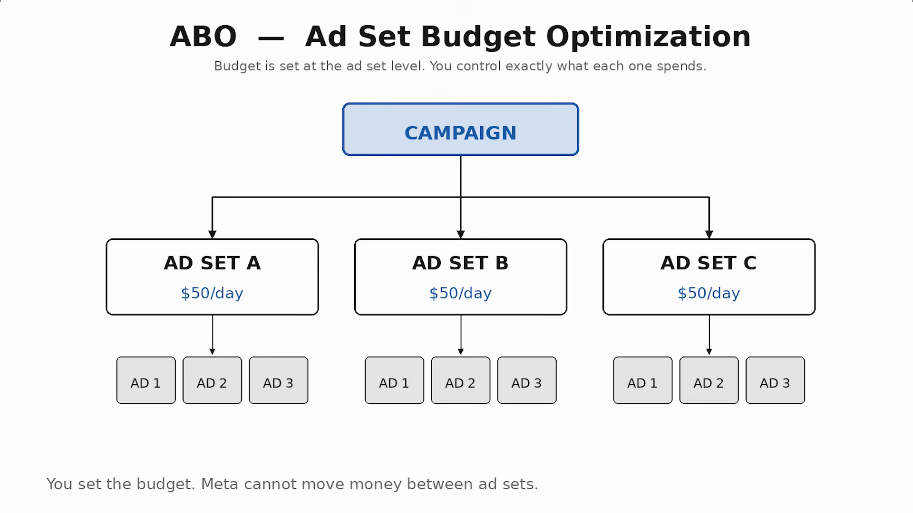

#### Cơ chế hoạt động:
* Ngân sách được cài đặt thủ công ở cấp từng Nhóm quảng cáo (**Ad Set**), ví dụ: Ad Set A = $50/ngày, Ad Set B = $50/ngày, Ad Set C = $50/ngày.
* Meta **bị khóa cứng**, không thể tự ý chuyển ngân sách giữa các ad set. Đặt bao nhiêu, tiêu bấy nhiêu.

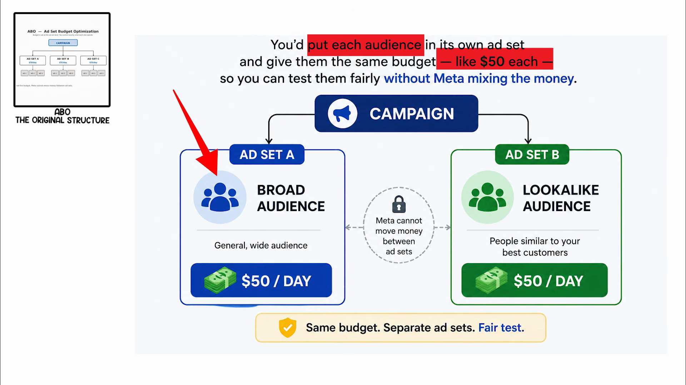

#### Vai trò sống còn trong năm 2026:
* **Sự cô lập (Audience Isolation):** Đây là cách duy nhất bảo đảm một tệp khách hàng bắt buộc phải nhận được ngân sách chi tiêu.
* **Tệp Retargeting nhỏ (Cart abandoners / Engaged users):** Nếu dùng CBO, thuật toán sẽ bỏ đói tệp này vì quy mô khán giả quá nhỏ. ABO bảo đảm tệp này nhận đúng ngân sách để chốt sale.
* **Kiểm tra công bằng (Fair Test):** So sánh thẳng thừng Broad Targeting vs Lookalike Audience với cùng mức ngân sách $50/ngày.

---

### Cấu Trúc 2: CBO (Campaign Budget Optimization) — "The Algorithm Takes Over"

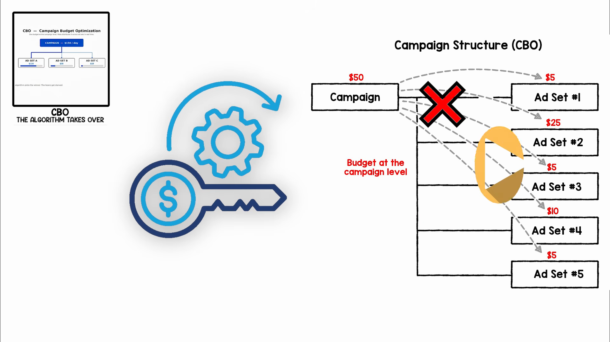

#### Cơ chế hoạt động:
* Meta đã đổi tên thành **Advantage Campaign Budget**. Ngân sách được đặt ở cấp Chiến dịch (ví dụ $150/ngày).
* Thuật toán AI phân tích dữ liệu thời gian thực và tự động rót tiền vào nhóm có tiềm năng sinh chuyển đổi rẻ nhất: Ad Set A nhận $110, Ad Set B nhận $30, Ad Set C nhận $10.

#### Quy luật 80/20 & Rủi ro kiểm thử:
* Nghiên cứu thực tế cho thấy **20% nhóm quảng cáo ngốn 80% ngân sách**. CBO được thiết kế để **chiến thắng (Scaling)** chứ không phải để **thử nghiệm công bằng (Testing)**.
* Nếu đưa 5 nhóm ads mới chưa kiểm chứng vào CBO, Meta có thể dồn 95% ngân sách vào nhóm đầu tiên và bỏ đói 4 nhóm còn lại $\rightarrow$ Không thu được bất kỳ dữ liệu có ích nào từ các nhóm bị bỏ rơi.

#### Nguyên tắc vàng:
1. **Quy tắc 7 ngày:** Mỗi lần can thiệp ngân sách, dừng hay sửa target trên CBO trực tiếp sẽ kích hoạt **Reset Learning Phase**. Thiết lập xong phải để chạy ổn định tối thiểu 7 ngày.
2. **Hàng rào an toàn (Ad Set Minimum Spend):** Cài đặt mức chi tiêu tối thiểu trên từng nhóm quan trọng để ép Meta phải phân bổ dữ liệu.

---

### Cấu Trúc 3: 1-1-1 (The Consolidation Structure) — "Hợp Nhất Tín Hiệu"

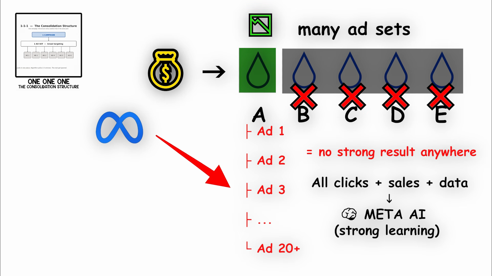

#### Nguồn gốc ra đời:
* Ra đời sau khi Apple ra mắt iOS 14 (App Tracking Transparency), làm suy giảm tín hiệu theo dõi của Meta.
* Nếu chia nhỏ ngân sách vào 10 nhóm quảng cáo, không nhóm nào đạt được ngưỡng **50 chuyển đổi/tuần** để thoát khỏi Learning Phase.
* Giải pháp: Gộp toàn bộ ngân sách vào **1 Chiến dịch $\rightarrow$ 1 Ad Set Broad $\rightarrow$ Xếp chồng 20+ Creatives**.

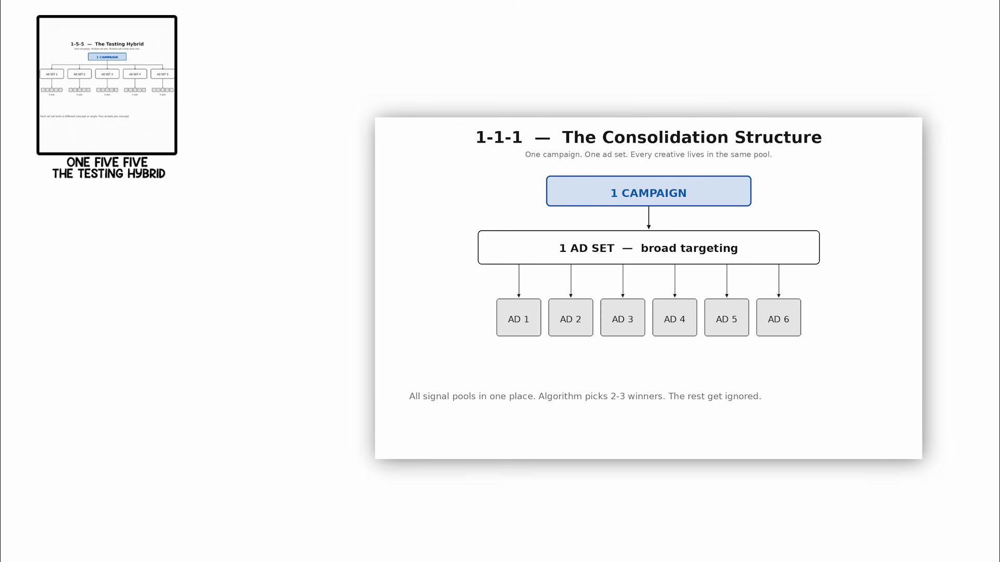

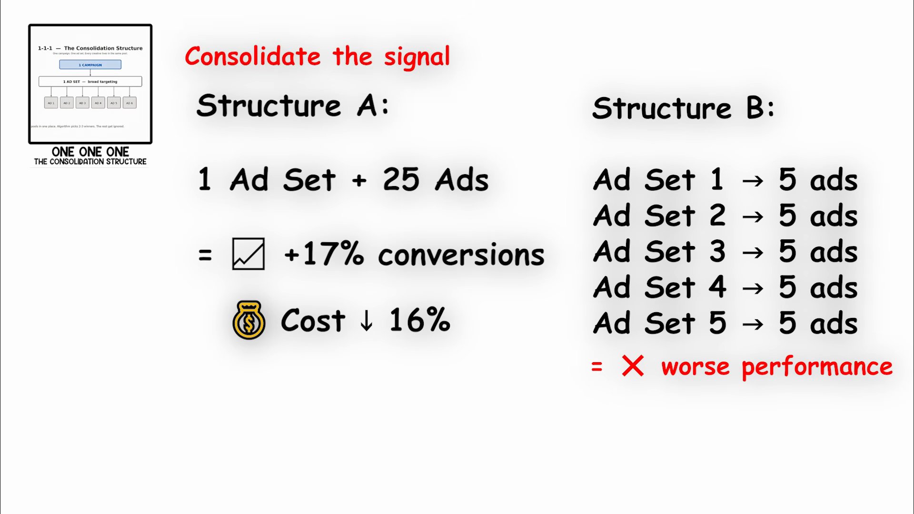

#### Dữ liệu đối chiếu của Meta:
* Mô hình 1 Ad Set chứa 25 Ads đem lại **nhiều hơn 17% chuyển đổi** với **chi phí CPA thấp hơn 16%** so với việc chia thành 5 Ad Sets chứa 5 Ads.

#### Giới hạn & Điểm nghẽn (Ceiling):
* Khi nhét quá 10–15 ads vào 1 nhóm, Meta sẽ chọn ra 2–3 "con cưng" (winners) và phân bổ hầu hết hiển thị. Các ads còn lại hầu như không được chạm tới.
* Ngay khi ad thắng bị cạn kiệt (ad fatigue), tài khoản không có "quân bài dự bị" nào đã được làm ấm dữ liệu $\rightarrow$ Toàn bộ tài khoản bị đình trệ đột ngột.

---

### Cấu Trúc 4: 1-5-5 (The Testing Hybrid) — "Chiến Mã Kiểm Thử Của Media Buyer"

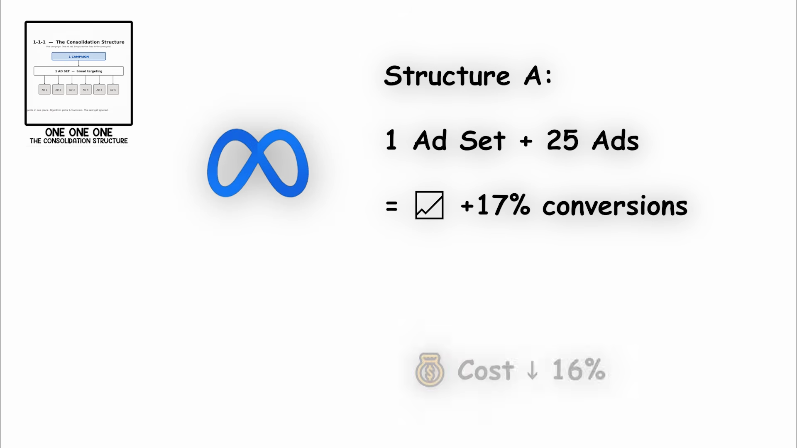

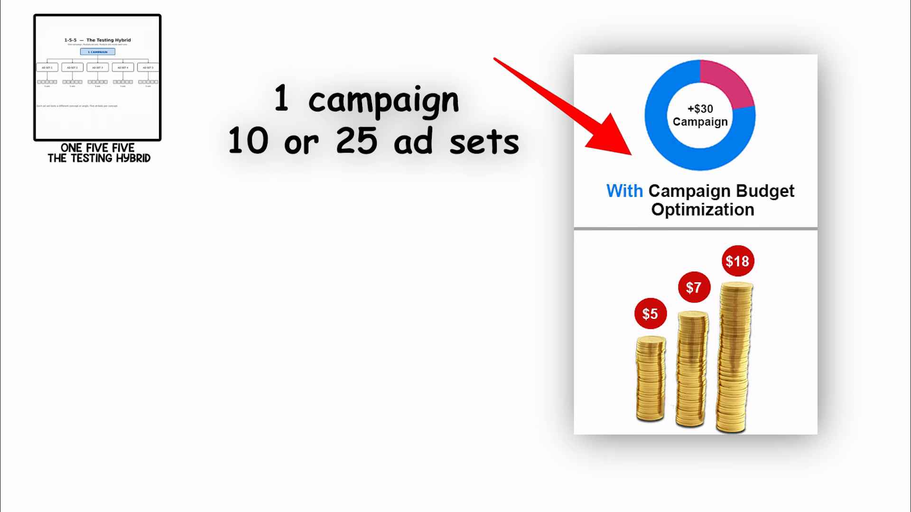

#### Công thức toán học:
* **1 Campaign $\rightarrow$ 5 Ad Sets $\rightarrow$ 5 Ads bên trong mỗi Ad Set**.
* Cấp Ad Set = **Thử nghiệm Ý tưởng cốt lõi (Core Concept)**.
* Cấp Ads bên trong = **Thử nghiệm Biến thể (Variation Test: 5 loại Hooks, tiêu đề mở đầu, góc máy, định dạng)**.

#### Tại sao 1-5-5 vượt trội:
* Người chạy có 5 cơ hội đánh trúng (at-bats) cho mỗi góc tiếp cận. Ngay cả khi Hook 1 thất bại, Hook 2 hoặc 3 vẫn có thể trở thành quán quân.
* **Ngưỡng chi tiêu tối ưu:** Dành cho tài khoản tiêu từ **$1,000 đến $20,000 / ngày**.
* **Cảnh báo lỗi phân mảnh:** Tuyệt đối không kéo dài thành 1-10-10 hay 1-25-5. Thuật toán Andromeda chỉ vận hành tối ưu ở trần thực tế từ **3 đến 5 nhóm quảng cáo**. Vượt quá mức này, dữ liệu bị phân mảnh và vướng vĩnh viễn trong giai đoạn học.

---

### Cấu Trúc 5: ASC (Advantage+ Shopping Campaign) — "The Black Box"

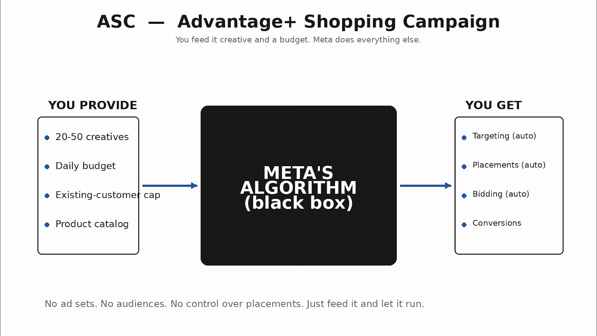

#### Bản chất:
* Nhà quảng cáo không tạo ad set, không chọn tệp khán giả, không chọn vị trí đặt.
* Bạn cung cấp: **20–50 Creatives, Ngân sách ngày, Hạn mức khách hàng cũ (Customer Cap), Catalog sản phẩm**.
* Meta Algorithm (Black box) tự xử lý: Target, Vị trí, Giá thầu, Tối ưu chuyển đổi. Theo Meta, ASC giúp giảm 17% CPA so với chiến dịch thủ công.

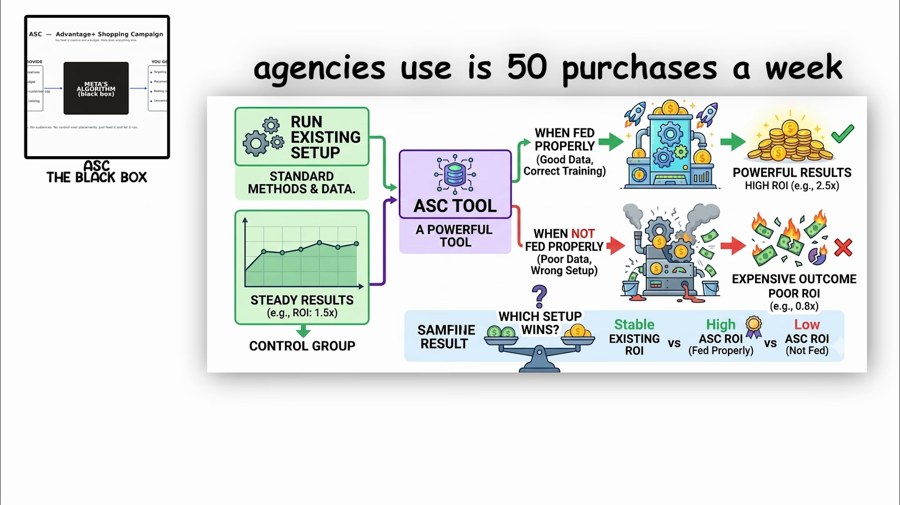

#### Đòn bẩy sống còn — Existing Customer Budget Cap:
* **Nguy cơ tiềm ẩn:** Nếu không đặt cap, Meta sẽ dồn 40–50% ngân sách để bám đuổi (retarget) người vừa mới mua hàng. ROAS trên báo cáo nhìn rất đẹp nhưng khách hàng mới (New Customer Acquisition) bằng 0.
* **Mức cài đặt khuyến nghị:** Khóa trần khách cũ ở mức **25% – 30%** (hoặc thấp hơn nếu muốn 100% khách hàng mới).
* **Ngưỡng bắt buộc:** Chỉ bật ASC khi tài khoản đạt tối thiểu **50 đơn hàng/tuần**. Dưới ngưỡng này, AI thiếu dữ liệu huấn luyện và sẽ đốt tiền với kết quả tệ hại (ROI < 0.8x).

---

### Cấu Trúc 6: Testing + Scaling Split — "Nhà Máy Sản Xuất & Tuyến Phân Phối"

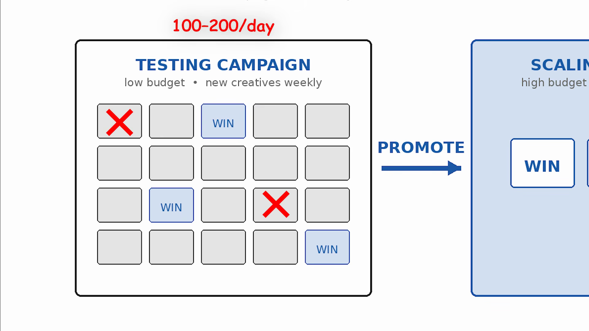

#### Mô hình 2 Chiến dịch độc lập:
1. **Testing Campaign (Nhà máy sản xuất):**
   * Ngân sách thấp ($100 – $200/ngày).
   * Liên tục đưa vào các creative mới mỗi tuần. Chấp nhận các mẫu thất bại để lọc ra 1 vài con thắng (WIN).
2. **Scaling Campaign (Tuyến phân phối giá trị cao):**
   * Ngân sách lớn, chạy CBO.
   * Chỉ tiếp nhận các mẫu đã được chứng minh thắng lợi từ bên Testing chuyển sang (PROMOTE).

#### Sức mạnh của Creative Volume:
* Dưới kỷ nguyên thuật toán Andromeda, khối lượng sáng tạo là đòn bẩy số 1: **Các thương hiệu thử nghiệm >20 ads mới mỗi tháng có ROAS cao hơn 65% so với thương hiệu thử nghiệm <10 ads**.
* Phân tách riêng giúp tài khoản tha hồ thử nghiệm mà không gây biến động làm Reset Learning Phase ở chiến dịch Scaling chính.

#### "Thuế Chuyển Dịch" (The Migration Tax):
* Khi nhân bản ad thắng từ Testing sang Scaling, ad thường bị chững hiệu suất 2-3 ngày đầu trước khi ổn định lại.
* Giải pháp: Sử dụng **Post ID Duplication** để giữ nguyên toàn bộ tương tác, like, bình luận (Social Proof) khi chuyển sang chiến dịch Scale.

---

### Cấu Trúc 7: Duplication (Vertical Scaling) — "Nhân Bản Để Vít Ngân Sách"

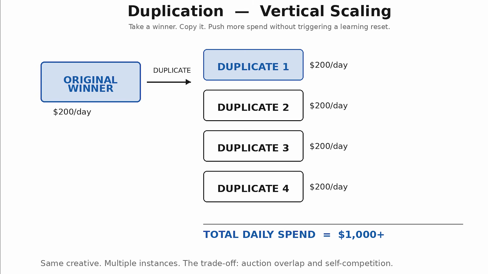

#### Kỹ thuật triển khai:
* Nhóm quảng cáo đang chạy $200/ngày và tạo hiệu suất cực tốt. Nếu tăng gấp đôi ngân sách trực tiếp, nhóm sẽ bị Reset Learning và tụt hiệu suất cả tuần.
* **Chiến thuật:** Nhân bản nhóm thắng thành **Duplicate 1, Duplicate 2, Duplicate 3, Duplicate 4** (mỗi nhóm $200/ngày). Tổng chi tiêu vọt lên **$1,000+/ngày** mà nhóm gốc không bị ảnh hưởng.
* Meta đối xử với mỗi bản sao như một thực thể mới trong phiên đấu giá, khai thác các phân khúc khách hàng tiềm năng khác nhau cùng thời điểm.

#### Mặt trái cần kiểm soát:
* **Trùng lặp đấu giá (Auction Overlap):** Tự mình cạnh tranh giá với chính mình.
* Khi nhân bản quá đà, tệp khán giả bị băm vụn $\rightarrow$ CPM tăng phi mã. Chỉ dùng duplication như một công cụ hỗ trợ ngắn hạn, không dùng làm chiến lược duy nhất.

---

### Cấu Trúc 8: Omni (The Consolidated Account) — "Andromeda End Game"

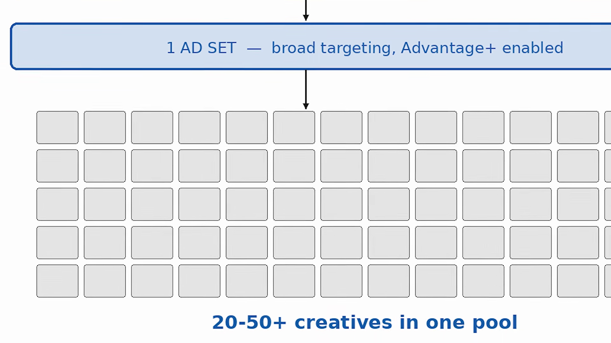

#### Định nghĩa:
* Đỉnh cao tối giản của các tập đoàn chi tiêu hàng trăm ngàn USD mỗi ngày: **1 Chiến dịch $\rightarrow$ 1 Ad Set Broad $\rightarrow$ 20 đến 50+ Creatives**. Không retargeting riêng, không prospecting riêng.
* **"Creative is the Targeting":** Thuật toán Andromeda đọc từng câu từ trong Hook, hình ảnh thị giác, giọng đọc voiceover để tự động nhận diện và phân phối quảng cáo tới đúng chân dung khách hàng phù hợp.

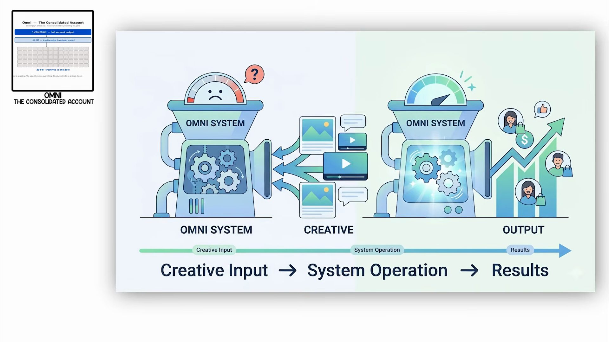

#### Nguyên Tắc Sống Còn Cuối Cùng:
> *"Don't pick a structure because it's trending. Pick the structure that solves the actual constraint in your account. If you can't produce enough creative to feed Omni, you have no business running Omni. **The structure follows the operation, not the other way around.**"*  
> *(Cấu trúc phải đi theo năng lực vận hành, không phải ngược lại).*

---

## 3. Lộ Trình Ứng Dụng Thực Chiến Cho TravelFrame Vietnam

Dựa trên hiện trạng được ghi nhận tại `Executive/Current-State.md` và `Brand-Strategy/Source-Of-Truth-Map.md`:
* **Workstream:** TravelFrame là consumer-facing workstream thuộc Hanoi Expert.
* **Phễu chuyển đổi chính:** Instagram DM / Messenger qualified leads (High-touch, Private Photography & Travel Concierge).
* **Năng lực hiện tại:** Ngân sách ban đầu tinh gọn, cần bảo toàn chi phí và lọc lead chất lượng cao thay vì vít volume bừa bãi.

### Khuyến nghị mô hình kiến trúc cho TravelFrame:

```text
[ Giai Đoạn Hiện Tại: Seed / Validation ]
├── Campaign 1 (Testing Factory - ABO / CBO nhỏ):
│   ├── Ad Set 1 (Concept: Street Style & Hidden Hanoi Photography)
│   │   ├── Ad 1 (Hook: "Lần đầu đến Hà Nội..." - P-001)
│   │   ├── Ad 2 (Hook: Mistake to avoid - P-009)
│   │   └── Ad 3 (Visual hook: Hoàng hôn cầu Long Biên)
│   ├── Ad Set 2 (Concept: Full Day Itinerary + Personal Photographer)
│   │   └── 3 biến thể Ads theo nhịp P-002
│   └── Ad Set 3 (Retargeting ấm - ABO cố định $5-$10/ngày):
│       └── Bám đuổi người đã nhắn tin / ghé profile Instagram
└── Campaign 2 (Scaling Engine - CBO khi có Winner):
    └── Tiếp nhận bài viết có CTR > 2.5%, CPA DM rẻ nhất qua Post ID.
```

### 4 Quy tắc áp dụng cho đội ngũ TravelFrame:
1. **Không chạy Omni khi chưa có kho Creative lớn:** Chỉ triển khai Omni khi phòng `Creative-Production` có thể bàn giao đều đặn 15–20 video reels/ảnh mỗi tháng.
2. **Khóa chặt Retargeting bằng ABO:** Với dịch vụ chụp ảnh và tour riêng, người quan tâm cần thời gian cân nhắc. Tuyệt đối không để CBO bỏ đói tệp Warm/Retargeting.
3. **Tuân thủ quy tắc Post ID:** Khi quảng cáo nào bắt đầu có nhiều bình luận khen ngợi, câu hỏi của khách du lịch, phải nhân bản bằng Post ID để bảo toàn toàn bộ Social Proof khi tăng ngân sách.
4. **Định hướng Creative-as-Targeting:** Nội dung video và hình ảnh chính là bộ lọc đối tượng (chất lượng ảnh cao cấp sẽ lọc được khách chi trả cao; tránh làm nội dung giật gân rẻ tiền thu hút sai tệp khách).

---
*Hồ sơ lưu trữ tri thức gốc: `Research-Insights/Library/videos/youtube/2026-09-15-meta-ads-structures/`*  
*Transcript đầy đủ: `Research-Insights/Library/transcripts/meta-ads-campaign-structures/transcript.txt`*
