# Phân Tích Chuyên Sâu: Toàn Bộ Phương Pháp Scale Chiến Dịch Meta Ads Đỉnh Cao (Every Way To Scale a Winning Meta Ad)

> **Tài liệu nghiên cứu và trích xuất tri thức từ video:** [Every Way To Scale a Winning Meta Ad Explained in 11 minutes](https://www.youtube.com/watch?v=ipMqfw8_4qI)  
> **Tác giả:** Eric | Ecom Explained (@ecomexplainedyt)  
> **Thời lượng:** 11 phút 19 giây | Ngày phân tích: 15-09-2026  
> **Mục tiêu:** Hệ thống hóa 8 đòn bẩy mở rộng quy mô (scaling levers) Meta Ads hiện đại, cơ chế toán học kiểm soát rủi ro, bộ tín hiệu nhận biết bão hòa và lộ trình ứng dụng thực chiến cho TravelFrame.

---

## 1. Bản Đồ Tổng Quan 8 Phương Pháp Scale Meta Ads (Master Scaling Architecture)

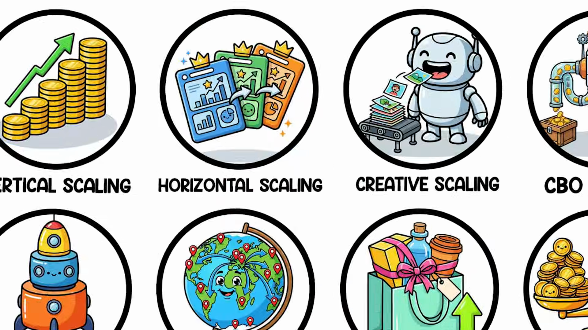

Mở rộng quy mô quảng cáo Meta Ads không đơn thuần là "bơm thêm tiền vào chiến dịch đang thắng". Trong môi trường thuật toán hiện đại (Andromeda, Advantage+, Auction Dynamics hậu iOS 14+), việc scale đòi hỏi sự phối hợp nhịp nhàng giữa 8 đòn bẩy kỹ thuật và kinh tế:

| STT | Đòn Bẩy Scale | Bản Chất Cốt Lõi | Điều Kiện Kích Hoạt | Tín Hiệu Thất Bại / Chạm Trần | Giải Pháp Khắc Phục |
|:---:|---|---|---|---|---|
| **1** | **Vertical Scaling** | Tăng ngân sách trực tiếp trên ad set thắng theo nấc thang 15–20% mỗi 48–72h | Ad set có ROAS ổn định $\ge 7$ ngày liên tục | CPA tăng 5%+ mỗi ngày trong 3 ngày liên tiếp | Tạm dừng nấc thang; kiểm tra `Account Spending Limit` |
| **2** | **Horizontal Scaling** | Nhân bản (duplication) ad set thắng, chỉ thay đổi DUY NHẤT 1 biến số | Ad set gốc chạm trần ngân sách hoặc muốn mở rộng tệp | Trùng lặp đấu giá (Auction Overlap), CPM tăng vọt | Gộp 3–5 bản copy vào 1 chiến dịch CBO điều phối động |
| **3** | **Creative Scaling** | Cung cấp nhiên liệu liên tục cho thuật toán (26 chu kỳ làm mới/năm) | Vòng đời creative co ngắn lại còn 2–3 tuần | CTR giảm >20%, Frequency >3.0, Creative Fatigue flag | Bổ sung 3–10 creative mới/tuần; ưu tiên Static Images (60–70% conversion) |
| **4** | **CBO Scaling** | Thuật toán tự động định tuyến ngân sách theo thời gian thực (Cấu trúc 70/30) | Có tối thiểu 3 nhóm thắng, mỗi nhóm đạt $\ge 50$ conversion/tuần | Tăng 20% ngân sách khiến CPA tăng vọt >30% (Ceiling Signal) | Làm mới creative pool; thiết lập Ad Set Minimum Spend |
| **5** | **ASC Engine** | Cấu trúc 3 tầng với Advantage+ Shopping Campaign làm động cơ chính (60–70%) | Tài khoản có data chuyển đổi ổn định, cần vít từ $1k lên $10k/ngày | ASC đốt tiền vào khách cũ, thổi phồng ROAS ảo | Khóa chặt trần khách cũ `Existing Customer Budget Cap` ở 25–30% |
| **6** | **Geographic Scaling** | Mở rộng thị trường theo chuỗi ngôn ngữ và tâm lý tiêu dùng | Thị trường nội địa bão hòa (+20% budget $\rightarrow$ +30% CPA) | CPM thị trường mới quá đắt hoặc rào cản ngôn ngữ | Mở rộng Tier 1 English (UK, CA, AU) trước khi vào Non-English (cần bản địa hóa) |
| **7** | **Offer Scaling** | Tái cấu trúc giá trị đơn hàng (AOV) để hấp thụ CPA tăng khi ngân sách lớn | Quảng cáo vận hành tốt nhưng biên lợi nhuận bị ăn mòn (Margin squeeze) | Khách mua 1 sản phẩm giá thấp không bù nổi chi phí quảng cáo cận biên | Triển khai Bundle (+40–60% AOV), Nâng mốc Freeship, Post-purchase Upsell |
| **8** | **The MER Framework** | Đo lường hiệu quả tổng thể (North Star) để tránh bẫy báo cáo in-platform ROAS | Ngân sách bắt đầu scale trên nhiều kênh hoặc scale lớn | In-platform ROAS báo 3.0x nhưng tài khoản ngân hàng hao hụt | Đo MER = Tổng doanh thu / Tổng ad spend; giữ sàn blended ROAS $\ge 3.0x$ |

---

## 2. Phân Tích Chuyên Sâu Từng Phương Pháp & Cơ Chế Toán Học

### Phương Pháp 1: Vertical Scaling — Quy Tắc 20% & Cầu Thang Ngân Sách (The Budget Ladder)

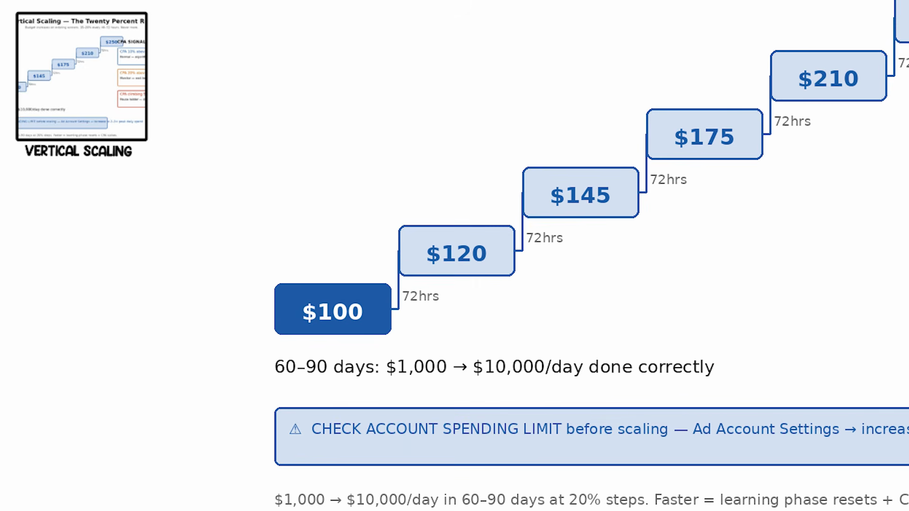

#### 1. Cơ chế vận hành & Phép toán leo thang:
* **Quy tắc bất di bất dịch:** Tăng ngân sách **15% đến 20% mỗi 48 đến 72 giờ**. Tuyệt đối không tăng nóng vượt mốc 20%.
* **Lý do thuật toán:** Bất kỳ mức tăng ngân sách nào vượt quá 20% sẽ làm xáo trộn nghiêm trọng hệ số đấu thầu trong cụm dữ liệu hiện tại, buộc nhóm quảng cáo **reset trở lại giai đoạn máy học (Learning Phase)**, khiến CPA tăng vọt và mất ổn định từ 3 đến 5 ngày.
* **Cầu thang ngân sách chuẩn mực:**
  $$\$100 \xrightarrow{72h} \$120 \xrightarrow{72h} \$145 \xrightarrow{72h} \$175 \xrightarrow{72h} \$210 \xrightarrow{72h} \$250$$
* **Khung thời gian thực tế:** Để scale một tài khoản từ $\$1,000/\text{ngày}$ lên $\$10,000/\text{ngày}$ một cách an toàn và bền vững, quy trình đòi hỏi **60 đến 90 ngày**. Bất kỳ nỗ lực đốt cháy giai đoạn nào cũng dẫn đến sụp đổ hiệu quả.

#### 2. Bộ tín hiệu CPA (CPA Signal Rules):
* **CPA tăng $\le 10\%$ so với mức cơ sở:** Bình thường. Thuật toán đang mở rộng sang tầng đối tượng tiếp theo trong tệp. Tiếp tục duy trì nấc thang.
* **CPA tăng khoảng $20\%$:** Chuyển sang chế độ giám sát. Chờ thêm 24–48 giờ để thuật toán tự tối ưu hóa trước khi quyết định tăng nấc tiếp theo.
* **CPA leo dốc $5\%+$ liên tục mỗi ngày trong 3 ngày:** **Tạm dừng cầu thang (Pause ladder)** ngay lập tức. Đây là tín hiệu tệp đối tượng đã bắt đầu cạn kiệt hoặc creative bị mệt mỏi (fatigue).

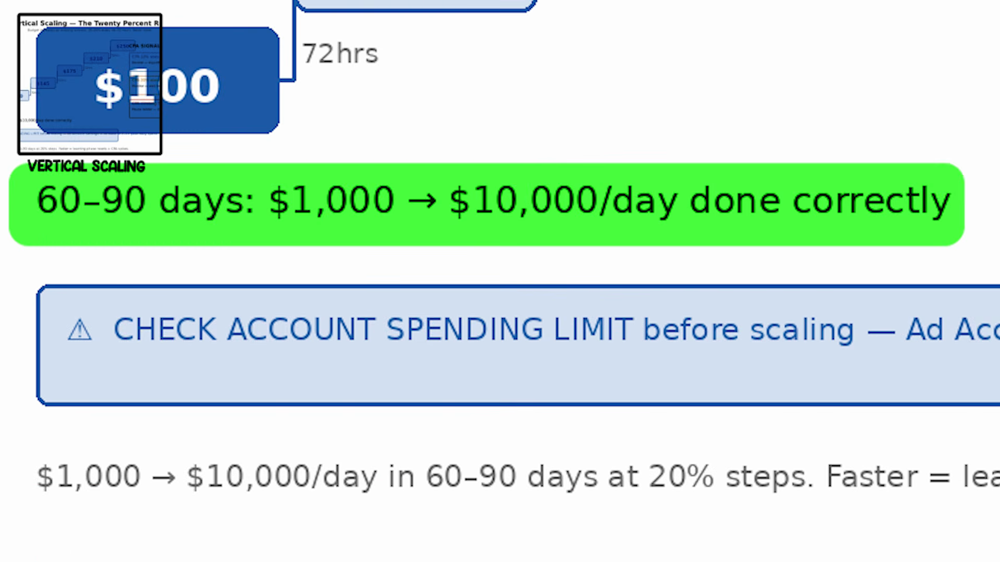

#### 3. Cạm bẫy ẩn: Giới hạn chi tiêu tài khoản (Account Spending Limit):
* Rất nhiều media buyer gặp tình trạng chiến dịch đang scale mượt bỗng nhiên ngừng tiêu tiền hoặc hiệu quả giảm sút nghiêm trọng mà không rõ nguyên nhân.
* **Nguyên nhân:** Chạm trần `Account Spending Limit` được thiết lập mặc định trong `Ad Account Settings`.
* **Hành động bắt buộc:** Trước khi bắt đầu chu kỳ scale, truy cập `Ad Account Settings` và nâng hạn mức chi tiêu tài khoản lên tối thiểu **2.5x đến 3x mức chi tiêu đỉnh dự kiến hàng ngày**.

---

### Phương Pháp 2: Horizontal Scaling — Mở Rộng Quy Mô Bằng Nhân Bản (Duplication)

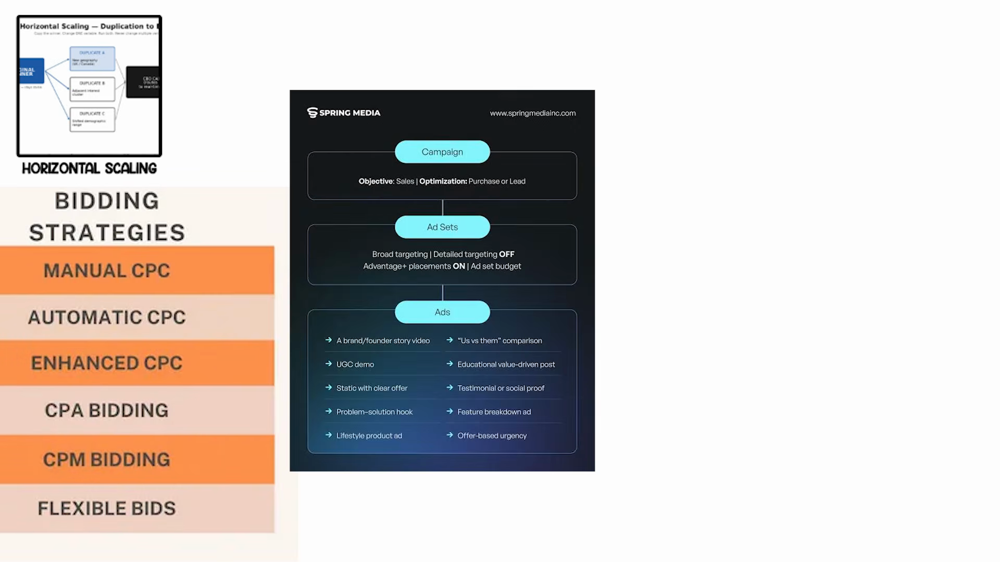

#### 1. Bản chất:
* Thay vì cố nhồi thêm ngân sách vào một ad set đơn lẻ (khiến tệp bị vắt kiệt và CPA tăng vọt), Horizontal Scaling mở rộng độ phủ (reach) bằng cách tạo ra các bản sao (duplicates) của ad set chiến thắng để tiếp cận các ngách khán giả mới.

#### 2. Quy tắc đơn biến (The Single-Variable Rule):
* **Nguyên tắc sống còn:** Khi nhân bản một ad set đang thắng (Original Winner có ROAS ổn định $\ge 7$ ngày), chỉ được phép thay đổi **DUY NHẤT 1 BIẾN SỐ**:
  * **Duplicate A:** Đổi biến Địa lý (ví dụ: mở rộng sang UK / Canada / Úc).
  * **Duplicate B:** Đổi biến Sở thích liền kề (Adjacent interest cluster).
  * **Duplicate C:** Đổi biến Nhân khẩu học (Shifted demographic age range).
* Nếu thay đổi từ 2 biến số trở lên cùng lúc, bạn sẽ hoàn toàn mất khả năng truy nguyên nguyên nhân thành công hay thất bại của nhóm quảng cáo mới.

#### 3. Cơ chế định tuyến CBO để triệt tiêu Auction Overlap:
* Rủi ro lớn nhất của Duplication là **Trùng lặp đấu giá (Auction Overlap)**: các nhóm quảng cáo trong cùng một tài khoản tự cạnh tranh và đẩy giá thầu của nhau lên.
* **Giải pháp chuẩn mực:** Gom nhóm gốc và 3–5 nhóm nhân bản dưới **1 Chiến dịch CBO (Campaign Budget Optimization)** duy nhất. Thuật toán Meta sẽ tự động điều chuyển dòng tiền đến ad set có chi phí chuyển đổi rẻ nhất trong từng thời điểm thực, triệt tiêu hiện tượng tự đấu giá nội bộ.

---

### Phương Pháp 3: Creative Scaling — Tiếp Nhiên Liệu Cho Thuật Toán (Feeding the Algorithm)

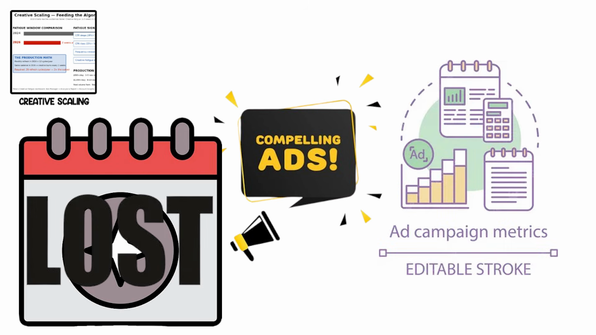

#### 1. Sự thu hẹp của chu kỳ Creative Fatigue dưới thuật toán Andromeda:
* Dưới tác động của hệ thống phân phối nội dung AI hiện đại, quảng cáo tiếp cận tệp đối tượng mục tiêu nhanh hơn gấp nhiều lần.
* **Cửa sổ kiệt sức (Fatigue Window):**
  * **Năm 2024:** Một creative thắng có thể duy trì hiệu quả trong **4+ tuần**.
  * **Năm 2025–2026:** Chu kỳ sống của creative bị co ngắn chỉ còn **2 đến 3 tuần**.
* **Bài toán năng suất sản xuất (The Production Math):**
  * Nếu giữ nguyên tần suất làm mới hàng tháng (12 chu kỳ/năm) như năm 2024, tài khoản sẽ liên tục rơi vào cảnh "chết đói creative" sau mỗi 2 tuần.
  * Trong năm 2026, yêu cầu tối thiểu là **26 chu kỳ làm mới/năm** — tức tăng gấp đôi sản lượng sáng tạo.

#### 2. Tín hiệu nhận diện Ad Fatigue:
* **CTR (Link Click-Through Rate)** sụt giảm $\ge 20\%$ so với mức đỉnh trung bình 7 ngày.
* **CPA (Cost per Acquisition)** tăng $\ge 15\%$ so với đường cơ sở.
* **Tần suất (Frequency)** vượt mốc **3.0**.
* Xuất hiện cảnh báo chính thức trên **Meta's Creative Fatigue Dashboard** (`Ads Manager -> Analyze & Report -> Account Insights`).

#### 3. Định mức sản xuất theo quy mô ngân sách:
* Ngân sách $\$500/\text{ngày}$: Bắt buộc bổ sung **3 đến 5 creative mới mỗi tuần**.
* Ngân sách $\$1,000+/\text{ngày}$: Bắt buộc bổ sung **8 đến 10 creative mới mỗi tuần**.
* **Sự thật về chuyển đổi:** Mặc dù video và Reels thu hút nhiều lượt hiển thị, nhưng **Static Images (Ảnh tĩnh chất lượng cao, rõ value proposition) vẫn chiếm từ 60% đến 70% tổng lượng chuyển đổi thực tế** trên toàn hệ thống Meta.

---

### Phương Pháp 4: CBO Scaling — Định Tuyến Ngân Sách Thuật Toán Tự Động

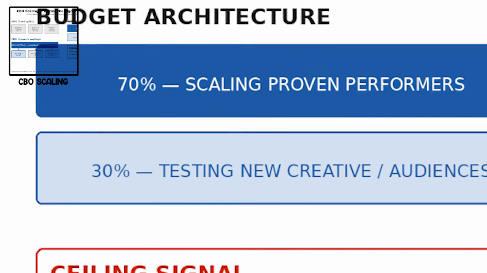

#### 1. Điều kiện chuyển giao từ ABO sang CBO:
* Đừng chuyển sang CBO quá sớm khi tài khoản còn nghèo nàn dữ liệu.
* **Điều kiện tiên quyết:** Cần tối thiểu **3 nhóm quảng cáo chiến thắng đã được kiểm chứng**, mỗi nhóm đạt tối thiểu **50 lượt chuyển đổi mỗi tuần** liên tục. Dưới ngưỡng này, CBO sẽ phân bổ sai lệch do thiếu dữ liệu thống kê.

#### 2. Kiến trúc phân bổ ngân sách 70/30:
* **70% Ngân sách:** Dành cho nhóm các ad set chiến thắng đã được chứng minh (Scaling Proven Performers).
* **30% Ngân sách:** Dành cho nhóm thử nghiệm creative mới hoặc tệp đối tượng mới (Testing Pool).
* **Công cụ bảo vệ:** Thiết lập **Ad Set Minimum Spend** cho nhóm thử nghiệm để ngăn chặn việc thuật toán dồn 100% ngân sách vào nhóm thắng cũ mà bỏ đói hoàn toàn nhóm test.

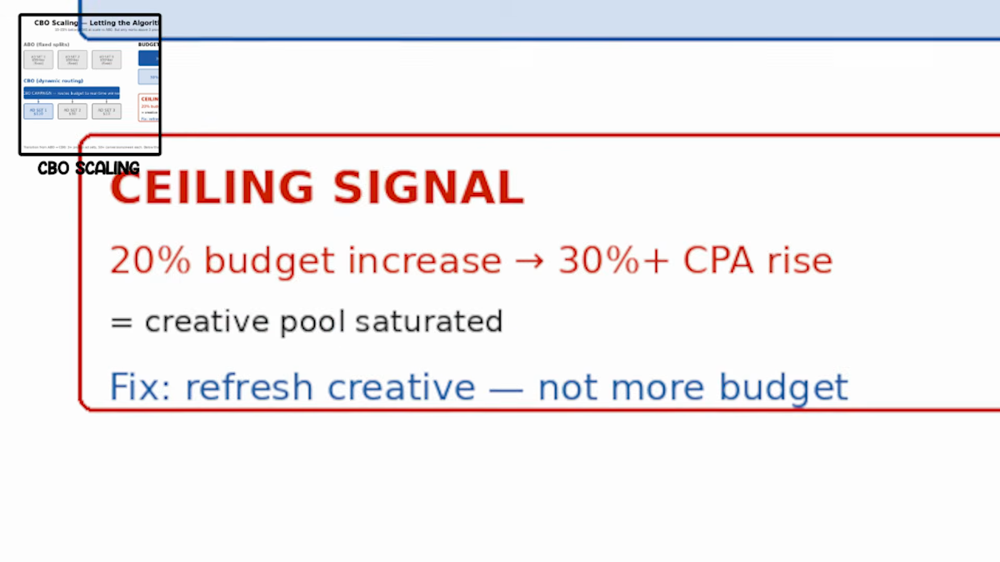

#### 3. Tín hiệu chạm trần (The Ceiling Signal):
* Khi tăng 20% ngân sách CBO mà **CPA tăng vọt trên 30%**, điều đó có nghĩa là **Kho tài nguyên sáng tạo (Creative Pool) đã hoàn toàn bão hòa**.
* **Hành động chuẩn xác:** **Làm mới Creative ngay lập tức — Tuyệt đối không tiếp tục bơm thêm tiền**. Bơm tiền vào một creative đã bão hòa chỉ làm tăng CPA chứ không mang lại thêm đơn hàng.

---

### Phương Pháp 5: Advantage+ Shopping Campaigns (ASC) — Cỗ Máy Scale Đa Tầng

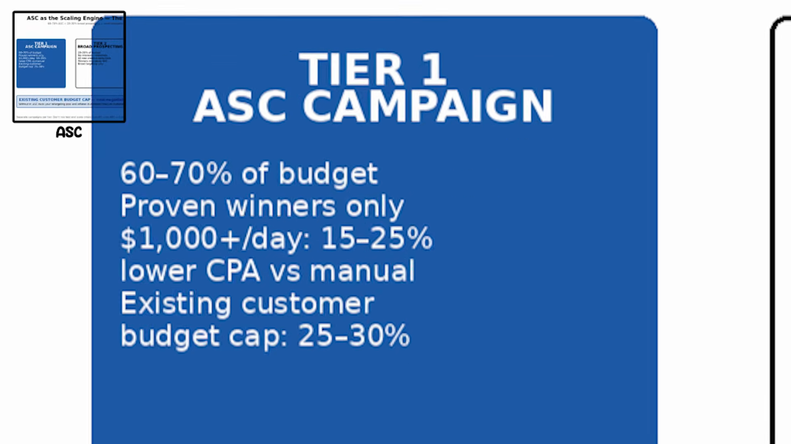

#### 1. Cấu trúc 3 tầng chuẩn mực từ $1k lên $10k/ngày:
Đưa toàn bộ ngân sách vào một chiến dịch ASC duy nhất là một sai lầm chết người. Cấu trúc scaling bền vững trong năm 2026 phân tách thành 3 tầng chiến lược:

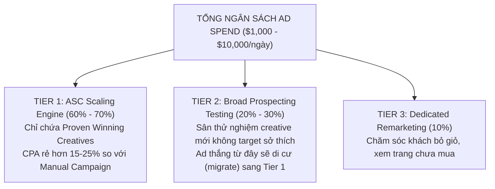

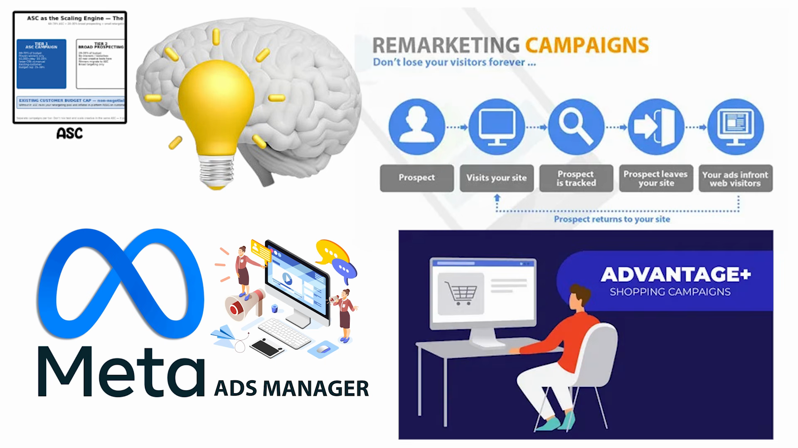

#### 2. Quy định bắt buộc: Khóa trần ngân sách khách hàng cũ (Existing Customer Budget Cap):
* ASC có xu hướng tự nhiên là săn lùng những người dễ chuyển đổi nhất — đó chính là khách hàng đã từng mua hàng hoặc tệp retargeting ấm.
* Nếu không kiểm soát, ASC sẽ âm thầm đốt từ **40% đến 50% ngân sách vào việc retargeting khách cũ**, làm đẹp chỉ số ROAS trên báo cáo nhưng hoàn toàn không mang lại sự tăng trưởng khách hàng mới.
* **Cài đặt bắt buộc:** Cài đặt **Existing Customer Budget Cap ở mức 25% đến 30%**. Con số này ép thuật toán AI của Meta phải dùng 70–75% ngân sách còn lại để tìm kiếm khách hàng hoàn toàn mới (Net-new customers).

---

### Phương Pháp 6: Geographic Scaling — Mở Rộng Địa Lý Theo Trình Tự Rủi Ro

#### 1. Dấu hiệu thị trường nội địa (Domestic Market) đã kịch trần:
* Tăng 20% ngân sách khiến CPA tăng vọt $\ge 30\%$.
* Tần suất hiển thị (Frequency) vượt quá 3.0 trên các creative hàng đầu.
* Các creative mới được tung vào bị suy giảm hiệu quả (fatigue) chỉ sau 1 tuần.

#### 2. Lộ trình mở rộng 3 giai đoạn (Expansion Sequence):
1. **Giai đoạn 1 — Domestic Market:** Khai thác tối đa thị trường quê nhà cho đến khi xuất hiện tín hiệu kịch trần.
2. **Giai đoạn 2 — Tier 1 English Markets (US $\rightarrow$ UK, Canada, Australia):**
   * Cùng ngôn ngữ tiếng Anh, rào cản chuyển đổi thấp.
   * Tâm lý người tiêu dùng và hành vi mua sắm tương đồng.
   * **Lợi thế chi phí:** CPM ở UK, Canada, Úc thường **thấp hơn từ 20% đến 35% so với thị trường Mỹ**, giúp hạ giá thành đơn hàng đáng kể.
3. **Giai đoạn 3 — Thị trường Châu Âu & Quốc tế (Europe / Non-English):**
   * Bắt buộc phải bản địa hóa toàn diện: Creative bằng ngôn ngữ bản địa, Landing page bản địa, cổng thanh toán địa phương và chính sách tiền tệ tương ứng.

#### 3. Quy tắc cấu trúc chiến dịch địa lý:
* **Tách riêng từng chiến dịch theo từng khu vực địa lý** (`Separate campaigns per region`).
* **Tuyệt đối không gộp chung nhiều quốc gia vào 1 chiến dịch CBO toàn cầu**: Meta sẽ tự động dồn toàn bộ ngân sách vào quốc gia có CPM rẻ nhất, nhưng đó thường lại là quốc gia có sức mua thấp nhất hoặc tỷ lệ hủy đơn cao nhất.

---

### Phương Pháp 7: Offer Scaling — Đòn Bẩy Tài Chính Khi Quảng Cáo Không Phải Là Điểm Nghẽn

#### 1. Nghịch lý quy mô (The Margin Squeeze Paradox):
* Khi mở rộng ngân sách quảng cáo, chi phí thu nạp khách hàng (CPA) **tất yếu sẽ tăng lên** theo định luật hiệu suất giảm dần.
* Nếu sản phẩm có giá bán cố định thấp (ví dụ: $30/sản phẩm với CPA ban đầu $15 $\rightarrow$ lãi $15$), khi scale lên ngân sách lớn, CPA tăng lên $25–$30 $\rightarrow$ biên lợi nhuận bị xóa sạch, doanh nghiệp càng bán nhiều càng lỗ.
* **Kết luận:** Quảng cáo không hỏng, mà chính cấu trúc giá trị đơn hàng (Offer Math) không đủ sức chịu tải chi phí quảng cáo ở quy mô lớn.

#### 2. Ba đòn bẩy Offer giúp tăng giá trị đơn hàng (AOV) để mở rộng quy mô:

| Đòn Bẩy | Cơ Chế Triển Khai | Tác Động Định Lượng Đến AOV | Hệ Quả Tài Chính Đối Với Ads |
|---|---|:---:|---|
| **Bundles** (Gói Combo 2–3 sản phẩm) | Đóng gói 2 đến 3 sản phẩm bổ trợ với mức chiết khấu nhẹ | **Tăng 40% – 60% AOV** | Giữ nguyên CPA quảng cáo nhưng doanh thu trên mỗi đơn tăng gấp rưỡi $\rightarrow$ Hấp thụ thoải mái mức CPA tăng khi scale |
| **Free Shipping / Bonus Threshold** | Nâng ngưỡng ưu đãi miễn phí từ mức thông thường lên cao hơn | **Tăng 15% – 20% AOV** | Thúc đẩy khách hàng chủ động nhặt thêm dịch vụ/sản phẩm phụ để chạm ngưỡng freeship |
| **Post-purchase Upsell** | Chào mời dịch vụ/sản phẩm nâng cấp ngay sau khi khách vừa nhập thẻ thanh toán | **Tăng 5% – 15% tổng giá trị đơn** | Chuyển đổi cực cao vì khách đã nhập thông tin thanh toán; **không tốn thêm 1 xu chi phí quảng cáo** |

---

### Phương Pháp 8: The MER Framework — Thước Đo Thực Tế & Bộ Chẩn Đoán Bão Hòa

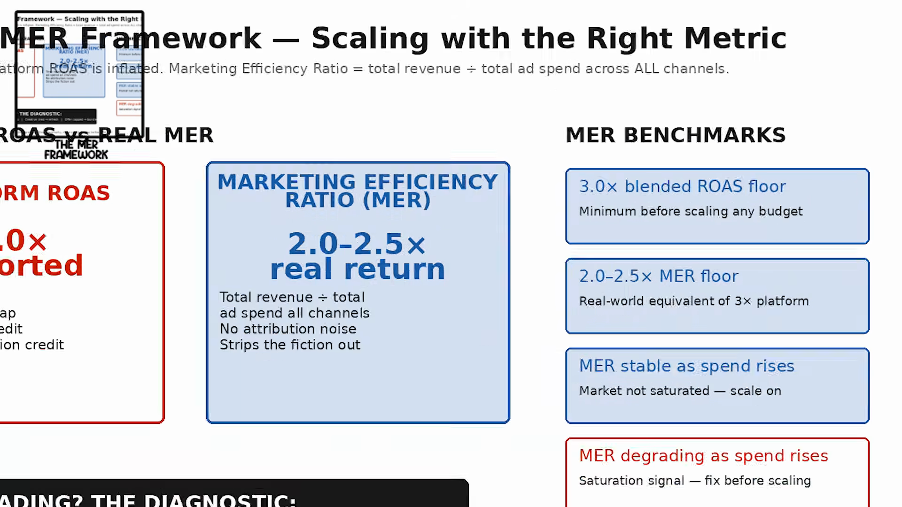

#### 1. Ảo giác In-Platform ROAS:
* Báo cáo ROAS hiển thị trong Meta Ads Manager thường bị **thổi phồng nghiêm trọng** do:
  * Trùng lặp quy kết (Attribution overlap) giữa Meta, Google và TikTok.
  * Tín hiệu xem qua (View-through attribution 1-day): Khách chỉ nhìn thấy quảng cáo lướt qua rồi tự tìm mua qua nguồn khác, Meta vẫn nhận công.
* Một tài khoản có in-platform ROAS báo cáo **3.0x** trên Meta, trên thực tế dòng tiền thực của doanh nghiệp chỉ đạt khoảng **2.0x – 2.5x**.

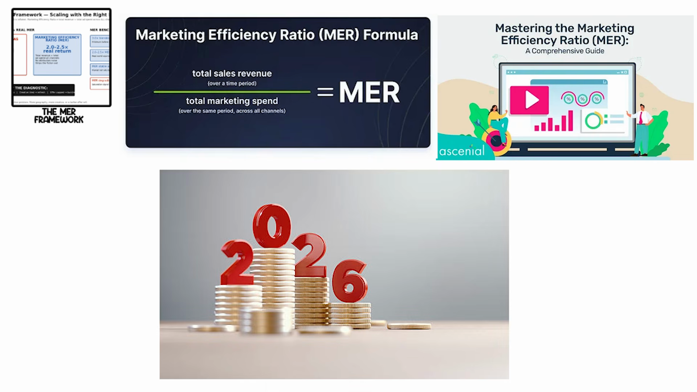

#### 2. Công thức MER (Marketing Efficiency Ratio):
$$\text{MER} = \frac{\text{Tổng Doanh Thu Toàn Hệ Thống (Total Sales Revenue)}}{\text{Tổng Chi Phí Quảng Cáo Mọi Kênh (Total Ad Spend across All Channels)}}$$
* MER loại bỏ hoàn toàn các giả định quy kết ảo và phản ánh chính xác từng đồng chi phí quảng cáo sinh ra bao nhiêu đồng doanh thu thật đổ về tài khoản ngân hàng.

#### 3. Bộ chuẩn đối sánh (MER Benchmarks):
* **Sàn Blended ROAS tối thiểu:** Phải đạt $\ge 3.0x$ trước khi phê duyệt tăng bất kỳ nấc ngân sách nào.
* **Sàn MER thực tế:** Phải đạt từ **2.0x đến 2.5x**.
* **Tín hiệu an toàn:** Khi ngân sách tăng mà MER duy trì ổn định $\rightarrow$ Thị trường chưa bão hòa, tiếp tục scale.
* **Tín hiệu cảnh báo:** Khi ngân sách tăng mà MER suy giảm rõ rệt $\rightarrow$ Đã chạm ngưỡng bão hòa.

#### 4. Bảng điều khiển chẩn đoán bão hòa (The Saturation Diagnostic):
Khi MER suy giảm, tuyệt đối không được tiếp tục tăng ngân sách. Hãy dùng bảng chẩn đoán 3 bước:
1. **Thị trường nội địa đã bão hòa?** $\rightarrow$ Kích hoạt **Geographic Expansion** (Mở rộng sang các quốc gia/khu vực mới).
2. **Creative đã mệt mỏi/cũ kỹ?** $\rightarrow$ Kích hoạt **Creative Scaling Engine** (Làm mới kho ảnh tĩnh và video theo chu kỳ 2 tuần).
3. **Sức mua của sản phẩm/dịch vụ đơn lẻ đã chạm trần?** $\rightarrow$ Tái cấu trúc **Offer Scaling & Bundling** để tăng AOV.

---

## 3. Ma Trận Quyết Định Lựa Chọn Chiến Lược Scale (Decision Matrix)

Để xác định phương pháp scale phù hợp nhất cho từng tình huống cụ thể, sử dụng cây quyết định sau:

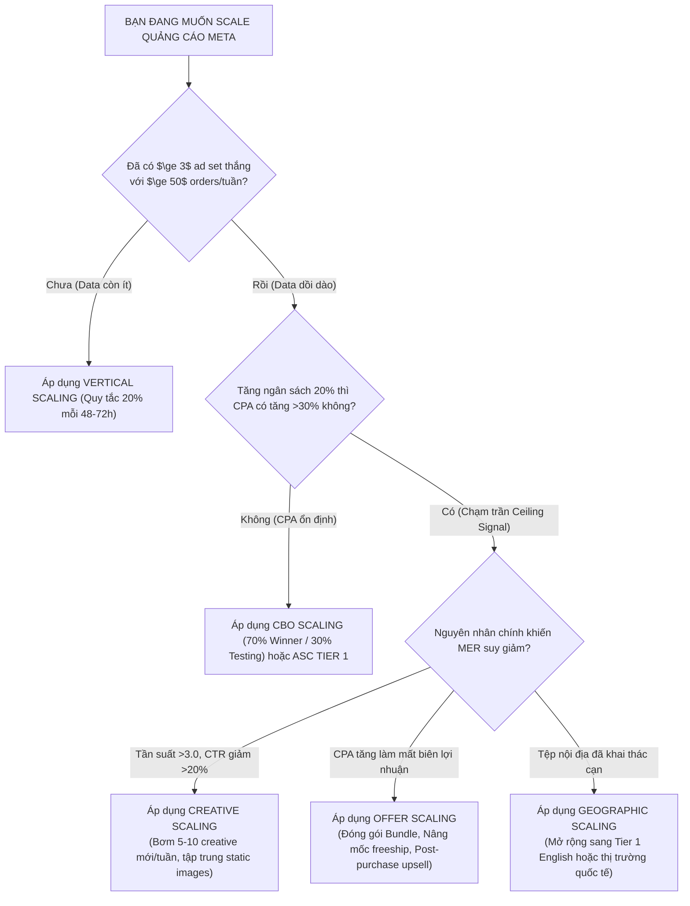

---

## 4. Kế Hoạch Ứng Dụng Thực Chiến Cho TravelFrame

TravelFrame cung cấp dịch vụ **Private Photographer & Content Creator Tour** tại Hà Nội và các điểm du lịch nổi tiếng Việt Nam (Ninh Bình, Sa Pa, Hạ Long, Hội An), phục vụ hai phân khúc chính:
1. **Khách du lịch quốc tế (Inbound Solo/Couples/Family travelers):** Đang lên kế hoạch hoặc vừa đặt chân đến Việt Nam.
2. **Khách nội địa & Việt kiều:** Nhu cầu chụp ảnh áo dài phố cổ, kỷ niệm, pre-wedding, bộ ảnh phong cách sống cao cấp.

Dưới đây là cẩm nang vận hành 8 phương pháp scale được may đo riêng cho TravelFrame:

### Đòn bẩy 1: Vertical Step Ladder cho các mùa cao điểm du lịch
* **Ứng dụng:** Khi bước vào mùa thu Hà Nội hoặc mùa cao điểm du lịch quốc tế (tháng 9 – tháng 4 năm sau), các ad set đang có tỷ lệ đặt lịch (Booking Rate) tốt sẽ được tăng ngân sách từ từ:
  * Ngày 1: $\$20/\text{ngày} \rightarrow$ Ngày 3: $\$24/\text{ngày} \rightarrow$ Ngày 6: $\$29/\text{ngày} \rightarrow$ Ngày 9: $\$35/\text{ngày}$.
* **Kiểm soát rủi ro:** Nếu CPA trên mỗi lead tin nhắn/form đặt lịch tăng quá $15\%$, tạm dừng ở nấc hiện tại 48 giờ để studio và thợ chụp điều phối lịch hẹn mượt mà, tránh tình trạng quá tải không đáp ứng được chất lượng dịch vụ.

### Đòn bẩy 2: Horizontal Scaling mở rộng theo tuyến điểm & phong cách chụp
* Nhóm chiến thắng ban đầu: *Chụp ảnh áo dài phố cổ Hà Nội*.
* Nhân bản thành các nhóm đơn biến:
  * **Duplicate A (Mở rộng địa lý liền kề):** *Tour chụp ảnh kết hợp trong ngày Hà Nội – Ninh Bình (Tràng An / Hang Múa)*.
  * **Duplicate B (Đổi phân khúc khách hàng):** *Bộ ảnh cặp đôi lãng mạn phong cách Cinematic / Film tone*.
  * **Duplicate C (Tệp khách gia đình du lịch):** *Family vacation photo session tại hồ Hoàn Kiếm và Văn Miếu*.

### Đòn bẩy 3: Creative Scaling với thế mạnh "Static Realism" của TravelFrame
* Áp dụng bài học sống còn: **Static Images chiếm 60–70% tổng chuyển đổi**.
* TravelFrame sở hữu kho hình ảnh thực tế đồ sộ từ các buổi chụp thật. Mỗi tuần, đội ngũ sản xuất 5–7 bộ ảnh carousel hoặc single image chất lượng cao:
  * Dạng 1: **Before / After** (Khách tự chụp bằng điện thoại vs Ảnh chuyên nghiệp do photographer TravelFrame ghi lại).
  * Dạng 2: **Story Carousel** ("Một buổi sáng 2 tiếng đi dạo phố cổ Hà Nội của cặp đôi người Úc cùng TravelFrame").
  * Dạng 3: **Social Proof Grid** (Feedback tin nhắn thật của khách quốc tế kèm hình ảnh kết quả lung linh).

### Đòn bẩy 4: CBO 70/30 điều phối dòng khách đặt tour
* Dành **70% ngân sách chiến dịch** cho 2 Concept chụp thắng lớn nhất (Áo dài phố cổ Hà Nội & Chụp ảnh street life ẩm thực đêm).
* Dành **30% ngân sách** để test các concept mới (Chụp ảnh film máy cơ Vintage, Concept trang phục dân tộc tại Sa Pa).
* Cài đặt **Ad Set Minimum Spend** $5/ngày cho concept test để bảo đảm Meta thu thập đủ phản hồi từ thị trường.

### Đòn bẩy 5: Advantage+ Shopping & Lead Generation Engine
* Xây dựng cấu trúc 3 tầng:
  * **Tier 1 (60%):** Chiến dịch Advantage+ Lead / Message Campaign tập hợp 5 bộ ảnh thực tế đẹp nhất.
  * **Tier 2 (30%):** Broad Prospecting với target mở hoàn toàn (Age 22–50, Vị trí: Những người đang ở hoặc vừa đến Việt Nam).
  * **Tier 3 (10%):** Retargeting những người đã nhắn tin Fanpage hoặc truy cập website `travelframe.vn` trong 30 ngày qua nhưng chưa chốt lịch hẹn.
* Khóa trần khách cũ ở mức **20%** để dồn sức tìm kiếm du khách mới đến Việt Nam.

### Đòn bẩy 6: Geographic Expansion đón đầu dòng khách Inbound
* Thay vì chỉ chạy quảng cáo trong lãnh thổ Việt Nam khi khách đã hạ cánh:
  * **Mở rộng đón đầu tại các thị trường Tier 1 English:** Chạy quảng cáo nhắm đến người dùng tại **Úc (Australia), Singapore, Mỹ, Anh, Canada** đang có hành vi tìm kiếm vé máy bay, khách sạn hoặc kế hoạch du lịch Đông Nam Á / Việt Nam trong 30 ngày tới.
  * **Chiến lược thông điệp:** *"Planning your trip to Hanoi? Book your private local photographer before departure to secure the golden hour slot!"*.
  * Tách riêng chiến dịch US/AU và chiến dịch Singapore/Malaysia để kiểm soát CPM hiệu quả.

### Đòn bẩy 7: Offer Scaling — Chìa khóa tăng AOV từ $70 lên $250+
* Đây là đòn bẩy quan trọng nhất giúp TravelFrame phá vỡ trần doanh thu:
  1. **Bundle Concept (Tăng 50% AOV):**
     * Gói lẻ: Gói chụp 1 tiếng phố cổ = $75.
     * Gói Bundle Premium: *Chụp ảnh 2 tiếng + Miễn phí thuê 2 bộ áo dài lụa cao cấp + Xe riêng đưa đón phố cổ + Bản đồ hướng dẫn quán ăn chuẩn bản địa* = **$150** (Khách hào hứng vì tiết kiệm thời gian chuẩn bị trang phục, TravelFrame tăng gấp đôi doanh thu trên một lượt phục vụ).
  2. **Multi-destination Package:** Combo *Hà Nội Golden Hour + Ninh Bình Day Tour Shoot* = **$280**.
  3. **Post-Booking Upsell:** Ngay sau khi khách cọc lịch, trợ lý gửi đề xuất bổ sung: *"Nâng cấp lên gói trả toàn bộ file RAW trong 6 giờ + 1 video ngắn Reels 4K quay góc hậu trường chỉ với +$35"*. Tỷ lệ đồng ý ước tính đạt 30–40% mà chi phí ads phát sinh là $0.

### Đòn bẩy 8: Quản trị bằng MER tổng thay vì phụ thuộc ROAS Meta
* Thiết lập hệ thống đo lường:
  $$\text{MER}_{\text{TravelFrame}} = \frac{\text{Tổng doanh thu cọc & thanh toán dịch vụ chụp}}{\text{Tổng chi phí quảng cáo (Meta Ads + Google Search Ads)}}$$
* **Ngưỡng hành động:**
  * Giữ MER mục tiêu $\ge 3.5x$ (đặc thù ngành dịch vụ cần biên lợi nhuận gộp cao để trang trải chi phí trả thợ chụp và chỉnh sửa ảnh).
  * Khi MER giảm xuống dưới $2.8x$, lập tức kích hoạt bộ chẩn đoán: kiểm tra xem creative đã dùng quá 3 tuần chưa, hoặc kiểm tra xem tỷ lệ chốt sales của tư vấn viên qua inbox có bị trễ không.

---

## 5. Tổng Kết Giá Trị Tri Thức

Tài liệu này bổ sung mảnh ghép còn thiếu bên cạnh tài liệu `Cấu Trúc Chiến Dịch Meta Ads (Campaign Structures)`:
* **Cấu Trúc Chiến Dịch (Campaign Structures):** Cho biết **bộ khung** và cách sắp xếp các thành phần quảng cáo.
* **Phương Pháp Scale (Scaling Winning Meta Ads):** Cho biết **cơ chế vận hành dòng tiền**, nhịp độ tăng trưởng, điểm cảnh báo bão hòa và các đòn bẩy phi quảng cáo (Offer, Geography, Production Cadence) để đưa doanh nghiệp vượt ngưỡng trần doanh thu một cách an toàn và bền vững.
