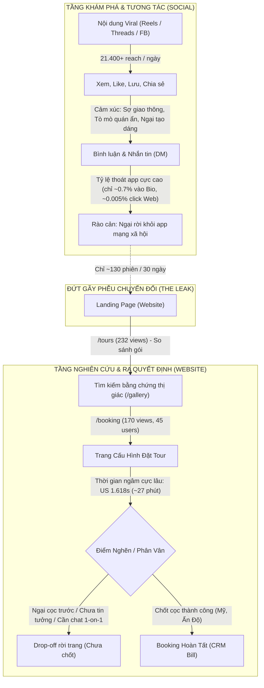

# NGHIÊN CỨU HÀNH VI KHÁCH HÀNG TRÊN WEBSITE VÀ SOCIAL
**Dự Án:** TravelFrame Vietnam (`travelframe.vn`)  
**Mã báo cáo:** `RES-20261013-CUSTOMER-BEHAVIOR-SYNTHESIS`  
**Ngày thực hiện:** 13/10/2026 | **Dữ liệu phân tích:** 30 ngày (14/09/2026 – 13/10/2026)  
**Phạm vi:** Google Analytics 4 (Property `552867189`), Meta Business Suite (Facebook Page `travelframe.vn` & Instagram `@travelframe.vn`), Threads, Drupal CRM (`/travelframe-admin/customers` & `/bills`).

---

## 1. TỔNG QUAN HÀNH VI VÀ BỨC TRANH TOÀN CẢNH

### 1.1. Nghịch lý hành vi cốt lõi (The Behavioral Paradox)
* **Trên Social (High Engagement - Low Click):** Du khách quốc tế tương tác rất mạnh mẽ với video đời thực (21.418 reach, 1.490 tương tác/ngày), nhưng **tuyệt đối ngại rời khỏi ứng dụng** (chỉ có **1 lượt click website** từ Instagram trong ngày 12/10). Họ muốn được phục vụ, hỏi giá và trao đổi trực tiếp trong comment hoặc Instagram DM.
* **Trên Website (High Intent - High Friction):** Nhóm khách vượt qua rào cản để vào website là tệp có **ý định mua cực kỳ cao (High-Intent)**. Điển hình, khách Mỹ dành trung bình **1.618 giây (hơn 26 phút)** trên trang `/booking` để cấu hình tour. Tuy nhiên, họ bị khựng lại ở bước chốt vì thiếu xác nhận an tâm cá nhân hóa (Social Proof, bảo chứng thanh toán, đối thoại trực tiếp).

---

## 2. HÀNH VI KHÁCH HÀNG TRÊN SOCIAL MEDIA

### 2.1. Phân bổ tương tác theo định dạng nội dung
Dữ liệu kiểm toán từ Instagram Reels, Facebook Fanpage và Threads cho thấy mức độ hấp dẫn của từng chủ đề:

| Nhóm chủ đề | Định dạng tiêu biểu | Tương tác & Phản ứng | Hành vi tâm lý của người xem |
| :--- | :--- | :--- | :--- |
| **Giao thông & Sinh tồn** | *"Crossing the road in Vietnam"*, *"Surviving Hanoi traffic"* | **Cao nhất** (56+ comments, hàng trăm shares) | Vừa kinh hoàng vừa phấn khích; so sánh như game *"Frogger"*; cần "người dẫn đường bản địa" dắt tay qua đường. |
| **Tiện ích ngôn ngữ & Ứng xử** | *"How to say NO, THANK YOU"*, *"Taxi drop-off phrase"* | **Viral tự nhiên** (57 likes, nhiều save) | Sợ bị chèo kéo, sợ lạc đường, lo rào cản ngôn ngữ. Muốn học các câu ngắn sinh tồn. |
| **Hướng dẫn tạo dáng (Photo Pose)** | *"How I direct someone who has never posed before"* | **Save & Share cao** | Nỗi sợ lớn nhất khi thuê thợ ảnh: **Ngại ngùng trước ống kính, sợ gượng gạo**. Họ cần người chụp biết cách chỉ dẫn tự nhiên. |
| **Quán ẩn (Hidden Gems / Gatekeeping)** | *"Lowkey gatekeeping this rooftop cafe..."* | **Comment chất lượng cao** | Khao khát trải nghiệm bản địa độc lạ; ghét các điểm du lịch xô bồ, thương mại hóa. |
| **Trải nghiệm gây tranh cãi** | *"Café dancing"*, *"Phố đường tàu"* | **Nhiều tranh luận trái chiều** | Khách Tây phản đối du lịch quá tải (*"On its way to becoming Bali"*), ghét cảnh du khách làm lố, muốn Hà Nội bình yên, nguyên bản. |

### 2.2. Khách hàng thực sự hỏi gì trên Social? (Voice of Customer)
Trích xuất từ các bình luận thực tế của người dùng:
1. **Hỏi về hướng dẫn và vị trí:**  
   * *"I’ll be there in December. I’d love to know how to get here and pls kindly share yummy authentic places to eat thanks"* — Regina G. Castillo.
   * *"We will be there in Feb. Tell me how to find this gem!"* — Jim Backowski.
2. **Hỏi về khả năng phiên dịch / đồng hành:**  
   * *"Are you translator?"* (Bình luận ngày 13/10 dưới Reel tiếng Việt) $\rightarrow$ Khách du lịch mong muốn thợ ảnh kiêm luôn vai trò thông dịch viên và bạn đồng hành.
3. **Phản hồi về nhịp điệu nội dung:**  
   * *"You talk way too quick for someone to learn and background music should be 30% more quiet"* (Dưới video dạy câu taxi) $\rightarrow$ Người học cần sự rõ ràng, chậm rãi, dễ nhớ.
4. **Nhu cầu ăn uống đặc thù:**  
   * Quan tâm đến ẩm thực Phở truyền thống vào sáng sớm, nhưng tệp khách Nam Á / Ấn Độ lại tìm kiếm các quán ẩm thực quê hương (*"Craving Indian food in Hanoi"*).

---

## 3. HÀNH VI KHÁCH HÀNG TRÊN WEBSITE (GA4 & CRM DATA)

### 3.1. Chân dung địa lý khách quốc tế (30 ngày gần nhất)
Sau khi bóc tách 137 người dùng nội địa (chủ yếu là đội ngũ nội bộ test hệ thống và admin):

| Quốc gia | Người dùng | Số phiên | Thời gian tương tác TB | Trang đích được xem nhiều nhất |
| :--- | :---: | :---: | :---: | :--- |
| **Hoa Kỳ (USA)** | **33** | **36** | **78s** (Trang `/booking` lên tới **1.618s**) | `/tours` (17), `/` (15), `/booking` (8) |
| **Ấn Độ (India)** | **10** | **11** | **123s** | `/tours` (7), `/booking` (6), `/` (4), `/guides` (4) |
| **Úc (Australia)** | **8** | **8** | **45s** | `/news/hanoi-photographer-tour-guide` (3), `/tours` (3), `/gallery` (2) |
| **Philippines** | **6** | **7** | **30s** | `/booking` (3), `/news` (3) |
| **Malaysia** | **1** | **1** | **264s** | `/gallery` (8), `/tours` (9) |
| **Canada / Đức / Thụy Điển** | **7** | **9** | **20s – 74s** | `/booking` (3), `/news`, `/guides` |

> [!IMPORTANT]
> **Tương quan tuyệt đối giữa GA4 và CRM:**  
> Toàn bộ các đơn booking có cọc thực tế trong hệ thống (`/travelframe-admin/bills`) đều xuất phát từ 2 quốc gia đứng đầu GA4:
> 1. **Glenn Wolfson** (Tháng 10/2026): Khách **Hoa Kỳ (+1727...)**, cọc $188 (4.895.000đ).
> 2. **Gaurav Dhingra** (Tháng 09/2026): Khách **Ấn Độ (+9197...)**, cọc $188.

### 3.2. Luồng hành vi trên trang (On-Site Navigation Flow)
1. **Lối vào chính (Entry):**  
   * 85%+ khách Mỹ vào từ **Facebook referral & Threads**.  
   * 80%+ khách Ấn Độ vào từ **Instagram referral & Bio link**.
2. **Khảo sát gói dịch vụ (`/tours` - 232 views):**  
   * Người dùng đọc lướt các lựa chọn tour (Phố cổ, Cà phê ngõ, Tour tâm linh Tây Hồ, Di sản Pháp).
3. **Thẩm định hình ảnh (`/gallery` - 83 views):**  
   * Khách dừng lại xem chất lượng ảnh thực tế để kiểm chứng màu sắc và phong cách chụp.
4. **Trang cấu hình & đặt tour (`/booking` - 170 views, 45 users):**  
   * **Hiện tượng bất thường:** Thời gian ngâm trang cực kỳ dài (tổng 13.558s). Khách bấm chọn các gói, đổi thời gian, thêm ảnh chỉnh màu, nhưng tỷ lệ hoàn tất đơn chỉ đạt ~2-3%.
   * **Nguyên nhân:** Khách có nhu cầu thật, đã vào tận giỏ hàng, nhưng gặp rào cản tâm lý:
     * Cần biết chính xác thợ ảnh là ai, có nói tiếng Anh lưu loát không.
     * Muốn được tư vấn lịch trình trước khi trả tiền cọc.
     * Vòng quay may mắn (`/api/wheel/spin`) không có tác dụng thúc đẩy vì chưa được truyền thông hay kết nối rõ ràng với khách hàng thực tế (100% 4 lượt quay vừa qua là của team test nội bộ).

---

## 4. MA TRẬN PHÂN TÍCH TÂM LÝ KHÁCH HÀNG (PSYCHOLOGICAL MATRIX)

| Yếu tố | Chi tiết phân tích hành vi | Dẫn chứng thực tế |
| :--- | :--- | :--- |
| **Problems (Nỗi đau thực tế)** | 1. **Nỗi sợ giao thông:** Không dám tự qua đường tại Hà Nội. 2. **Nỗi sợ bị bẫy du lịch:** Khói tàu, quán xá quá tải ở Phố Đường Tàu. 3. **Sợ ảnh gượng gạo:** Không biết tạo dáng, sợ bị thợ bắt đứng đơ người. 4. **Rào cản giao tiếp:** Bất đồng ngôn ngữ với tài xế taxi, chủ quán. | *"Real life frogger game right there"* *"Balcony seat = train exhaust fumes in your face"* *"How I direct someone who has never posed before"* *"Are you translator?"* |
| **Triggers (Động lực thúc đẩy)** | 1. **Khao khát ảnh đẹp kỷ niệm:** Muốn có ảnh đời thường lung linh để đăng mạng xã hội. 2. **Khám phá ngõ ngách bí mật:** Thích các quán cafe trên tầng thượng chợ Đồng Xuân hoặc ngõ vắng. 3. **Tìm kiếm bạn đồng hành an tâm:** Muốn một người địa phương kiêm bảo vệ, kiêm phiên dịch. | *"I’ll be there in December... share yummy authentic places"* *"Tell me how to find this gem"* *"Now that’s my kinda cafe"* |
| **Objections (Rào cản từ chối)** | 1. **Ngại rời app mạng xã hội:** Đang lướt Reels lười click sang web. 2. **E ngại về chi phí & đặt cọc trước:** Chưa sẵn sàng thanh toán qua cổng web lạ cho chuyến đi tháng 12/tháng 2. 3. **Khoảng cách thời gian:** Khách lên kế hoạch trước 1–3 tháng (cửa sổ tháng 12 và tháng 2). | Dwell time trên `/booking` 26 phút nhưng không bấm gửi; chỉ 1 click web trên 149 profile visits. |

---

## 5. 3 PHÂN KHÚC KHÁCH HÀNG MỤC TIÊU & HÀNH VI ĐẶC TRƯNG

### Phân khúc 1: The Cautious Western Explorer (Âu - Mỹ, Úc)
* **Đặc điểm:** Du khách phương Tây (Mỹ, Úc, Anh, Đức) đến Đông Nam Á lần đầu hoặc đi nghỉ dài ngày.
* **Hành vi trên Social:** Bị thu hút bởi các video về văn hóa giao thông, hướng dẫn sinh tồn và các quán cà phê ngõ cổ kính. Cực kỳ nhạy cảm với việc "du lịch quá tải".
* **Hành vi trên Web:** Đọc kỹ thông tin, nghiên cứu kỹ trang `/booking` và `/tours`.
* **Thông điệp chuyển đổi phù hợp:** *"Your trusted local friend in Hanoi — Safe street navigation, hidden gems & effortless candid photography."*

### Phân khúc 2: The Camera-Shy Solo Traveler / Couple
* **Đặc điểm:** Đi du lịch một mình hoặc đi theo cặp đôi kỷ niệm, muốn lưu lại khoảnh khắc nhưng sợ ống kính máy ảnh.
* **Hành vi:** Lưu các bài hướng dẫn tạo dáng (`18424214338151406`), xem kỹ `/gallery` để xem ảnh có tự nhiên không.
* **Thông điệp chuyển đổi phù hợp:** *"No awkward posing required. Just enjoy Hanoi, we capture the laughter."*

### Phân khúc 3: The Festive & Winter Planner (Khách đặt trước tháng 12 & Tết)
* **Đặc điểm:** Tệp khách đã mua vé máy bay cho kỳ nghỉ Giáng sinh/Năm mới (Tháng 12) hoặc kỳ nghỉ mùa xuân (Tháng 2).
* **Hành vi:** Bình luận hỏi trước lịch trình, địa điểm ẩm thực, chỗ ở giá hợp lý.
* **Hành vi chuyển đổi:** Không chốt ngay trên web nếu không có người tư vấn lộ trình 1-on-1 qua tin nhắn.

---

## 6. ĐỀ XUẤT HÀNH ĐỘNG CHIẾN LƯỢC ĐỂ TỐI ƯU HÓA PHỄU

### 6.1. Hóa giải điểm nghẽn Social $\rightarrow$ Web
1. **Chuyển trọng tâm CTA sang Chat trực tiếp (In-App DM first):**
   * Vì du khách rất lười bấm link web, mọi video/bài viết cần kêu gọi nhắn tin: *"DM 'HANOI' to get our free Winter Walking Map & chat with a local photographer."*
   * Tận dụng ManyChat tự động gửi tài liệu PDF ngay trong Instagram DM/Facebook Messenger, sau đó gợi ý đặt lịch tư vấn 1-on-1.
2. **Tối ưu hóa Bio Link:**
   * Thay vì chỉ để một link web chung chung, dùng Smart Link có 2 nút bấm to rõ:
     * 🟢 *Chat trực tiếp qua WhatsApp / Instagram DM*
     * 📸 *Xem các gói tour & bảng giá công khai*

### 6.2. Hóa giải điểm nghẽn trên Website (`/booking`)
1. **Bổ sung Social Proof & Cam kết ngay trên Form đặt tour:**
   * Hiển thị ảnh chụp thực tế của khách hàng kèm đánh giá ngắn.
   * Gắn nhãn cam kết: *"No awkward poses. Free rescheduling if it rains. 100% money-back guarantee if you don't love your photos."*
2. **Nút hỗ trợ nhanh "Chat with us before booking":**
   * Thêm nút WhatsApp / Messenger nổi ở góc màn hình trang `/booking` để hỗ trợ ngay lập tức cho những khách đang ngâm trang hơn 20 phút mà chưa chốt cọc.
3. **Kích hoạt lại Vòng quay may mắn có gắn SĐT:**
   * Hiển thị vòng quay dạng popup khi khách có ý định thoát trang (Exit-Intent Popup) với quà tặng thực tế (ví dụ: *Tặng 1 ly Cà phê Trứng đặc sản* hoặc *Tặng 10 ảnh chỉnh màu* khi điền WhatsApp/Email).
