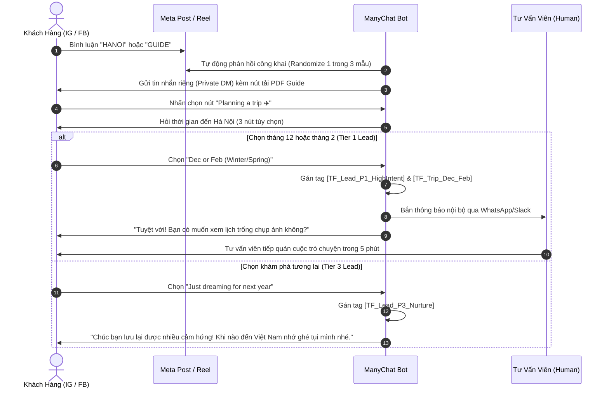

# ManyChat Segment Triage Flows — TravelFrame 2026

- **Mã tài liệu:** `MCT-20260926-SEGMENT-TRIAGE-SPEC`
- **Bộ phận chủ trì:** Sales-CRM & Technology-Automation
- **Kênh áp dụng:** Instagram Direct Message & Facebook Messenger (Meta Business Suite)
- **Tài liệu tham chiếu:** 
  - [`Research-Insights/Library/knowledge/2026-09-26-customer-evidence-synthesis.md`](file:///Users/macbook/Codex%20GPT/travelframe.vn/Research-Insights/Library/knowledge/2026-09-26-customer-evidence-synthesis.md)
  - [`Sales-CRM/Scripts/2026-09-26-Customer-Segment-Interaction-Playbooks.md`](file:///Users/macbook/Codex%20GPT/travelframe.vn/Sales-CRM/Scripts/2026-09-26-Customer-Segment-Interaction-Playbooks.md)
  - [`Sales-CRM/Automation/ManyChat/manychat-travelframe-typesafe-triage-2026-09-23.md`](file:///Users/macbook/Codex%20GPT/travelframe.vn/Sales-CRM/Automation/ManyChat/manychat-travelframe-typesafe-triage-2026-09-23.md)
- **Ngày hiệu lực:** 2026-09-26
- **Trạng thái:** `Review` (Đặc tả kỹ thuật luồng tự động)

---

## 1. Mục Tiêu Nghiệp Vụ (Business Objective)

Xây dựng các kịch bản tự động hóa trên ManyChat nhằm chuyển hóa lưu lượng tương tác tự nhiên từ các bài đăng mạng xã hội (Facebook Reels, Instagram Reels) thành các cuộc hội thoại 1-on-1 có giá trị cao, tự động phân hạng khách hàng (Lead Triage) và bàn giao cho tư vấn viên con người đúng thời điểm vàng.

Dựa trên dữ liệu kiểm toán ngày 2026-09-26, hệ thống tập trung vào 2 Trigger tăng trưởng chính:
1. **Trigger Flow A:** Khách để lại bình luận từ khóa `HANOI`, `CAFE`, `GUIDE` để nhận tài liệu hướng dẫn.
2. **Trigger Flow B:** Khách bình luận hỏi vị trí dưới các bài đăng dạng bí mật / ngõ ẩn ("Lowkey gatekeeping...").

---

## 2. Trigger Flow A: Comment Growth Tool `HANOI` / `GUIDE`

### Bước 1: Phản hồi công khai trên bài đăng (Public Comment Auto-Reply)
*Xoay vòng ngẫu nhiên 3 mẫu để tránh thuật toán spam của nền tảng:*
- Mẫu 1: *"Sent the full cheat sheet straight to your DM! Have an amazing time exploring Hanoi 🇻🇳✨"*
- Mẫu 2: *"Check your inbox! Just dropped our secret guide in your DMs ☕🗺️"*
- Mẫu 3: *"Just sent you the insider guide! Let us know if you need any local tips for your trip 🙌"*

### Bước 2: Tin nhắn mở trong hộp thư (Private Reply DM)
- **Nội dung:**
  > *"Hi [First Name]! 🇻🇳*
  >
  > *Here is your requested **Hanoi First-Timer Cheat Sheet & Nightlife Guide**:*
  > 📥 [Button: Download PDF Guide]
  >
  > *Inside you’ll find:*
  > - 🛵 3 Golden Rules for crossing roads safely
  > - ☕ 5 secret alleyway cafes you won't find on tourist maps
  > - 🍜 Our top street food picks with exact local addresses
  >
  > *Quick question to help us share the best tips for your trip:*
  > *Are you planning a trip soon, or just saving ideas for later?*
  >
  > *[Button: Planning a trip ✈️]  [Button: Just dreaming 💭]*"

### Bước 3: Phân luồng câu trả lời (Interactive Triage)
- **Nhánh "Planning a trip ✈️":**
  > *"Awesome! Which month are you visiting Hanoi?*
  >
  > *[Button: This Month / Soon]  [Button: Dec or Feb (Winter/Spring)]  [Button: Later in 2027]*"
  - **Hành động hệ thống:**
    - Khi chọn `[Dec or Feb]`:
      - Set Field `TF_Travel_Horizon` = `"Dec-Feb"`
      - Add Tag `TF_Lead_P1_HighIntent`
      - Add Tag `TF_Trip_1to3Months`
      - Kích hoạt **Live Chat Notification** cho nhân viên tư vấn.

---

## 3. Trigger Flow B: Gatekeeping Post Inbound ("Where is this cafe / Send location")

### Bước 1: Nhận diện từ khóa kích hoạt (Keywords Trigger)
- Các từ khóa bình luận: `where`, `address`, `location`, `pm`, `dm`, `quán nào`, `ở đâu`, `cho xin địa chỉ`.

### Bước 2: Phản hồi công khai
- *"Sent the exact secret entrance coordinates and walkthrough straight to your DM! 🤫☕"*

### Bước 3: Tin nhắn trong hộp thư (Private DM Card)
- **Card hiển thị:**
  - Hình ảnh: Góc chụp tầng thượng Nắng Coffee nhìn xuống mái ngói phố cổ.
  - Tiêu đề: **Nắng Coffee — Hidden Rooftop, Đồng Xuân**
  - Mô tả: *27 Đồng Xuân Street (Walk through the ground-floor hallway and take the stairs to the top)*.
- **Văn bản đi kèm:**
  > *"Here is the secret spot! Walk right through the narrow residential corridor at 27 Đồng Xuân and head up to the open-air deck for the best view in the market area.*
  >
  > *Pro tip: Try their signature coconut coffee or salt coffee while watching the street life below.*
  >
  > *Would you like to explore Hanoi's secret corners with a local photographer who captures your best candid moments?*
  >
  > *[Button: See Photo Walk Packages 📸]  [Button: Chat with a Local Host 💬]*"

---

## 4. Định Nghĩa Custom User Fields (CUF) & Thẻ Phân Hạng (Tags)

| Tên Trường / Thẻ | Loại Dữ Liệu | Giá Trị Hợp Lệ | Mục Đích Nghiệp Vụ |
|---|---|---|---|
| `TF_Travel_Horizon` | Text | `This month`, `Dec-Feb`, `Later`, `Unknown` | Xác định độ khẩn cấp của lịch trình. |
| `TF_Group_Type` | Text | `Solo`, `Couple`, `Family`, `Friends` | Đề xuất gói dịch vụ phù hợp (Quick Walk vs Signature Tour). |
| `TF_Lead_Tier` | Text | `Tier 1 (High)`, `Tier 2 (Warm)`, `Tier 3 (Nurture)` | Định tuyến hàng đợi ưu tiên cho tư vấn viên. |
| `TF_Lead_P1_HighIntent` | Tag | Boolean | Khách đã có ngày cụ thể, ưu tiên phản hồi trong 5 phút. |
| `TF_Lead_P2_Warm` | Tag | Boolean | Khách tải cẩm nang, đang cân nhắc lịch trình. |
| `TF_Lead_P3_Nurture` | Tag | Boolean | Khách lưu tài liệu tham khảo dài hạn. |
| `TF_Intent_HiddenSpot` | Tag | Boolean | Khách quan tâm đặc biệt tới các quán cà phê ngõ sâu. |
| `TF_Lead_Escalate_Human` | Tag | Boolean | Khách yêu cầu nói chuyện trực tiếp với tư vấn viên. |

---

## 5. Quy Chuẩn Kỹ Thuật & Rào Cản An Toàn (Guardrails)

1. **Cửa sổ 24 giờ của Meta (24-Hour Messaging Window):**
   - Mọi tin nhắn tương tác tự động chỉ được gửi trong vòng 24 giờ kể từ khi khách có tương tác cuối cùng (gửi tin nhắn hoặc nhấn nút).
   - Tuyệt đối không gửi tin nhắn quảng cáo ngoài cửa sổ 24 giờ mà không có Message Tag được Meta phê duyệt.
2. **Bảo mật thông tin cá nhân (PII Protection):**
   - ManyChat không thu thập số thẻ tín dụng hoặc mật khẩu của khách hàng.
   - Khi khách cung cấp số WhatsApp để nhận tư vấn, số điện thoại chỉ được lưu trong hệ thống CRM nội bộ được bảo mật, tuyệt đối không xuất hiện trong Git commit log.
3. **Phê duyệt trước khi triển khai (Approval Gate):**
   - Toàn bộ nội dung kịch bản ManyChat này phải được trình Rocky / Brand Lead phê duyệt trước khi kết nối trực tiếp vào tài khoản Meta Business Suite đang hoạt động.
