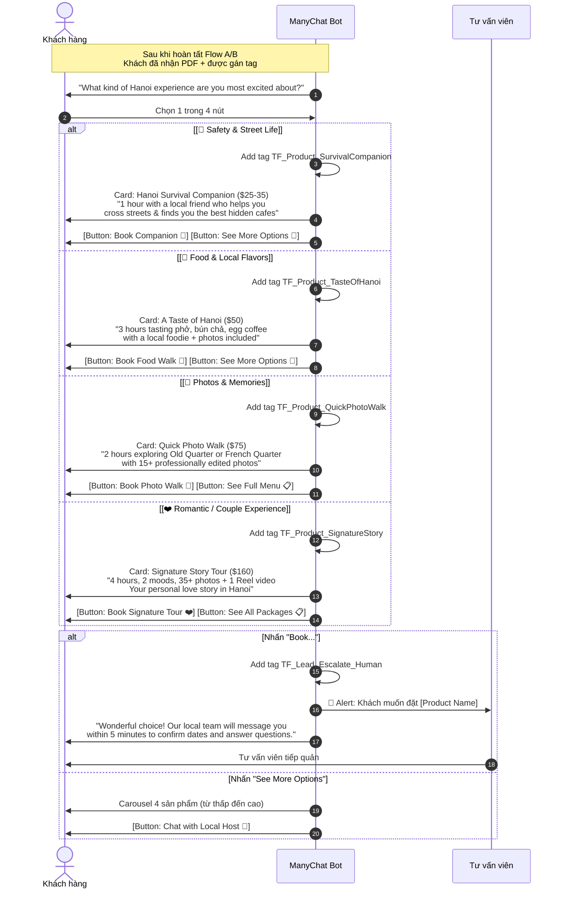

# Draft: ManyChat Product-Match Addon Flow

- **Mã tài liệu:** `MCT-20260929-PRODUCT-MATCH-ADDON`
- **Bộ phận chủ trì:** Sales-CRM & Marketing-Growth
- **Trạng thái:** `Draft` — Chờ Rocky phê duyệt
- **Tài liệu gốc:** [`MCT-20260926-SEGMENT-TRIAGE-SPEC`](file:///Users/macbook/Codex%20GPT/travelframe.vn/Sales-CRM/Automation/ManyChat/2026-09-26-manychat-segment-triage-flows.md)
- **Cơ sở:** [Product Recommendation Report](file:///Users/macbook/.gemini/antigravity-cli/brain/7d49a958-b681-4d74-ab26-da5623bb629f/product-recommendation-from-engagement-data.md)

---

## 1. Mục Đích

Bổ sung **nhánh giới thiệu sản phẩm phù hợp** vào luồng ManyChat hiện tại, dựa trên phân khúc khách hàng đã được phân loại qua Flow A/B.

Hiện tại ManyChat chỉ dừng ở bước phân loại lead → handoff cho tư vấn viên. Addon này thêm bước **gợi ý sản phẩm tự động** trước khi handoff, giúp:
- Tăng tỷ lệ chuyển đổi từ DM → booking inquiry
- Rút ngắn thời gian tư vấn viên phải giải thích sản phẩm
- Anchor giá ở entry point thấp ($25-50) trước khi giới thiệu gói cao hơn

---

## 2. Flow: Product-Match After Triage

---

## 3. Nội Dung Tin Nhắn Chi Tiết

### 3.1 Câu hỏi phân luồng sản phẩm

> *"Now that you have your Hanoi survival guide, one more question!*
>
> *What kind of experience are you most excited about?"*
>
> *[🛵 Safety & Street Life]*
> *[🍜 Food & Local Flavors]*
> *[📸 Photos & Memories]*
> *[❤️ Romantic / Couple]*

### 3.2 Product Cards (theo thứ tự giá tăng dần)

#### Card 1: Hanoi Survival Companion
- **Hình ảnh:** Host dẫn khách qua đường tại ngã tư Hàng Bông
- **Giá:** From $25 USD
- **Mô tả:**
  > *"Your Hanoi initiation: 1 hour with a friendly local who helps you master street crossing, discovers 2 hidden cafes in tiny alleys, and snaps casual phone photos of your adventure. The perfect way to start your trip!"*

#### Card 2: A Taste of Hanoi
- **Hình ảnh:** Bàn phở bốc khói với egg coffee bên cạnh
- **Giá:** From $50 USD
- **Mô tả:**
  > *"3 hours of pure food heaven: authentic phở, crispy bánh mì, legendary egg coffee, and craft beer on Tạ Hiện — all guided by a local foodie who knows every stall by name. Photos included!"*

#### Card 3: Quick Photo Walk
- **Hình ảnh:** Solo traveler cười tự nhiên tại góc phố cổ
- **Giá:** From $75 USD
- **Mô tả:**
  > *"2 hours wandering through Hanoi's most photogenic corners with a professional photographer. You get 15+ edited keepsake photos delivered within 48 hours. No awkward posing — just genuine moments."*

#### Card 4: Signature Story Tour
- **Hình ảnh:** Cặp đôi candid tại Phan Đình Phùng
- **Giá:** From $160 USD
- **Mô tả:**
  > *"The full TravelFrame experience: 4 hours, 2 signature moods, 35+ retouched photos + 1 Instagram Reel video with licensed music. Your personal visual story of Hanoi, delivered in 48 hours."*

---

## 4. Custom User Fields & Tags Bổ Sung

| Tên | Loại | Mục đích |
|---|---|---|
| `TF_Product_SurvivalCompanion` | Tag | Khách quan tâm gói entry $25-35 |
| `TF_Product_TasteOfHanoi` | Tag | Khách quan tâm food tour $50 |
| `TF_Product_QuickPhotoWalk` | Tag | Khách quan tâm photo walk $75 |
| `TF_Product_SignatureStory` | Tag | Khách quan tâm full tour $160 |
| `TF_Product_Carousel_Viewed` | Tag | Khách đã xem carousel đầy đủ |

---

## 5. Quyết Định Cần Rocky Phê Duyệt

1. **Có tích hợp gói Survival Companion ($25-35) vào flow không?** — Nếu chưa tạo sản phẩm chính thức thì thay bằng Quick Photo Walk ($75) làm entry.
2. **Có chạy addon này song song với flow hiện tại không?** — Hay thay thế hoàn toàn bước handoff hiện tại.
3. **Thời điểm triển khai:** Trước hay sau khi gia hạn Meta token.

---

*Draft này KHÔNG phải kịch bản live. Cần phê duyệt từ Rocky trước khi kết nối vào ManyChat.*
