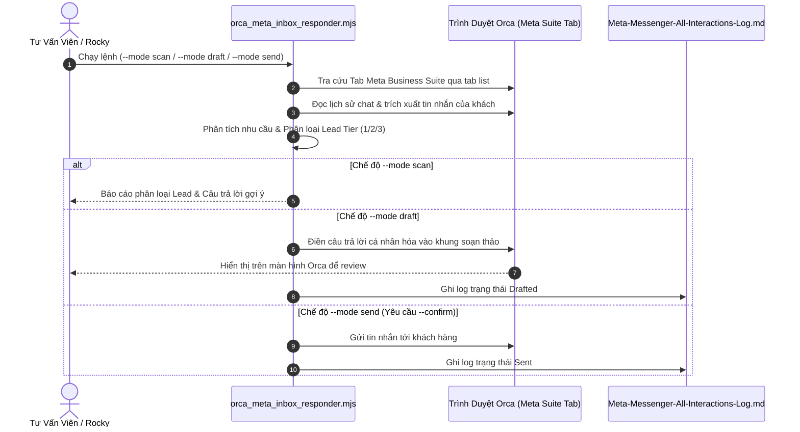

# Runbook: Orca Meta Inbox Responder & Lead Triage

- **Mã tài liệu:** `DES-20260927-ORCA-META-INBOX-RESPONDER`
- **Bộ phận chủ trì:** Technology-Automation & Sales-CRM
- **Kênh áp dụng:** Facebook Messenger & Instagram Direct Message (qua Meta Business Suite Inbox trên trình duyệt Orca)
- **Tài liệu tham chiếu:**
  - [`Creative-Production/Deliverables/TravelFrame-Hanoi-Photographer-Tour-Guide.pdf`](file:///Users/macbook/Codex%20GPT/travelframe.vn/Creative-Production/Deliverables/TravelFrame-Hanoi-Photographer-Tour-Guide.pdf)
  - [`Sales-CRM/Automation/ManyChat/2026-09-26-manychat-segment-triage-flows.md`](file:///Users/macbook/Codex%20GPT/travelframe.vn/Sales-CRM/Automation/ManyChat/2026-09-26-manychat-segment-triage-flows.md)
  - [`Technology-Automation/Scripts/orca_meta_inbox_responder.mjs`](file:///Users/macbook/Codex%20GPT/travelframe.vn/Technology-Automation/Scripts/orca_meta_inbox_responder.mjs)
  - [`Marketing-Growth/Content/Meta-Messenger-All-Interactions-Log.md`](file:///Users/macbook/Codex%20GPT/travelframe.vn/Marketing-Growth/Content/Meta-Messenger-All-Interactions-Log.md)
- **Ngày ban hành:** 2026-09-27
- **Trạng thái:** `Approved` (Hệ thống tự động hóa nội bộ)

---

## 1. Mục Đích & Bối Cảnh (Purpose & Context)

Hệ thống cung cấp kịch bản tự động hóa điều khiển trình duyệt **Orca** để:
1. Giám sát và đọc tin nhắn từ khách hàng trên **Meta Business Suite Inbox** (Facebook Messenger & Instagram Direct).
2. Tự động nhận diện ý định (Intent Recognition): khách hỏi địa điểm ăn uống, hỏi lịch trình, xin cẩm nang du lịch Hà Nội, hoặc có ý định đặt tour chụp ảnh (Lead Intent).
3. Tự động trích xuất thông tin hành trình: ngày đến Hà Nội, khung giờ quá cảnh (layover hours), loại món ăn quan tâm.
4. Tự động soạn thảo câu trả lời cá nhân hóa theo phong cách *Warm Local Friend* và chuẩn bị tệp cẩm nang `TravelFrame-Hanoi-Photographer-Tour-Guide.pdf` (hoặc liên kết tải nhanh).
5. Hỗ trợ 2 chế độ an toàn:
   - **Draft Mode:** Điền sẵn câu trả lời vào khung chat trên Orca để nhân viên tư vấn xem trước và bấm gửi.
   - **Send Mode:** Tự động gửi sau khi có cờ xác nhận `--confirm` tuân thủ nghiêm ngặt chính sách an toàn `AGENTS.md`.

---

## 2. Kiến Trúc Kỹ Thuật (Architecture)



---

## 3. Quy Tắc Phân Loại Lead (Lead Triage Rules)

| Tiêu chí | Tier 1 (High Intent) | Tier 2 (Warm) | Tier 3 (Nurture) |
|---|---|---|---|
| **Dấu hiệu** | Có ngày cụ thể (ví dụ Nov 28, 5pm-10pm), hỏi tour/chụp ảnh/layover food walk | Đang lên kế hoạch đi Hà Nội, hỏi quán ăn, xin cẩm nang chung | Hỏi bâng quơ, lưu lại xem sau |
| **Hành động** | Trả lời chi tiết lộ trình + Đề xuất gói 2h Quick Photo Walk + Báo tư vấn viên | Gửi cẩm nang PDF + Hỏi tháng dự kiến đi | Gửi cẩm nang PDF + Chúc chuyến đi vui vẻ |
| **SLA phản hồi** | < 5 phút | < 30 phút | Tự động |

---

## 4. Hướng Dẫn Vận Hành (CLI Usage)

```bash
# 1. Quét và phân tích hội thoại đang mở trên Meta Business Suite
node Technology-Automation/Scripts/orca_meta_inbox_responder.mjs --mode scan

# 2. Soạn sẵn câu trả lời vào ô chat trên Orca (an toàn, không tự ý gửi)
node Technology-Automation/Scripts/orca_meta_inbox_responder.mjs --mode draft

# 3. Gửi tin nhắn tự động (chỉ chạy khi được duyệt rõ ràng)
node Technology-Automation/Scripts/orca_meta_inbox_responder.mjs --mode send --confirm
```
